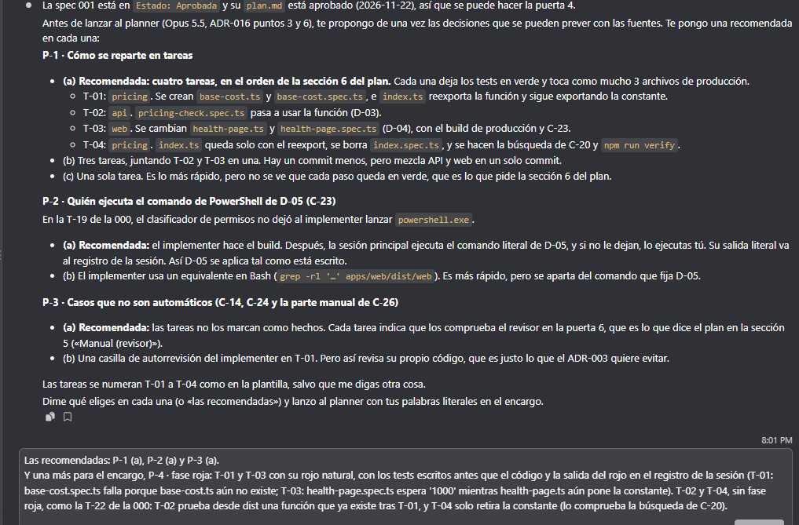
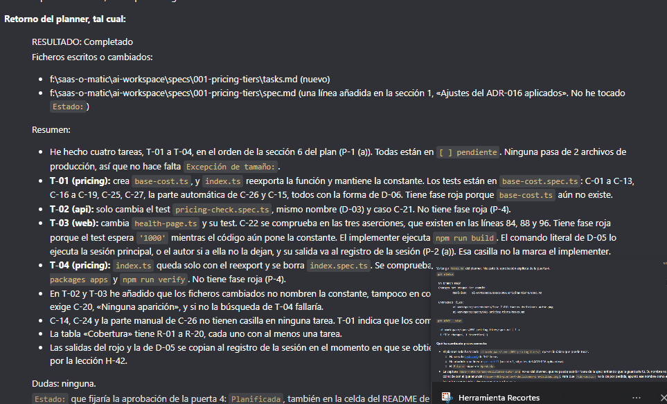

# 001-pricing-tiers — Fase 7 (2026-11-22, sesión 13)

## Objetivo y fase
Fase 7, spec `001-pricing-tiers`: puerta 4 (tareas) con `/sdd-tasks`, siguiendo `/sdd-flow`. Al empezar, `Estado: Aprobada` y `plan.md` aprobado en la puerta 3 (sesión 12). Ajustes del ADR-016 aplicados: punto 3 (decisiones previsibles propuestas antes de lanzar al planner), punto 4 (encargo del planner lanzado sin enseñarlo antes), punto 5 («Rutas a leer» acotadas) y punto 6 (planner con Opus 5.5).

## Prompts clave
Invocación:
> /sdd-tasks 001-pricing-tiers

Elección del autor ante las decisiones previsibles P-1 a P-3, con una decisión nueva suya (P-4):
> Las recomendadas: P-1 (a), P-2 (a) y P-3 (a).
> Y una más para el encargo, P-4 · fase roja: T-01 y T-03 con su rojo natural, con los tests escritos antes que el código y la salida del rojo en el registro de la sesión (T-01: base-cost.spec.ts falla porque base-cost.ts aún no existe; T-03: health-page.spec.ts espera '1000' mientras health-page.ts aún pone la constante). T-02 y T-04, sin fase roja, como la T-22 de la 000: T-02 prueba desde dist una función que ya existe tras T-01, y T-04 solo retira la constante (lo comprueba la búsqueda de C-20).

Aprobación de la puerta 4:
> Apruebo la Puerta 4 · tareas de la spec 001-pricing-tiers, con tasks.md tal como está.
> 1. Estado: Planificada en spec.md y en la fila 001 del README, en el mismo paso.
> 2. Captura: vale, apunta fase-7-001-tareas-decisiones-autor.png como la anunciada.
> 3. En spec.md:33, que la línea cubra también la puerta 3: «Puertas 3 y 4, punto 3: en la 3, D-01 a D-04 (formato, ubicación, test de la API y campo de la web), propuestas por la sesión principal antes de lanzar al planner, constan en plan.md; en la 4, P-1 a P-3, propuestas igual, y P-4, del autor, constan literales en tasks.md».
> 4. MEMORY.md como quedará tras el commit, con un máximo de 50 líneas (ahora tiene 51): fusiona o quita lo resuelto, no añadas.
> 5. En CLAUDE.md, línea 37, añade a la regla de MEMORY.md, sin crear una línea nueva: «máximo 50 líneas; al añadir, fusiona o quita lo resuelto».
> 6. Después te lanzo /sdd-session 7 001-pricing-tiers. Luego enséñame el diff y propón el commit, sin Co-Authored-By. NO hagas el commit: espera mi aprobación.

## Qué propuso la IA
- Comprobación previa: `Estado: Aprobada` y `plan.md` aprobado, así que la puerta 4 se podía hacer.
- Decisiones previsibles (ADR-016, punto 3), presentadas de una vez, cada una con opciones y una recomendada:
  - P-1, reparto en tareas: (a) cuatro tareas en el orden de la sección 6 del plan (recomendada); (b) tres, juntando la de la API y la de la web; (c) una sola.
  - P-2, quién ejecuta el comando de PowerShell de D-05 (C-23), porque en la T-19 de la 000 se denegó al implementer lanzar `powershell.exe`: (a) el implementer hace el build, y el comando literal lo ejecuta la sesión principal, o el autor si a ella no la dejan (recomendada); (b) un equivalente en Bash.
  - P-3, casos manuales C-14, C-24 y la parte manual de C-26: (a) para el revisor en la puerta 6, sin casilla en las tareas (recomendada); (b) una autorrevisión del implementer, que choca con el ADR-003.
  - Numeración T-01 a T-04, como la plantilla.
- Encargo del planner (Opus 5.5) con las decisiones literales del autor y «Rutas a leer» acotadas: plantilla de `tasks.md`; secciones 2 y 4 de `spec.md`; secciones 2, 3, 5 y 6 de `plan.md`; T-22 y T-23 de `000-skeleton/tasks.md`, solo como referencia de forma.
- Retorno del planner: «Completado», sin dudas.
  - `tasks.md` con T-01 a T-04 en `[ ] pendiente`; ninguna pasa de 2 archivos de producción.
  - Fase roja en T-01 y T-03.
  - El comando de D-05 lo ejecuta la sesión principal (o el autor).
  - Los casos manuales, para el revisor en la puerta 6.
  - Tabla «Cobertura» con R-01 a R-20.
  - Regla común: las salidas del rojo y de D-05 se copian al registro de la sesión en el momento (lección H-42).
  - En T-02 y T-03, los ficheros no nombran la constante, tampoco en comentarios (sale de C-20).
  - Una línea añadida en la sección 1 de `spec.md`.
- Comprobación de límites con `git status` y `git diff --stat`: el planner solo tocó `ai-workspace/specs/001-pricing-tiers/`. La captura `fase-7-001-tareas-decisiones-autor.png` la guardó el autor, con un nombre distinto del anunciado.
- Tras la aprobación:
  - `Estado: Planificada` en `spec.md` y en el README.
  - Línea 33 de `spec.md` con el texto literal del autor.
  - `CLAUDE.md`, línea 37, con la regla añadida.
  - `MEMORY.md` de 51 a 50 líneas: se quita la línea «Fase 5, probado», que ya estaba resuelta, con una frase en su lugar en la línea de la fase 5; la línea de la fase 7 queda al día (puerta 4 y siguiente paso: T-01).

## Qué corregí y por qué
- Añadí la P-4 (fase roja solo en T-01 y T-03, con el rojo natural y su salida en el registro de la sesión; T-02 y T-04 sin rojo, como la T-22 de la 000). Motivo, en mis palabras: «T-02 prueba desde dist una función que ya existe tras T-01, y T-04 solo retira la constante (lo comprueba la búsqueda de C-20)».
- La línea que añadió el planner en `spec.md:33` solo hablaba de la puerta 4. La cambié para que cubra también la puerta 3 (D-01 a D-04, propuestas por la sesión principal). Motivo: (no registrado).
- La captura anunciada como `fase-7-001-puerta-4-decisiones-previsibles.png` queda sustituida por `fase-7-001-tareas-decisiones-autor.png`.
- Límite de 50 líneas para MEMORY.md, escrito en `CLAUDE.md`. Motivo: (no registrado).

## Decisiones tomadas
- P-1 (a): cuatro tareas en el orden de la sección 6 del plan (T-01 pricing, T-02 api, T-03 web, T-04 retirada de la constante).
- P-2 (a): el comando literal de D-05 lo ejecuta la sesión principal, o el autor si a ella no la dejan; su salida literal va al registro de la sesión.
- P-3 (a): C-14, C-24 y la parte manual de C-26 los comprueba el revisor en la puerta 6.
- P-4: rojo natural en T-01 y T-03; T-02 y T-04 sin fase roja.
- Puerta 4 aprobada el 2026-11-22, con `tasks.md` tal como está: `Estado: Planificada` en `spec.md` y en el README de specs.
- `CLAUDE.md`: MEMORY.md tiene un máximo de 50 líneas; al añadir, se fusiona o se quita lo resuelto.
- Commit: el de cierre de esta sesión.

## Capturas

La captura anunciada como `fase-7-001-puerta-4-decisiones-previsibles.png` es la primera de esta lista: el autor la guardó con otro nombre y aceptó ese nombre. Las demás capturas `fase-7-001-*` son de las sesiones 11 y 12.

## Pendiente para la siguiente sesión
- Puerta 5 con `/sdd-implement 001-pricing-tiers`, empezando por T-01. Al empezar, `Estado:` pasa a `En implementación`. La salida literal del rojo se copia al registro de la sesión en el momento.
- En T-03, la sesión principal ejecuta el comando de D-05 (o el autor, si a ella no la dejan) y copia su salida literal al registro.
