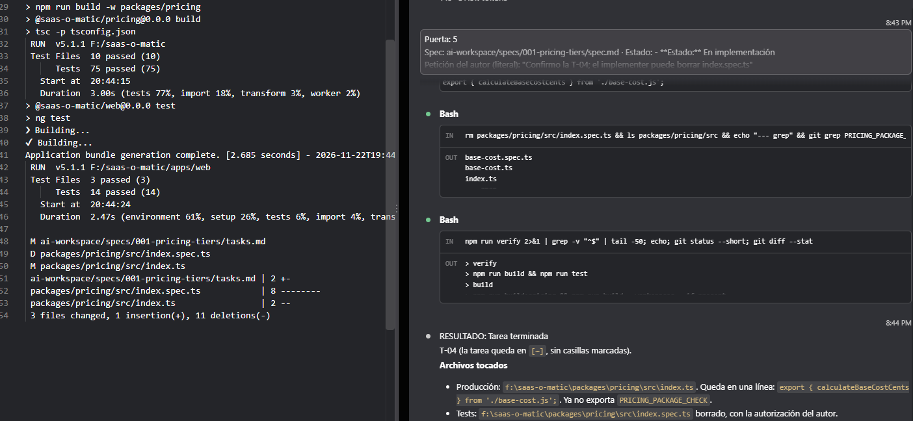

# 001-pricing-tiers — Fase 7 (2026-11-22, sesión 17)

## Objetivo y fase
Fase 7, spec `001-pricing-tiers`, puerta 5 (implementación) con `/sdd-implement`: última tarea, T-04 (retirar `PRICING_PACKAGE_CHECK` de `packages/pricing`). Al empezar, la spec estaba en `- **Estado:** En implementación`, con T-01 a T-03 en `[x]`.

## Prompts clave
> /sdd-implement 001-pricing-tiers

> Confirmo la T-04; el implementer puede borrar index.spec.ts

> Apruebo la T-04. No hace falta la salida completa de npm run verify: la casilla pide los recuentos, y la salida literal de tests y build irá en el encargo del revisor de la Puerta 6, como pide /sdd-flow.
> Marca la T-04 en [x] con sus cinco casillas y actualiza MEMORY.md (máximo 50 líneas). Antes del commit lanzo /sdd-session 7 001-pricing-tiers para cerrar la Puerta 5, y el commit lleva su registro. Luego enséñame el diff y propón el commit, sin Co-Authored-By. NO hagas el commit: espera mi aprobación.

> /sdd-session 7 001-pricing-tiers
> Añade «y una captura» al final del mensaje del commit: entra fase-7-001-t04-verde.png.

## Qué propuso la IA
- **Propuesta de tarea.** Leí la línea `Estado:` de `spec.md` y `tasks.md`, y propuse la T-04 como única tarea pendiente, sin fase roja (P-4). La T-04 borra `packages/pricing/src/index.spec.ts` y CLAUDE.md pide preguntar antes de borrar, así que pregunté si confirmar la tarea autorizaba al implementer a borrarlo. Dije que el implementer iría con Sonnet 5.5 y que el encargo se lanzaría sin enseñarlo antes (ADR-016).
- **Antes de lanzar.** La sesión principal ejecutó `npm test` (11 ficheros y 76 tests en la raíz; 3 ficheros y 14 tests en la web) y `npm run build` (pricing, api y web sin error) desde la raíz, y puso sus salidas literales en el encargo. También puso D-01, P-1 (a), P-4, R-01, R-13, C-20, la fila literal de la T-04 y tu confirmación literal.
- **Retorno del implementer (literal):**

  > RESULTADO: Tarea terminada
  >
  > T-04 (la tarea queda en `[~]`, sin casillas marcadas).
  >
  > **Archivos tocados**
  > - Producción: `f:\saas-o-matic\packages\pricing\src\index.ts`. Queda en una línea: `export { calculateBaseCostCents } from './base-cost.js';`. Ya no exporta `PRICING_PACKAGE_CHECK`.
  > - Tests: `f:\saas-o-matic\packages\pricing\src\index.spec.ts` borrado, con la autorización del autor.
  > - `tasks.md`: solo el `Estado` de T-04, ahora `[~] en curso`.
  >
  > **Sin fase roja (P-4):** T-04 solo retira la constante, y eso lo comprueba la búsqueda de C-20.
  >
  > **C-20**
  > - `git grep PRICING_PACKAGE_CHECK -- packages apps` no da ninguna línea de salida y termina con `exit=1`.
  >
  > **`npm run verify`**
  > - `build`: pricing, api y web sin error.
  > - Vitest raíz: `Test Files 10 passed (10)`, `Tests 75 passed (75)`.
  > - Web: `Test Files 3 passed (3)`, `Tests 14 passed (14)`.
  > - Los tests de la raíz pasan de 76 a 75 porque se borró el test de la constante en `index.spec.ts`.
  >
  > **`git status` y `git diff --stat`**
  > - De `packages/` y `apps/` solo cambian `index.ts` (modificado) e `index.spec.ts` (borrado).
  > - El resto de la diferencia es `tasks.md`.
  > - Resumen: 3 ficheros, 1 inserción y 11 borrados.
  >
  > **Desviaciones o bloqueos:** ninguno.
  >
  > **La sesión principal debe actualizar**
  > - `MEMORY.md`.
  > - Tras la aprobación del autor, el `[x]` de T-04 y sus casillas de «Hecho cuando».
  > - El `Estado:` de `spec.md` no cambia: ya está en `En implementación`.

- **Comprobación de límites (sesión principal), salida literal:**

  ```
  	modified:   ai-workspace/specs/001-pricing-tiers/tasks.md
  	deleted:    packages/pricing/src/index.spec.ts
  	modified:   packages/pricing/src/index.ts

   ai-workspace/specs/001-pricing-tiers/tasks.md | 2 +-
   packages/pricing/src/index.spec.ts            | 8 --------
   packages/pricing/src/index.ts                 | 2 --
   3 files changed, 1 insertion(+), 11 deletions(-)
  ```
  Solo cambiaron los ficheros permitidos. La sesión principal repitió la búsqueda de C-20, `git grep PRICING_PACKAGE_CHECK -- packages apps`: ninguna línea, `exit=1`.
- **Aviso antes de aprobar.** El implementer dio los recuentos de `npm run verify`, no su salida literal. Ofrecí ejecutarlo para el registro.
- **Tras la aprobación.**
  - En `tasks.md`, la T-04 queda en `[x] hecha`, con sus cinco casillas y una línea «Aprobación del autor 2026-11-22 (literal)» que también recoge la confirmación del borrado.
  - En `MEMORY.md`, que sigue en 50 líneas, solo cambia la línea de la fase 7: puertas 1 a 5 aprobadas, T-04 hecha y la puerta 6 como siguiente paso.
  - Propuse el mensaje del commit.

## Qué corregí y por qué
- No hizo falta la salida completa de `npm run verify`. La casilla pide los recuentos, y la salida literal de tests y build irá en el encargo del revisor de la puerta 6, como pide `/sdd-flow`.
- Añadí «y una captura» al final del mensaje del commit, porque el commit incluye `fase-7-001-t04-verde.png`.

## Decisiones tomadas
- T-04 confirmada, y el implementer autorizado a borrar `packages/pricing/src/index.spec.ts`.
- T-04 aprobada (literal en `tasks.md`). Con ella están hechas T-01 a T-04 y termina la puerta 5. `Estado:` sigue en `En implementación` hasta que empiece la puerta 6.
- Salida literal de `verify`: no va en este registro, va en el encargo del revisor de la puerta 6.
- Commit: el de cierre de esta sesión.

## Capturas


En esta sesión no se anunció ninguna captura con `CAPTURA:`. Esta la añadió el autor. Las demás capturas `fase-7-001-*` son de las sesiones 11 a 16.

## Pendiente para la siguiente sesión
- Puerta 6 de la spec 001 (`/sdd-validate 001-pricing-tiers`): `Estado:` pasa a `En revisión` al empezar.
  - El encargo del revisor (modo puerta 6) lleva la salida literal de tests y build, `git status` y `git diff --stat`, ejecutados ese día, y las tareas T-01 a T-04 con sus commits.
  - La spec 001 no tiene vistas nuevas. Si hace falta Lighthouse para `health/`: (no registrado).
- El revisor comprueba C-14, C-24 y la parte manual de C-26. Para C-26, tiene en cuenta que en la T-01 aceptaste `Math.min` y `Math.max`.
