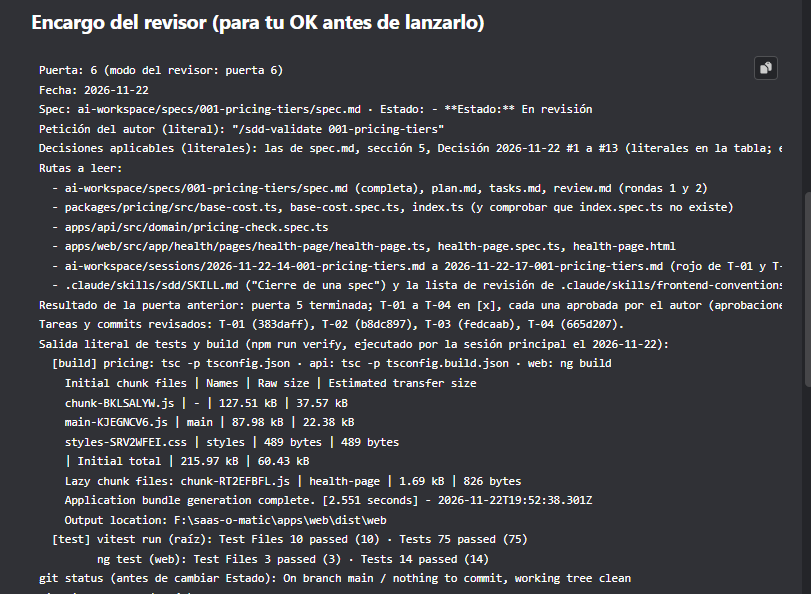
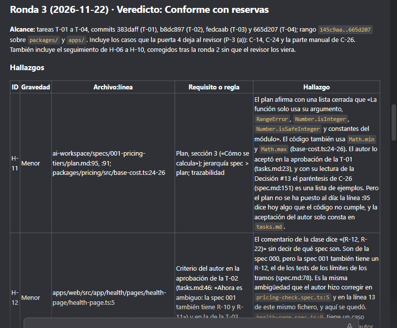
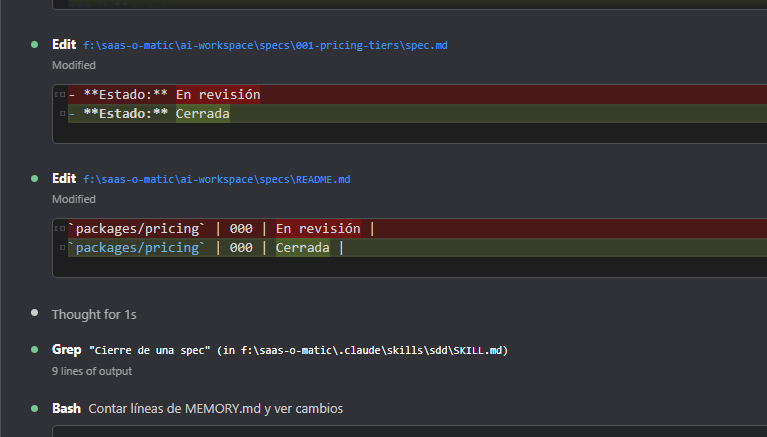

# 001-pricing-tiers — Fase 7 (2026-11-22, sesión 18)

## Objetivo y fase
Fase 7, spec `001-pricing-tiers`: puerta 6 (validación) con `/sdd-validate`, tras terminar la puerta 5 (T-01 a T-04 en `[x]`), y cierre de la spec.

## Prompts clave
> /sdd-validate 001-pricing-tiers

> OK al encargo, con estos puntos:
> 1. Lighthouse: no aplica, de acuerdo.
> 2. Estado: sí, cámbialo a En revisión en spec.md y en el README antes de lanzar, y añade al encargo una línea: «git status tras cambiar el Estado: spec.md y README.md modificados, solo la línea Estado».
> 3. Petición del autor: vale así, el comando literal.
> 4. Antes de lanzar, vuelve a ejecutar el comando literal de D-05 sobre el build de este verify y añade su salida literal al encargo. La del registro 16 es del build de la T-03 (chunk-ABIKERZK.js); tras la T-04 el chunk de health-page es chunk-RT2EFBFL.js. Así C-23 se comprueba sobre el estado final.
> Después, lanza al revisor.

> 1. Sí, guarda el informe como ronda 3 en review.md, con los signos > y < reales.
> 2. Reservas:
> - H-11, aceptada como reserva. Motivo: la desviación está decidida y anotada literal en la aprobación de la T-01 (tasks.md:23), y C-26 cumple; plan.md:95 describe la implementación prevista, y corregirlo ahora exigiría una puerta 4 ampliada y otra ronda por una línea de documentación.
> - H-12, aceptada como reserva. Motivo: es un comentario heredado de la spec 000, sin efecto en el comportamiento; se califica por spec la próxima vez que otra spec toque health/.
> - H-13, decisión del autor: no se cambia nada. La comprobación de '1000' en health/ verifica el cableado que piden R-15 y C-22; no repite los límites de los tramos, que se prueban una sola vez en packages/pricing (C-01 a C-08). Manda la spec, por encima de la convención. Criterio para las specs siguientes: la web puede comprobar un importe concreto para verificar que muestra lo que calcula packages/pricing; lo que no repite es la batería de límites de los tramos.
> - H-14, aceptada como reserva. Motivo: la propia reserva deja constancia de los ajustes de la puerta 5 (punto 4, encargos del implementer sin enseñar; punto 6, implementer con Sonnet 5.5), y anotarlo ahora en spec.md exigiría otra ronda.
> 3. Apruebo el cierre de la spec 001-pricing-tiers con las reservas H-11, H-12 y H-14 y la decisión sobre H-13. Pon Estado: Cerrada en spec.md y en el README, añade a review.md la aprobación del autor de la puerta 6 con este texto literal y actualiza MEMORY.md (máximo 50 líneas): las tres reservas como pendientes y el criterio de H-13 para las specs 005 y 004. Después te lanzo /sdd-session 7 001-pricing-tiers. Enséñame el diff y propón el commit, sin Co-Authored-By. NO hagas el commit: espera mi aprobación.

> /sdd-session 7 001-pricing-tiers

## Qué propuso la IA
- Puerta 6 según el `Estado:` (`En implementación`, con T-01 a T-04 en `[x]`). Antes de montar el encargo, la sesión principal ejecutó `npm run verify` (en verde: raíz 10 ficheros y 75 tests; web 3 ficheros y 14 tests), `git status` (árbol limpio) y `git diff --stat 145c9aa HEAD -- packages apps` (7 ficheros, 177 inserciones y 23 borrados).
- Encargo del revisor (modo puerta 6, ronda 3), enseñado antes de lanzarlo. Contenía la petición literal (el comando), las decisiones aplicables (#1 a #13, D-01 a D-06, P-1 a P-4 y las aprobaciones de T-01 a T-04, con la de `Math.min` y `Math.max` literal), las rutas a leer, los commits revisados (383daff, b8dc897, fedcaab y 665d207), los casos que tocan al revisor (C-14, C-24 y la parte manual de C-26) y la auditoría Lighthouse como no aplicable (la spec no tiene vistas). Hizo tres preguntas: Lighthouse, cuándo cambiar el `Estado:` y si la petición era solo el comando.
- Tras el OK, `Estado: En revisión` en `spec.md` y en el README. Después, el comando literal de D-05 sobre el build del `verify`, ejecutado con `powershell.exe` desde Bash. Salida literal:
  ```
  Path       : F:\saas-o-matic\apps\web\dist\web\browser\chunk-RT2EFBFL.js
  LineNumber : 1
  Match      : activeUsers must be a non-negative integer
  ```
- Revisor lanzado con Opus y effort «High». Al volver, `git status` y `git diff --stat` solo mostraban `spec.md` y `README.md` (la línea `Estado`) y la captura sin seguimiento `fase-7-001-validar-encargo.png`, que la IA no había creado. Informe enseñado tal cual: ronda 3, `Conforme con reservas`, con H-11 a H-14 `Menor`. H-11: `plan.md:95` no cita `Math.min` ni `Math.max`. H-12: el comentario de `health-page.ts:5` no dice de qué spec es. H-13: tensión entre la checklist de `frontend-conventions` y spec.md:15 frente a R-15 y C-22; la decide el autor. H-14: la sección 1 de `spec.md` no anota los ajustes del ADR-016 de la puerta 5. C-14, C-24 y C-26 cumplen.
- Tras la aprobación: ronda 3 añadida a `review.md` con `Edit` sobre su última línea, con los signos `>` y `<` reales (en la notificación venían como `&gt;` y `&lt;`), y la sección «Aprobación del autor» con los puntos 2 y 3 literales del autor. `Estado: Cerrada` en `spec.md` y en el README. MEMORY.md al día con 50 líneas: una línea de cierre de la fase 7, las reservas H-11, H-12 y H-14 como pendientes, el criterio de H-13 para las specs 005 y 004, y un aprendizaje (la salida de tests y build va cruda en el encargo del revisor). Propuesta de commit sin `Co-Authored-By`, sin hacerlo.
- En `/sdd-session`: comprobación de las capturas anunciadas. Faltaba `fase-7-001-cierre-aprobado.png`. Después apareció en disco como `ase-7-001-cierre-aprobado.png`, sin la «f», y la IA preguntó antes de renombrarla.

## Qué corregí y por qué
- Añadí al encargo la línea «git status tras cambiar el Estado: spec.md y README.md modificados, solo la línea Estado», y la salida nueva del comando de D-05 sobre el build final. Motivo: la del registro 16 era del build de la T-03 (`chunk-ABIKERZK.js`), y C-23 debía comprobarse sobre el estado final (`chunk-RT2EFBFL.js`).
- H-13: decidí no cambiar nada y fijé el criterio para las specs siguientes (ver el prompt literal).
- La captura de cierre se guardó sin la «f»; autoricé a la IA a renombrarla.

## Decisiones tomadas
- Lighthouse no aplica en la puerta 6 de la 001 (sin vistas).
- `Estado: En revisión` antes de lanzar al revisor; `Cerrada` tras la aprobación escrita.
- Reservas aceptadas: H-11, H-12 y H-14, cada una con su motivo (aprobación literal al final de `review.md`). H-13, decidida por el autor: la web puede comprobar un importe concreto para verificar que muestra lo que calcula `packages/pricing`; lo que no repite es la batería de límites de los tramos.
- Cierre de la spec `001-pricing-tiers` aprobado por el autor.
- Commit: el de cierre de esta sesión.

## Capturas




 

## Pendiente para la siguiente sesión
- Buscar `(pendiente de /sdd-session)` en `spec.md` de la 001 y, si aparece, proponer la ruta real.
- Commit de cierre de la puerta 6, con la aprobación del autor y sin `Co-Authored-By`.
- Reservas abiertas de la 001 (en MEMORY.md): H-11, H-12 (calificar por spec el comentario de `health/` cuando otra spec la toque) y H-14.
- Siguiente spec del orden del ADR-016: `002-customers-create`, que trae `foreign_keys = ON` y WAL en `openDatabase` (pendiente de la spec 000).
