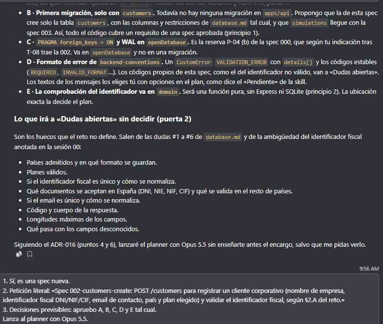
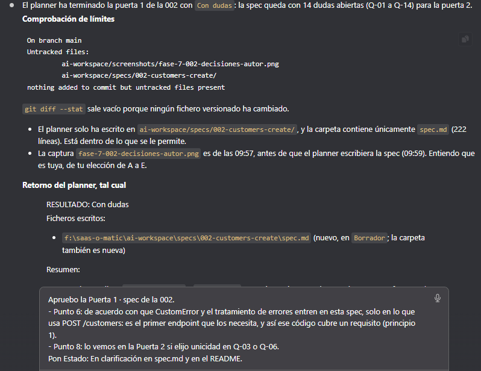
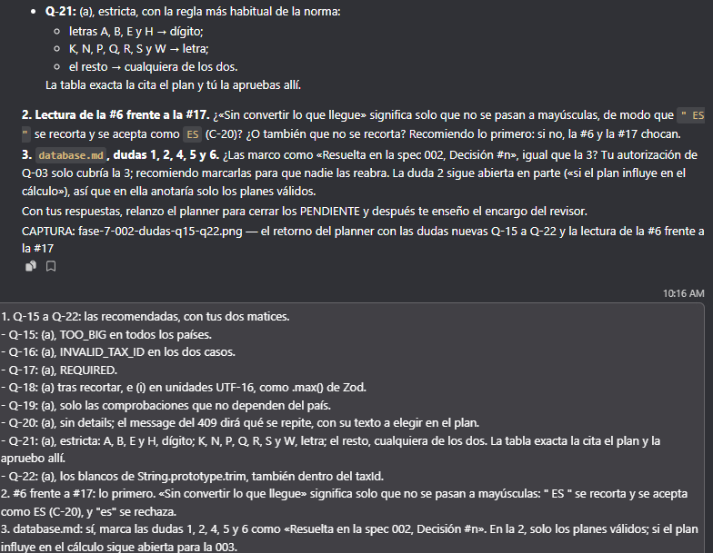
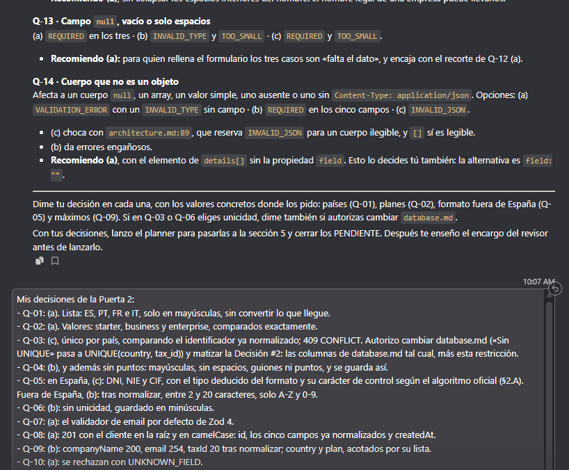
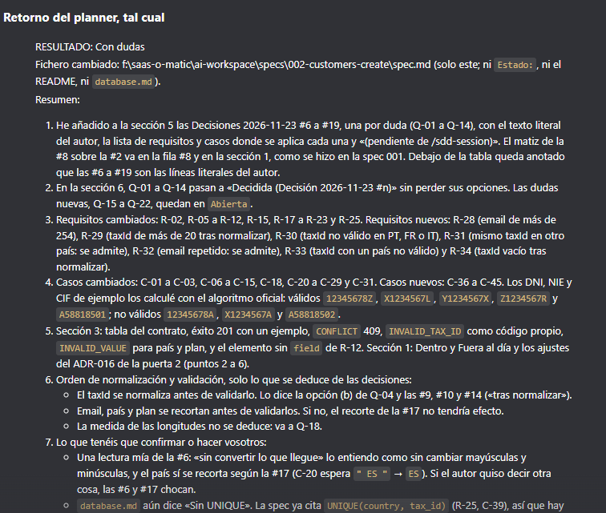
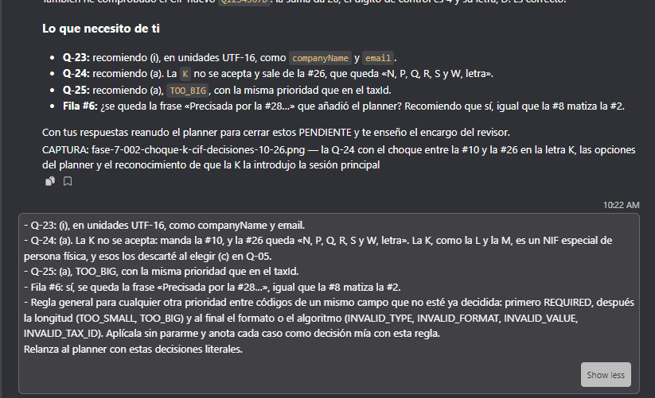
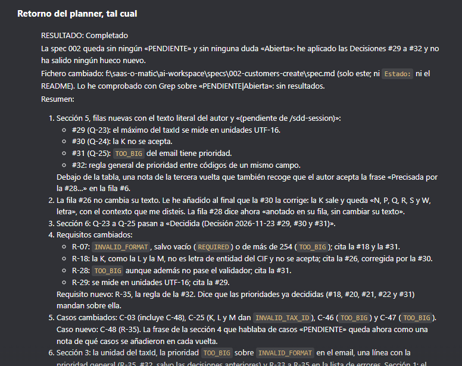
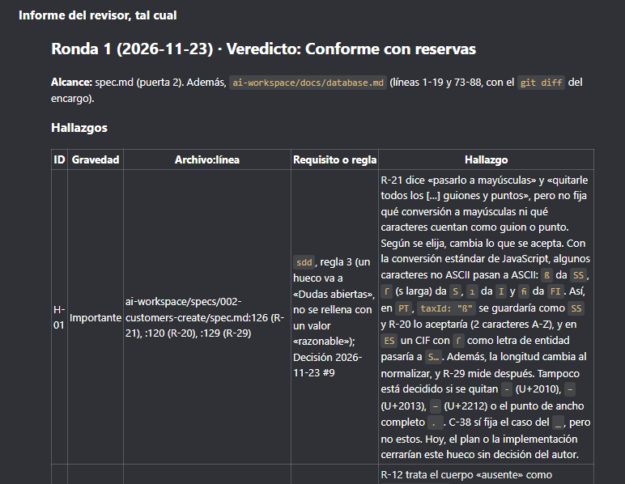
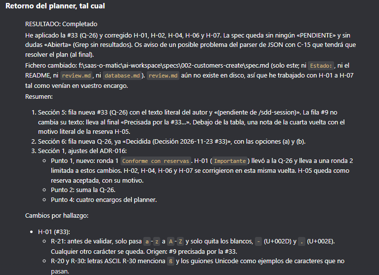
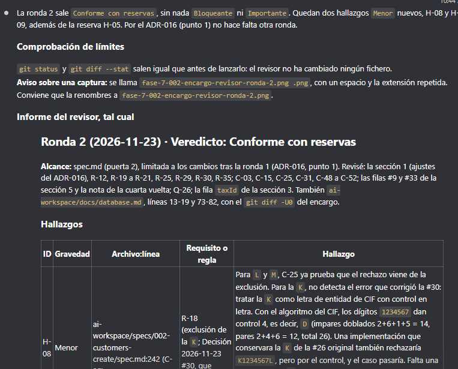

# 002-customers-create — Fase 7 (2026-11-23, sesión 01)

## Objetivo y fase
Fase 7. En la spec `002-customers-create` se llevan dos puertas: la 1 (spec), con `/sdd-spec`, y la 2 (clarificación), con `/sdd-clarify`. Al terminar, la spec queda en `Aprobada` y lista para la puerta 3 (plan).

## Prompts clave
Invocación inicial: `/sdd-spec 002-customers-create` (puerta 1, siguiendo `.claude/commands/sdd-flow.md`).

Respuesta del autor a la propuesta de la puerta 1:
> 1. Sí, es una spec nueva.
> 2. Petición literal: «Spec 002-customers-create: POST /customers para registrar un cliente corporativo (nombre de empresa, identificador fiscal DNI/NIF/CIF, email de contacto, país y plan elegido) y validar el identificador fiscal, según §2.A del reto.»
> 3. Decisiones previsibles: apruebo A, B, C, D y E tal cual.
> Lanza al planner con Opus 5.5.

Aprobación de la puerta 1:
> Apruebo la Puerta 1 · spec de la 002.
> - Punto 6: de acuerdo con que CustomError y el tratamiento de errores entren en esta spec, solo en lo que usa POST /customers: es el primer endpoint que los necesita, y así ese código cubre un requisito (principio 1).
> - Punto 8: lo vemos en la Puerta 2 si elijo unicidad en Q-03 o Q-06.
> Pon Estado: En clarificación en spec.md y en el README.

Invocación de la puerta 2: `/sdd-clarify 002-customers-create`.

Decisiones de Q-01 a Q-14. El autor activó el modo plan antes de que se lanzara al planner y aprobó el plan de la sesión principal; la aprobación no tiene texto registrado.
> Mis decisiones de la Puerta 2:
> - Q-01: (a). Lista: ES, PT, FR e IT, solo en mayúsculas, sin convertir lo que llegue.
> - Q-02: (a). Valores: starter, business y enterprise, comparados exactamente.
> - Q-03: (c), único por país, comparando el identificador ya normalizado; 409 CONFLICT. Autorizo cambiar database.md («Sin UNIQUE» pasa a UNIQUE(country, tax_id)) y matizar la Decisión #2: las columnas de database.md tal cual, más esta restricción.
> - Q-04: (b), y además sin puntos: mayúsculas, sin espacios, guiones ni puntos, y se guarda así.
> - Q-05: en España, (c): DNI, NIE y CIF, con el tipo deducido del formato y su carácter de control según el algoritmo oficial (§2.A). Fuera de España, (b): tras normalizar, entre 2 y 20 caracteres, solo A-Z y 0-9.
> - Q-06: (b): sin unicidad, guardado en minúsculas.
> - Q-07: (a): el validador de email por defecto de Zod 4.
> - Q-08: (a): 201 con el cliente en la raíz y en camelCase: id, los cinco campos ya normalizados y createdAt.
> - Q-09: (b): companyName 200, email 254, taxId 20 tras normalizar; country y plan, acotados por su lista.
> - Q-10: (a): se rechazan con UNKNOWN_FIELD.
> - Q-11: (a): INVALID_TAX_ID para el identificador; INVALID_VALUE para un país o un plan fuera de la lista.
> - Q-12: (a): se recortan y se guarda recortado, sin colapsar los espacios interiores.
> - Q-13: (a): REQUIRED en los tres casos.
> - Q-14: (a): VALIDATION_ERROR con un INVALID_TYPE, y el elemento de details[] sin la propiedad field.
> Lanza al planner con estas decisiones literales.

Decisiones de Q-15 a Q-22:
> 1. Q-15 a Q-22: las recomendadas, con tus dos matices.
> - Q-15: (a), TOO_BIG en todos los países.
> - Q-16: (a), INVALID_TAX_ID en los dos casos.
> - Q-17: (a), REQUIRED.
> - Q-18: (a) tras recortar, e (i) en unidades UTF-16, como .max() de Zod.
> - Q-19: (a), solo las comprobaciones que no dependen del país.
> - Q-20: (a), sin details; el message del 409 dirá qué se repite, con su texto a elegir en el plan.
> - Q-21: (a), estricta: A, B, E y H, dígito; K, N, P, Q, R, S y W, letra; el resto, cualquiera de los dos. La tabla exacta la cita el plan y la apruebo allí.
> - Q-22: (a), los blancos de String.prototype.trim, también dentro del taxId.
> 2. #6 frente a #17: lo primero. «Sin convertir lo que llegue» significa solo que no se pasan a mayúsculas: " ES " se recorta y se acepta como ES (C-20), y "es" se rechaza.
> 3. database.md: sí, marca las dudas 1, 2, 4, 5 y 6 como «Resuelta en la spec 002, Decisión #n». En la 2, solo los planes válidos; si el plan influye en el cálculo sigue abierta para la 003.
> La captura fase-7-002-dudas-q01-q04.png es de esta spec: tu presentación de Q-01 a Q-04.
> Relanza al planner con estas decisiones literales.

Decisiones de Q-23 a Q-25 y regla general:
> - Q-23: (i), en unidades UTF-16, como companyName y email.
> - Q-24: (a). La K no se acepta: manda la #10, y la #26 queda «N, P, Q, R, S y W, letra». La K, como la L y la M, es un NIF especial de persona física, y esos los descarté al elegir (c) en Q-05.
> - Q-25: (a), TOO_BIG, con la misma prioridad que en el taxId.
> - Fila #6: sí, se queda la frase «Precisada por la #28…», igual que la #8 matiza la #2.
> - Regla general para cualquier otra prioridad entre códigos de un mismo campo que no esté ya decidida: primero REQUIRED, después la longitud (TOO_SMALL, TOO_BIG) y al final el formato o el algoritmo (INVALID_TYPE, INVALID_FORMAT, INVALID_VALUE, INVALID_TAX_ID). Aplícala sin pararme y anota cada caso como decisión mía con esta regla.
> Relanza al planner con estas decisiones literales.

Lanzamiento de la ronda 1:
> Sí, lánzalo con este encargo y con mis tres mensajes completos en los corchetes. Añade una cosa: el git diff literal de ai-workspace/docs/database.md, para que el revisor compruebe que solo cambian las líneas que autoricé (15 y 78, y las dudas 1, 2, 4, 5 y 6).

Tras la ronda 1:
> 1. Sí, guarda la ronda 1 tal cual en review.md, con la cabecera de la plantilla.
> 2. Q-26: (a), solo ASCII: normalizar solo pasa a-z a A-Z y quita los blancos de la #27, el guion - (U+002D) y el punto . (U+002E); cualquier otro carácter se queda y no pasa la validación (INVALID_TAX_ID).
> 3. Menores: corrige H-02, H-04, H-06 y H-07 en esta vuelta del planner, como propones. H-05, aceptada como reserva: son requisitos compuestos, como la H-08 de la spec 000, y partirlos alarga la spec sin cambiar ningún comportamiento.
> 4. H-03: (a) autorizo «se guarda normalizado (#9)» en database.md:15, porque es lo que decide la #9; (b) de acuerdo, ya estaba en el plan que aprobé: pon ese texto literal en el encargo de la ronda 2; (c) autorizo cambiar el encabezado a «Dudas para las specs».
> 5. Reanuda el planner y enséñame el encargo de la ronda 2, limitada a estos cambios.

Lanzamiento de la ronda 2:
> Sí, lánzalo con este encargo y con el diff completo en su sitio. El aviso de express.json() llévalo a la Puerta 3, como dices.

Tras la ronda 2 (aprobación de la puerta 2):
> 1. Sí, añade la ronda 2 tal cual al final de review.md.
> 2. H-08 y H-09: (a). Que el planner los corrija en una vuelta corta, sin otra ronda del revisor, como hice con H-06 a H-10 en la 001: C-25 añade K1234567D y precisa que «no del control» vale para los dos algoritmos; en la sección 1, «tres vueltas» pasa a «cuatro». Anota que el revisor no ha visto estas dos correcciones, para que las siga en la Puerta 6.
> 3. Apruebo la Puerta 2 · clarificación de la spec 002-customers-create con la reserva H-05 (motivo: son requisitos compuestos, como la H-08 de la spec 000, y partirlos alarga la spec sin cambiar ningún comportamiento), y con H-08 y H-09 corregidas en esa vuelta. Cuando el planner termine, pon Estado: Aprobada en spec.md y en el README, añade a review.md mi aprobación literal y actualiza MEMORY.md (máximo 50 líneas). Después lanzo /sdd-session 7 002-customers-create. Enséñame el diff y propón un solo commit de las puertas 1 y 2, sin Co-Authored-By. NO hagas el commit: espera mi aprobación.

Capturas que faltan:
> (b), descártalas: su contenido consta en la spec y en review.md

## Qué propuso la IA
- **Puerta 1.**
  - La sesión principal propuso cinco decisiones previsibles (ADR-016, punto 3):
    - (A) solo API, sin vista;
    - (B) primera migración solo con `customers`;
    - (C) `foreign_keys` y WAL en `openDatabase`;
    - (D) formato de error de `backend-conventions`;
    - (E) la comprobación del identificador como función pura en `domain`.
  - También listó los huecos que irían a «Dudas abiertas».
  - El planner (Opus 5.5) creó `spec.md` en `Borrador` con 27 requisitos, 35 casos y Q-01 a Q-14. Avisó de un posible choque con `database.md` si se elegía unicidad (Q-03 y Q-06).
- **Puerta 2, presentación en bloque.** La sesión principal presentó Q-01 a Q-14 de una vez (ADR-016, punto 2), cada una con opciones, pros y contras y una recomendada. Las comprobó contra `architecture.md:89`; por ejemplo, Q-14 (c) chocaba con el uso de `INVALID_JSON`.
- **Vueltas del planner.**
  - Primera: pasó las #6 a #19 y abrió Q-15 a Q-22.
  - Segunda: pasó las #20 a #28 y abrió Q-23 a Q-25. La Q-24 era un choque entre la #10 y la #26 por la `K`.
  - Tercera: pasó las #29 a #32 sin dudas nuevas. Señaló que la #21 manda sobre la #32 en un identificador de menos de 2 caracteres.
  - Cuarta: aplicó la #33 y corrigió H-02, H-04, H-06 y H-07. Avisó de que `express.json()` en modo `strict` responde a `null`, `"texto"` y `42` antes del DTO.
  - Quinta, corta: corrigió H-08 y H-09.
- **`database.md`.** La sesión principal lo cambió con autorización del autor:
  - `UNIQUE(country, tax_id)` en la fila `tax_id`;
  - las dudas 1 a 6 marcadas como resueltas;
  - el encabezado sin «(sin resolver)».
- **Ronda 1 del revisor:** `Conforme con reservas`, con H-01 `Importante` (normalización del `taxId` sin decidir: `ß` → `SS`, `ſ` → `S`, guiones y puntos Unicode) y H-02 a H-07 `Menor`.
- **Ronda 2, limitada:** `Conforme con reservas`, con H-01 a H-07 resueltos salvo la reserva H-05, y H-08 y H-09 `Menor`.
- **Comprobaciones de la sesión principal:** recalculó todos los identificadores de ejemplo: los DNI y NIE, los CIF `A58818501`, `Q1234567D`, `S1234567D` y `K1234567D`, y los NIF `K1234567L`, `L7654321J` y `M1111111G`. Todos son correctos.

## Qué corregí y por qué
- **Q-04:** añadí «y además sin puntos» a la opción (b) propuesta.
- **Q-24 (#30):** la `K` de la lista de letras del CIF la había introducido la sesión principal en su matiz de la Q-21, y la acepté sin advertirlo. La `K`, como la `L` y la `M`, es un NIF especial de persona física, que descarté al elegir (c) en Q-05. Manda la #10, y la #26 queda «N, P, Q, R, S y W, letra».
- **#32:** añadí por mi cuenta una regla general de prioridad entre códigos de un mismo campo, para que el planner no parara por cada solape.
- **Encargo de la ronda 1:** pedí añadir el `git diff` literal de `database.md`, para que el revisor comprobara que solo cambiaba lo que autoricé.
- **H-03:** «se guarda normalizado (#9)» lo había añadido la sesión principal sin autorización: lo autoricé porque es lo que decide la #9. También autoricé el cambio de encabezado y pedí el texto literal del plan en el encargo de la ronda 2.
- **H-08 y H-09:** pedí que se corrigieran sin otra ronda, como en la 001, y que se anotara que el revisor no los ha visto.
- **Errores de la sesión principal en esta sesión:**
  - reanudó el planner antes de crear `review.md`, que el encargo le pedía leer;
  - anunció `fase-7-002-dudas-q01-q14.png`, y quedó con el nombre del autor, `fase-7-002-decisiones-q01-q14.png`;
  - en el primer commit propuesto puso «sesión 19» en lugar de «sesión 01».

## Decisiones tomadas
- **Decisión 2026-11-23 #1 a #5:** decisiones previsibles A a E, aprobadas tal cual.
- **Decisión 2026-11-23 #6 a #19 (Q-01 a Q-14):**
  - países `ES`, `PT`, `FR` e `IT`;
  - planes `starter`, `business` y `enterprise`;
  - `UNIQUE(country, tax_id)` con 409 (matiza la #2);
  - normalización del `taxId`;
  - DNI, NIE y CIF en ES y formato básico fuera de ES;
  - email en minúsculas, sin unicidad, con el validador de Zod 4;
  - 201 con el cliente;
  - máximos 200, 254 y 20;
  - `UNKNOWN_FIELD`, `INVALID_TAX_ID` e `INVALID_VALUE`;
  - recorte de espacios;
  - `REQUIRED` para `null`, vacío o blancos;
  - `INVALID_TYPE` sin `field` para un cuerpo que no es objeto.
- **Decisión 2026-11-23 #20 a #27 (Q-15 a Q-22):**
  - `TOO_BIG` en el `taxId`;
  - `INVALID_TAX_ID` fuera de ES;
  - `REQUIRED` si queda vacío tras normalizar;
  - máximos tras recortar, en UTF-16;
  - con un país no válido, solo comprobaciones que no dependen del país;
  - 409 sin `details`;
  - control del CIF estricto;
  - blancos de `String.prototype.trim`.
- **Decisión 2026-11-23 #28:** «sin convertir lo que llegue» solo significa no pasar a mayúsculas; precisa la #6.
- **Decisión 2026-11-23 #29 a #31:** UTF-16 para el `taxId`; la `K` no se acepta (corrige la #26); `TOO_BIG` del email con prioridad.
- **Decisión 2026-11-23 #32:** regla general de prioridad entre códigos de un mismo campo.
- **Decisión 2026-11-23 #33 (Q-26):** normalización del `taxId` solo en ASCII; precisa la #9.
- **`database.md`:** `UNIQUE(country, tax_id)` y «se guarda normalizado (#9)» en la línea 15; dudas 1 a 6 marcadas como resueltas (la 2, solo los planes válidos); encabezado «Dudas para las specs».
- **Reserva aceptada:** H-05 (R-18, R-21 y R-22 compuestos), con el motivo del autor.
- **Corregidos después de la ronda 2 sin que el revisor los vea:** H-08 y H-09. Los sigue el revisor en la puerta 6.
- **Estado:** `Estado: En clarificación` tras la puerta 1 y `Estado: Aprobada` tras la puerta 2, en `spec.md` y en el README.
- **Ajustes del ADR-016 aplicados:**
  - punto 1: dos rondas en la puerta 2, porque la ronda 1 traía un `Importante`;
  - punto 2: dudas en bloque;
  - punto 3: decisiones previsibles;
  - punto 4: encargos del planner sin enseñar y del revisor enseñados;
  - punto 5: rutas acotadas;
  - punto 6: planner con Opus 5.5 y revisor en Opus.
- Commit: el de cierre de esta sesión.

## Capturas

Anunciadas y no existentes, descartadas por el autor («su contenido consta en la spec y en review.md»):
- `fase-7-002-dudas-q15-q22-decididas.png`
- `fase-7-002-choque-k-cif-decisiones-10-26.png`
- `fase-7-002-q26-y-reservas-ronda-1.png`

Sustituida por el nombre del autor: `fase-7-002-dudas-q01-q14.png` → `fase-7-002-decisiones-q01-q14.png`.

## Pendiente para la siguiente sesión
- **Celdas de la sección 5:** sustituir `(pendiente de /sdd-session)` por la ruta de este registro, con el OK del autor. Después, el commit de cierre de las puertas 1 y 2.
- **Puerta 3 de la 002:**
  - preguntar el formato de `plan.md`;
  - textos de los mensajes de error y del 409, que elige el autor con opciones;
  - tabla exacta del CIF de la #26, corregida por la #30, que el autor aprueba en el plan;
  - configurar `express.json()` para cumplir la #19 y R-12 (modo `strict`); si no se puede, parar y preguntar;
  - comprobar `reportInput` con `safeParse` y cómo pasa un `refine` su código propio a `details[].code`.
- **Puerta 6:** seguir H-08 y H-09 (corregidos sin revisión) y la reserva H-05.
