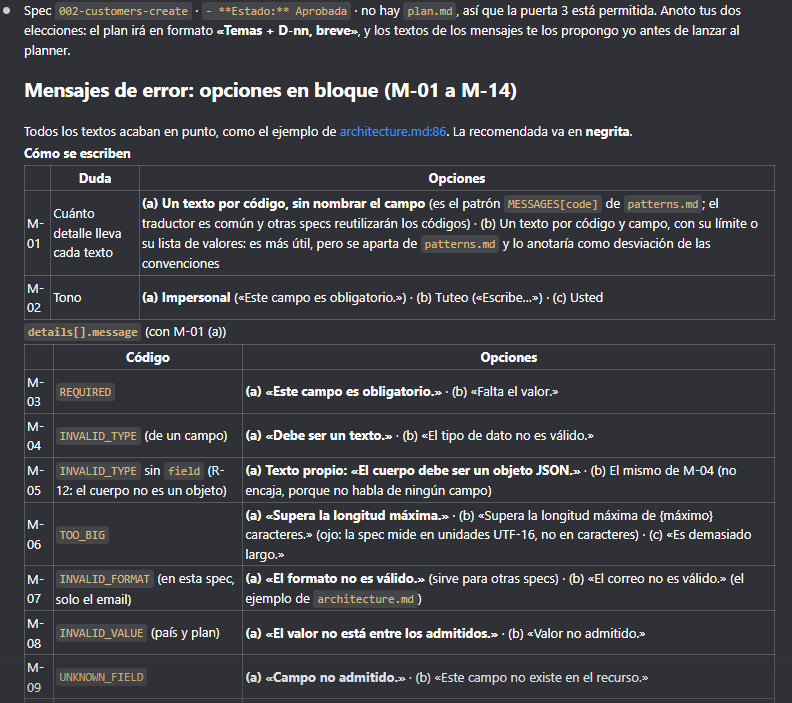
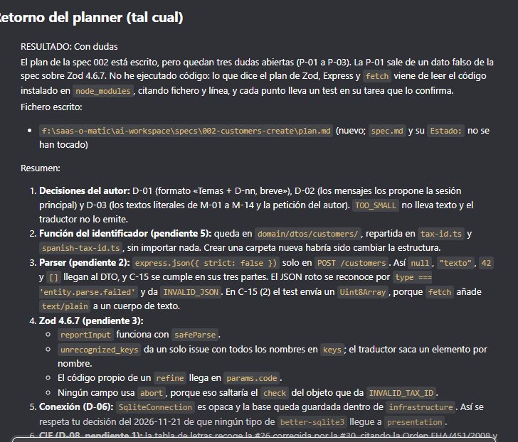
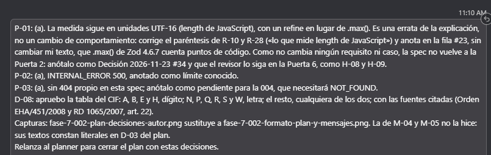
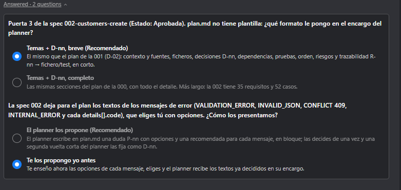
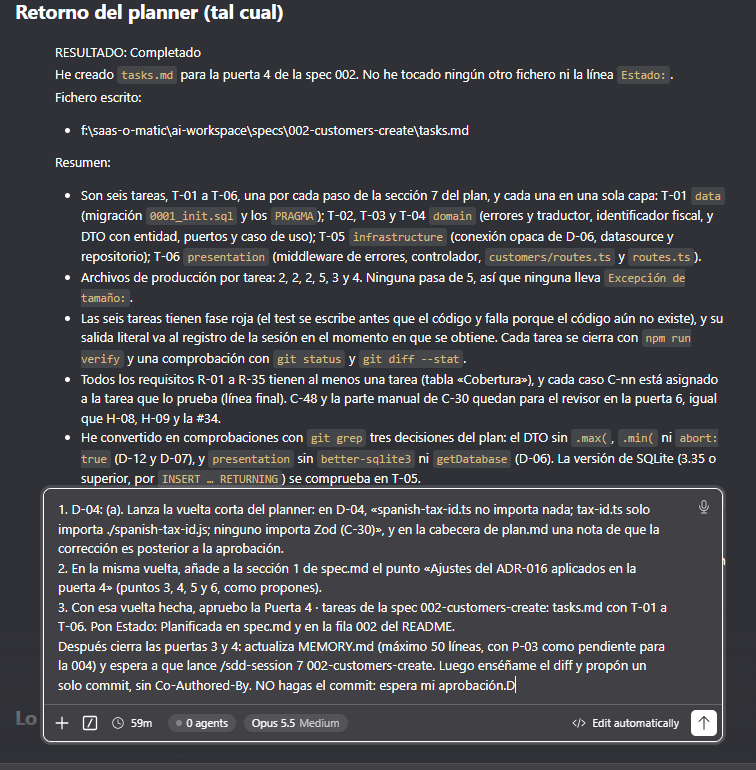

# 002-customers-create — Fase 7 (2026-11-23, sesión 02)

## Objetivo y fase
Fase 7, spec `002-customers-create`: puertas 3 (plan) y 4 (tareas), lanzadas con `/sdd-plan 002-customers-create`. La spec partía de `- **Estado:** Aprobada` y sin `plan.md`, y termina en `Planificada`, con `plan.md` (D-01 a D-14) y `tasks.md` (T-01 a T-06) aprobados. Las dos puertas se cierran en un solo commit, igual que las puertas 1 y 2.

## Prompts clave
Invocación inicial:
> /sdd-plan 002-customers-create

Respuestas del autor al cuadro de opciones de la puerta 3:
> "Puerta 3 de la spec 002-customers-create (Estado: Aprobada). plan.md no tiene plantilla: ¿qué formato le pongo en el encargo del planner?"="Temas + D-nn, breve (Recomendado)", "La spec 002 deja para el plan los textos de los mensajes de error (VALIDATION_ERROR, INVALID_JSON, CONFLICT 409, INTERNAL_ERROR y cada details[].code), que eliges tú con opciones. ¿Cómo los presentamos?"="Te los propongo yo antes"

Decisión del autor sobre los mensajes:
> M-01 a M-14: las recomendadas, salvo M-04 (b) y M-05 (b). Motivo: con un texto por código que reutilizarán otras specs, INVALID_TYPE debe ser genérico (en la 003 habrá campos numéricos), y con «El tipo de dato no es válido.» sirve también cuando el cuerpo no es un objeto, sin excepciones en el traductor.
> Lanza al planner con estos textos literales y con los pendientes que indicas.

Decisiones del autor sobre P-01 a P-03 y D-08:
> P-01: (a). La medida sigue en unidades UTF-16 (length de JavaScript), con un refine en lugar de .max(). Es una errata de la explicación, no un cambio de comportamiento: corrige el paréntesis de R-10 y R-28 («lo que mide length de JavaScript») y anota en la fila #23, sin cambiar mi texto, que .max() de Zod 4.6.7 cuenta puntos de código. Como no cambia ningún requisito ni caso, la spec no vuelve a la Puerta 2: anótalo como Decisión 2026-11-23 #34 y que el revisor lo siga en la Puerta 6, como H-08 y H-09.
> P-02: (a), INTERNAL_ERROR 500, anotado como límite conocido.
> P-03: (a), sin 404 propio en esta spec; anótalo como pendiente para la 004, que necesitará NOT_FOUND.
> D-08: apruebo la tabla del CIF: A, B, E y H, dígito; N, P, Q, R, S y W, letra; el resto, cualquiera de los dos; con las fuentes citadas (Orden EHA/451/2008 y RD 1065/2007, art. 22).
> Capturas: fase-7-002-plan-decisiones-autor.png sustituye a fase-7-002-formato-plan-y-mensajes.png. La de M-04 y M-05 no la hice: sus textos constan literales en D-03 del plan.
> Relanza al planner para cerrar el plan con estas decisiones.

Aprobación de la puerta 3, condicionada a una vuelta corta:
> 1. Q-18: añade en su celda «Estado» «(explicación corregida por la #34)».
> 2. Sí, lanza una vuelta corta del planner que añada al punto «puerta 3» de la sección 1 los ajustes del ADR-016 aplicados en esta puerta (puntos 3, 4, 5 y 6), junto con la nota de Q-18. Así no se repite la reserva H-14 de la 001.
> 3. fase-7-002-formato-plan-y-mensajes.png: consérvala, también es de esta puerta.
> Con esa vuelta hecha, apruebo la Puerta 3 · plan de la spec 002-customers-create: plan.md con D-01 a D-14, la tabla del CIF de D-08 aprobada y P-02 y P-03 como límites conocidos. Pon en la cabecera de plan.md «aprobado por el autor el 2026-11-23». El Estado: sigue en Aprobada.
> No cierres todavía: seguimos con la Puerta 4 y cerramos las dos puertas en un solo commit, como las puertas 1 y 2

Aprobación de la puerta 4, condicionada a una vuelta corta:
> 1. D-04: (a). Lanza la vuelta corta del planner: en D-04, «spanish-tax-id.ts no importa nada; tax-id.ts solo importa ./spanish-tax-id.js; ninguno importa Zod (C-30)», y en la cabecera de plan.md una nota de que la corrección es posterior a la aprobación.
> 2. En la misma vuelta, añade a la sección 1 de spec.md el punto «Ajustes del ADR-016 aplicados en la puerta 4» (puntos 3, 4, 5 y 6, como propones).
> 3. Con esa vuelta hecha, apruebo la Puerta 4 · tareas de la spec 002-customers-create: tasks.md con T-01 a T-06. Pon Estado: Planificada en spec.md y en la fila 002 del README.
> Después cierra las puertas 3 y 4: actualiza MEMORY.md (máximo 50 líneas, con P-03 como pendiente para la 004) y espera a que lance /sdd-session 7 002-customers-create. Luego enséñame el diff y propón un solo commit, sin Co-Authored-By. NO hagas el commit: espera mi aprobación.D

Celda de C-30 y capturas:
> 1. Sí, corrige tú la celda de C-30 en plan.md antes del commit, con ese texto.
> 2. Capturas: acabo de hacer las dos que faltaban, con esos nombres. fase-7-002-plan-decisiones-autor.png y fase-7-002-tareas-retorno.png se quedan como extra: la primera es el cuadro de formato y mensajes, y la segunda, el retorno del planner de la puerta 4.

Descarte de las capturas que faltaban:
> b, descartalas

## Qué propuso la IA
- **Antes de lanzar al planner:** un cuadro con dos preguntas. Una, el formato de `plan.md` (recomendado «Temas + D-nn, breve», el de la 001). Otra, cómo presentar los textos de error (recomendado que los propusiera el planner).
- **Mensajes de error en bloque, M-01 a M-14,** con opciones y una recomendada en cada uno:
  - cuánto detalle lleva cada texto: uno por código, sin nombrar el campo (patrón `MESSAGES[code]` de `patterns.md`);
  - tono impersonal;
  - un texto para cada `details[].code` y para cada `error.message`;
  - sin texto para `TOO_SMALL`, porque esta spec no lo usa (#21).
- **Pendientes que llevaría el encargo del planner,** sacados de `MEMORY.md` y de la spec: la tabla del CIF, `express.json()` en modo `strict`, tres comprobaciones con Zod 4.6.7, los límites del email en C-10 y un CIF «del resto» en C-22.
- **Primera vuelta del planner (Opus 5.5): «Con dudas».**
  - P-01: `.max()` de Zod 4.6.7 cuenta puntos de código, no unidades UTF-16. La sesión principal lo comprobó en `node_modules/zod/v4/core/checks.js` (`$ZodCheckMaxLength`).
  - P-02: 413, 415 y la petición cortada.
  - P-03: el `NOT_FOUND` 404 sin requisito.
  - La sesión principal añadió que la opción (a) de P-01 también tocaba la spec, y que el texto literal de la #23 no se reescribe.
- **Segunda vuelta del planner:**
  - corrigió el paréntesis de R-10 y avisó de que R-28 no lo llevaba: en la primera vuelta se había equivocado, y la sesión principal lo pasó al autor sin comprobarlo;
  - añadió la nota en la fila #23 y la fila #34 con `(pendiente de /sdd-session)`;
  - convirtió P-01 a P-03 en D-12 a D-14 y dejó D-08 aprobada;
  - señaló que la misma frase falsa seguía en la opción (i) de Q-18.
- **Antes de pedir la aprobación de la puerta 3,** la sesión principal propuso:
  - dejar Q-18 como estaba;
  - una vuelta corta para anotar en la sección 1 los ajustes del ADR-016 de la puerta 3, para no repetir la H-14 de la 001;
  - preguntar al autor por la captura `formato-plan-y-mensajes`.
- **Tercera vuelta corta:** la celda de Q-18 y los ajustes del ADR-016 de la puerta 3 (puntos 3, 4, 5 y 6). Después, la sesión principal puso «aprobado por el autor el 2026-11-23» en la cabecera de `plan.md`, con la aprobación literal.
- **Puerta 4, planner nuevo (Opus 5.5): «Completado».**
  - `tasks.md` con T-01 a T-06, una por capa, con 2, 2, 2, 5, 3 y 4 archivos de producción.
  - Fase roja en las seis tareas.
  - Tres comprobaciones con `git grep`.
  - Avisó de una contradicción en D-04, que decía que los dos ficheros no importan nada cuando `tax-id.ts` importa `./spanish-tax-id.js`. En T-03 siguió C-30.
  - Avisó de que faltaban los ajustes del ADR-016 de la puerta 4.
  - La sesión principal comprobó la contradicción en `plan.md:110` y en `spec.md:254` y propuso la opción (a).
- **Vuelta corta de la puerta 4:** D-04 corregida, una nota «Corrección posterior a la aprobación» en la cabecera de `plan.md` y los ajustes del ADR-016 de la puerta 4. El planner avisó de que la celda de C-30 en la sección 5 del plan (`plan.md:208`) aún decía «(ninguno)».
- **La sesión principal, tras la aprobación de la puerta 4:**
  - `Estado: Planificada` en `spec.md` y en la fila 002 del README;
  - `MEMORY.md` al día (50 líneas);
  - la celda de C-30 corregida por orden del autor.

## Qué corregí y por qué
- **M-04 y M-05: (b) en lugar de (a).** `INVALID_TYPE` lleva el texto genérico «El tipo de dato no es válido.», también cuando el cuerpo no es un objeto. Motivo: «con un texto por código que reutilizarán otras specs, INVALID_TYPE debe ser genérico (en la 003 habrá campos numéricos), y con «El tipo de dato no es válido.» sirve también cuando el cuerpo no es un objeto, sin excepciones en el traductor».
- **P-01: es una errata de la explicación, no un cambio de requisitos.** La spec no vuelve a la puerta 2: se registra como Decisión #34 y la sigue el revisor en la puerta 6.
- **Q-18:** en lugar de dejarla como estaba (lo recomendado), su celda «Estado» anota la corrección de la #34.
- **Capturas:** `fase-7-002-plan-decisiones-autor.png` sustituye a `fase-7-002-formato-plan-y-mensajes.png`, y después se conservan las dos. La de M-04 y M-05 se descarta porque sus textos constan en D-03. Las de la aprobación condicionada y de D-04 se descartan (sin motivo dado).

## Decisiones tomadas
- **Formato de `plan.md`:** «Temas + D-nn, breve» (D-01). Los mensajes los propone la sesión principal (D-02).
- **Textos de error (D-03):**

  | Código | Texto |
  |---|---|
  | `REQUIRED` | «Este campo es obligatorio.» |
  | `INVALID_TYPE` (de un campo o del cuerpo) | «El tipo de dato no es válido.» |
  | `TOO_BIG` | «Supera la longitud máxima.» |
  | `INVALID_FORMAT` | «El formato no es válido.» |
  | `INVALID_VALUE` | «El valor no está entre los admitidos.» |
  | `UNKNOWN_FIELD` | «Campo no admitido.» |
  | `INVALID_TAX_ID` | «El identificador fiscal no es válido.» |
  | `VALIDATION_ERROR` | «Hay datos no válidos.» |
  | `INVALID_JSON` | «El cuerpo no es un JSON válido.» |
  | `CONFLICT` | «Ya existe un cliente con ese identificador fiscal en ese país.» |
  | `INTERNAL_ERROR` | «Error interno del servidor.» |

  `TOO_SMALL` queda sin texto.
- **Decisión 2026-11-23 #34 (D-12):** la medida sigue en unidades UTF-16 (`length` de JavaScript), con `refine`. Cambian el paréntesis de R-10, la nota de la fila #23 y la celda de Q-18. Ningún comportamiento cambia.
- **D-13:** 413, 415 y la petición cortada salen como `INTERNAL_ERROR` 500 (límite conocido).
- **D-14:** esta spec no tiene un 404 propio; queda pendiente para la 004 (`NOT_FOUND`).
- **D-08 aprobada:** A, B, E y H, con dígito; N, P, Q, R, S y W, con letra; el resto, cualquiera de los dos. Fuentes: Orden EHA/451/2008 y RD 1065/2007, art. 22.
- **D-04 corregida tras la aprobación:** `spanish-tax-id.ts` no importa nada, `tax-id.ts` solo importa `./spanish-tax-id.js` y ninguno importa Zod. La celda de C-30 del plan dice lo mismo.
- **Puerta 3 aprobada:** `plan.md` con D-01 a D-14. La spec siguió en `Aprobada`.
- **Puerta 4 aprobada:** `tasks.md` con T-01 a T-06. `Estado: Planificada` en `spec.md` y en el README.
- Commit: el de cierre de esta sesión.

## Capturas
Capturas de esta sesión (las demás de la fase 7 son de sesiones anteriores):

Anunciadas y no existentes:
- `fase-7-002-mensajes-m04-m05-corregidos.png`: descartada por el autor, porque sus textos constan literales en D-03 del plan.
- `fase-7-002-plan-aprobacion-condicionada.png`: descartada por el autor (sin motivo dado).
- `fase-7-002-tareas-d04-opcion-a.png`: descartada por el autor (sin motivo dado).

## Pendiente para la siguiente sesión
- Puerta 5 de la 002: empezar por T-01 (migración `0001_init.sql` y los `PRAGMA`). Al empezar, `Estado:` pasa a `En implementación`.
- Las comprobaciones de Zod 4.6.7 y Express que el plan hizo leyendo `node_modules`, sin ejecutar código, se confirman con los tests de cada tarea. La versión de SQLite (3.35 o superior) se comprueba en T-05.
- En la puerta 6, el revisor sigue lo que no ha visto: H-08, H-09, la #34 (D-12) y la corrección de D-04. Sigue pendiente la reserva H-05.
- Spec 004: `NOT_FOUND` 404 con el formato único (D-14).
- La celda `(pendiente de /sdd-session)` de la fila #34 de `spec.md` se sustituye por la ruta de este registro, con tu OK.
