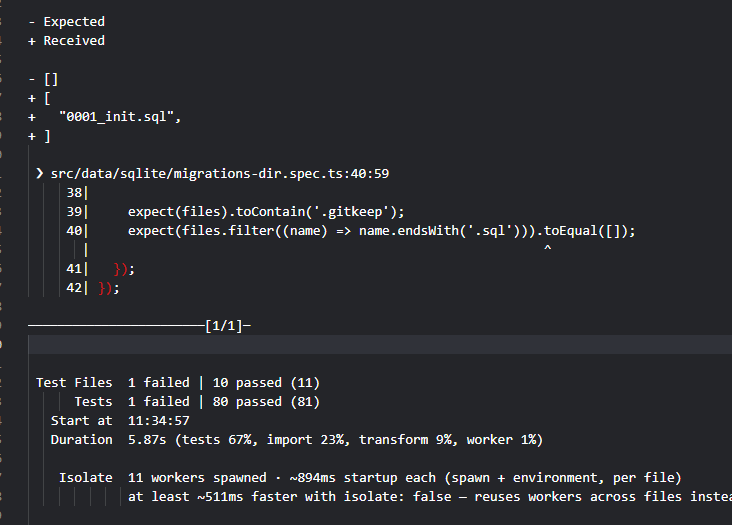
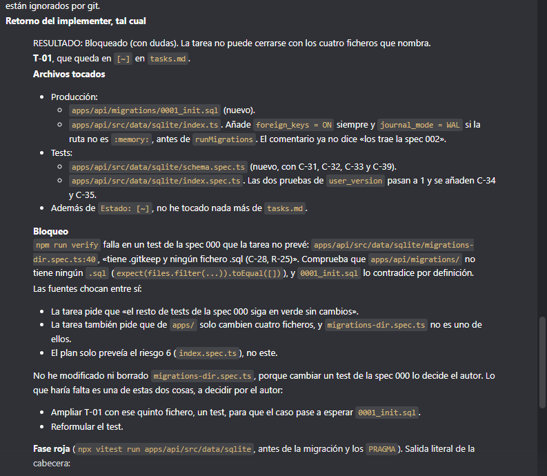
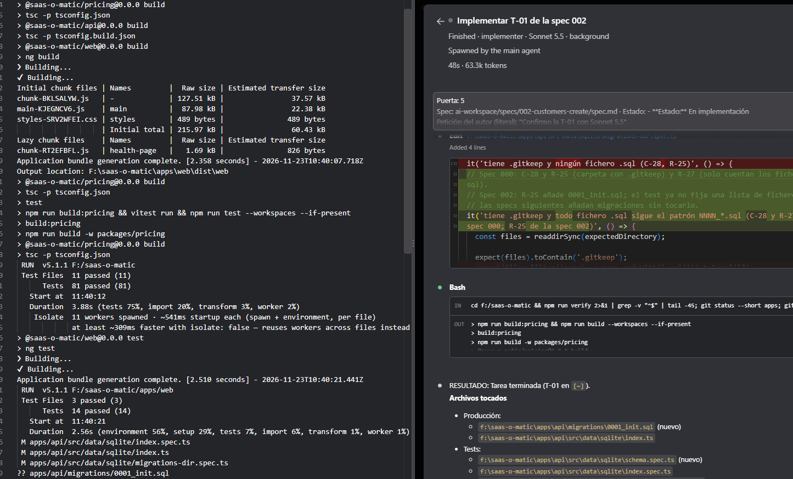

# 002-customers-create — Fase 7 (2026-11-23, sesión 03)

## Objetivo y fase
Fase 7, spec `002-customers-create`. Puerta 5 (implementación), lanzada con `/sdd-implement 002-customers-create`.
- **Estado de partida:** `- **Estado:** Planificada`, con las seis tareas (T-01 a T-06) pendientes.
- **Al empezar:** la spec pasa a `En implementación`, porque la T-01 es la primera tarea.
- **Alcance de la sesión:** la T-01 (data: migración `0001_init.sql` y `PRAGMA` en `openDatabase`), hasta su aprobación y el commit propuesto.
- **Registro:** se abrió durante la sesión para copiar la fase roja literal en el momento, como pide la regla de `tasks.md`. `/sdd-session` lo completa aquí.

## Prompts clave
Invocación inicial:
> /sdd-implement 002-customers-create

Confirmación de la tarea y del modelo:
> Confirmo la T-01 con Sonnet 5.5

Decisiones sobre el bloqueo de la T-01:
> 1. migrations-dir.spec.ts: (A), con un cambio: en vez de esperar exactamente .gitkeep y 0001_init.sql, que la segunda comprobación exija .gitkeep y que todo .sql siga el patrón NNNN_nombre.sql (R-27 de la spec 000). Así la 003, que añadirá 0002, no tendrá que tocar este test otra vez. Amplía la T-01 con ese fichero de test y anota en ella mi autorización literal, como el borrado de index.spec.ts en la T-04 de la 001.
> 2. Rojo de C-34: (A). Acéptalo sin C-34 y anótalo en la T-01 con su motivo (better-sqlite3 se compila con SQLITE_DEFAULT_FOREIGN_KEYS=1). El PRAGMA explícito se queda por R-26.
> 3. Crea ya el registro 2026-11-23-03-002-customers-create.md y copia en él la fase roja literal, como pide la regla de tasks.md; /sdd-session lo completará al cerrar.
> Reanuda al implementer para cerrar la T-01 y relanzar npm run verify.

Aprobación de la T-01:
> Apruebo la T-01.
> Marca la T-01 en [x] con sus casillas y mi aprobación literal, y actualiza MEMORY.md (máximo 50 líneas). No lanzo /sdd-session en cada tarea (CLAUDE.md:44 pide solo MEMORY.md y diff): completa tú el registro 03 con el retorno del implementer y mi aprobación literal, como en la 001; /sdd-session irá al cerrar la Puerta 5. Enséñame el diff y propón el commit, sin Co-Authored-By. NO hagas el commit: espera mi aprobación.

Invocación del registro, número y captura:
> /sdd-session 7 002-customers-create

> completa la 03

> Descártala y guárdalo en la 03

## Qué propuso la IA
- **La tarea:** la T-01, con el implementer en Sonnet 5.5 (ADR-016, punto 6) y el encargo sin enseñar antes (punto 4). Antes de lanzarlo, la sesión principal cambió el `Estado:` en `spec.md` y en el README y ejecutó `npm run verify`: exit 0, 75 + 14. La salida literal fue en el encargo.
- **Primer retorno del implementer:** `Bloqueado`. La fase roja (literal, abajo) falla en 7 de 29 tests de `data/sqlite`, y C-34 no falla. Tras implementar, `npm run verify` falla solo en `migrations-dir.spec.ts:40`, un test de la spec 000 que exige `migrations/` sin ningún `.sql`. El implementer no lo tocó y lo devolvió como choque entre fuentes.
- **Comprobaciones de la sesión principal:**
  - El test que falla existe y dice eso (`migrations-dir.spec.ts:36-41`).
  - `better-sqlite3` se compila con `SQLITE_DEFAULT_FOREIGN_KEYS=1` (`node_modules/better-sqlite3/deps/defines.gypi:14`), así que C-34 no podía fallar sin el `PRAGMA`.
- **Opciones presentadas:**
  - Para `migrations-dir.spec.ts`: (A) ampliar T-01 con ese test, autorización literal en `tasks.md`; (B) quitar el bloque del esqueleto; (C) puerta 4 ampliada con el planner. Recomendada: (A).
  - Para el rojo de C-34: (A) aceptarlo con su motivo; (B) buscar otro test. Recomendada: (A).
  - Sobre el registro: si crearlo ya o dejarlo para `/sdd-session`.
- **Antes de aplicar la decisión del autor:** la sesión principal comprobó que R-27 de la spec 000 (`spec.md:113`) dice «solo los ficheros con nombre `NNNN_*.sql`». Después anotó en la T-01 las dos autorizaciones literales, creó este registro con la fase roja y reanudó al implementer.
- **Segundo retorno del implementer:** tarea terminada, con `npm run verify` en verde (81 + 14) y solo los cinco ficheros autorizados en `apps/` (literal, abajo).
- **Comprobado por la sesión principal:** `npm run verify` relanzado desde la raíz, exit 0 (81 + 14). Además, `0001_init.sql` coincide con la tabla `customers` de `database.md` (líneas 10-19), más `UNIQUE (country, tax_id)` y sin `simulations`.
- **Tras la aprobación:**
  - La T-01 queda en `[x]`, con sus casillas y la aprobación literal en `tasks.md`.
  - Dos casillas no se cumplen al pie de la letra: la del resto de tests de la spec 000 «sin cambios» y la de los cuatro ficheros de `apps/`. Su texto no se cambió: la línea de aprobación anota que se cumplen con la ampliación autorizada.
  - `MEMORY.md` queda en 50 líneas: la línea 9 resume la T-01 y la línea 47 retira el pendiente (2) de la spec 000 (`foreign_keys` y WAL, P-04 (b)).
  - Se propuso el commit, sin `Co-Authored-By`.
- **Sobre el número de este registro:** `/sdd-session` pide recalcular NN si el fichero existe. La sesión principal lo señaló como choque y propuso completar el `03`.

### T-01 · fase roja (retorno literal del implementer)
Comando: `npx vitest run apps/api/src/data/sqlite`, antes de la migración y los `PRAGMA`.

```
 RUN  v5.1.1 F:/saas-o-matic

 ❯ |api| src/data/sqlite/index.spec.ts (8 tests | 3 failed) 48ms
   ❯ openDatabase (8)
     × aplica las migraciones reales de apps/api/migrations/ (0001_init.sql) y user_version queda en 1 (base de C-09) 9ms
     × aplica las migraciones reales también en una base en fichero (user_version 1) 5ms
     × C-35: journal_mode vale wal con un fichero temporal (R-27) 5ms
 ❯ |api| src/data/sqlite/schema.spec.ts (4 tests | 4 failed) 29ms
   ❯ esquema de customers (R-25) (4)
     × C-31: customers es STRICT, con sus siete columnas y UNIQUE(country, tax_id); sin simulations; user_version 1 17ms
     × C-32: el CHECK rechaza un texto solo con espacios en cada columna de texto 6ms
     × C-33: sin created_at, se rellena con formato AAAA-MM-DDTHH:MM:SS.sssZ 2ms
     × C-39: UNIQUE rechaza el mismo country y tax_id; con country distinto entran las dos 2ms
```
Motivos de cada fallo:
- `user_version`: `expected +0 to be 1`.
- C-35: `expected 'delete' to be 'wal'`.
- C-31: `expected undefined to be 1`. `customers?.strict` es `undefined` porque la tabla no existe.
- C-32: `no such table: customers`.
- C-33: `SqliteError: no such table: customers`.
- C-39: `SqliteError: no such table: customers`.

Resumen: `Test Files 2 failed | 2 passed (4)`, `Tests 7 failed | 22 passed (29)`.

C-34 no falló en rojo. `better-sqlite3` ya activa `foreign_keys` por defecto, así que ese test pasa sin el `PRAGMA`. Lo dejo escrito porque lo exige la tarea. El `PRAGMA` explícito cumple R-26 igualmente.

Verde parcial del implementer (`npm run verify` tras implementar):
- `build` sin error.
- Tests de la raíz: `Test Files 1 failed | 10 passed (11)` y `Tests 1 failed | 80 passed (81)`.
- El único fallo es `migrations-dir.spec.ts:40` («tiene .gitkeep y ningún fichero .sql (C-28, R-25)», test de la spec 000).
- `ng test` no llegó a ejecutarse.

Resultado: `Bloqueado`.

### T-01 · retorno del implementer tras reanudarlo (literal)
> RESULTADO: Tarea terminada (T-01 en `[~]`).
>
> **Archivos tocados**
> - Producción:
>   - `f:\saas-o-matic\apps\api\migrations\0001_init.sql` (nuevo)
>   - `f:\saas-o-matic\apps\api\src\data\sqlite\index.ts`
> - Tests:
>   - `f:\saas-o-matic\apps\api\src\data\sqlite\schema.spec.ts` (nuevo)
>   - `f:\saas-o-matic\apps\api\src\data\sqlite\index.spec.ts`
>   - `f:\saas-o-matic\apps\api\src\data\sqlite\migrations-dir.spec.ts`: solo el bloque «carpeta migrations/ del esqueleto». El primer `describe` no se ha tocado.
>
> **Cambio en `migrations-dir.spec.ts`**
> - El `it` exige `.gitkeep` y que todo `.sql` cumpla `/^\d{4}_.+\.sql$/`. No fija ninguna lista de ficheros.
> - El comentario cita C-28, R-25 y R-27 de la spec 000, y R-25 de la spec 002.
> - Límite de esta comprobación: detecta un `.sql` con nombre que no sea `NNNN_*.sql`, por ejemplo `init.sql` o `001_x.sql`. Un `.sql` bien nombrado pero con numeración saltada (`0003` sin `0002`) no lo detecta este test. Eso ya lo cubre `run-migrations`, que valida la numeración al arrancar.
>
> **`npm run verify` desde la raíz** (verde)
> - `build`: sin error en `pricing`, `api` y `web` (`Application bundle generation complete. [2.358 seconds]`).
> - Tests de la raíz (Vitest):
>   - `Test Files  11 passed (11)`
>   - `Tests  81 passed (81)`
> - `ng test` (web):
>   - `Test Files  3 passed (3)`
>   - `Tests  14 passed (14)`
>
> **`git status` y `git diff --stat` de `apps/`**
> ```
>  M apps/api/src/data/sqlite/index.spec.ts
>  M apps/api/src/data/sqlite/index.ts
>  M apps/api/src/data/sqlite/migrations-dir.spec.ts
> ?? apps/api/migrations/0001_init.sql
> ?? apps/api/src/data/sqlite/schema.spec.ts
>
>  apps/api/src/data/sqlite/index.spec.ts          | 24 ++++++++++++++++++++----
>  apps/api/src/data/sqlite/index.ts               |  8 +++++++-
>  apps/api/src/data/sqlite/migrations-dir.spec.ts |  8 ++++++--
>  3 files changed, 33 insertions(+), 7 deletions(-)
> ```
> Solo cambian los cinco ficheros autorizados. Los dos nuevos no salen en `git diff --stat` porque aún no están en el índice.
>
> **Desviaciones**
> - C-34 no tuvo fase roja: pasaba sin el `PRAGMA`. Lo aceptó el autor. Queda anotado en `tasks.md` y el `PRAGMA` explícito se mantiene por R-26.
>
> **Qué debe actualizar la sesión principal**
> - `MEMORY.md` al cerrar la tarea.
> - `[x]` y las casillas de «Hecho cuando» de T-01, tras la aprobación del autor.
> - El `Estado:` de la spec ya es `En implementación`.

## Qué corregí y por qué
- **`migrations-dir.spec.ts`:** el autor eligió (A), pero cambió lo propuesto. La IA había propuesto que el test esperase exactamente `.gitkeep` y `0001_init.sql`. El autor pidió que exija `.gitkeep` y que todo `.sql` siga `NNNN_nombre.sql`, por R-27 de la spec 000. Motivo del autor: «Así la 003, que añadirá 0002, no tendrá que tocar este test otra vez».
- **Registro de cada tarea:** el autor no lanza `/sdd-session` en cada tarea. Motivo del autor: «CLAUDE.md:44 pide solo MEMORY.md y diff». La sesión principal completa este registro con el retorno del implementer y la aprobación literal, «como en la 001». `/sdd-session` irá al cerrar la puerta 5.
- **Número del registro:** el autor eligió completar el `03` en vez de crear un `04`.
- **Captura anunciada:** el autor descartó la que faltaba (`fase-7-002-t01-decision-autor-migrations-dir.png`).

## Decisiones tomadas
- **Implementer:** T-01 con Sonnet 5.5 (ADR-016, punto 6), con el encargo sin enseñar antes (punto 4).
- **Ampliación de la T-01:** se amplía con el test `apps/api/src/data/sqlite/migrations-dir.spec.ts`, que es de la spec 000. Exige `.gitkeep` y que todo `.sql` siga `NNNN_*.sql`. La autorización literal está en la T-01 de `tasks.md`, y la tarea sigue con 2 archivos de producción.
- **Rojo de C-34:** se acepta sin C-34, con su motivo (`SQLITE_DEFAULT_FOREIGN_KEYS=1`), anotado en la T-01. El `PRAGMA foreign_keys = ON` explícito se queda por R-26.
- **Cierre de la T-01:** aprobada por el autor (aprobación literal en `tasks.md`), con `npm run verify` en verde (81 + 14).
- **`MEMORY.md`:** al día, en 50 líneas. Queda resuelto el pendiente (2) de la spec 000 (P-04 (b)).
- **Commit:** el de cierre de esta sesión.

## Capturas




- Anunciada y no existente, descartada por el autor: `fase-7-002-t01-decision-autor-migrations-dir.png`, la decisión del autor sobre `migrations-dir.spec.ts` y el rojo de C-34. Su contenido consta literal en la T-01 de `tasks.md` y en «Prompts clave».

## Pendiente para la siguiente sesión
- **Puerta 5:** T-02 (domain: `CustomError` y traductor de `details[]`), y después T-03 a T-06.
- **Spec 002, para las tareas que siguen:**
  - Comprobaciones de Zod 4.6.7 y Express (T-02, T-04 y T-06).
  - SQLite ≥ 3.35 (T-05).
- **Revisor, en la puerta 6:**
  - Lo que aún no ha visto: H-08, H-09, la #34 y la corrección de D-04.
  - La ampliación de la T-01 (`migrations-dir.spec.ts`) y el rojo sin C-34.
- **`/sdd-session` al cerrar la puerta 5,** según indicó el autor.
