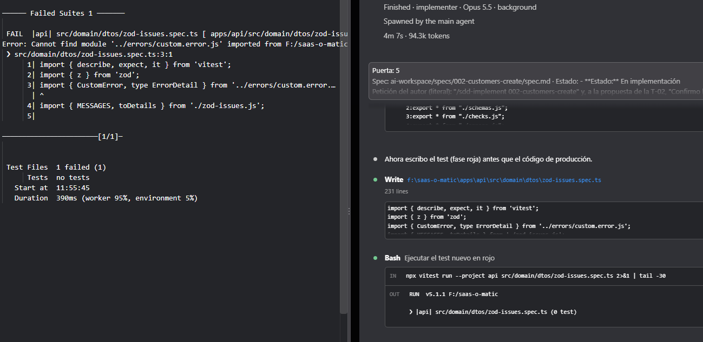
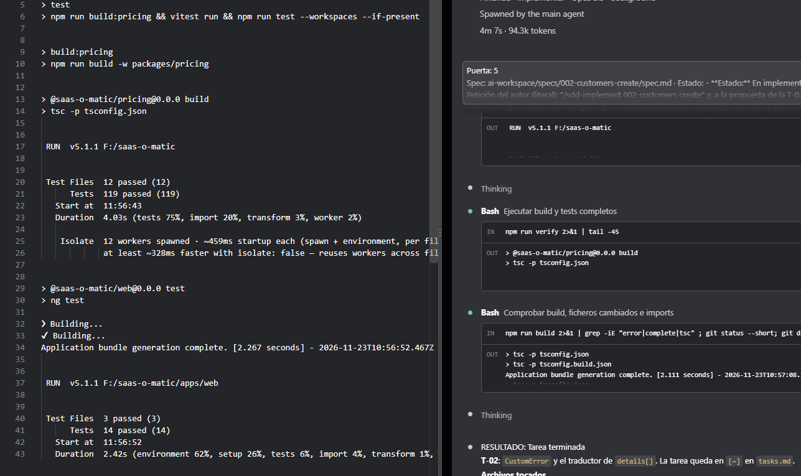
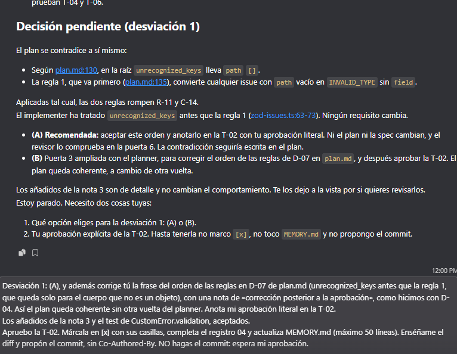

# 002-customers-create — Fase 7 (2026-11-23, sesión 04)

## Objetivo y fase
Fase 7, spec `002-customers-create`. Puerta 5 (implementación), lanzada con `/sdd-implement 002-customers-create`.
- **Estado de partida:** `- **Estado:** En implementación`, con la T-01 hecha y T-02 a T-06 pendientes.
- **Alcance de la sesión:** la T-02 (domain: `CustomError` y traductor de `details[]`), hasta su aprobación y el commit propuesto.
- **Registro:** se abrió durante la sesión para copiar la fase roja literal en el momento, como pide la regla de `tasks.md`. Lo completó la sesión principal al aprobarse la tarea, y `/sdd-session` lo cierra aquí.

## Prompts clave
Invocación inicial:
> /sdd-implement 002-customers-create

Confirmación de la tarea y del modelo:
> Confirmo la T-02 con Opus 5.5.

Decisión sobre la desviación y aprobación de la T-02:
> Desviación 1: (A), y además corrige tú la frase del orden de las reglas en D-07 de plan.md (unrecognized_keys antes que la regla 1, que queda solo para el cuerpo que no es un objeto), con una nota de «corrección posterior a la aprobación», como hicimos con D-04. Así el plan queda coherente sin otra vuelta del planner. Anota mi aprobación literal en la T-02.
> Los añadidos de la nota 3 y el test de CustomError.validation, aceptados.
> Apruebo la T-02. Márcala en [x] con sus casillas, completa el registro 04 y actualiza MEMORY.md (máximo 50 líneas). Enséñame el diff y propón el commit, sin Co-Authored-By. NO hagas el commit: espera mi aprobación.

Invocación del registro y número:
> antes del commit /sdd-session 7 002-customers-create

> Guárdalo en la 04

## Qué propuso la IA
- **La tarea:** la T-02, la siguiente del orden de construcción y sin dependencias. Implementer con Opus 5.5, porque la tarea tiene lógica de prioridad y comprueba el comportamiento de Zod 4.6.7 (ADR-016, punto 6). Encargo sin enseñar antes (punto 4).
- **Antes de lanzarlo:** la sesión principal ejecutó `npm run verify`: exit 0, 81 + 14. La salida literal completa fue en el encargo.
- **Retorno del implementer:** tarea terminada (literal, abajo), con una desviación que pedía el visto bueno del autor.
- **Comprobaciones de la sesión principal:**
  - `git status` y `git diff --stat`: en `apps/` solo los tres ficheros de la tarea; fuera, solo la línea `Estado` de la T-02 en `tasks.md`.
  - `npm run verify` relanzado desde la raíz: exit 0, 119 + 14.
  - Lectura de `custom.error.ts` y `zod-issues.ts`: textos M-03 a M-11 literales, sin `TOO_SMALL`, e importaciones solo de tipos de `zod` y de `../errors/`.
  - La desviación es cierta: `plan.md` (D-07) dice que `unrecognized_keys` lleva en la raíz `path` `[]`, y la regla 1, que va primero, convierte todo `path` vacío en `INVALID_TYPE` sin `field`. Aplicadas en ese orden, rompen R-11 y C-14.
- **Opciones presentadas para la desviación:** (A) aceptar el orden del implementer y anotarlo en la T-02, sin cambiar el plan (recomendada); (B) puerta 3 ampliada con el planner para corregir D-07.
- **Tras la aprobación:**
  - La T-02 queda en `[x]`, con sus casillas, la decisión y la aprobación literales en `tasks.md`.
  - `plan.md`: la frase del orden de las reglas de D-07 y la regla 1, corregidas, con una segunda nota «Corrección posterior a la aprobación» en la cabecera, como la de D-04.
  - `MEMORY.md` sigue en 50 líneas: la línea 9 resume la T-02 y la corrección de D-07.
  - Se propuso el commit, sin `Co-Authored-By`.
- **Número de este registro:** `/sdd-session` pide pasar al número siguiente si el fichero ya existe. La sesión principal lo señaló como choque y propuso completar el `04`, como en la sesión 03.

### T-02 · fase roja (retorno literal del implementer)
Comando: `npx vitest run --project api src/domain/dtos/zod-issues.spec.ts`, escrito antes que los dos ficheros de producción.

```
 RUN  v5.1.1 F:/saas-o-matic

 ❯ |api| src/domain/dtos/zod-issues.spec.ts (0 test)

⎯⎯⎯⎯⎯⎯ Failed Suites 1 ⎯⎯⎯⎯⎯⎯⎯

 FAIL  |api| src/domain/dtos/zod-issues.spec.ts [ apps/api/src/domain/dtos/zod-issues.spec.ts ]
Error: Cannot find module '../errors/custom.error.js' imported from F:/saas-o-matic/apps/api/src/domain/dtos/zod-issues.spec.ts
 ❯ src/domain/dtos/zod-issues.spec.ts:3:1
      1| import { describe, expect, it } from 'vitest';
      2| import { z } from 'zod';
      3| import { CustomError, type ErrorDetail } from '../errors/custom.error.…
       | ^
      4| import { MESSAGES, toDetails } from './zod-issues.js';
      5|

⎯⎯⎯⎯⎯⎯⎯⎯⎯⎯⎯⎯⎯⎯⎯⎯⎯⎯⎯⎯⎯⎯⎯⎯[1/1]⎯


 Test Files  1 failed (1)
      Tests  no tests
   Start at  11:55:45
   Duration  390ms (worker 95%, environment 5%)
```

### T-02 · retorno del implementer (literal, salvo la fase roja, ya copiada arriba)
> RESULTADO: Tarea terminada
>
> **T-02**: `CustomError` y el traductor de `details[]`. La tarea queda en `[~]` en `tasks.md`.
>
> **Archivos tocados**
> - Producción (2):
>   - `f:\saas-o-matic\apps\api\src\domain\errors\custom.error.ts` (nuevo)
>   - `f:\saas-o-matic\apps\api\src\domain\dtos\zod-issues.ts` (nuevo)
> - Tests (1): `f:\saas-o-matic\apps\api\src\domain\dtos\zod-issues.spec.ts` (nuevo)
> - Fuera de `apps/`: solo la línea `Estado` de T-02 en `f:\saas-o-matic\ai-workspace\specs\002-customers-create\tasks.md`.
> - `git status --short`: ` M tasks.md`, `?? apps/api/src/domain/dtos/`, `?? apps/api/src/domain/errors/`.
>
> **Verde**
> - El mismo test: `Test Files  1 passed (1)`, `Tests  38 passed (38)`.
> - `npx tsc -p tsconfig.json --noEmit` en `apps/api`, con los specs incluidos: sin errores.
> - `npm run verify` desde la raíz:
>   - Raíz: `Test Files  12 passed (12)`, `Tests  119 passed (119)` (antes eran 81; los 38 nuevos son de este test).
>   - Web: `Test Files  3 passed (3)`, `Tests  14 passed (14)`.
>   - El build se repitió aparte (`npm run build`), sin errores: `tsc -p tsconfig.build.json` y `Application bundle generation complete. [2.111 seconds]`.
>
> **Comprobaciones de Zod 4.6.7** (las hace el test con esquemas reales)
> - `reportInput` funciona con `safeParse`: el issue lleva `input` (123) con él y no lo lleva sin él.
> - `unrecognized_keys` en la raíz da un solo issue con `path: []` y `keys: ['id', 'createdAt']`.
> - `refine(…, { params: { code } })` y `ctx.addIssue({ code: 'custom', path, params })` conservan `params.code`, y el segundo también `path`.
> - `z.enum` da `invalid_value`, `z.email()` da `invalid_format` y `.min()` da `too_small`. Este último se traduce a `INVALID_VALUE`, nunca a `TOO_SMALL`.
> - `custom.error.ts` no importa nada. `zod-issues.ts` solo importa `zod` y `../errors/custom.error.js`, los dos como tipo: sin `node:*`, Express ni `better-sqlite3`.
>
> **Desviaciones y notas**
> 1. **Orden de las reglas 1 y 3 (pide tu visto bueno).** En la raíz, `unrecognized_keys` también tiene `path: []`. Si se aplica la regla 1 tal cual, en primer lugar, un campo desconocido en la raíz saldría `INVALID_TYPE` sin `field`, y eso choca con R-11 y C-14.
>    - Lo he resuelto como dice el resto de D-07: un `UNKNOWN_FIELD` por nombre, con el nombre en `field`.
>    - Para eso, `unrecognized_keys` se trata antes que la regla 1, y la regla 1 queda solo para el caso de su paréntesis: el cuerpo no es un objeto.
>    - Es una lectura mía del plan, no una decisión tuya. Va anotada en un comentario del código. Si prefieres otra, el cambio es pequeño.
> 2. **Test de `CustomError.validation` (R-15).** Lo he añadido en `zod-issues.spec.ts`: comprueba `VALIDATION_ERROR`, M-11 y los `details` recibidos. La casilla dice que lo prueban T-04 y T-06; este test no sustituye a esos.
> 3. **Pequeños añadidos que no fija el plan:**
>    - `CustomError` pone `this.name = 'CustomError'`.
>    - `details` y `ErrorDetail` son `readonly`.
>    - Se exporta el tipo `DetailCode`.
>    - Si un mismo campo trae varios issues de la misma prioridad (los dos del grupo «el resto»), se queda el primero que llega. Ninguna fuente lo fija y, con el esquema de D-07, no puede pasar.
>
> **Qué debe actualizar la sesión principal**
> - Copiar la salida de la fase roja de arriba al registro de la sesión.
> - `MEMORY.md`: T-02 hecha, y siguiente tarea T-03.
> - El `Estado:` de la spec no cambia: ya está en `En implementación`.
> - Tras tu aprobación: `[x]` en T-02 y sus casillas de «Hecho cuando». La casilla de R-15 se cumple en parte aquí; el resto lo prueban T-04 y T-06.

## Qué corregí y por qué
- **Desviación 1:** el autor eligió (A), pero amplió lo propuesto. La IA había propuesto dejar el plan como estaba. El autor pidió además corregir en `plan.md` la frase del orden de las reglas de D-07, con una nota de corrección posterior a la aprobación, como la de D-04. Motivo del autor: «Así el plan queda coherente sin otra vuelta del planner».
- **Orden de cierre:** el autor pidió lanzar `/sdd-session` antes del commit.
- **Número del registro:** el autor eligió completar el `04` en vez de crear un `05`.

## Decisiones tomadas
- **Implementer:** T-02 con Opus 5.5 (ADR-016, punto 6), con el encargo sin enseñar antes (punto 4).
- **Orden del traductor:** `unrecognized_keys` se trata antes que la regla 1 de D-07, que queda solo para el cuerpo que no es un objeto. Corregido en `plan.md` (D-07 y nota en la cabecera), sin cambio de ningún requisito.
- **Añadidos aceptados por el autor:** `this.name = 'CustomError'`, `details` y `ErrorDetail` `readonly`, el tipo `DetailCode` exportado, el primero que llega entre issues de la misma prioridad y el test de `CustomError.validation` en `zod-issues.spec.ts`.
- **Cierre de la T-02:** aprobada por el autor (aprobación literal en `tasks.md`), con `npm run verify` en verde (119 + 14).
- **`MEMORY.md`:** al día, en 50 líneas.
- **Commit:** el de cierre de esta sesión.

## Capturas




## Pendiente para la siguiente sesión
- **Puerta 5:** T-03 (domain: normalización y validación del identificador fiscal), y después T-04 a T-06.
- **Spec 002, para las tareas que siguen:**
  - Comprobaciones de Zod 4.6.7 y Express (T-04 y T-06).
  - SQLite ≥ 3.35 (T-05).
- **Revisor, en la puerta 6:**
  - Lo que aún no ha visto: H-08, H-09, la #34 y las correcciones de D-04 y de D-07.
  - La ampliación de la T-01 (`migrations-dir.spec.ts`) y el rojo sin C-34.
- **`/sdd-session` al cerrar la puerta 5,** según indicó el autor.
