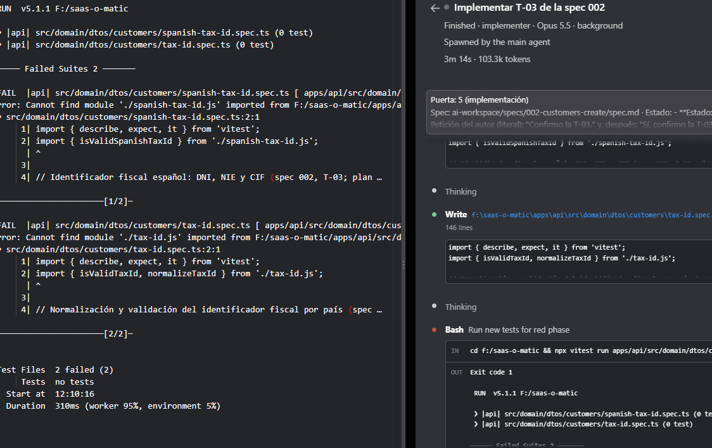
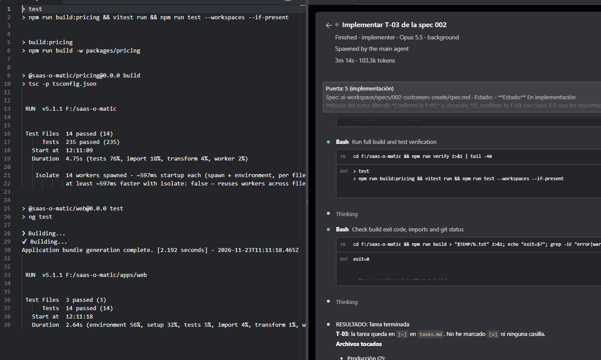

# 002-customers-create — Fase 7 (2026-11-23, sesión 05)

## Objetivo y fase
Fase 7, spec `002-customers-create`. Puerta 5 (implementación), lanzada con `/sdd-implement 002-customers-create`.
- **Estado de partida:** `- **Estado:** En implementación`, con T-01 y T-02 hechas y T-03 a T-06 pendientes.
- **Alcance de la sesión:** la T-03 (domain: normalización y validación del identificador fiscal), hasta su aprobación y el commit propuesto.
- **Registro:** se abrió durante la sesión para copiar la fase roja literal en el momento, como pide la regla de `tasks.md`. Lo completó la sesión principal al aprobarse la tarea, y `/sdd-session` lo cierra aquí.

## Prompts clave
Invocación inicial:
> /sdd-implement 002-customers-create

Confirmación de la tarea:
> Confirmo la T-03.

Corrección del modelo:
> Sí, confirmo la T-03 con Opus 5.5: son los algoritmos del DNI, el NIE y el CIF, y el ADR-016 (punto 6) reserva Sonnet para las tareas sencillas.

Pregunta del autor tras interrumpir una orden:
> El implementar a terminado?

Decisión sobre los añadidos y aprobación de la T-03:
> Nota 1: aceptado el tipo TaxIdCountry. Nota 3: aceptados los casos de más.
> Apruebo la T-03. Márcala en [x] con sus casillas y mi aprobación literal, completa el registro 05 y actualiza MEMORY.md (máximo 50 líneas). Antes del commit lanzo /sdd-session 7 002-customers-create. Después enséñame el diff y propón el commit, sin Co-Authored-By. NO hagas el commit: espera mi aprobación.

Verify antes del commit y descarte de la captura:
> Sí, relanza npm run verify antes del commit y pon su salida en el registro 05, porque se cortó el anterior. La captura de la corrección del modelo, descártala: consta en el registro 05 y en el mensaje del commit.

Invocación del registro y número:
> /sdd-session 7 002-customers-create

> Guárdalo en la 05

## Qué propuso la IA
- **La tarea:** la T-03, la siguiente del orden de construcción y sin dependencias. Encargo sin enseñar antes (ADR-016, punto 4).
- **Antes de lanzarlo:** la sesión principal ejecutó `npm run verify`: en verde, 119 + 14. La salida literal fue en el encargo.
- **Modelo:**
  - La sesión principal lanzó primero al implementer con Sonnet 5.5, sin comprobar que la tarea no era sencilla, y el autor lo corrigió a Opus 5.5 (ADR-016, punto 6).
  - Ese primer agente se paró antes de escribir nada: `git status` salió limpio.
  - Se relanzó con Opus 5.5, con el mismo encargo y la petición literal ampliada con la corrección.
- **Retorno del implementer:** tarea terminada, sin bloqueos ni choques entre fuentes (literal, abajo).
  - Dos notas pedían el visto bueno del autor: el tipo `TaxIdCountry` (nota 1) y los casos de más en los tests (nota 3).
  - La nota 2 no era una desviación: describía la normalización de D-04 y la #33.
- **Comprobaciones de la sesión principal:**
  - `git status` y `git diff --stat`: en `apps/` solo los cuatro ficheros de la tarea; fuera, solo la línea `Estado` de la T-03 en `tasks.md`.
  - Lectura de los dos ficheros de producción:
    - `spanish-tax-id.ts` no tiene ningún `import`. Valida DNI y NIE con `n mod 23` y el CIF según la tabla aprobada de D-08, sin `K`, `L` ni `M`.
    - `tax-id.ts` solo importa `./spanish-tax-id.js`.
  - Los valores de «Hecho cuando» aparecen en los dos tests (Grep).
  - El autor interrumpió el `npm run verify` que relanzaba la sesión principal. La aprobación se dio con el verde del implementer (235 + 14). Antes del commit, a petición del autor, se relanzó desde la raíz: exit 0, 235 + 14 (salida abajo).
- **Captura anunciada y descartada:** `fase-7-002-t03-correccion-modelo.png` no se hizo. El autor la descarta porque la corrección consta en este registro y en el mensaje del commit.
- **Tras la aprobación:**
  - La T-03 queda en `[x]` en `tasks.md`, con sus casillas, la decisión sobre las notas y la aprobación literales.
  - `MEMORY.md` sigue en 50 líneas: la línea 9 resume la T-03 y la siguiente pasa a ser la T-04. En «Aprendizajes» se añade elegir el modelo con el punto 6 del ADR-016 antes de lanzar al implementer.
  - Se propuso el commit, sin `Co-Authored-By`.
- **Número de este registro:** `/sdd-session` pide pasar al número siguiente si el fichero ya existe. La sesión principal lo señaló como choque y propuso completar el `05`, como en la sesión 04.

### T-03 · fase roja (retorno literal del implementer)
Comando: `npx vitest run apps/api/src/domain/dtos/customers`, escrito antes que los dos ficheros de producción.

```
Exit code 1

 RUN  v5.1.1 F:/saas-o-matic

 ❯ |api| src/domain/dtos/customers/spanish-tax-id.spec.ts (0 test)
 ❯ |api| src/domain/dtos/customers/tax-id.spec.ts (0 test)

⎯⎯⎯⎯⎯⎯ Failed Suites 2 ⎯⎯⎯⎯⎯⎯⎯

 FAIL  |api| src/domain/dtos/customers/spanish-tax-id.spec.ts [ apps/api/src/domain/dtos/customers/spanish-tax-id.spec.ts ]
Error: Cannot find module './spanish-tax-id.js' imported from F:/saas-o-matic/apps/api/src/domain/dtos/customers/spanish-tax-id.spec.ts
 ❯ src/domain/dtos/customers/spanish-tax-id.spec.ts:2:1
      1| import { describe, expect, it } from 'vitest';
      2| import { isValidSpanishTaxId } from './spanish-tax-id.js';
       | ^
      3|
      4| // Identificador fiscal español: DNI, NIE y CIF (spec 002, T-03; plan …

⎯⎯⎯⎯⎯⎯⎯⎯⎯⎯⎯⎯⎯⎯⎯⎯⎯⎯⎯⎯⎯⎯⎯⎯[1/2]⎯

 FAIL  |api| src/domain/dtos/customers/tax-id.spec.ts [ apps/api/src/domain/dtos/customers/tax-id.spec.ts ]
Error: Cannot find module './tax-id.js' imported from F:/saas-o-matic/apps/api/src/domain/dtos/customers/tax-id.spec.ts
 ❯ src/domain/dtos/customers/tax-id.spec.ts:2:1
      1| import { describe, expect, it } from 'vitest';
      2| import { isValidTaxId, normalizeTaxId } from './tax-id.js';
       | ^
      3|
      4| // Normalización y validación del identificador fiscal por país (spec …

⎯⎯⎯⎯⎯⎯⎯⎯⎯⎯⎯⎯⎯⎯⎯⎯⎯⎯⎯⎯⎯⎯⎯⎯[2/2]⎯


 Test Files  2 failed (2)
      Tests  no tests
   Start at  12:10:16
   Duration  310ms (worker 95%, environment 5%)
```

### T-03 · retorno del implementer (literal, salvo la fase roja, ya copiada arriba)
RESULTADO: Tarea terminada

**T-03**: la tarea queda en `[~]` en `tasks.md`. No he marcado `[x]` ni ninguna casilla.

**Archivos tocados**
- Producción (2):
  - `f:\saas-o-matic\apps\api\src\domain\dtos\customers\tax-id.ts` (nuevo)
  - `f:\saas-o-matic\apps\api\src\domain\dtos\customers\spanish-tax-id.ts` (nuevo)
- Tests (2):
  - `f:\saas-o-matic\apps\api\src\domain\dtos\customers\tax-id.spec.ts` (nuevo)
  - `f:\saas-o-matic\apps\api\src\domain\dtos\customers\spanish-tax-id.spec.ts` (nuevo)
- Otros: `f:\saas-o-matic\ai-workspace\specs\002-customers-create\tasks.md`, solo el `Estado` de T-03 (`[ ] pendiente` → `[~] en curso`).

`git status --short`:
```
 M ai-workspace/specs/002-customers-create/tasks.md
?? apps/api/src/domain/dtos/customers/
```
`git diff --stat`: `tasks.md | 2 +-`, 1 inserción y 1 borrado. Los cuatro ficheros de la carpeta nueva están sin seguir, así que no aparecen en el diff.

**Fase roja**: copiada arriba.

**Verde de la tarea**: con el mismo comando salen `Test Files  2 passed (2)` y `Tests  116 passed (116)`.

**`npm run verify` final**, desde la raíz:
```
 RUN  v5.1.1 F:/saas-o-matic

 Test Files  14 passed (14)
      Tests  235 passed (235)
   Start at  12:11:09
   Duration  4.75s (tests 76%, import 18%, transform 4%, worker 2%)
...
> @saas-o-matic/web@0.0.0 test
> ng test
✔ Building...
Application bundle generation complete. [2.192 seconds] - 2026-11-23T11:11:18.465Z

 RUN  v5.1.1 F:/saas-o-matic/apps/web

 Test Files  3 passed (3)
      Tests  14 passed (14)
```
En la raíz se pasa de 119 a 235 tests (los 116 nuevos) y en la web siguen 14. He vuelto a lanzar `npm run build` aparte: `exit=0` y ninguna línea con `error` ni `warn`. Los dos comandos que pedía el encargo existían en esta tarea.

**Grep de los `import`** (`grep -n "import"` sobre los dos ficheros de producción):
```
apps/api/src/domain/dtos/customers/tax-id.ts:1:import { isValidSpanishTaxId } from './spanish-tax-id.js';
apps/api/src/domain/dtos/customers/spanish-tax-id.ts:2:// Función pura y sin import (R-24, C-30). Recibe el valor ya normalizado (R-21): no convierte nada.
```
`spanish-tax-id.ts` no tiene ningún `import`: la única coincidencia es la palabra dentro de un comentario. `tax-id.ts` solo importa `./spanish-tax-id.js` y ninguno de los dos importa Zod (D-04, C-30).

**Desviaciones y añadidos de detalle, para que el autor los apruebe o no**
1. `tax-id.ts` exporta el tipo `TaxIdCountry = 'ES' | 'PT' | 'FR' | 'IT'`, que es el tipo del parámetro `country` de `isValidTaxId`. Lo añadí para que la función no se pueda llamar con otro país. Es la lista de la Decisión #6 y R-33 ya dice que el DTO solo la llama con un país válido; no cambia ningún comportamiento. Si el autor prefiere `string`, es un cambio de una línea.
2. `normalizeTaxId` primero quita `/[\s.\-]/g` y después pasa `/[a-z]/g` a mayúsculas restando 32 al código del carácter, sin `toUpperCase`. Es lo que dicen D-04 y la #33.
3. Los tests prueban más casos de los que nombra «Hecho cuando»:
   - cada letra de entidad de la tabla de D-08, con dígito y con letra;
   - `I`, `O` y `T`, que no son letra de entidad;
   - el control 0 del CIF: `B00000000`, `N0000000J`, `G00000000` y `G0000000J`;
   - `G1234567K` y `00000000T`;
   - DNI y NIE de longitud incorrecta y dígitos no ASCII;
   - blancos de `trim` como U+00A0, U+FEFF, U+2028 y U+3000, quitados también en el interior;
   - `fi`, `é` y `ñ`, que la normalización deja sin tocar;
   - minúsculas sin normalizar, que no son válidas.

   Los valores esperados los he calculado con el algoritmo de D-08.

No hay bloqueos ni choques entre fuentes.

**Qué debe actualizar la sesión principal**
- Copiar al registro de la sesión la salida de la fase roja de arriba, tal como está.
- `MEMORY.md`: T-03 en `[~]`; los 2 ficheros de producción y los 2 tests; `npm run verify` en verde (235 + 14); el tipo `TaxIdCountry` pendiente de aprobación; siguiente, T-04.
- El `Estado:` de la spec no cambia: ya está en `En implementación`.
- Tras la aprobación del autor: `[x]` en T-03 y sus casillas de «Hecho cuando». La parte manual de C-30 la hace el revisor en la puerta 6.

### T-03 · `npm run verify` antes del commit (sesión principal)
Relanzado desde la raíz a petición del autor, porque el anterior se cortó: exit 0. Salida literal desde el build de `pricing` del script `test` (sin códigos de color):

```
> @saas-o-matic/pricing@0.0.0 build
> tsc -p tsconfig.json


> test
> npm run build:pricing && vitest run && npm run test --workspaces --if-present


> build:pricing
> npm run build -w packages/pricing


> @saas-o-matic/pricing@0.0.0 build
> tsc -p tsconfig.json


 RUN  v5.1.1 F:/saas-o-matic


 Test Files  14 passed (14)
      Tests  235 passed (235)
   Start at  12:17:16
   Duration  3.59s (tests 70%, import 23%, transform 4%, worker 2%)

    Isolate  14 workers spawned · ~507ms startup each (spawn + environment, per file)
             at least ~507ms faster with isolate: false — reuses workers across files instead of one per file


> @saas-o-matic/web@0.0.0 test
> ng test

❯ Building...
✔ Building...
Application bundle generation complete. [2.170 seconds] - 2026-11-23T11:17:24.850Z


 RUN  v5.1.1 F:/saas-o-matic/apps/web


 Test Files  3 passed (3)
      Tests  14 passed (14)
   Start at  12:17:25
   Duration  2.61s (environment 59%, setup 28%, tests 6%, import 5%, transform 1%, worker 1%)
```

## Qué corregí y por qué
- **Modelo del implementer:** de Sonnet 5.5 a Opus 5.5. La tarea son los algoritmos del DNI, el NIE y el CIF, y el ADR-016 (punto 6) reserva Sonnet para las tareas sencillas.
- **`npm run verify` antes del commit:** el que lanzó la sesión principal se cortó, así que se relanzó y su salida va en este registro.

## Decisiones tomadas
- La T-03 se hace con el implementer en Opus 5.5 (ADR-016, punto 6), por corrección del autor.
- Nota 1 del implementer: se acepta el tipo `TaxIdCountry`.
- Nota 3 del implementer: se aceptan los casos de más en los tests.
- T-03 aprobada por el autor el 2026-11-23 («Apruebo la T-03.»).
- La captura `fase-7-002-t03-correccion-modelo.png` se descarta: consta en este registro y en el mensaje del commit.
- Commit: el de cierre de esta sesión.

## Capturas



Anunciadas y no existentes:
- `fase-7-002-t03-correccion-modelo.png`: corrección del modelo del implementer por el autor. La descarta el autor.

## Pendiente para la siguiente sesión
- La T-04 (domain: DTO de alta, entidad, puertos y caso de uso), que depende de la T-02 y la T-03, ya hechas.
- Puerta 6: la parte manual de C-30 la hace el revisor.
