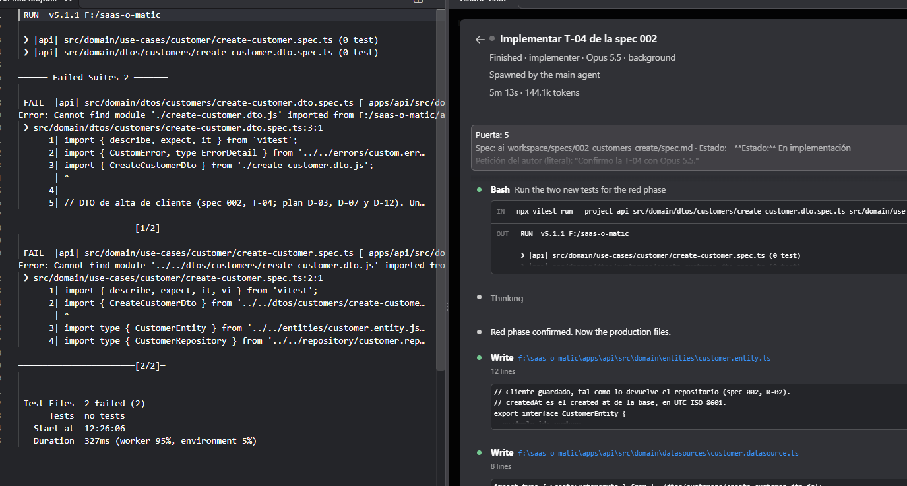
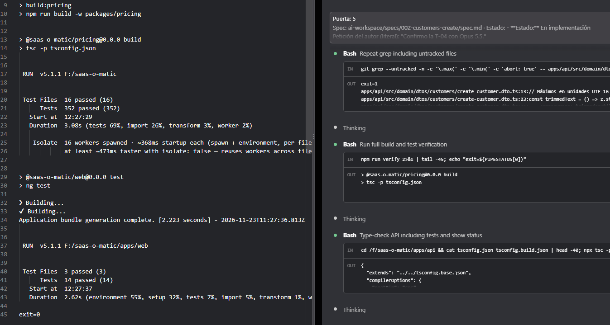

# 002-customers-create — Fase 7 (2026-11-23, sesión 06)

## Objetivo y fase
Fase 7, spec `002-customers-create`. Puerta 5 (implementación), lanzada con `/sdd-implement 002-customers-create`.
- **Estado de partida:** `- **Estado:** En implementación`, con T-01 a T-03 hechas y T-04 a T-06 pendientes.
- **Alcance de la sesión:** la T-04 (domain: DTO de alta, entidad, puertos y caso de uso), hasta su aprobación y el commit propuesto.
- **Registro:** se abrió durante la sesión para copiar la fase roja literal en el momento, como pide la regla de `tasks.md`. Lo completó la sesión principal al aprobarse la tarea, y `/sdd-session` lo cierra aquí.

## Prompts clave
Invocación inicial:
> /sdd-implement 002-customers-create

Confirmación de la tarea y del modelo:
> Confirmo la T-04 con Opus 5.5.

Decisión sobre las desviaciones y la nota, y aprobación de la T-04:
> Desviaciones 1, 2 y 3: aceptadas; no cambian el comportamiento y son la forma de escribirlo en Zod 4.6.7 (la 3 es la que pide D-07).
> Nota 4: sí, anótala en la T-04 junto a mi aprobación, sin cambiar el texto de la casilla.
> Apruebo la T-04. Márcala en [x] con sus casillas y mi aprobación literal, completa el registro 06 y actualiza MEMORY.md (máximo 50 líneas). Antes del commit lanzo /sdd-session 7 002-customers-create. Después enséñame el diff y propón el commit, sin Co-Authored-By. NO hagas el commit: espera mi aprobación.

Invocación del registro y número:
> /sdd-session 7 002-customers-create


## Qué propuso la IA
- **La tarea:** la T-04, la siguiente del orden de construcción (depende de T-02 y T-03, hechas). Implementer con Opus 5.5, propuesto antes de lanzarlo (ADR-016, punto 6), y el autor lo confirmó. Así no se repitió la corrección de la T-03. Encargo sin enseñar antes (ADR-016, punto 4).
- **Antes de lanzarlo:** la sesión principal ejecutó `npm run verify`: exit 0, 235 + 14. La salida literal fue en el encargo.
- **Retorno del implementer:** tarea terminada, sin bloqueos ni choques entre fuentes. Los 117 tests nuevos pasan y `npm run verify` da 352 + 14.
  - Tres desviaciones sin cambio de comportamiento, que el autor aceptó:
    1. `country` y `plan` pasan el texto recortado por `.pipe(z.enum(…))`.
    2. El email usa `.check(z.email())`, porque `.email()` está obsoleto en Zod 4.6.7.
    3. `INVALID_TAX_ID` es un `refine` del objeto con `when`, la forma que pide D-07. El implementer comprobó en `node_modules` cuándo corre.
  - Una nota: la casilla del `git grep` necesita `--untracked`, porque el fichero aún no está en git. El autor pidió anotarla en la T-04 sin cambiar la casilla.
- **Comprobaciones de la sesión principal:**
  - `git status` y `git diff --stat`: en `apps/` solo los cinco ficheros de producción y sus dos tests. Fuera de `apps/`, solo la línea `Estado` de la T-04 en `tasks.md`, más este registro, que abrió la sesión principal.
  - Lectura de los cinco ficheros de producción:
    - El DTO solo importa `zod`, `custom.error`, `zod-issues` y `tax-id`.
    - La entidad, los dos puertos y el caso de uso solo importan tipos de `domain`.
  - Repetición del `git grep --untracked` de D-12 y D-07: sin resultados (exit=1).
  - `npm run verify`, relanzado por la sesión principal: exit 0, 352 + 14 (salida abajo).
- **Tras la aprobación:**
  - La T-04 queda en `[x]` en `tasks.md`, con sus 23 casillas y la decisión del autor sobre las desviaciones y la nota 4, literales.
  - `MEMORY.md` sigue en 50 líneas:
    - La línea 9 resume la T-04, y la siguiente tarea pasa a ser la T-05.
    - En «Aprendizajes» se añade que una casilla con `git grep` sobre un fichero nuevo necesita `--untracked`.
  - Se propone el commit, sin `Co-Authored-By`.
- **Número de este registro:** `/sdd-session` pide pasar al número siguiente si el fichero ya existe. La sesión principal lo señaló como choque y propuso completar el `06`, como en las sesiones 04 y 05.

### T-04 · fase roja (retorno literal del implementer)
Los dos tests se escribieron antes que el código. Comando, desde la raíz: `npx vitest run --project api src/domain/dtos/customers/create-customer.dto.spec.ts src/domain/use-cases/customer/create-customer.spec.ts`. Salida literal:
```
 RUN  v5.1.1 F:/saas-o-matic

 ❯ |api| src/domain/use-cases/customer/create-customer.spec.ts (0 test)
 ❯ |api| src/domain/dtos/customers/create-customer.dto.spec.ts (0 test)

⎯⎯⎯⎯⎯⎯ Failed Suites 2 ⎯⎯⎯⎯⎯⎯⎯

 FAIL  |api| src/domain/dtos/customers/create-customer.dto.spec.ts [ apps/api/src/domain/dtos/customers/create-customer.dto.spec.ts ]
Error: Cannot find module './create-customer.dto.js' imported from F:/saas-o-matic/apps/api/src/domain/dtos/customers/create-customer.dto.spec.ts
 ❯ src/domain/dtos/customers/create-customer.dto.spec.ts:3:1
      1| import { describe, expect, it } from 'vitest';
      2| import { CustomError, type ErrorDetail } from '../../errors/custom.err…
      3| import { CreateCustomerDto } from './create-customer.dto.js';
       | ^
      4|
      5| // DTO de alta de cliente (spec 002, T-04; plan D-03, D-07 y D-12). Un…

⎯⎯⎯⎯⎯⎯⎯⎯⎯⎯⎯⎯⎯⎯⎯⎯⎯⎯⎯⎯⎯⎯⎯⎯[1/2]⎯

 FAIL  |api| src/domain/use-cases/customer/create-customer.spec.ts [ apps/api/src/domain/use-cases/customer/create-customer.spec.ts ]
Error: Cannot find module '../../dtos/customers/create-customer.dto.js' imported from F:/saas-o-matic/apps/api/src/domain/use-cases/customer/create-customer.spec.ts
 ❯ src/domain/use-cases/customer/create-customer.spec.ts:2:1
      1| import { describe, expect, it, vi } from 'vitest';
      2| import { CreateCustomerDto } from '../../dtos/customers/create-custome…
       | ^
      3| import type { CustomerEntity } from '../../entities/customer.entity.js…
      4| import type { CustomerRepository } from '../../repository/customer.repository.js…

⎯⎯⎯⎯⎯⎯⎯⎯⎯⎯⎯⎯⎯⎯⎯⎯⎯⎯⎯⎯⎯⎯⎯⎯[2/2]⎯


 Test Files  2 failed (2)
      Tests  no tests
   Start at  12:26:06
   Duration  327ms (worker 95%, environment 5%)
```
Con el mismo comando, tras implementar: `Test Files  2 passed (2)` y `Tests  117 passed (117)`.

### T-04 · `git grep` de D-12 y D-07 (retorno literal del implementer)
```
$ git grep --untracked -n -e '\.max(' -e '\.min(' -e 'abort: true' -- apps/api/src/domain/dtos/customers/create-customer.dto.ts
exit=1
```

### T-04 · `npm run verify` de la sesión principal tras el retorno (exit 0; parte de tests, literal)
```


> test
> npm run build:pricing && vitest run && npm run test --workspaces --if-present


> build:pricing
> npm run build -w packages/pricing


> @saas-o-matic/pricing@0.0.0 build
> tsc -p tsconfig.json


 RUN  v5.1.1 F:/saas-o-matic


 Test Files  16 passed (16)
      Tests  352 passed (352)
   Start at  12:28:53
   Duration  2.82s (tests 69%, import 25%, transform 3%, worker 2%)

    Isolate  16 workers spawned · ~371ms startup each (spawn + environment, per file)
             at least ~477ms faster with isolate: false — reuses workers across files instead of one per file


> @saas-o-matic/web@0.0.0 test
> ng test

❯ Building...
✔ Building...
Application bundle generation complete. [1.913 seconds] - 2026-11-23T11:29:00.374Z


 RUN  v5.1.1 F:/saas-o-matic/apps/web


 Test Files  3 passed (3)
      Tests  14 passed (14)
   Start at  12:29:00
   Duration  2.37s (environment 52%, setup 33%, import 6%, tests 6%, transform 1%, worker 1%)
```
El build previo (pricing, API y web) sale sin errores.

## Qué corregí y por qué
(no registrado): el autor no corrigió nada en esta sesión. Aceptó las tres desviaciones y la nota 4 tal como las propuso el implementer.

## Decisiones tomadas
- La T-04 se hace con el implementer en Opus 5.5 (ADR-016, punto 6), propuesto por la sesión principal y confirmado por el autor.
- Desviaciones 1, 2 y 3 del implementer, aceptadas: `.pipe(z.enum(…))` en `country` y `plan`, `.check(z.email())` en el email e `INVALID_TAX_ID` como `refine` del objeto con `when` (D-07).
- Nota 4 del implementer: se anota en la T-04 que la casilla del `git grep` necesita `--untracked`, sin cambiar el texto de la casilla.
- T-04 aprobada por el autor el 2026-11-23 («Apruebo la T-04.»).
- El registro de la sesión se completa en el `06`, por decisión del autor («Guárdalo en la 06»).
- Commit: el de cierre de esta sesión.

## Capturas



No hubo capturas anunciadas con `CAPTURA:` en esta sesión.

## Pendiente para la siguiente sesión
- La T-05 (infrastructure: conexión opaca, datasource y repositorio de clientes), que depende de la T-01 y la T-04, ya hechas. En ella, `SELECT sqlite_version()` debe dar 3.35 o superior (`INSERT … RETURNING`).
- Elegir el modelo del implementer de la T-05 con el punto 6 del ADR-016 antes de lanzarlo.
- Puerta 6: el revisor hace la parte manual de C-30 y C-48, y revisa lo que aún no ha visto: H-08, H-09, la #34 y la corrección de D-04.
