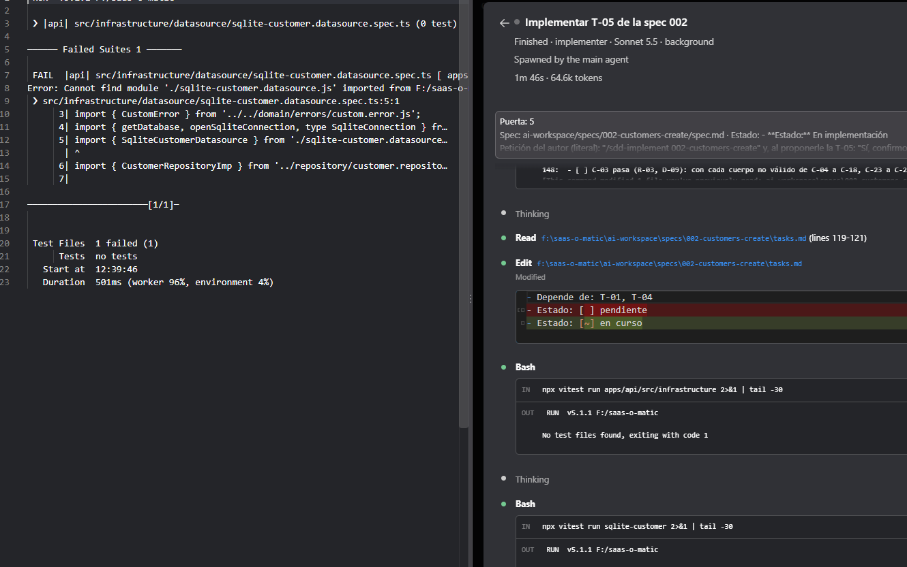
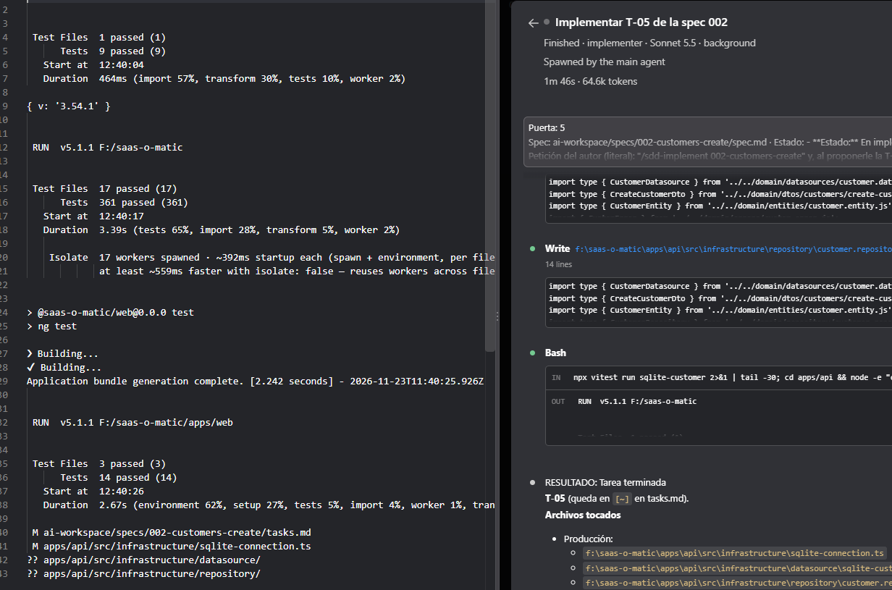

# 002-customers-create — Fase 7 (2026-11-23, sesión 07)

## Objetivo y fase
Fase 7, spec `002-customers-create`. Puerta 5 (implementación), lanzada con `/sdd-implement 002-customers-create`.
- **Estado de partida:** `- **Estado:** En implementación`, con T-01 a T-04 hechas y T-05 y T-06 pendientes.
- **Alcance de la sesión:** la T-05 (infrastructure: conexión opaca, datasource y repositorio de clientes), hasta su aprobación y el commit propuesto.
- **Registro:** se abrió durante la sesión para copiar la fase roja literal en el momento, como pide la regla de `tasks.md`. Lo completó la sesión principal al aprobarse la tarea, y `/sdd-session` lo cierra aquí.

## Prompts clave
Invocación inicial:
> /sdd-implement 002-customers-create

Confirmación de la tarea y del modelo:
> Sí, confirmo la T-05 con Sonnet 5.5.

Decisión sobre las tres decisiones de detalle del implementer y aprobación de la T-05:
> Las tres decisiones de detalle, aceptadas, con un cambio en la 1: que el mensaje vaya en inglés, «Unknown SQLite connection», como los demás errores internos del código (los de envs.ts y run-migrations.ts de la 000 están en inglés). Hazlo tú, es solo el texto del mensaje, relanza npm run verify y anótalo con mi aprobación.
> Apruebo la T-05. Márcala en [x] con sus casillas y mi aprobación literal, completa el registro 07 y actualiza MEMORY.md (máximo 50 líneas). Antes del commit lanzo /sdd-session 7 002-customers-create. Después enséñame el diff y propón el commit, sin Co-Authored-By. NO hagas el commit: espera mi aprobación.

Invocación del registro y número:
> /sdd-session 7 002-customers-create

## Qué propuso la IA
- **La tarea:** la T-05, la siguiente del orden de construcción. Depende de la T-01 y la T-04, ya hechas.
  - Implementer con Sonnet 5.5 (ADR-016, punto 6), propuesto antes de lanzarlo porque la tarea es de una sola capa, con SQL directo, un único código de error y sin algoritmos. El autor lo confirmó.
  - Encargo sin enseñar antes (ADR-016, punto 4).
- **Antes de lanzarlo:** la sesión principal ejecutó `npm run verify`: 352 + 14, en verde. La salida literal fue en el encargo.
- **Retorno del implementer:** tarea terminada, sin desviaciones, bloqueos ni choques entre fuentes. Los 9 tests nuevos pasan y `npm run verify` da 361 + 14. Hubo tres decisiones de detalle que la tarea no pedía:
  1. `getDatabase` lanza un `Error` si la conexión no está en el `WeakMap`, con el texto «Conexión desconocida».
  2. `CustomerRepositoryImp` se prueba en el mismo fichero de test, en un `describe` aparte, con un datasource falso.
  3. El error de SQLite que no es de `UNIQUE` se provoca cerrando la base antes del `create`.
- **Comprobaciones de la sesión principal:**
  - `git status` y `git diff --stat`: en `apps/` solo los tres ficheros de producción y el test del datasource. Fuera de `apps/`, solo la línea `Estado` de la T-05 en `tasks.md`, más este registro, que abrió la sesión principal.
  - Lectura de los tres ficheros de producción:
    - `SqliteConnection` solo expone `close()` y la base vive en un `WeakMap` del módulo (D-06).
    - El `INSERT … RETURNING` usa cinco `?`.
    - `SQLITE_CONSTRAINT_UNIQUE` pasa a `CustomError('CONFLICT', M-13)` sin `details`, y lo demás se relanza.
    - El repositorio solo delega.
  - `npm run verify`, relanzado por la sesión principal: exit 0, 361 + 14.
- **Tras la aprobación:**
  - Antes de cambiar el mensaje, la sesión principal comprobó con Grep que los errores internos de `envs.ts` y `run-migrations.ts` están en inglés y que ningún test compara el texto de `getDatabase`.
  - Cambió el texto a `'Unknown SQLite connection'` y relanzó `npm run verify`: exit 0, 361 + 14 (salida abajo).
  - La T-05 queda en `[x]` en `tasks.md`, con sus 10 casillas y la decisión y la aprobación del autor, literales.
  - `MEMORY.md` sigue en 50 líneas: la línea 9 resume la T-05, y la siguiente tarea pasa a ser la T-06.
  - Las dos capturas de la T-05, que no hizo la sesión principal, se enlazan en «Capturas».
  - Se propone el commit, sin `Co-Authored-By`.
- **Número de este registro:** `/sdd-session` pide pasar al número siguiente si el fichero ya existe. La sesión principal lo señaló como choque y propuso completar el `07`, como en las sesiones 04 a 06. El autor eligió el `07` («Sí, guárdalo en la 07.»).

### T-05 · fase roja (retorno literal del implementer)
Comando: `npx vitest run sqlite-customer`, antes de escribir producción. Salida:
```
 FAIL  |api| src/infrastructure/datasource/sqlite-customer.datasource.spec.ts
Error: Cannot find module './sqlite-customer.datasource.js' imported from F:/saas-o-matic/apps/api/src/infrastructure/datasource/sqlite-customer.datasource.spec.ts
 Test Files  1 failed (1)
      Tests  no tests
```
Con el mismo comando, tras implementar: `Test Files 1 passed (1)` y `Tests 9 passed (9)`.

### T-05 · versión de SQLite (retorno literal del implementer)
`INSERT … RETURNING` pide 3.35 o superior:
```
cd apps/api && node -e "const D=require('better-sqlite3');console.log(new D(':memory:').prepare('SELECT sqlite_version() AS v').get())"
{ v: '3.54.1' }
```

### T-05 · `npm run verify` de la sesión principal tras cambiar el mensaje (exit 0; parte de tests, literal)
```
> test
> npm run build:pricing && vitest run && npm run test --workspaces --if-present


> build:pricing
> npm run build -w packages/pricing


> @saas-o-matic/pricing@0.0.0 build
> tsc -p tsconfig.json


 RUN  v5.1.1 F:/saas-o-matic


 Test Files  17 passed (17)
      Tests  361 passed (361)
   Start at  12:44:11
   Duration  4.09s (tests 68%, import 27%, worker 3%, transform 3%)

    Isolate  17 workers spawned · ~565ms startup each (spawn + environment, per file)
             at least ~808ms faster with isolate: false — reuses workers across files instead of one per file


> @saas-o-matic/web@0.0.0 test
> ng test

❯ Building...
✔ Building...
Application bundle generation complete. [2.232 seconds] - 2026-11-23T11:44:20.315Z


 RUN  v5.1.1 F:/saas-o-matic/apps/web


 Test Files  3 passed (3)
      Tests  14 passed (14)
   Start at  12:44:20
   Duration  2.43s (environment 61%, setup 27%, tests 6%, import 4%, transform 1%, worker 1%)
```
El build previo (pricing, API y web) sale sin errores.

## Qué corregí y por qué
- El texto del `Error` de `getDatabase` pasa de «Conexión desconocida» a «Unknown SQLite connection». El autor quiere que vaya en inglés, como los demás errores internos del código (`envs.ts` y `run-migrations.ts`, de la spec 000). Lo cambió la sesión principal, por indicación del autor.

## Decisiones tomadas
- La T-05 se hace con el implementer en Sonnet 5.5 (ADR-016, punto 6), propuesto por la sesión principal y confirmado por el autor.
- Las tres decisiones de detalle del implementer, aceptadas; la 1, con el mensaje en inglés.
- T-05 aprobada por el autor el 2026-11-23 («Apruebo la T-05.»).
- El registro de la sesión se completa en el `07`, por decisión del autor («Sí, guárdalo en la 07.»).
- Commit: el de cierre de esta sesión.

## Capturas



No hubo capturas anunciadas con `CAPTURA:` en esta sesión.

## Pendiente para la siguiente sesión
- La T-06 (presentation: `POST /customers` y middleware de errores), que depende de la T-02, la T-04 y la T-05, ya hechas.
- Elegir el modelo del implementer de la T-06 con el punto 6 del ADR-016 antes de lanzarlo.
- Puerta 6: el revisor hace la parte manual de C-30 y C-48, y revisa lo que aún no ha visto: H-08, H-09, la #34 y la corrección de D-04.
