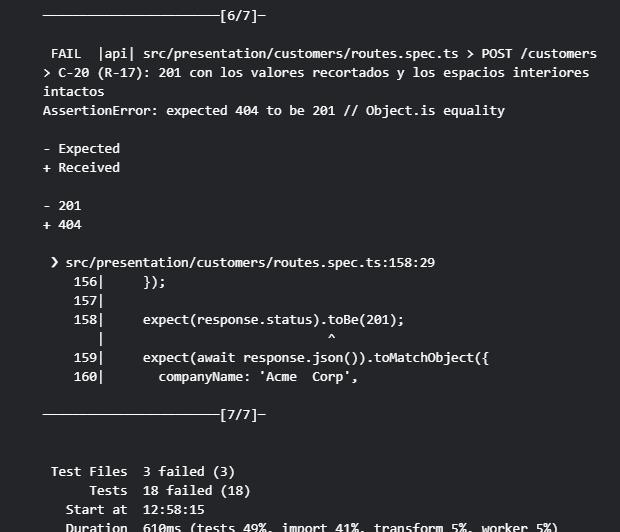
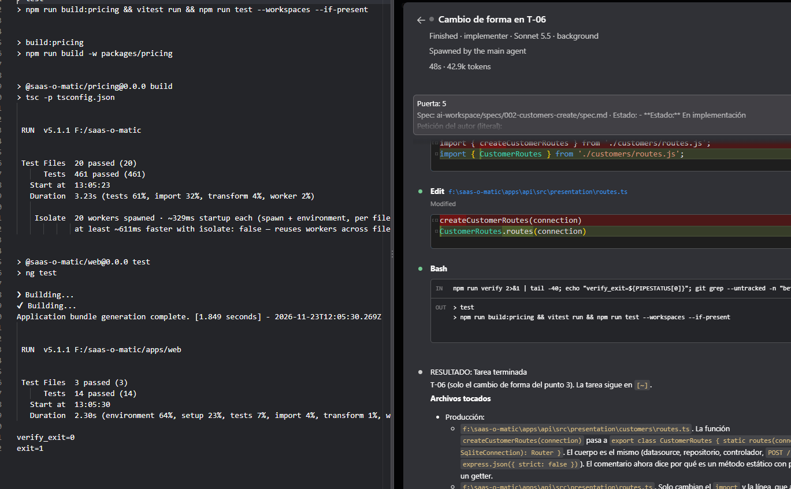

# 002-customers-create — Fase 7 (2026-11-23, sesión 08)

## Objetivo y fase
Fase 7, spec `002-customers-create`. Puerta 5 (implementación), lanzada con `/sdd-implement 002-customers-create`.
- **Estado de partida:** `- **Estado:** En implementación`, con T-01 a T-05 hechas y la T-06 pendiente.
- **Alcance de la sesión:** la T-06 (presentation: `POST /customers` y middleware de errores), hasta su aprobación y el commit propuesto.
- **Registro:** lo abrió la sesión principal al obtener la fase roja (regla de `tasks.md`) y `/sdd-session` lo completa al cerrar la tarea, sin crear otro (decisión del autor, abajo).

## Prompts clave
Invocación inicial:
> /sdd-implement 002-customers-create

Confirmación de la tarea y del modelo, y decisión sobre el registro:
> Sí, confirmo la T-06 con Opus 5.5: une todas las capas y lleva el parser y los códigos HTTP, así que no es una tarea sencilla (ADR-016, punto 6).
> Además, anota como decisión mía en el registro de esta tarea y en MEMORY.md: la sesión principal abre el registro al obtener la fase roja (regla de tasks.md) y /sdd-session lo completa al cerrar la tarea, sin crear otro. Al cerrar la spec ajustaremos el comando /sdd-session para que lo diga.

Decisión sobre las desviaciones y las decisiones de detalle del implementer, y aprobación de la T-06:
> 1. Desviación 1: (a). Una base :memory: nueva por caso aísla igual y no abre una excepción a D-06.
> 2. Desviación 2: aceptada; C-16 no llega al controlador y C-18 no tiene cuerpo propio, y los dos se prueban por HTTP.
> 3. Decisión de detalle 2: no la acepto tal cual. Quiero la forma de la convención (patterns.md): una clase CustomerRoutes con un método estático routes(connection: SqliteConnection): Router (no puede ser un getter porque recibe la conexión de D-06), y en presentation/routes.ts, router.use('/customers', CustomerRoutes.routes(connection)). createRoutes de la 000 no se toca. Relanza al implementer con Sonnet solo para este cambio y vuelve a pasar npm run verify y el git grep de D-06.
> 4. Decisiones de detalle 1, 3, 4, 5 y 6: aceptadas.
> Con ese cambio hecho, apruebo la T-06. Márcala en [x] con sus casillas y mi aprobación literal, completa el registro 08 y actualiza MEMORY.md (máximo 50 líneas). Antes del commit lanzo /sdd-session 7 002-customers-create. Después enséñame el diff y propón el commit, sin Co-Authored-By. NO hagas el commit: espera mi aprobación.

Invocación del registro:
> /sdd-session 7 002-customers-create

Confirmación del registro:
> si, guardala, ademas he añadido la image

## Qué propuso la IA
- **La tarea:** la T-06, la única pendiente. Depende de la T-02, la T-04 y la T-05, ya hechas.
  - Implementer con Opus 5.5 (ADR-016, punto 6), porque une todas las capas, trae el parser con las variantes de C-15 y los códigos HTTP. El autor lo confirmó.
  - Encargo sin enseñar antes (ADR-016, punto 4).
- **Antes de lanzarlo:** `npm run verify`: 361 + 14, en verde.
- **Retorno del implementer:** tarea terminada, con 100 tests nuevos y `npm run verify` con 461 + 14. C-15 (2) confirma con `req.headers` que no llega `content-type`, así que no hizo falta parar (riesgo 3). Trajo dos desviaciones y seis decisiones de detalle:
  - Desviación 1: `customers/routes.spec.ts` no vacía `customers`. Cada caso abre su `createRoutes(':memory:')`, porque vaciarla exige `getDatabase` y el `git grep` de D-06 lo prohíbe en `presentation/`. Opciones: (a) aceptarlo, recomendada; (b) una excepción del `git grep` para los specs.
  - Desviación 2: C-03 en el controlador no cubre C-16 ni C-18, que no tienen un cuerpo que llegue al controlador.
  - Decisión de detalle 2: la composición como función `createCustomerRoutes(connection)`, no como la clase de `patterns.md`. La sesión principal la señaló como alejada de la convención.
- **Comprobaciones de la sesión principal:**
  - `git status` y `git diff --stat`: en `apps/` solo los 4 ficheros de producción y los 3 tests; fuera, solo la línea `Estado` de la T-06 y el cambio de `MEMORY.md` hecho por la sesión principal.
  - Lectura de los tres ficheros nuevos de producción: M-12 y M-14 coinciden con D-03, `STATUS_BY_CODE` tiene las cuatro filas de D-11 y `express.json({ strict: false })` solo está en `POST /`.
  - `npm run verify` relanzado (461 + 14) y `git grep` de D-06 sin resultados.
- **Tras la decisión del autor:** segundo encargo al implementer con Sonnet 5.5, solo para el cambio de forma. Cambiaron solo `customers/routes.ts` (clase `CustomerRoutes` con `static routes(connection)`) y dos líneas de `presentation/routes.ts`. Ningún test usaba el nombre anterior. La sesión principal comprobó `git status` y `git diff --stat`, y relanzó `npm run verify` (abajo) y el `git grep` de D-06 (sin resultados, exit 1).
- **Cierre de la tarea:** la T-06 queda en `[x]` en `tasks.md`, con sus 17 casillas y la decisión y la aprobación del autor, literales. `MEMORY.md` sigue en 50 líneas: la línea de la fase 7 resume la T-06 y la siguiente es la puerta 6. Se propone el commit, sin `Co-Authored-By`.
- **Número de este registro:** `/sdd-session` pide pasar al número siguiente si el fichero ya existe. Por la decisión del autor de esta sesión, la sesión principal propuso completar el `08`, y el autor lo confirmó.
- **Capturas:** ninguna línea `CAPTURA:` en la sesión. El autor añadió la de la fase roja de la T-06 al confirmar el registro.

### T-06 · fase roja (salida literal del implementer)
Comando: `npx vitest run --project api src/presentation/middlewares src/presentation/customers` (exit 1), antes de escribir producción. Salida completa:
```
 RUN  v5.1.1 F:/saas-o-matic

 ❯ |api| src/presentation/customers/controller.spec.ts (0 test)
 ❯ |api| src/presentation/middlewares/error-handler.spec.ts (0 test)
 ❯ |api| src/presentation/customers/routes.spec.ts (18 tests | 18 failed) 198ms
   ❯ POST /customers (18)
     × C-01 (R-01, R-02): 201 con el cliente en la raíz, en camelCase 62ms
     × C-02 (R-01): PT con 123456789 da 201 17ms
     × C-42 (R-31): 123456789 en PT y en FR, y 12345678Z en ES y en PT, dan 201 en todas 9ms
     × C-43 (R-32): dos altas con el mismo email y otra que solo difiere en mayúsculas dan 201 11ms
     × C-20 (R-17): 201 con los valores recortados y los espacios interiores intactos 13ms
     × C-04 y C-18 (R-04, R-15): sin companyName, 400 con un REQUIRED en companyName 6ms
     × C-05 y C-18 (R-04, R-14, R-15): {} da 400 con cinco REQUIRED, uno por campo 7ms
     × C-17 y C-18 (R-14, R-15): email no válido y sin companyName, 400 con dos elementos 7ms
     ❯ C-15 (R-12, R-04; D-05) (7)
       × (1) con Content-Type: application/json, [] da 400 con un único INVALID_TYPE sin field 7ms
       × (1) con Content-Type: application/json, null da 400 con un único INVALID_TYPE sin field 7ms
       × (1) con Content-Type: application/json, "texto" da 400 con un único INVALID_TYPE sin field 5ms
       × (1) con Content-Type: application/json, 42 da 400 con un único INVALID_TYPE sin field 5ms
       × (2) sin Content-Type y sin cuerpo: 400 con un único INVALID_TYPE sin field 6ms
       × (2) sin Content-Type y con el objeto válido como Uint8Array: 400 con un único INVALID_TYPE sin field 6ms
       × (3) con Content-Type: application/json y el cuerpo vacío: los cinco REQUIRED de C-05 5ms
     × C-16 (R-13): JSON roto con Content-Type: application/json da 400 INVALID_JSON con M-12, sin details 5ms
     × C-28 (R-22): la primera alta en ES con 12345678Z da 201 y la segunda, 409 CONFLICT con M-13 sin details 8ms
     × C-28 (R-22): la segunda alta con 12.345.678-z también da 409 CONFLICT con M-13 sin details 8ms

⎯⎯⎯⎯⎯⎯ Failed Suites 2 ⎯⎯⎯⎯⎯⎯⎯

 FAIL  |api| src/presentation/customers/controller.spec.ts [ apps/api/src/presentation/customers/controller.spec.ts ]
Error: Cannot find module './controller.js' imported from F:/saas-o-matic/apps/api/src/presentation/customers/controller.spec.ts
 ❯ src/presentation/customers/controller.spec.ts:7:1
      5| import { CustomError } from '../../domain/errors/custom.error.js';
      6| import type { CustomerRepository } from '../../domain/repository/custo…
      7| import { CustomerController } from './controller.js';
       | ^
      8|
      9| // Textos literales de D-03 (plan): M-11, M-13 y M-14.

⎯⎯⎯⎯⎯⎯⎯⎯⎯⎯⎯⎯⎯⎯⎯⎯⎯⎯⎯⎯⎯⎯⎯⎯[1/7]⎯

 FAIL  |api| src/presentation/middlewares/error-handler.spec.ts [ apps/api/src/presentation/middlewares/error-handler.spec.ts ]
Error: Cannot find module './error-handler.js' imported from F:/saas-o-matic/apps/api/src/presentation/middlewares/error-handler.spec.ts
 ❯ src/presentation/middlewares/error-handler.spec.ts:4:1
      2| import { describe, expect, it, vi } from 'vitest';
      3| import { CustomError } from '../../domain/errors/custom.error.js';
      4| import { errorHandler, STATUS_BY_CODE, toHttpError } from './error-han…
       | ^
      5|
      6| // Textos literales de D-03 (plan): M-11, M-12, M-13 y M-14.

⎯⎯⎯⎯⎯⎯⎯⎯⎯⎯⎯⎯⎯⎯⎯⎯⎯⎯⎯⎯⎯⎯⎯⎯[2/7]⎯


⎯⎯⎯⎯⎯⎯ Failed Tests 18 ⎯⎯⎯⎯⎯⎯⎯

 FAIL  |api| src/presentation/customers/routes.spec.ts > POST /customers > C-01 (R-01, R-02): 201 con el cliente en la raíz, en camelCase
 FAIL  |api| src/presentation/customers/routes.spec.ts > POST /customers > C-04 y C-18 (R-04, R-15): sin companyName, 400 con un REQUIRED en companyName
 FAIL  |api| src/presentation/customers/routes.spec.ts > POST /customers > C-05 y C-18 (R-04, R-14, R-15): {} da 400 con cinco REQUIRED, uno por campo
 FAIL  |api| src/presentation/customers/routes.spec.ts > POST /customers > C-17 y C-18 (R-14, R-15): email no válido y sin companyName, 400 con dos elementos
 FAIL  |api| src/presentation/customers/routes.spec.ts > POST /customers > C-15 (R-12, R-04; D-05) > (1) con Content-Type: application/json, [] da 400 con un único INVALID_TYPE sin field
 FAIL  |api| src/presentation/customers/routes.spec.ts > POST /customers > C-15 (R-12, R-04; D-05) > (1) con Content-Type: application/json, null da 400 con un único INVALID_TYPE sin field
 FAIL  |api| src/presentation/customers/routes.spec.ts > POST /customers > C-15 (R-12, R-04; D-05) > (1) con Content-Type: application/json, "texto" da 400 con un único INVALID_TYPE sin field
 FAIL  |api| src/presentation/customers/routes.spec.ts > POST /customers > C-15 (R-12, R-04; D-05) > (1) con Content-Type: application/json, 42 da 400 con un único INVALID_TYPE sin field
 FAIL  |api| src/presentation/customers/routes.spec.ts > POST /customers > C-15 (R-12, R-04; D-05) > (2) sin Content-Type y sin cuerpo: 400 con un único INVALID_TYPE sin field
 FAIL  |api| src/presentation/customers/routes.spec.ts > POST /customers > C-15 (R-12, R-04; D-05) > (2) sin Content-Type y con el objeto válido como Uint8Array: 400 con un único INVALID_TYPE sin field
 FAIL  |api| src/presentation/customers/routes.spec.ts > POST /customers > C-15 (R-12, R-04; D-05) > (3) con Content-Type: application/json y el cuerpo vacío: los cinco REQUIRED de C-05
 FAIL  |api| src/presentation/customers/routes.spec.ts > POST /customers > C-16 (R-13): JSON roto con Content-Type: application/json da 400 INVALID_JSON con M-12, sin details
 FAIL  |api| src/presentation/customers/routes.spec.ts > POST /customers > C-28 (R-22): la primera alta en ES con 12345678Z da 201 y la segunda, 409 CONFLICT con M-13 sin details
 FAIL  |api| src/presentation/customers/routes.spec.ts > POST /customers > C-28 (R-22): la segunda alta con 12.345.678-z también da 409 CONFLICT con M-13 sin details
SyntaxError: Unexpected token '<', "<!DOCTYPE "... is not valid JSON
⎯⎯⎯⎯⎯⎯⎯⎯⎯⎯⎯⎯⎯⎯⎯⎯⎯⎯⎯⎯⎯⎯⎯⎯[3/7]⎯

 FAIL  |api| src/presentation/customers/routes.spec.ts > POST /customers > C-02 (R-01): PT con 123456789 da 201
AssertionError: expected 404 to be 201 // Object.is equality

- Expected
+ Received

- 201
+ 404

 ❯ src/presentation/customers/routes.spec.ts:116:29
    114|     const response = await postJson(baseUrl, { ...validBody, country: …
    115|
    116|     expect(response.status).toBe(201);
       |                             ^
    117|     expect(await response.json()).toMatchObject({ country: 'PT', taxId…
    118|   });

⎯⎯⎯⎯⎯⎯⎯⎯⎯⎯⎯⎯⎯⎯⎯⎯⎯⎯⎯⎯⎯⎯⎯⎯[4/7]⎯

 FAIL  |api| src/presentation/customers/routes.spec.ts > POST /customers > C-42 (R-31): 123456789 en PT y en FR, y 12345678Z en ES y en PT, dan 201 en todas
AssertionError: expected 404 to be 201 // Object.is equality

- Expected
+ Received

- 201
+ 404

 ❯ src/presentation/customers/routes.spec.ts:130:54
    128|
    129|     for (const body of bodies) {
    130|       expect((await postJson(baseUrl, body)).status).toBe(201);
       |                                                      ^
    131|     }
    132|   });

⎯⎯⎯⎯⎯⎯⎯⎯⎯⎯⎯⎯⎯⎯⎯⎯⎯⎯⎯⎯⎯⎯⎯⎯[5/7]⎯

 FAIL  |api| src/presentation/customers/routes.spec.ts > POST /customers > C-43 (R-32): dos altas con el mismo email y otra que solo difiere en mayúsculas dan 201
AssertionError: expected 404 to be 201 // Object.is equality

- Expected
+ Received

- 201
+ 404

 ❯ src/presentation/customers/routes.spec.ts:143:54
    141|
    142|     for (const body of bodies) {
    143|       expect((await postJson(baseUrl, body)).status).toBe(201);
       |                                                      ^
    144|     }
    145|   });

⎯⎯⎯⎯⎯⎯⎯⎯⎯⎯⎯⎯⎯⎯⎯⎯⎯⎯⎯⎯⎯⎯⎯⎯[6/7]⎯

 FAIL  |api| src/presentation/customers/routes.spec.ts > POST /customers > C-20 (R-17): 201 con los valores recortados y los espacios interiores intactos
AssertionError: expected 404 to be 201 // Object.is equality

- Expected
+ Received

- 201
+ 404

 ❯ src/presentation/customers/routes.spec.ts:158:29
    156|     });
    157|
    158|     expect(response.status).toBe(201);
       |                             ^
    159|     expect(await response.json()).toMatchObject({
    160|       companyName: 'Acme  Corp',

⎯⎯⎯⎯⎯⎯⎯⎯⎯⎯⎯⎯⎯⎯⎯⎯⎯⎯⎯⎯⎯⎯⎯⎯[7/7]⎯


 Test Files  3 failed (3)
      Tests  18 failed (18)
   Start at  12:58:15
   Duration  610ms (tests 49%, import 41%, transform 5%, worker 5%)
```
Los 18 tests de `routes.spec.ts` fallan porque `POST /customers` aún no está montado: da el 404 HTML de Express. Los otros dos specs fallan porque `controller.js` y `error-handler.js` no existen.

### T-06 · `git grep` de D-06 (retorno literal del implementer)
```
$ git grep --untracked -n "better-sqlite3\|getDatabase" -- apps/api/src/presentation; echo "exit=$?"
exit=1
```
En la primera pasada salió un resultado: un comentario de `customers/routes.ts` que nombraba «better-sqlite3». El implementer lo reescribió antes de dar este resultado.

### T-06 · `npm run verify` de la sesión principal tras el cambio de forma (exit 0; parte de tests, literal)
```
> test
> npm run build:pricing && vitest run && npm run test --workspaces --if-present


> build:pricing
> npm run build -w packages/pricing


> @saas-o-matic/pricing@0.0.0 build
> tsc -p tsconfig.json


 RUN  v5.1.1 F:/saas-o-matic


 Test Files  20 passed (20)
      Tests  461 passed (461)
   Start at  13:06:39
   Duration  4.19s (tests 64%, import 31%, transform 3%, worker 2%)

    Isolate  20 workers spawned · ~477ms startup each (spawn + environment, per file)
             at least ~885ms faster with isolate: false — reuses workers across files instead of one per file


> @saas-o-matic/web@0.0.0 test
> ng test

❯ Building...
✔ Building...
Application bundle generation complete. [2.260 seconds] - 2026-11-23T12:06:47.782Z


 RUN  v5.1.1 F:/saas-o-matic/apps/web


 Test Files  3 passed (3)
      Tests  14 passed (14)
   Start at  13:06:48
   Duration  2.36s (environment 58%, setup 27%, import 6%, tests 6%, transform 1%, worker 1%)
```
El build previo (pricing, API y web) sale sin errores. El `git grep --untracked` de D-06, relanzado por la sesión principal, no da resultados (exit 1).

## Qué corregí y por qué
- La composición de `customers` pasa de la función `createCustomerRoutes(connection)` a la clase `CustomerRoutes` con el método estático `routes(connection: SqliteConnection): Router`, para seguir la forma de `patterns.md`. Es un método y no un getter porque recibe la conexión de D-06. `createRoutes` de la spec 000 no se toca.

## Decisiones tomadas
- La T-06 se hace con el implementer en Opus 5.5 (ADR-016, punto 6), propuesto por la sesión principal y confirmado por el autor. El cambio de forma, con Sonnet 5.5, por decisión del autor.
- Decisión del autor (2026-11-23): la sesión principal abre el registro al obtener la fase roja (regla de `tasks.md`) y `/sdd-session` lo completa al cerrar la tarea, sin crear otro. Al cerrar la spec 002 se ajusta `/sdd-session` para que lo diga. Anotada también en `MEMORY.md` (línea del ADR-004).
- Desviación 1, opción (a); desviación 2, aceptada; decisión de detalle 2, sustituida por `CustomerRoutes.routes(connection)`; decisiones de detalle 1, 3, 4, 5 y 6, aceptadas.
- T-06 aprobada por el autor el 2026-11-23 («Con ese cambio hecho, apruebo la T-06.»).
- Commit: el de cierre de esta sesión.

## Capturas



No hubo capturas anunciadas con `CAPTURA:` en esta sesión.

## Pendiente para la siguiente sesión
- Puerta 6 de la spec 002 (`/sdd-validate 002-customers-create`). Las seis tareas están en `[x]`; `Estado:` pasa a `En revisión` al empezar.
- En la puerta 6, el revisor hace la parte manual de C-30 y C-48 y revisa lo que aún no ha visto: H-08, H-09, la #34 y la corrección de D-04. Reserva H-05 pendiente.
- Al cerrar la spec 002, ajustar `/sdd-session` para que diga que completa el registro abierto con la fase roja, sin crear otro (decisión del autor de esta sesión).
