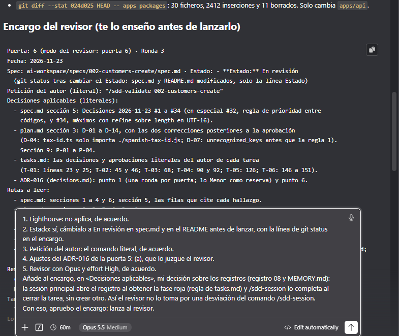
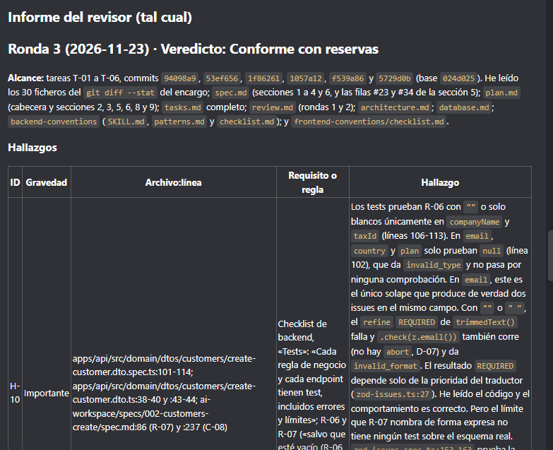
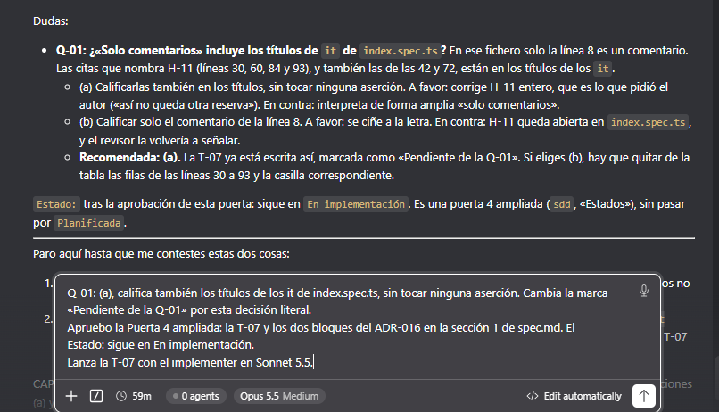

# 002-customers-create — Fase 7 (2026-11-23, sesión 09)

## Objetivo y fase
Fase 7, spec `002-customers-create`: puerta 6 (validación) con `/sdd-validate`, tras terminar la puerta 5 (T-01 a T-06 en `[x]`). La ronda 3 del revisor dio `Conforme con reservas`. Por decisión del autor, la spec volvió a `En implementación` para corregir H-10 y H-11 en una tarea nueva, la T-07: puerta 4 ampliada con el planner y puerta 5 con el implementer.

## Prompts clave
> /sdd-validate 002-customers-create

Respuesta al encargo del revisor:
> 1. Lighthouse: no aplica, de acuerdo.
> 2. Estado: sí, cámbialo a En revisión en spec.md y en el README antes de lanzar, con la línea de git status en el encargo.
> 3. Petición del autor: el comando literal, de acuerdo.
> 4. Ajustes del ADR-016 de la puerta 5: (a), que lo juzgue el revisor.
> 5. Revisor con Opus y effort High, de acuerdo.
> Añade al encargo, en «Decisiones aplicables», mi decisión sobre los registros (registro 08 y MEMORY.md): la sesión principal abre el registro al obtener la fase roja (regla de tasks.md) y /sdd-session lo completa al cerrar la tarea, sin crear otro. Así el revisor no lo toma por una desviación del comando /sdd-session.
> Con eso, apruebo el encargo: lanza al revisor.

Respuesta a la ronda 3:
> 1. Sí, guarda el informe como ronda 3 en review.md, con los signos < y > reales.
> 2. H-10: (a), corregirlo. Lanza al planner en una puerta 4 ampliada con una tarea T-07: tests del DTO con "" y solo blancos en email, country y plan, que dan REQUIRED y un solo elemento por campo, sin código de producción. C-08 y los requisitos no se tocan: R-06 ya cubre todos los campos.
> 3. H-11: corrígelo en la misma T-07: calificar por spec las citas de los comentarios de index.ts, index.spec.ts, sqlite-connection.ts y presentation/routes.ts («spec 000: …», «spec 002: …»), solo comentarios. Así no queda otra reserva.
> 4. H-12: sí, renombra la captura a fase-7-002-validar-encargo.png.
> 5. En la misma vuelta del planner, añade a la sección 1 de spec.md los ajustes del ADR-016 de la puerta 5 (puntos 4 y 6) y de esta puerta 6 (punto 1), para que no quede el hueco de la H-14 de la 001.
> La spec vuelve a En implementación; la T-07, con el implementer en Sonnet (solo tests y comentarios). Antes del commit de la T-07 lanzo /sdd-session 7 002-customers-create. Después, una ronda 4 del revisor limitada a la T-07: enséñame su encargo antes de lanzarlo.

Fase roja de la T-07 y captura del veredicto:
> 1. Fase roja de la T-07: (a), sin fase roja, con el motivo escrito en la tarea, como la T-02 y la T-04 de la 001. Que cada test nuevo compruebe el código exacto (REQUIRED) y un solo elemento en details[] para ese campo: así fallaría si ganara INVALID_FORMAT o si salieran dos.
> 2. Sí, renombra la captura a fase-7-002-validar-veredicto.png.
> Lanza al planner

Q-01 del planner y aprobación de la puerta 4 ampliada:
> Q-01: (a), califica también los títulos de los it de index.spec.ts, sin tocar ninguna aserción. Cambia la marca «Pendiente de la Q-01» por esta decisión literal.
> Apruebo la Puerta 4 ampliada: la T-07 y los dos bloques del ADR-016 en la sección 1 de spec.md. El Estado: sigue en En implementación.
> Lanza la T-07 con el implementer en Sonnet 5.5.

Aprobación de la T-07:
> Los tres detalles: corrígelos tú, son solo textos (títulos y comentarios, ninguna aserción): 1) un solo «spec 002:» en los títulos de C-34 y C-35; 2) «(spec 000: base de C-09)» en index.spec.ts:72; 3) quita «H-10» del comentario del DTO. Después relanza npm run verify.
> Apruebo la T-07. Márcala en [x] con sus casillas y mi aprobación literal y actualiza MEMORY.md (máximo 50 líneas). Antes del commit lanzo /sdd-session 7 002-customers-create. Después enséñame el diff y propón el commit, sin Co-Authored-By. NO hagas el commit: espera mi aprobación.
> Luego enséñame el encargo de la ronda 4 del revisor, limitada a la T-07.

> /sdd-session 7 002-customers-create

## Qué propuso la IA
- **Puerta según el `Estado:`:** `En implementación`, con T-01 a T-06 en `[x]`, así que puerta 6.
  - Antes del encargo: `npm run verify` en verde (20 ficheros y 461 tests en la raíz; 3 y 14 en la web, exit 0) y `git status` limpio.
  - `git diff --stat 024d025 HEAD -- apps packages`: 30 ficheros, 2412 inserciones y 11 borrados, solo en `apps/api`.
- **Encargo del revisor (ronda 3, modo puerta 6), enseñado antes de lanzarlo.** Llevaba las decisiones #1 a #34, D-01 a D-14 con sus dos correcciones, las aprobaciones de T-01 a T-06, los commits de cada tarea y lo que tocaba al revisor:
  - C-48 y la parte manual de C-30;
  - H-08, H-09, la #34 y las correcciones de D-04 y D-07.
  Hizo cinco preguntas: Lighthouse, cuándo cambiar el `Estado:`, la petición, los ajustes del ADR-016 de la puerta 5 que faltaban en la sección 1 (recomendada (a): que lo juzgue el revisor) y el modelo.
- **Lanzamiento del revisor:** tras el OK, `Estado: En revisión` en `spec.md` y en el README (solo esa línea, comprobado con `git diff`). La decisión del autor sobre los registros se añadió al encargo con su texto literal del registro 08 (línea 15). Revisor con Opus y effort «High», con la salida de `verify` cruda.
- **Al volver el revisor:**
  - `git status` mostraba `spec.md`, `README.md` y la captura `fase-7-002-validar-encargo.png .png`, sin seguimiento. La IA aclaró que el autor la había guardado después de su `git status`, así que el encargo no la omitió.
  - La IA comprobó H-10 en `create-customer.dto.spec.ts:101-114` antes de pasarlo: ningún test manda `""` ni blancos en `email`, `country` o `plan`.
  - Informe enseñado tal cual: ronda 3, `Conforme con reservas`. H-10 `Importante`: sin test del vacío en `email`, `country` y `plan`. H-11 `Menor`: citas de la 000 y la 002 sin calificar en cuatro ficheros. H-12 `Menor`: captura con `.png .png`. C-48 y C-30 (manual) cumplen, y H-08, H-09, la #34, D-04 y D-07, también.
  - Propuso corregir H-10 en una tarea nueva solo de tests, sin tocar C-08.
- **Tras la decisión del autor:**
  - Ronda 3 añadida al final de `review.md` con `Edit` sobre su última línea, con `<recurso>` real.
  - Captura renombrada a `fase-7-002-validar-encargo.png`.
  - `Estado: En implementación` en `spec.md` y en el README.
  - Antes de lanzar al planner, la IA paró por una decisión previsible (ADR-016, punto 3): la fase roja de la T-07. Opciones: (a) sin fase roja, recomendada; (b) rojo con un cambio temporal en el DTO. También vio que `fase-7-002-validar-veredicto.png .png` tenía el mismo error y preguntó antes de renombrarla.
- **Planner (Opus 5.5, puerta 4 ampliada):** encargo sin enseñar (ADR-016, punto 4), con las palabras literales del autor. Devolvió `Con dudas`:
  - T-07 añadida a `tasks.md`: 9 `it`, una tabla de 15 citas con su spec, «sin fase roja» y la cabecera y «Cobertura» ajustadas.
  - Dos bloques nuevos del ADR-016 en la sección 1 de `spec.md`, con los modelos de cada tarea sacados de `tasks.md` y de los registros 03 a 08.
  - Q-01: las citas de `index.spec.ts` están en títulos de `it`, no en comentarios. Recomendada (a): calificarlas también.
  - La IA comprobó la Q-01 con `grep` y que solo había cambiado la carpeta de la spec.
- **Antes de lanzar la T-07:**
  - La marca «Pendiente de la Q-01» de `tasks.md:201` se cambió por la decisión literal del autor.
  - `npm run verify` relanzado (461 + 14), con su salida literal en el encargo.
- **Implementer (Sonnet 5.5):** T-07 en `[~]`, sin fase roja declarada.
  - 9 tests nuevos y 15 citas calificadas.
  - `verify` 470 + 14.
  - Señaló como desviación el «spec 002:» doble en los títulos de C-34 y C-35.
- **Comprobaciones de la IA sobre el retorno:**
  - Leyó los cinco diffs: en producción solo cambian líneas `//`, y en `index.spec.ts`, el comentario y seis títulos.
  - Relanzó `verify`: 470 + 14, exit 0.
  - Propuso tres detalles de texto: el «spec 002:» doble, «(base de spec 000: C-09)» y «H-10» en un comentario del código.
- **Tras la aprobación:**
  - La sesión principal hizo las tres correcciones de texto, sin tocar ninguna aserción, y relanzó `verify`: 470 + 14, exit 0.
  - T-07 en `[x]` con sus 8 casillas, la decisión de las correcciones y la aprobación literal.
  - MEMORY.md al día, en 50 líneas.
  - Diff y commit propuesto sin `Co-Authored-By`, sin hacerlo.
  - Encargo de la ronda 4, limitado a la T-07, enseñado con huecos para las salidas tras el commit. Dos preguntas: el `Estado:` a `En revisión` antes de lanzar, y si los dos bloques nuevos de la sección 1 entran en el alcance.
- **En `/sdd-session`:** de las cuatro capturas anunciadas, faltaba `fase-7-002-t07-fase-roja-opciones.png`.

## Qué corregí y por qué
- **Decisión sobre los registros:** añadí al encargo del revisor mi decisión literal sobre los registros (la sesión principal abre el registro con la fase roja y `/sdd-session` lo completa). Motivo: que el revisor no la tomara por una desviación del comando `/sdd-session`.
- **H-11:** pedí corregirla en la misma T-07 en vez de dejarla como reserva. Motivo: «Así no queda otra reserva».
- **Sección 1 de `spec.md`:** pedí al planner que añadiera los ajustes del ADR-016 de las puertas 5 y 6. Motivo: que no quedara el hueco de la H-14 de la 001.
- **Tests de la T-07:** cada test nuevo debía comprobar el código exacto y un solo elemento. Motivo: así fallaría si ganara `INVALID_FORMAT` o si salieran dos.
- **Detalles de texto:** encargué a la sesión principal los tres detalles de texto de la T-07, en vez de otra vuelta del implementer, porque son solo títulos y comentarios.

## Decisiones tomadas
- **Lighthouse:** no aplica en la puerta 6 de la 002 (sin vistas).
- **Estado de la spec:**
  - `En revisión` antes de lanzar la ronda 3;
  - de vuelta a `En implementación` tras la ronda 3, para corregir H-10 y H-11.
- **Hallazgos de la ronda 3:**
  - H-10: corregida en la T-07, solo con tests, sin tocar C-08 ni los requisitos (R-06 ya cubre todos los campos);
  - H-11: corregida en la T-07, citas calificadas por spec, también en los títulos de `it` (Q-01 (a));
  - H-12: resuelta al renombrar las capturas `fase-7-002-validar-encargo.png` y `fase-7-002-validar-veredicto.png`.
- **Fase roja de la T-07:** sin fase roja, con el motivo escrito en la tarea, como la T-02 y la T-04 de la 001.
- **Modelo de la T-07:** implementer con Sonnet 5.5.
- **Aprobaciones:**
  - puerta 4 ampliada (T-07 y los dos bloques del ADR-016) aprobada, con el `Estado:` en `En implementación`;
  - T-07 aprobada, con las tres correcciones de texto.
- **Ronda 4:** limitada a la T-07; su encargo, enseñado antes de lanzarlo.
- **Captura que falta:** `fase-7-002-t07-fase-roja-opciones.png` se descarta, porque la Q-01 ya lo muestra.
- **Commit:** el de cierre de esta sesión.

## Capturas

## Pendiente para la siguiente sesión
- Commit de cierre de esta sesión, con la aprobación del autor y sin `Co-Authored-By`.
- Ronda 4 del revisor, limitada a la T-07. El encargo ya está enseñado. Faltan dos cosas:
  - que el autor responda si el `Estado:` pasa a `En revisión` y si los dos bloques nuevos de la sección 1 entran en el alcance;
  - rellenar el encargo con el hash del commit y con `verify`, `git status` y `git diff --stat 5729d0b HEAD -- apps packages` literales tras el commit.
- Al cerrar la spec 002: ajustar `/sdd-session` para que diga que completa el registro abierto con la fase roja (decisión del autor de la T-06).
- Buscar `(pendiente de /sdd-session)` en `spec.md` de la 002 y, si aparece, proponer la ruta real.
- Reserva abierta de la 002: H-05.
