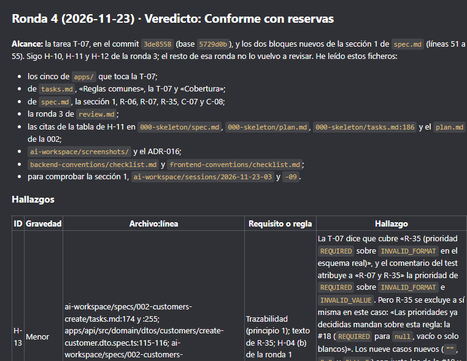
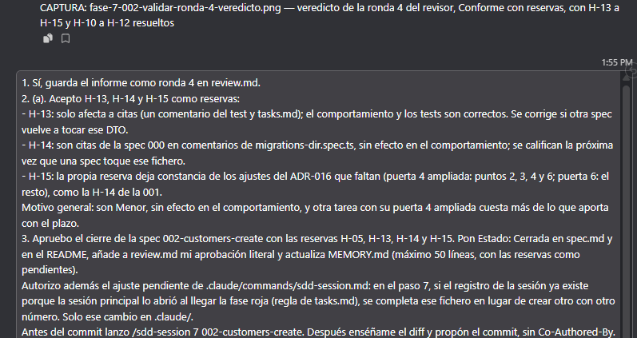

# 002-customers-create — Fase 7 (2026-11-23, sesión 10)

## Objetivo y fase
Fase 7, spec `002-customers-create`: commit de la sesión 09, ronda 4 del revisor en la puerta 6 (limitada a la T-07) y cierre de la spec.

## Prompts clave
> Apruebo el commit; Estado a En revisión y bloques incluidos

> Lanza al revisor con este encargo, con Opus y effort High. Antes, en «Petición del autor (literal)», pon mi texto exacto, no un resumen.
> La línea «Anunciada y no existente: fase-7-002-t07-fase-roja-opciones.png» de la sección «Capturas» del registro 09: vuelve a ponerla en el commit de cierre.

> 1. Sí, guarda el informe como ronda 4 en review.md.
> 2. (a). Acepto H-13, H-14 y H-15 como reservas:
> - H-13: solo afecta a citas (un comentario del test y tasks.md); el comportamiento y los tests son correctos. Se corrige si otra spec vuelve a tocar ese DTO.
> - H-14: son citas de la spec 000 en comentarios de migrations-dir.spec.ts, sin efecto en el comportamiento; se califican la próxima vez que una spec toque ese fichero.
> - H-15: la propia reserva deja constancia de los ajustes del ADR-016 que faltan (puerta 4 ampliada: puntos 2, 3, 4 y 6; puerta 6: el resto), como la H-14 de la 001.
> Motivo general: son Menor, sin efecto en el comportamiento, y otra tarea con su puerta 4 ampliada cuesta más de lo que aporta con el plazo.
> 3. Apruebo el cierre de la spec 002-customers-create con las reservas H-05, H-13, H-14 y H-15. Pon Estado: Cerrada en spec.md y en el README, añade a review.md mi aprobación literal y actualiza MEMORY.md (máximo 50 líneas, con las reservas como pendientes).
> Autorizo además el ajuste pendiente de .claude/commands/sdd-session.md: en el paso 7, si el registro de la sesión ya existe porque la sesión principal lo abrió al llegar la fase roja (regla de tasks.md), se completa ese fichero en lugar de crear otro con otro número. Solo ese cambio en .claude/.
> Antes del commit lanzo /sdd-session 7 002-customers-create. Después enséñame el diff y propón el commit, sin Co-Authored-By. NO hagas el commit: espera mi aprobación.

> /sdd-session 7 002-customers-create

> Ya la he hecho, comprueba otra vez

## Qué propuso la IA
- **Antes del commit de la sesión 09:** el registro 09 había cambiado en disco y la IA lo leyó. El autor había quitado la línea «Anunciada y no existente». La IA no la repuso y le avisó de que `/sdd-session` pide esa línea.
- **Commit `3de8558`**, sin `Co-Authored-By`; árbol limpio.
- **Preparación de la ronda 4:**
  - `Estado: En revisión` en `spec.md` y en el README, comprobado con `git status` y `git diff --stat` (solo esas dos líneas).
  - `npm run verify`: exit 0, 470 + 14.
  - `git diff --stat 5729d0b HEAD -- apps packages`: los 5 ficheros de la T-07, con 31 inserciones y 15 borrados.
  - Encargo enseñado con los datos reales. La IA no lo lanzó, porque el autor había contestado a las preguntas pero no había dicho «lanza».
- **Tras la orden del autor:**
  - «Petición del autor (literal)» pasó a llevar sus cuatro textos completos, en vez de dos fragmentos.
  - La línea de la captura descartada volvió a «Capturas» del registro 09. Antes del commit de cierre, el registro 09 volvió en disco a su versión de `3de8558`, sin esa línea; la IA preguntó y el autor decidió dejarlo así (ver «Decisiones tomadas»).
  - Revisor lanzado con Opus y effort «High», con la salida de `verify` cruda.
- **Al volver el revisor:**
  - `git status`: solo cambios de la sesión principal.
  - La IA comprobó H-13, que R-35 se excluye cuando decide la #18 (`spec.md:128`), y H-14, con las citas sin calificar en `migrations-dir.spec.ts:11`, `:15` y `:27`.
  - Informe enseñado tal cual: ronda 4, `Conforme con reservas`, con H-10, H-11 y H-12 resueltos y tres `Menor` nuevos (H-13: cita a R-35 y R-07; H-14: `migrations-dir.spec.ts`; H-15: ajustes del ADR-016 que faltan en la sección 1).
  - Opciones: (a) reservas y cierre; (b) corregir en una T-08 sin ronda 5. La IA recomendó la (b).
- **Tras la aprobación del cierre:**
  - Ronda 4 y la aprobación literal (puntos 2 y 3) añadidas a `review.md`.
  - `Estado: Cerrada` en `spec.md` y en el README.
  - Paso 7 de `.claude/commands/sdd-session.md` ajustado, solo ese cambio.
  - MEMORY.md al día, en 50 líneas: la 002 resumida como `Cerrada` y sus reservas H-05, H-13, H-14 y H-15 como pendientes. La IA quitó una afirmación suya que no tenía fuente («la 003 lo hará al añadir `0002`»).
  - Diff y commit propuesto, sin hacerlo.
- **En `/sdd-session`:** faltaba `fase-7-002-cierre-aprobado.png`. El autor la había hecho, y en la segunda comprobación ya existía.

## Qué corregí y por qué
- **«Petición del autor (literal)»** del encargo de la ronda 4: pedí mi texto exacto, no un resumen. La IA había puesto dos fragmentos.
- **Captura descartada:** pedí que la línea «Anunciada y no existente» del registro 09 volviera en el commit de cierre.
- **H-13 a H-15:** elegí aceptarlas como reservas (a), y no la T-08 recomendada (b). Motivo: son `Menor`, sin efecto en el comportamiento, y otra tarea con su puerta 4 ampliada cuesta más de lo que aporta con el plazo.

## Decisiones tomadas
- **Commit de la sesión 09** aprobado (`3de8558`).
- **Ronda 4:** `Estado: En revisión` antes de lanzarla, con los dos bloques nuevos de la sección 1 en su alcance.
- **Reservas aceptadas:** H-13, H-14 y H-15, cada una con su motivo, y H-05 de la puerta 2.
- **Cierre** de la spec `002-customers-create` aprobado por el autor (aprobación literal al final de `review.md`).
- **`/sdd-session`, paso 7:** completa el registro que la sesión principal abrió con la fase roja, en vez de crear otro (autorizado por el autor; decisión de la T-06).
- **Registro 09:** se queda como en `3de8558`, sin la línea «Anunciada y no existente»; decisión del autor antes del commit de cierre: «dejalo, descara ese cambio y haz el commit».
- **Commit:** el de cierre de esta sesión.

## Capturas

## Pendiente para la siguiente sesión
- Commit de cierre de la spec 002, con la aprobación del autor y sin `Co-Authored-By`.
- Reservas abiertas de la 002 (en MEMORY.md): H-05, H-13, H-14 y H-15.
- Siguiente spec del orden del ADR-016: `003-simulations-create`.
