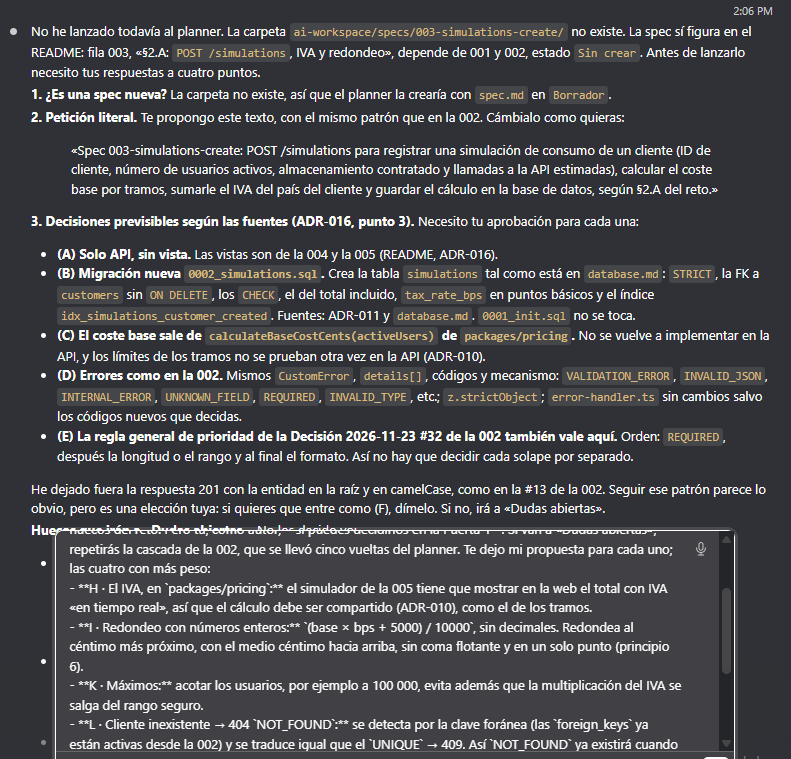
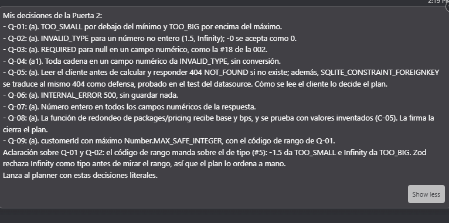
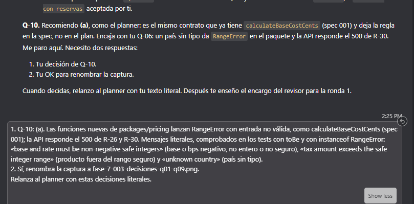
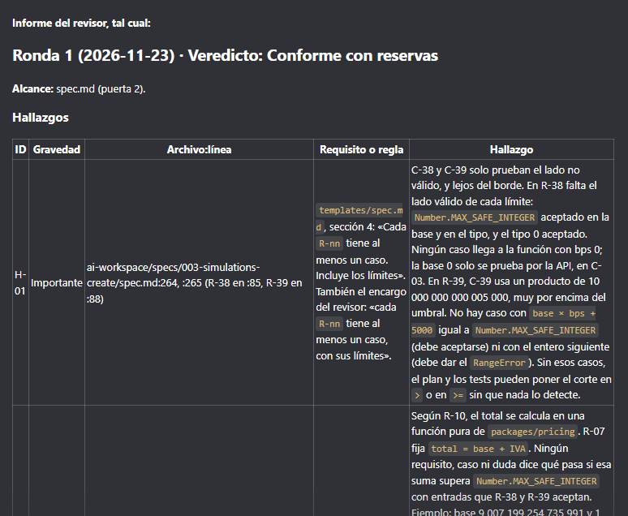
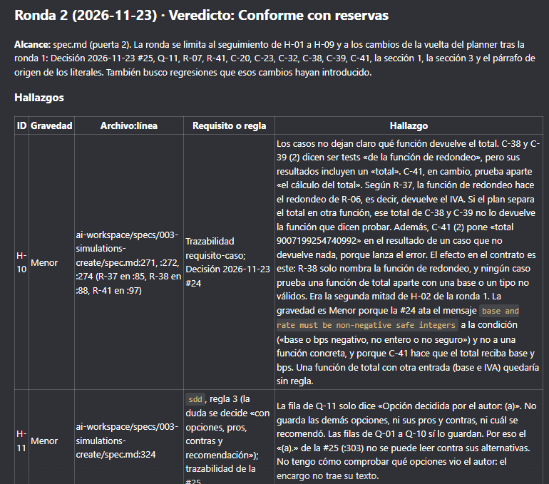

# 003-simulations-create — Fase 7 (2026-11-23, sesión 11)

## Objetivo y fase
Fase 7. En la spec `003-simulations-create` se hicieron dos puertas: la 1 (spec), con `/sdd-spec`, y la 2 (clarificación), con `/sdd-clarify`. Al terminar, la spec queda en `Aprobada` y lista para la puerta 3 (plan).

## Prompts clave
Invocación inicial: `/sdd-spec 003-simulations-create` (puerta 1, siguiendo `.claude/commands/sdd-flow.md`).

Respuesta del autor a la propuesta de la puerta 1:
> De acuerdo con A–E y con la petición literal. **Añade la F** (la respuesta 201 igual que en la 002), por coherencia entre los dos endpoints.
>
> **Lo más importante: decide ya los huecos.** La sesión principal hace bien en no decidirlos ella; son huecos del reto. Pero tú, como autor, **sí puedes decidirlos en la Puerta 1**. Si van a «Dudas abiertas», repetirás la cascada de la 002, que se llevó cinco vueltas del planner. Te dejo mi propuesta para cada uno; las cuatro con más peso:
> - **H · El IVA, en `packages/pricing`:** el simulador de la 005 tiene que mostrar en la web el total con IVA «en tiempo real», así que el cálculo debe ser compartido (ADR-010), como el de los tramos.
> - **I · Redondeo con números enteros:** `(base × bps + 5000) / 10000`, sin decimales. Redondea al céntimo más próximo, con el medio céntimo hacia arriba, sin coma flotante y en un solo punto (principio 6).
> - **K · Máximos:** acotar los usuarios, por ejemplo a 100 000, evita además que la multiplicación del IVA se salga del rango seguro.
> - **L · Cliente inexistente → 404 `NOT_FOUND`:** se detecta por la clave foránea (las `foreign_keys` ya están activas desde la 002) y se traduce igual que el `UNIQUE` → 409. Así `NOT_FOUND` ya existirá cuando lo necesite la 004.
>
> Los tipos de IVA que propongo son los generales de cada país. Revisa los valores de K: son una propuesta mía y puedes cambiarlos.
>
> **Antes de responder,** haz la captura `fase-7-003-decisiones-autor.png` de este mensaje con tu respuesta.
>
> ```
> 1. Sí, es una spec nueva.
> 2. Petición literal: la que propones, tal cual.
> 3. Decisiones previsibles: apruebo A, B, C, D y E tal cual, y añade F: 201 con la simulación en la raíz y en camelCase (id, customerId, activeUsers, storage, apiCalls, baseCostCents, taxRateBps, taxAmountCents, totalCents y createdAt), como la #13 de la 002.
> Además decido ya estos huecos, para que no vayan a «Dudas abiertas» (ADR-016, punto 3):
> - G · Tipos de IVA: ES 21 %, PT 23 %, FR 20 % e IT 22 % (tipos generales), guardados en puntos básicos (2100, 2300, 2000 y 2200).
> - H · Dónde se calcula: en packages/pricing, junto a calculateBaseCostCents, con la tabla de tipos por país, porque el simulador de la 005 tiene que mostrar el total con IVA en tiempo real en la web (ADR-010).
> - I · Base y redondeo: el IVA se aplica sobre el coste base (baseCostCents); taxAmountCents se redondea al céntimo más próximo, con el medio céntimo hacia arriba, en aritmética entera ((base × bps + 5000) / 10000, sin decimales), en un único punto (principio 6); totalCents = base + IVA.
> - J · Plan, almacenamiento y llamadas a la API: se guardan pero no influyen en el coste; §2.A solo tarifica por usuarios.
> - K · Datos de la simulación: activeUsers entero de 0 a 100 000; storage en GB, entero de 0 a 1 000 000; apiCalls al mes, entero de 0 a 1 000 000 000; customerId entero mayor o igual que 1.
> - L · Cliente inexistente: 404 NOT_FOUND, sin details, detectado por la clave foránea (SQLITE_CONSTRAINT_FOREIGNKEY) y traducido como el UNIQUE de la 002.
> Los textos de los mensajes nuevos me los propones con opciones antes de lanzar al planner de la Puerta 3, como en la 002.
> 4. Planner con Opus 5.5, de acuerdo.
> ```
>
> Cuando vuelva el planner, pégame el retorno.

Respuesta del autor sobre J y los documentos desfasados:
> 1. J: (a). El plan sigue solo en customers y simulations no lleva columna plan. «Se guardan» se refiere a storage y apiCalls. No se cambia el esquema.
> 2. ADR-010, database.md (unidad GB y dudas 2 y 7 a 10 resueltas) y el comentario de architecture.md: no es un choque de fuentes; los actualizas con mi autorización cuando apruebe la Puerta 2, como en la 002.
> Lanza al planner con Opus 5.5.

Aprobación de la puerta 1:
> Apruebo la Puerta 1 · spec de la 003. Pon Estado: En clarificación en spec.md y en el README.

Invocación de la puerta 2: `/sdd-clarify 003-simulations-create`.

Decisiones de Q-01 a Q-09:
> Mis decisiones de la Puerta 2:
> - Q-01: (a). TOO_SMALL por debajo del mínimo y TOO_BIG por encima del máximo.
> - Q-02: (a). INVALID_TYPE para un número no entero (1.5, Infinity); -0 se acepta como 0.
> - Q-03: (a). REQUIRED para null en un campo numérico, como la #18 de la 002.
> - Q-04: (a1). Toda cadena en un campo numérico da INVALID_TYPE, sin conversión.
> - Q-05: (a). Leer el cliente antes de calcular y responder 404 NOT_FOUND si no existe; además, SQLITE_CONSTRAINT_FOREIGNKEY se traduce al mismo 404 como defensa, probado en el test del datasource. Cómo se lee el cliente lo decide el plan.
> - Q-06: (a). INTERNAL_ERROR 500, sin guardar nada.
> - Q-07: (a). Número entero en todos los campos numéricos de la respuesta.
> - Q-08: (a). La función de redondeo de packages/pricing recibe base y bps, y se prueba con valores inventados (C-05). La firma la cierra el plan.
> - Q-09: (a). customerId con máximo Number.MAX_SAFE_INTEGER, con el código de rango de Q-01.
> Aclaración sobre Q-01 y Q-02: el código de rango manda sobre el de tipo (#5): -1.5 da TOO_SMALL e Infinity da TOO_BIG. Zod rechaza Infinity como tipo antes de mirar el rango, así que el plan lo ordena a mano.
> Lanza al planner con estas decisiones literales.

Decisión de Q-10:
> 1. Q-10: (a). Las funciones nuevas de packages/pricing lanzan RangeError con entrada no válida, como calculateBaseCostCents (spec 001); la API responde el 500 de R-26 y R-30. Mensajes literales, comprobados en los tests con toBe y con instanceof RangeError: «base and rate must be non-negative safe integers» (base o bps negativo, no entero o no seguro), «tax amount exceeds the safe integer range» (producto fuera del rango seguro) y «unknown country» (país sin tipo).
> 2. Sí, renombra la captura a fase-7-003-decisiones-q01-q09.png.
> Relanza al planner con estas decisiones literales.

Lanzamiento de la ronda 1:
> Sí, lánzalo con este encargo, con Opus y effort High.

Tras la ronda 1:
> 1. Sí, guarda la ronda 1 tal cual en review.md, con la cabecera de la plantilla y los signos < y > reales.
> 2. H-02 (Q-11): (a). RangeError como en la #24, con el cuarto mensaje literal «total exceeds the safe integer range», comprobado con toBe e instanceof RangeError, y un caso en el borde exacto (total igual a MAX_SAFE_INTEGER aceptado, y el siguiente con el RangeError). Por la API no se alcanza, y la API respondería el 500 si ocurriera.
> 3. H-01: que el planner añada los casos en el borde exacto: en R-38, la base y el bps a MAX_SAFE_INTEGER aceptados y el bps a 0 aceptado; en R-39, el producto más 5000 igual a MAX_SAFE_INTEGER aceptado y el entero siguiente con RangeError; y el total en el borde de la Q-11. H-03: que corrija C-32 sin tocar el esquema: quita id de la prueba del -1, y customer_id = -1 lo rechaza la clave foránea, no un CHECK. H-05 a H-09: que los corrija en esta misma vuelta; en H-07, la sección 1 dirá «la fila NOT_FOUND y su comentario de la línea 8»; en H-08, se anota en «Fuera» que la ruta inexistente sigue con el 404 de Express y lo que queda para la 004; en H-09, se declara entero el prefijo «1. » que se quitó. H-04: aceptada como reserva; son requisitos compuestos, como la H-05 de la 002 y la H-08 de la 000, y partirlos alarga la spec sin cambiar ningún comportamiento.
> 4. Lanza después la ronda 2 del revisor, limitada a estos cambios, y enséñame su encargo antes.

Lanzamiento de la ronda 2:
> Sí, lánzalo con Opus y effort High, y renombra la captura.

Tras la ronda 2 (aprobación de la puerta 2):
> 1. Sí, guarda la ronda 2 tal cual en review.md.
> 2. H-10 y H-11: (A). Vuelta corta del planner, sin otra ronda del revisor: en H-10, el mensaje de R-38 vale para cualquier función nueva del paquete que reciba base y bps; separa en C-38 y C-39 el IVA (función de redondeo) y el total; y quita el «total 9007199254740992» de C-41 (2), porque ese caso lanza el error. En H-11, completa la fila de Q-11 con tus opciones (a) y (b), sus pros y contras y la recomendada, copiadas literalmente. Anota que el revisor no ha visto estas dos correcciones y debe seguirlas en la Puerta 6.
> 3. Con esa vuelta hecha, apruebo la Puerta 2 · clarificación de la spec 003-simulations-create con la reserva H-04 (requisitos compuestos, como la H-05 de la 002 y la H-08 de la 000; partirlos alarga la spec sin cambiar ningún comportamiento) y con H-10 y H-11 corregidas en esa vuelta. Pon Estado: Aprobada en spec.md y en el README y añade a review.md mi aprobación literal.
> 4. Autorizo los cambios que dejé previstos, tras enseñarme el diff: ADR-010 (el IVA entra en packages/pricing), database.md (unidad GB en storage; dudas 2 y 7 a 10 resueltas con su Decisión #n; solo eso) y el comentario de architecture.md:7.
> 5. Actualiza MEMORY.md (máximo 50 líneas, con la reserva H-04 como pendiente). Antes del commit lanzo /sdd-session 7 003-simulations-create. Después enséñame el diff y propón un solo commit de las puertas 1 y 2, sin Co-Authored-By. NO hagas el commit: espera mi aprobación.

Invocación del registro: `/sdd-session 7 003-simulations-create`.
> /sdd-session 7 003-simulations-create  

## Qué propuso la IA
- **Puerta 1.**
  - La sesión principal propuso la petición literal y cinco decisiones previsibles (ADR-016, punto 3):
    - (A) solo API, sin vista;
    - (B) `0002_simulations.sql` con la tabla de `database.md` tal cual;
    - (C) el coste base con `calculateBaseCostCents`;
    - (D) el formato de error de la 002;
    - (E) la regla de prioridad de la #32 de la 002.
  - Dejó fuera la respuesta 201 como en la 002, por ser elección del autor.
  - Listó los huecos que irían a «Dudas abiertas».
  - Antes de lanzar al planner comprobó las decisiones G a L contra las fuentes. Preguntó por la J (¿columna `plan` en `simulations`?) y avisó de que el ADR-010, `database.md` y `architecture.md:7` quedarían desfasados.
  - El planner (Opus 5.5) creó `spec.md` en `Borrador`, con 34 requisitos, 35 casos y Q-01 a Q-09. Q-05 señalaba que la L no puede ser la única vía, porque para calcular el IVA hay que leer antes el país del cliente.
  - La sesión principal comprobó la aritmética (15, 100 y 100 000 usuarios; producto máximo 115 039 105 000) y que Q-05 y Q-08 eran ciertas.
- **Puerta 2, presentación en bloque.**
  - La sesión principal presentó Q-01 a Q-09 de una vez (ADR-016, punto 2), cada una con opciones, pros, contras y una recomendada.
  - Comprobó las opciones contra `patterns.md:32-34` y `architecture.md`. Avisó de que Zod 4 rechaza `Infinity` como tipo antes de mirar el rango y de que `null` no da `REQUIRED` en el traductor sin tratarlo aparte.
- **Vueltas del planner.**
  - Primera, pasó las #14 a #23 y abrió Q-10 (entrada no válida en las funciones nuevas del paquete).
  - Segunda, pasó la #24. Partió R-38 en R-38 a R-40.
  - Tercera, tras la ronda 1: pasó la #25 (R-41) y corrigió H-01, H-03 y H-05 a H-09. Los bordes exactos usan base 123386291160767 con 73 bps, base 1125899906841999 con 8 bps y bases 9006298624878503 y 9006298624878504 con 1 bps.
  - Cuarta, corta: corrigió H-10 y H-11.
  - En su segundo retorno, el planner añadió una línea `CAPTURA:` propia. La sesión principal no la contó como anunciada.
- **Comprobaciones de la sesión principal:**
  - recalculó con `BigInt` todos los bordes de C-38, C-39 y C-41, y todos coinciden;
  - comprobó con `grep` que no quedaba ningún `PENDIENTE` ni ninguna duda «Abierta»;
  - contó 41 requisitos, 41 casos y 11 dudas.
- **Ronda 1 del revisor (Opus, effort «High»):** `Conforme con reservas`. H-01 a H-03 `Importante`:
  - H-01: faltaban los bordes exactos de R-38 y R-39;
  - H-02: total fuera del rango seguro sin decidir;
  - H-03: C-32 esperaba un `CHECK` en `id` y en `customer_id` que no existe.

  H-04 a H-09, `Menor`.
- **Ronda 2, limitada:** `Conforme con reservas`. H-01 a H-09 resueltos, salvo la reserva H-04. H-10 (qué función devuelve el total) y H-11 (la fila de Q-11 sin opciones), `Menor`.
- **Documentos.** Con autorización del autor, la sesión principal cambió:
  - el ADR-010 (el IVA entra en el paquete, con una línea «Modificación» que conserva el texto original);
  - `database.md` (`storage` en GB; dudas 2 y 7 a 10 resueltas);
  - `architecture.md:7` («cálculo por tramos e IVA»).

  La línea 5 de `database.md` no se cambió, por el «solo eso» del autor.

## Qué corregí y por qué
- **Huecos del reto en la puerta 1:** la sesión principal los iba a llevar a «Dudas abiertas». Decidí G a L yo mismo en la puerta 1 (ADR-016, punto 3), para no repetir la cascada de la 002, que se llevó cinco vueltas del planner.
- **F:** añadí la respuesta 201 como en la 002, por coherencia entre los dos endpoints.
- **Aclaración sobre Q-01 y Q-02:** el código de rango manda sobre el de tipo (`-1.5` → `TOO_SMALL`, `Infinity` → `TOO_BIG`), y el plan lo ordena a mano.
- **Q-10 y Q-11:** fijé los cuatro mensajes literales de los `RangeError` y que se comprueban con `toBe` e `instanceof`.
- **`review.md`:** pedí los signos `<` y `>` reales (el retorno del revisor traía `&gt;`).
- **Capturas:** `fase-7-003-decisiones-q01-q09.png .png` y `fase-7-003-revisor-ronda-1-veredicto.png .png` se renombraron con mi OK.
- **H-10 y H-11:** pedí que se corrigieran sin otra ronda, como H-08 y H-09 en la 002, y que se anotara que el revisor no los ha visto.
- **Errores de la sesión principal en esta sesión:** (no registrado)

## Decisiones tomadas
- **Decisión 2026-11-23 #1 a #5 (spec 003):** decisiones previsibles A a E, aprobadas tal cual.
- **#6 (F):** 201 con la simulación en la raíz y en `camelCase`.
- **#7 a #12 (G a L), huecos decididos en la puerta 1:**
  - IVA de ES 2100, PT 2300, FR 2000 e IT 2200 bps;
  - el IVA se calcula en `packages/pricing`;
  - `(base × bps + 5000) / 10000` entero, y total = base + IVA;
  - plan, `storage` y `apiCalls` no influyen en el coste;
  - límites de los cuatro campos;
  - 404 `NOT_FOUND` para el cliente inexistente.
- **#13:** J (a). `simulations` no lleva columna `plan` y el esquema no cambia (precisa la #10).
- **#14 a #22 (Q-01 a Q-09):**
  - `TOO_SMALL` y `TOO_BIG`;
  - `INVALID_TYPE` para los no enteros, y `-0` como 0;
  - `REQUIRED` para `null`;
  - `INVALID_TYPE` para las cadenas;
  - lectura previa del cliente → 404, y la clave foránea traducida al mismo 404;
  - 500 para un país sin tipo;
  - números enteros en la respuesta;
  - redondeo probado con valores inventados;
  - `customerId` hasta `MAX_SAFE_INTEGER`.
- **#23:** el rango manda sobre el tipo (precisa la #14 y la #15).
- **#24 (Q-10):** `RangeError` con tres mensajes literales.
- **#25 (Q-11):** `RangeError` «total exceeds the safe integer range».
- **Reserva aceptada:** H-04 (requisitos compuestos), con el motivo del autor.
- **Corregidos tras la ronda 2 sin que el revisor los vea:** H-10 y H-11. Los sigue el revisor en la puerta 6.
- **Documentos:** ADR-010, `database.md` (GB y dudas 2 y 7 a 10) y `architecture.md:7`, actualizados con autorización del autor.
- **Estado:** `En clarificación` tras la puerta 1 y `Aprobada` tras la puerta 2, en `spec.md` y en el README.
- **Ajustes del ADR-016 aplicados:**
  - punto 1: dos rondas en la puerta 2, porque la ronda 1 traía tres `Importante`;
  - punto 2: dudas en bloque;
  - punto 3: decisiones previsibles y huecos decididos en la puerta 1;
  - punto 4: encargos del planner sin enseñar y del revisor enseñados;
  - punto 5: rutas acotadas;
  - punto 6: planner con Opus 5.5 y revisor en Opus con effort «High».
- Commit: el de cierre de esta sesión.

## Capturas






Sustituida por el nombre del autor: `fase-7-003-decision-q10.png` → `fase-7-003-dudas-q10.png`.

Anunciada y no existente, descartada por el autor (motivo: no registrado): `fase-7-003-q11-y-correcciones-ronda-1.png`.

Renombradas con OK del autor (venían con la extensión repetida): `fase-7-003-decisiones-q01-q09.png` y `fase-7-003-revisor-ronda-1-veredicto.png`.

## Pendiente para la siguiente sesión
- **Celdas de la sección 5:** sustituir `(pendiente de /sdd-session)` por la ruta de este registro, con el OK del autor. Después, el commit de cierre de las puertas 1 y 2.
- **Puerta 3 de la 003:**
  - preguntar el formato de `plan.md`;
  - textos de los `message` nuevos (el 404 y los códigos de `details[]`), con opciones, antes de lanzar al planner (#4);
  - `null` → `REQUIRED`, tratado aparte del traductor (`patterns.md:32`);
  - ordenar a mano el rango antes que el tipo con `Infinity` (#23);
  - comprobar que `better-sqlite3` guarda y devuelve `-0` como 0 (C-36);
  - el cálculo del total recibe la base y el bps (C-41) y lanza el error de R-39 si lo lanza el IVA (aviso del planner, sin decisión aparte);
  - cómo se lee el cliente (#18);
  - la línea 5 de `database.md`, que sigue diciendo que esta spec decide dónde se calcula el IVA.
- **Puerta 6:** seguir H-10 y H-11, corregidos sin revisión, y la reserva H-04.
