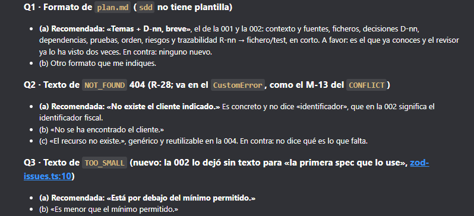
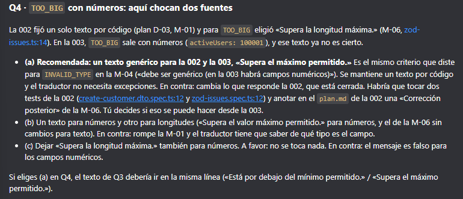
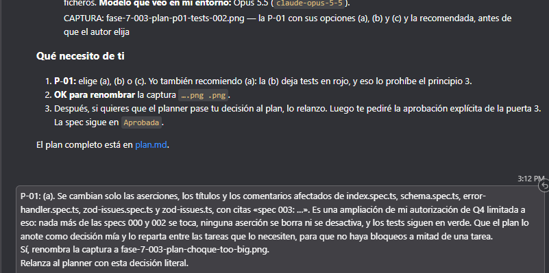
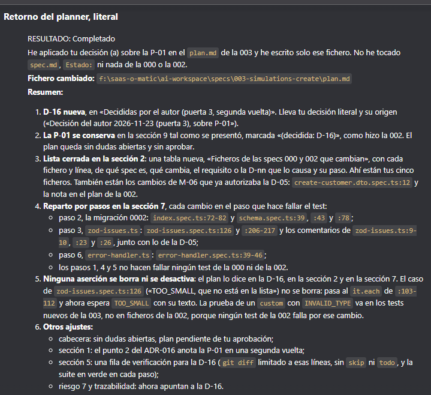
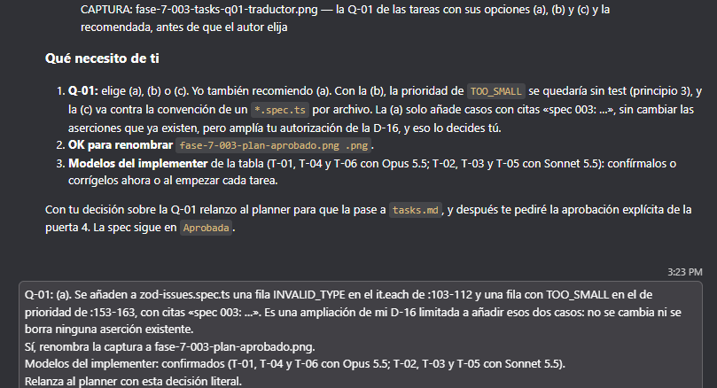

# 003-simulations-create — Fase 7 (2026-11-23, sesión 12)

## Objetivo y fase
Fase 7, spec `003-simulations-create`: puerta 3 (plan) con `/sdd-plan` y puerta 4 (tareas) con `/sdd-tasks`. Las dos se cierran en un solo commit, por decisión del autor. La spec empezó en `Aprobada` y queda en `Planificada`.

## Prompts clave
Lanzamiento de la puerta 3:
> /sdd-plan 003-simulations-create

Respuesta del autor a Q1 a Q4, antes de lanzar al planner:
> Q1: (a), «Temas + D-nn, breve».
> Q2: (a), «No existe el cliente indicado.»
> Q3: (a), «Está por debajo del mínimo permitido.»
> Q4: (a), un texto genérico para la 002 y la 003: «Supera el máximo permitido.» Autorizo tocar la spec 002 solo para esto: cambia el texto de M-06 en zod-issues.ts y en los dos tests (create-customer.dto.spec.ts y zod-issues.spec.ts), y anota una «Corrección posterior a la aprobación» de la M-06 en el plan.md de la 002 y en el de la 003, con mi autorización. Nada más de la 002 se toca. Los tests de la 002 siguen en verde.
> Mensajes: «Te los propongo yo antes», con la decisión de Q2 a Q4 como texto literal.
> Lanza al planner con Opus 5.5, con los pendientes que indicas en el encargo.

Decisión sobre la P-01 del planner:
> P-01: (a). Se cambian solo las aserciones, los títulos y los comentarios afectados de index.spec.ts, schema.spec.ts, error-handler.spec.ts, zod-issues.spec.ts y zod-issues.ts, con citas «spec 003: …». Es una ampliación de mi autorización de Q4 limitada a eso: nada más de las specs 000 y 002 se toca, ninguna aserción se borra ni se desactiva, y los tests siguen en verde. Que el plan lo anote como decisión mía y lo reparta entre las tareas que lo necesiten, para que no haya bloqueos a mitad de una tarea.
> Sí, renombra la captura a fase-7-003-plan-choque-too-big.png.
> Relanza al planner con esta decisión literal.

Aprobación de la puerta 3:
> 1. La regla añadida por el planner (si falla otro test de la 000 o la 002 que no está en la lista, la tarea para y lo devuelve): aceptada, como decisión mía.
> 2. Apruebo la Puerta 3 · plan de la spec 003-simulations-create: plan.md con D-01 a D-16. El Estado: sigue en Aprobada. Pon en la cabecera de plan.md «aprobado por el autor el 2026-11-23».
> No cierres todavía: seguimos con la Puerta 4 y cerramos las dos puertas en un solo commit.

Lanzamiento de la puerta 4:
> /sdd-tasks 003-simulations-create

Decisión sobre la Q-01 de las tareas:
> Q-01: (a). Se añaden a zod-issues.spec.ts una fila INVALID_TYPE en el it.each de :103-112 y una fila con TOO_SMALL en el de prioridad de :153-163, con citas «spec 003: …». Es una ampliación de mi D-16 limitada a añadir esos dos casos: no se cambia ni se borra ninguna aserción existente.
> Sí, renombra la captura a fase-7-003-plan-aprobado.png.
> Modelos del implementer: confirmados (T-01, T-04 y T-06 con Opus 5.5; T-02, T-03 y T-05 con Sonnet 5.5).
> Relanza al planner con esta decisión literal.

Aprobación de la puerta 4 y orden de cierre:
> Apruebo la Puerta 4 · tareas de la spec 003-simulations-create: tasks.md con T-01 a T-06 y la Q-01 decidida. Pon Estado: Planificada en spec.md y en la fila 003 del README.
> Cierra las puertas 3 y 4: actualiza MEMORY.md (máximo 50 líneas) y espera a que lance /sdd-session 7 003-simulations-create. Luego enséñame el diff y propón un solo commit, sin Co-Authored-By. NO hagas el commit: espera mi aprobación.

## Qué propuso la IA
- **Sesión principal, antes de lanzar al planner (ADR-016, puntos 2 y 3):** cuatro dudas en bloque, con opciones y una recomendada.
  - Q1: formato del plan.
  - Q2: texto del 404.
  - Q3: texto de `TOO_SMALL`.
  - Q4: un choque. La M-06 de la 002 («Supera la longitud máxima.», un texto por código según la M-01) es falsa para los campos numéricos de la 003. Se recomendó la opción (a), un texto genérico.
  - Además se anunció la lista de pendientes de la puerta 3 de `MEMORY.md` que iría en el encargo.
- **Planner (Opus 5.5), primera vuelta de la puerta 3:** `plan.md` con D-01 a D-15. Resultado «Con dudas», con la P-01: los tests de la 000 y la 002 que fallan por requisitos ya aprobados de la 003 (`user_version` 2 y `simulations`; la fila `NOT_FOUND`; el texto de `TOO_SMALL`). Opciones (a), (b) y (c), con (a) recomendada.
- **Sesión principal:** comprobó que existen las líneas que citaba la P-01, y las citas de Zod (`v4/core/schemas.js:642-658`) y de `better-sqlite3` (`src/util/data.cpp:1-6`).
- **Planner, segunda vuelta:**
  - Añadió la D-16 y repartió los cambios por pasos de la sección 7.
  - Propuso por su cuenta una regla: si falla otro test de la 000 o la 002, la tarea para y lo devuelve. La sometió al autor, que la aceptó.
- **Sesión principal:** escribió en la cabecera de `plan.md` la aprobación literal y la aceptación de la regla.
- **Planner, primera vuelta de la puerta 4:**
  - `tasks.md` con T-01 a T-06, una por capa, ninguna de más de 5 archivos de producción (la T-04 llega justo a 5).
  - Una propuesta de modelo para cada tarea.
  - La tabla R-nn → T-nn.
  - Resultado «Con dudas», con la Q-01: dónde se prueban `INVALID_TYPE` en `CUSTOM_CODES` y la prioridad de `TOO_SMALL`. Opción (a) recomendada.
- **Sesión principal:** comprobó que están R-01 a R-41 (R-16 dentro de «R-15 a R-17»), el número de archivos de cada tarea y los dos `it.each` citados.
- **Planner, segunda vuelta de la puerta 4:** Q-01 decidida, dos casos nuevos en la T-03 con sus casillas, y los modelos marcados como confirmados.
- **Sesión principal, al aprobarse la puerta 4:**
  - `Estado: Planificada` en `spec.md` y en el README.
  - En `tasks.md:5`, la aprobación literal en lugar de «pendientes de la aprobación». Esto no lo pidió el autor, y se le avisó.
  - `MEMORY.md` actualizado (50 líneas).

## Qué corregí y por qué
- Q4: el autor eligió la (a), pero limitó su alcance: autorizó tocar la 002 solo para el texto de la M-06 y su nota.
- P-01: el autor amplió la autorización de la Q4 solo a las aserciones, los títulos y los comentarios afectados, con la condición de que ninguna aserción se borre ni se desactive. Además pidió repartir los cambios entre tareas para que ninguna se bloquee a mitad.
- Q-01: el autor amplió la D-16 solo para añadir dos casos, sin cambiar ni borrar ninguna aserción.
- Dos capturas se guardaron con el nombre `….png .png`, y el autor autorizó renombrarlas.
- (no registrado) No hubo otras correcciones a propuestas.

## Decisiones tomadas
- Puerta 3, en `plan.md`:
  - D-01 a D-05 (Q1 a Q4 y la forma de presentar los mensajes).
  - D-06 a D-15, del planner.
  - D-16 (P-01), con la regla del planner aceptada por el autor.
  - Plan aprobado por el autor el 2026-11-23.
- Puerta 4, en `tasks.md`: T-01 a T-06, la Q-01 decidida (a) y los modelos confirmados (T-01, T-04 y T-06 con Opus 5.5; T-02, T-03 y T-05 con Sonnet 5.5). Tareas aprobadas por el autor el 2026-11-23.
- `Estado: Planificada` en `spec.md` y en el README.
- Ajustes del ADR-016 aplicados:
  - punto 2: dudas en bloque;
  - punto 3: textos y formato propuestos antes de lanzar al planner;
  - punto 4: encargos del planner lanzados sin enseñarlos antes;
  - punto 5: rutas a leer acotadas;
  - punto 6: planner con Opus 5.5.
- Commit: el de cierre de esta sesión.

## Capturas

## Pendiente para la siguiente sesión
- Puerta 5 (`/sdd-implement 003-simulations-create`): empezar por la T-01 (`packages/pricing`) con el implementer en Opus 5.5.
- La T-03 incluye la nota «Corrección posterior a la aprobación» de la M-06 en el `plan.md` de la 002.
- `-0` en SQLite se confirma con el test del datasource en la T-05 (D-11).
- Regla de la D-16: si falla un test de la 000 o la 002 que no está en la lista, la tarea para.
- Reserva H-04 pendiente; H-10 y H-11, para la puerta 6.
