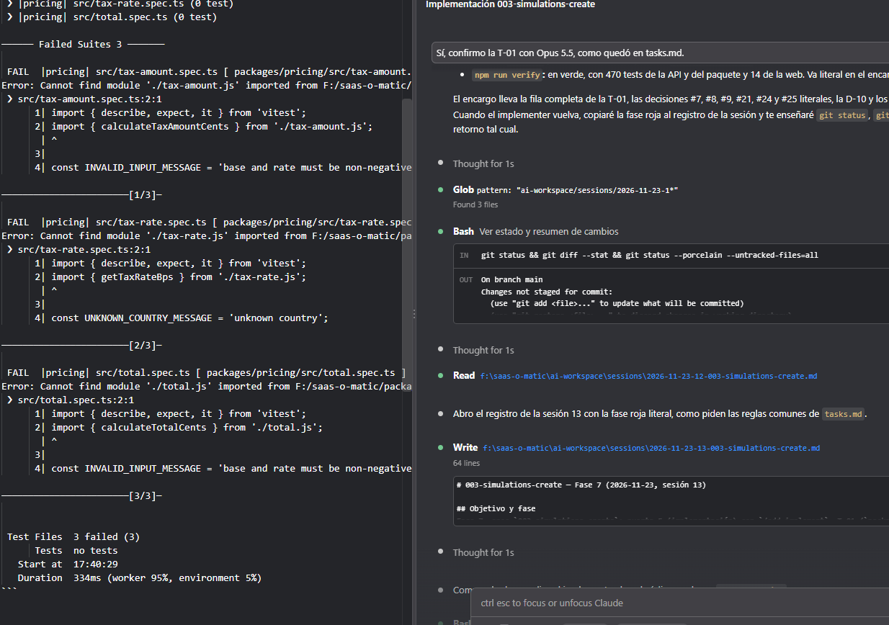
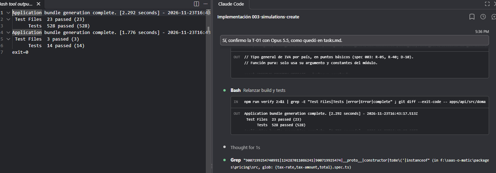

# 003-simulations-create — Fase 7 (2026-11-23, sesión 13)

## Objetivo y fase
Fase 7, spec `003-simulations-create`: puerta 5 (implementación) con `/sdd-implement`, T-01 (`packages/pricing`: tipo de IVA por país, IVA redondeado y total). La spec pasa de `Planificada` a `En implementación` al empezar la primera tarea.

## Prompts clave
Lanzamiento de la puerta 5:
> /sdd-implement 003-simulations-create

Confirmación de la tarea:
> Sí, confirmo la T-01 con Opus 5.5, como quedó en tasks.md.

Aprobación de la T-01 y orden de cierre:
> Apruebo la T-01. Márcala en [x] con sus casillas y mi aprobación literal, completa el registro 13 y actualiza MEMORY.md (máximo 50 líneas). Antes del commit lanzo /sdd-session 7 003-simulations-create. Después enséñame el diff y propón el commit, sin Co-Authored-By. NO hagas el commit: espera mi aprobación.

Registro de la sesión:
> /sdd-session 7 003-simulations-create

## T-01 · Fase roja (retorno literal del implementer)
Comando: `npx vitest run --project pricing tax-rate tax-amount total`

```
 RUN  v5.1.1 F:/saas-o-matic

 ❯ |pricing| src/tax-amount.spec.ts (0 test)
 ❯ |pricing| src/tax-rate.spec.ts (0 test)
 ❯ |pricing| src/total.spec.ts (0 test)

⎯⎯⎯⎯⎯⎯ Failed Suites 3 ⎯⎯⎯⎯⎯⎯⎯

 FAIL  |pricing| src/tax-amount.spec.ts [ packages/pricing/src/tax-amount.spec.ts ]
Error: Cannot find module './tax-amount.js' imported from F:/saas-o-matic/packages/pricing/src/tax-amount.spec.ts
 ❯ src/tax-amount.spec.ts:2:1
      1| import { describe, expect, it } from 'vitest';
      2| import { calculateTaxAmountCents } from './tax-amount.js';
       | ^
      3|
      4| const INVALID_INPUT_MESSAGE = 'base and rate must be non-negative safe…

⎯⎯⎯⎯⎯⎯⎯⎯⎯⎯⎯⎯⎯⎯⎯⎯⎯⎯⎯⎯⎯⎯⎯⎯[1/3]⎯

 FAIL  |pricing| src/tax-rate.spec.ts [ packages/pricing/src/tax-rate.spec.ts ]
Error: Cannot find module './tax-rate.js' imported from F:/saas-o-matic/packages/pricing/src/tax-rate.spec.ts
 ❯ src/tax-rate.spec.ts:2:1
      1| import { describe, expect, it } from 'vitest';
      2| import { getTaxRateBps } from './tax-rate.js';
       | ^
      3|
      4| const UNKNOWN_COUNTRY_MESSAGE = 'unknown country';

⎯⎯⎯⎯⎯⎯⎯⎯⎯⎯⎯⎯⎯⎯⎯⎯⎯⎯⎯⎯⎯⎯⎯⎯[2/3]⎯

 FAIL  |pricing| src/total.spec.ts [ packages/pricing/src/total.spec.ts ]
Error: Cannot find module './total.js' imported from F:/saas-o-matic/packages/pricing/src/total.spec.ts
 ❯ src/total.spec.ts:2:1
      1| import { describe, expect, it } from 'vitest';
      2| import { calculateTotalCents } from './total.js';
       | ^
      3|
      4| const INVALID_INPUT_MESSAGE = 'base and rate must be non-negative safe…

⎯⎯⎯⎯⎯⎯⎯⎯⎯⎯⎯⎯⎯⎯⎯⎯⎯⎯⎯⎯⎯⎯⎯⎯[3/3]⎯


 Test Files  3 failed (3)
      Tests  no tests
   Start at  17:40:29
   Duration  334ms (worker 95%, environment 5%)
```

## Qué propuso la IA
- **Sesión principal, al lanzar la puerta 5:** propuso la T-01 con Opus 5.5, primera del orden de construcción y la que necesita la T-04. Esperó la confirmación del autor.
- **Sesión principal, antes de lanzar al implementer:**
  - `Estado: En implementación` en `spec.md` y en la fila 003 del README (primera tarea).
  - `npm run verify` en verde (470 + 14), con su salida en el encargo.
  - Encargo lanzado sin enseñarlo antes (ADR-016, punto 4), con la fila literal de la T-01, las decisiones #7, #8, #9, #21, #24 y #25 literales, la D-10 y los riesgos 5 y 6 del plan.
- **Implementer (Opus 5.5):**
  - Fase roja: tres suites sin módulo (`Cannot find module`), copiada literal arriba en cuanto llegó.
  - `tax-rate.ts`, `tax-amount.ts` y `total.ts` nuevos y tres reexportaciones en `index.ts`; 58 tests nuevos (7, 26 y 25).
  - `npm run verify` en verde (528 + 14); `pricing-check.spec.ts` sin cambios. Sin desviaciones.
  - Añadió un comentario en `tax-amount.ts` (el resultado nunca es `-0`), sin cambiar la fórmula.
- **Sesión principal, al volver el implementer:**
  - `git status` y `git diff --stat`: solo los cuatro ficheros de producción, los tres tests y el `[~]` de `tasks.md`, más el `Estado:` que cambió ella.
  - Leyó los tres módulos contra la D-10 (`Map`, mensajes como constantes, cociente con resto sin `Math.floor`, único `import` `./tax-amount.js`) y buscó en los tests los bordes (9007199254740991, 124287011086241, 900719925474, `"constructor"`, `"__proto__"`).
  - Relanzó `npm run verify` (528 + 14) y `git diff --exit-code` de `pricing-check.spec.ts` (código 0).
- **Sesión principal, tras la aprobación:** T-01 en `[x]` con sus once casillas y la aprobación literal en `tasks.md`; `MEMORY.md` al día.

## Qué corregí y por qué
- (no registrado) No hubo correcciones del autor a propuestas.

## Decisiones tomadas
- T-01 aprobada por el autor el 2026-11-23, literal en `tasks.md`: «Apruebo la T-01.»
- `Estado: En implementación` en `spec.md` y en el README.
- Ajustes del ADR-016 aplicados: punto 4 (encargo del implementer sin enseñarlo antes), punto 5 (rutas a leer acotadas) y punto 6 (implementer con Opus 5.5, confirmado en la puerta 4).
- Commit: el de cierre de esta sesión.

## Capturas



## Pendiente para la siguiente sesión
- Puerta 5: la T-02 (`0002_simulations.sql`) con el implementer en Sonnet 5.5; la T-03 también es independiente (Sonnet 5.5).
- Regla de la D-16: si falla un test de la 000 o la 002 que no está en la lista, la tarea para.
- Reserva H-04 pendiente; H-10 y H-11, para la puerta 6.
