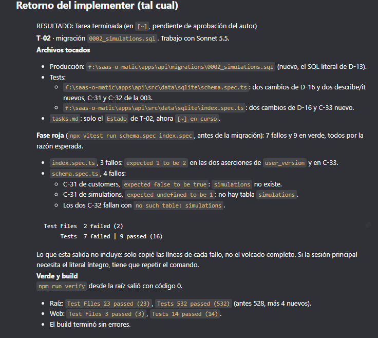
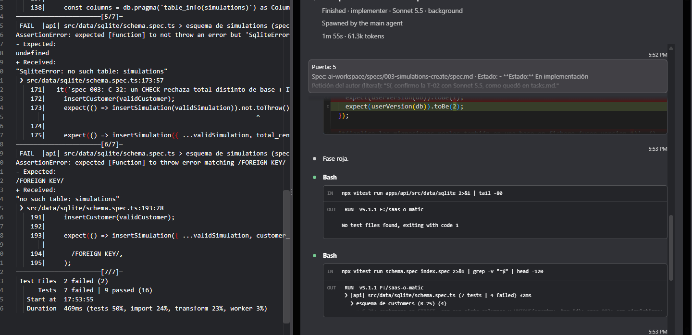
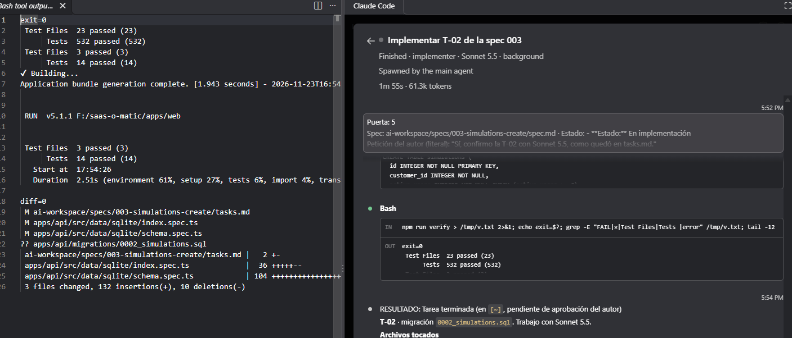
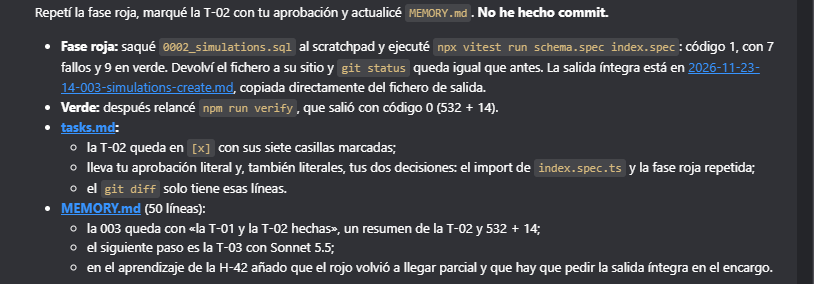

# 003-simulations-create — Fase 7 (2026-11-23, sesión 14)

## Objetivo y fase
Fase 7, spec `003-simulations-create`: puerta 5 (implementación) con `/sdd-implement`, T-02 (`data`: migración `0002_simulations.sql`). La spec sigue en `En implementación`.

## Prompts clave
Lanzamiento de la puerta 5:
> /sdd-implement 003-simulations-create

Confirmación de la tarea:
> Sí, confirmo la T-02 con Sonnet 5.5, como quedó en tasks.md.

Decisiones sobre el retorno, aprobación de la T-02 y orden de cierre:
> 1. Fase roja: (b). Repítela íntegra tú mismo: saca 0002_simulations.sql al scratchpad, ejecuta npx vitest run schema.spec index.spec, copia la salida literal completa al registro 14, devuelve el fichero a su sitio y comprueba con git status que queda igual.
> 2. Cambio de import en index.spec.ts (import type Database a import Database, y readFileSync): aceptado, lo exige C-33. Anótalo en la T-02 como decisión mía.
> Apruebo la T-02. Márcala en [x] con sus casillas y mi aprobación literal y actualiza MEMORY.md (máximo 50 líneas). Antes del commit lanzo /sdd-session 7 003-simulations-create. Después enséñame el diff y propón el commit, sin Co-Authored-By. NO hagas el commit: espera mi aprobación.

Registro de la sesión:
> /sdd-session 7 003-simulations-create

## T-02 · Fase roja (retorno literal del implementer)
Comando: `npx vitest run schema.spec index.spec` (antes de crear la migración).

El implementer no devolvió la salida íntegra: solo copió las líneas de cada fallo y el recuento final. Su texto, literal:

> - `index.spec.ts`, 3 fallos: `expected 1 to be 2` en las dos aserciones de `user_version` y en C-33.
> - `schema.spec.ts`, 4 fallos:
>   - C-31 de customers, `expected false to be true`: `simulations` no existe.
>   - C-31 de simulations, `expected undefined to be 1`: no hay tabla `simulations`.
>   - Los dos C-32 fallan con `no such table: simulations`.
>
> ```
>  Test Files  2 failed (2)
>       Tests  7 failed | 9 passed (16)
> ```
> Lo que esta salida no incluye: solo copié las líneas de cada fallo, no el volcado completo. Si la sesión principal necesita el literal íntegro, tiene que repetir el comando.

`git diff --exit-code -- apps/api/migrations/0001_init.sql`: código 0 y sin salida (retorno del implementer).

## T-02 · Fase roja íntegra (repetida por la sesión principal, decisión del autor)
Decisión del autor (literal): «1. Fase roja: (b). Repítela íntegra tú mismo: saca 0002_simulations.sql al scratchpad, ejecuta npx vitest run schema.spec index.spec, copia la salida literal completa al registro 14, devuelve el fichero a su sitio y comprueba con git status que queda igual.»

Cambio temporal: `apps/api/migrations/0002_simulations.sql` movido al scratchpad; comando `npx vitest run schema.spec index.spec` desde la raíz; el fichero, devuelto a su sitio. `git status --short` después: igual que antes (`0002_simulations.sql` sin seguimiento en `apps/api/migrations/`), más las capturas del autor.

Salida literal completa (con el código de salida añadido al final):

```

 RUN  v5.1.1 F:/saas-o-matic

 ❯ |api| src/data/sqlite/schema.spec.ts (7 tests | 4 failed) 46ms
   ❯ esquema de customers (R-25) (4)
     × C-31: customers es STRICT, con sus siete columnas y UNIQUE(country, tax_id); spec 003: con simulations; user_version 2 17ms
   ❯ esquema de simulations (spec 003: R-31) (3)
     × spec 003: C-31: simulations es STRICT con sus diez columnas, clave foránea, índice y user_version 2 5ms
     × spec 003: C-32: un CHECK rechaza total distinto de base + IVA y -1 en cada columna con CHECK (>= 0) 5ms
     × spec 003: C-32: la clave foránea rechaza un customer_id inexistente y customer_id = -1 5ms
 ❯ |api| src/data/sqlite/index.spec.ts (9 tests | 3 failed) 180ms
   ❯ openDatabase (9)
     × aplica las migraciones reales de apps/api/migrations/ (spec 003: 0001_init.sql y 0002_simulations.sql) y user_version queda en 2 (spec 000: base de C-09) 14ms
     × aplica las migraciones reales también en una base en fichero (spec 003: 0002_simulations.sql, user_version 2) 20ms
     × spec 003: C-33: una base con solo 0001_init.sql (user_version 1) y un cliente pasa a user_version 2, crea simulations y conserva el cliente (R-32) 29ms

⎯⎯⎯⎯⎯⎯⎯ Failed Tests 7 ⎯⎯⎯⎯⎯⎯⎯

 FAIL  |api| src/data/sqlite/index.spec.ts > openDatabase > aplica las migraciones reales de apps/api/migrations/ (spec 003: 0001_init.sql y 0002_simulations.sql) y user_version queda en 2 (spec 000: base de C-09)
AssertionError: expected 1 to be 2 // Object.is equality

- Expected
+ Received

- 2
+ 1

 ❯ src/data/sqlite/index.spec.ts:75:29
     73|     db = openDatabase(':memory:');
     74|
     75|     expect(userVersion(db)).toBe(2);
       |                             ^
     76|   });
     77|

⎯⎯⎯⎯⎯⎯⎯⎯⎯⎯⎯⎯⎯⎯⎯⎯⎯⎯⎯⎯⎯⎯⎯⎯[1/7]⎯

 FAIL  |api| src/data/sqlite/index.spec.ts > openDatabase > aplica las migraciones reales también en una base en fichero (spec 003: 0002_simulations.sql, user_version 2)
AssertionError: expected 1 to be 2 // Object.is equality

- Expected
+ Received

- 2
+ 1

 ❯ src/data/sqlite/index.spec.ts:81:29
     79|     db = openDatabase(path.join(tempRoot, 'data', 'saas-o-matic.db'));
     80|
     81|     expect(userVersion(db)).toBe(2);
       |                             ^
     82|   });
     83|

⎯⎯⎯⎯⎯⎯⎯⎯⎯⎯⎯⎯⎯⎯⎯⎯⎯⎯⎯⎯⎯⎯⎯⎯[2/7]⎯

 FAIL  |api| src/data/sqlite/index.spec.ts > openDatabase > spec 003: C-33: una base con solo 0001_init.sql (user_version 1) y un cliente pasa a user_version 2, crea simulations y conserva el cliente (R-32)
AssertionError: expected 1 to be 2 // Object.is equality

- Expected
+ Received

- 2
+ 1

 ❯ src/data/sqlite/index.spec.ts:101:29
     99|     db = openDatabase(databasePath);
    100|
    101|     expect(userVersion(db)).toBe(2);
       |                             ^
    102|     const tables = db.pragma('table_list') as Array<{ name: string }>;
    103|     expect(tables.some((table) => table.name === 'simulations')).toBe(…

⎯⎯⎯⎯⎯⎯⎯⎯⎯⎯⎯⎯⎯⎯⎯⎯⎯⎯⎯⎯⎯⎯⎯⎯[3/7]⎯

 FAIL  |api| src/data/sqlite/schema.spec.ts > esquema de customers (R-25) > C-31: customers es STRICT, con sus siete columnas y UNIQUE(country, tax_id); spec 003: con simulations; user_version 2
AssertionError: expected false to be true // Object.is equality

- Expected
+ Received

- true
+ false

 ❯ src/data/sqlite/schema.spec.ts:44:66
     42|     expect(customers?.strict).toBe(1);
     43|     // spec 003: la migración 0002_simulations.sql crea simulations.
     44|     expect(tables.some((table) => table.name === 'simulations')).toBe(…
       |                                                                  ^
     45|
     46|     const columns = db.pragma('table_info(customers)') as ColumnInfo[];

⎯⎯⎯⎯⎯⎯⎯⎯⎯⎯⎯⎯⎯⎯⎯⎯⎯⎯⎯⎯⎯⎯⎯⎯[4/7]⎯

 FAIL  |api| src/data/sqlite/schema.spec.ts > esquema de simulations (spec 003: R-31) > spec 003: C-31: simulations es STRICT con sus diez columnas, clave foránea, índice y user_version 2
AssertionError: expected undefined to be 1 // Object.is equality

- Expected:
1

+ Received:
undefined

 ❯ src/data/sqlite/schema.spec.ts:136:74
    134|     const tables = db.pragma('table_list') as Array<{ name: string; st…
    135|     expect(tables.find((table) => table.name === 'customers')?.strict)…
    136|     expect(tables.find((table) => table.name === 'simulations')?.stric…
       |                                                                          ^
    137|
    138|     const columns = db.pragma('table_info(simulations)') as ColumnInfo…

⎯⎯⎯⎯⎯⎯⎯⎯⎯⎯⎯⎯⎯⎯⎯⎯⎯⎯⎯⎯⎯⎯⎯⎯[5/7]⎯

 FAIL  |api| src/data/sqlite/schema.spec.ts > esquema de simulations (spec 003: R-31) > spec 003: C-32: un CHECK rechaza total distinto de base + IVA y -1 en cada columna con CHECK (>= 0)
AssertionError: expected [Function] to not throw an error but 'SqliteError: no such table: simulatio…' was thrown

- Expected:
undefined

+ Received:
"SqliteError: no such table: simulations"

 ❯ src/data/sqlite/schema.spec.ts:173:57
    171|   it('spec 003: C-32: un CHECK rechaza total distinto de base + IVA y …
    172|     insertCustomer(validCustomer);
    173|     expect(() => insertSimulation(validSimulation)).not.toThrow();
       |                                                         ^
    174|
    175|     expect(() => insertSimulation({ ...validSimulation, total_cents: 1…

⎯⎯⎯⎯⎯⎯⎯⎯⎯⎯⎯⎯⎯⎯⎯⎯⎯⎯⎯⎯⎯⎯⎯⎯[6/7]⎯

 FAIL  |api| src/data/sqlite/schema.spec.ts > esquema de simulations (spec 003: R-31) > spec 003: C-32: la clave foránea rechaza un customer_id inexistente y customer_id = -1
AssertionError: expected [Function] to throw error matching /FOREIGN KEY/ but got 'no such table: simulations'

- Expected:
/FOREIGN KEY/

+ Received:
"no such table: simulations"

 ❯ src/data/sqlite/schema.spec.ts:193:78
    191|     insertCustomer(validCustomer);
    192|
    193|     expect(() => insertSimulation({ ...validSimulation, customer_id: 9…
       |                                                                              ^
    194|       /FOREIGN KEY/,
    195|     );

⎯⎯⎯⎯⎯⎯⎯⎯⎯⎯⎯⎯⎯⎯⎯⎯⎯⎯⎯⎯⎯⎯⎯⎯[7/7]⎯


 Test Files  2 failed (2)
      Tests  7 failed | 9 passed (16)
   Start at  17:58:29
   Duration  460ms (tests 70%, import 19%, transform 7%, worker 4%)

exit=1
```

## Qué propuso la IA
- Puerta 5, siguiente tarea: la T-02 con el implementer en Sonnet 5.5, como se confirmó en la puerta 4. La alternativa era la T-03, que tampoco depende de otra.
- Antes de lanzar el implementer, `npm run verify` en verde (528 + 14), con su salida literal en el encargo. El encargo se lanzó sin enseñarlo antes (ADR-016, punto 4), con la D-13 (el SQL literal) y la D-16 literales.
- Al volver el implementer:
  - `git status` y `git diff --stat`: solo cambiaron la migración, `schema.spec.ts`, `index.spec.ts` y el `Estado` de la T-02 en `tasks.md`.
  - La migración coincide con la D-13 de `plan.md` y el `afterEach` cierra la conexión antes de borrar la carpeta temporal.
  - Se abrió el registro 14 con la fase roja tal como llegó.
- Dos puntos para el autor:
  1. La fase roja no era literal (como en la H-42): (a) aceptarla así, o (b) repetirla la sesión principal con un cambio temporal. Recomendada: (b).
  2. El cambio de import en `index.spec.ts`, fichero de la 000, que la D-16 no nombra.
- Tras la aprobación:
  - La sesión principal repitió el rojo, devolvió la migración a su sitio y comprobó con `git status` que todo quedaba igual. Después relanzó `npm run verify` en verde (532 + 14).
  - Marcó la T-02 y sus casillas y actualizó `MEMORY.md` (50 líneas).
  - Propuso el commit sin `Co-Authored-By`.

## Qué corregí y por qué
- El implementer devolvió la fase roja parcial, solo las líneas de cada fallo. El autor eligió repetirla íntegra (opción (b), la recomendada) para que la casilla «Fase roja: salida literal» se cumpla. Motivo del autor: (no registrado).
- El autor aceptó como decisión suya el cambio de import en `index.spec.ts` (`import type Database` → `import Database`, y `readFileSync`). Motivo, literal: «lo exige C-33».

## Decisiones tomadas
- T-02 con el implementer en Sonnet 5.5 (confirmación del autor).
- Fase roja: opción (b), repetida íntegra por la sesión principal con la migración fuera y de vuelta. Quedó en este registro.
- Import de valor de `better-sqlite3` y `readFileSync` en `index.spec.ts` para C-33: aceptado por el autor y anotado en la T-02 como decisión suya.
- T-02 aprobada por el autor, con su aprobación literal en `tasks.md`; `npm run verify` en verde (532 + 14).
- Aprendizaje en `MEMORY.md`: pedir en el encargo del implementer la salida íntegra del rojo.
- Commit: el de cierre de esta sesión.

## Capturas





## Pendiente para la siguiente sesión
- Puerta 5 de la spec 003: la T-03 (textos `TOO_SMALL` y `TOO_BIG`, traductor y `NOT_FOUND`) con el implementer en Sonnet 5.5. La nota de la M-06 en el `plan.md` de la 002 va en ella.
- En el encargo del implementer, pedir la salida íntegra de la fase roja.
