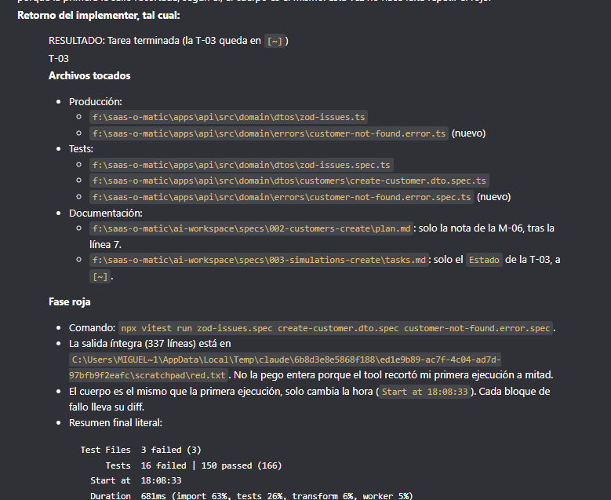
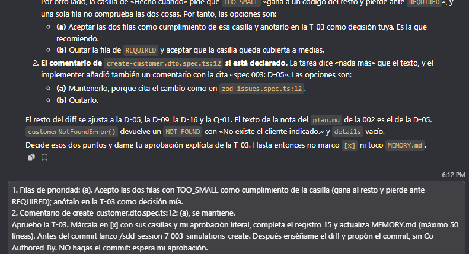

# 003-simulations-create — Fase 7 (2026-11-23, sesión 15)

## Objetivo y fase
Fase 7, spec `003-simulations-create`: puerta 5 (implementación) con `/sdd-implement`, T-03 (`domain`: textos de `TOO_SMALL` y `TOO_BIG`, traductor y error `NOT_FOUND`). La spec sigue en `En implementación`.

## Prompts clave
Lanzamiento de la puerta 5:
> /sdd-implement 003-simulations-create

Confirmación de la tarea:
> Confirmo la T-03, con Sonnet 5.5.

## T-03 · Fase roja (salida íntegra, copiada en el momento de recibirla)
Comando: `npx vitest run zod-issues.spec create-customer.dto.spec customer-not-found.error.spec` (antes de tocar el código de producción).

El implementer guardó la salida íntegra en el scratchpad (337 líneas) en una segunda ejecución del mismo comando, porque la herramienta le recortó la primera. Según su retorno, el cuerpo es igual y solo cambia la hora. Copia literal:

```

 RUN  v5.1.1 F:/saas-o-matic

 ❯ |api| src/domain/errors/customer-not-found.error.spec.ts (0 test)
 ❯ |api| src/domain/dtos/zod-issues.spec.ts (41 tests | 6 failed) 53ms
   ❯ toDetails: regla 3, resto de códigos (13)
     × refine con params.code TOO_BIG da ese código 9ms
     × refine con params.code TOO_SMALL da ese código 4ms
     × refine con params.code INVALID_TYPE da ese código 2ms
   ❯ toDetails: regla 4, un elemento por campo con prioridad (R-14, R-35) (9)
     × con ["INVALID_TAX_ID","TOO_SMALL"] da un solo elemento TOO_SMALL 2ms
     × TOO_BIG gana a INVALID_FORMAT en el mismo campo 2ms
   ❯ MESSAGES (D-03) (1)
     × tiene los textos literales de M-03 a M-10 y TOO_SMALL (spec 003: D-04) 2ms
 ❯ |api| src/domain/dtos/customers/create-customer.dto.spec.ts (125 tests | 10 failed) 70ms
   ❯ C-13: máximo de companyName, tras recortar (R-10, R-17) (3)
     × 201 caracteres da TOO_BIG 7ms
   ❯ C-40: máximo del email, tras recortar (R-28) (3)
     × email de 255 da TOO_BIG 1ms
   ❯ C-36 a C-38: longitud y caracteres del identificador (R-29, R-30) (6)
     × C-37: 21 caracteres en ES da TOO_BIG 1ms
     × C-37: 21 caracteres en PT da TOO_BIG 1ms
     × C-37: 21 caracteres en FR da TOO_BIG 1ms
     × C-37: 21 caracteres en IT da TOO_BIG 1ms
   ❯ C-44: con país no válido, solo las comprobaciones que no dependen del país (R-33) (4)
     × (3) XX y 21 caracteres: country INVALID_VALUE y taxId TOO_BIG 1ms
   ❯ C-46 y C-52: longitud en unidades UTF-16 (R-29, D-12) (3)
     × C-46: once 𝐀 en PT dan un solo TOO_BIG 1ms
     × C-52: 20 caracteres más ß en PT dan TOO_BIG 1ms
   ❯ C-47: email largo y sin @ (R-28, Decisión 2026-11-23 #31) (1)
     × 300 caracteres sin @ dan un solo TOO_BIG 1ms

⎯⎯⎯⎯⎯⎯ Failed Suites 1 ⎯⎯⎯⎯⎯⎯⎯

 FAIL  |api| src/domain/errors/customer-not-found.error.spec.ts [ apps/api/src/domain/errors/customer-not-found.error.spec.ts ]
Error: Cannot find module './customer-not-found.error.js' imported from F:/saas-o-matic/apps/api/src/domain/errors/customer-not-found.error.spec.ts
 ❯ src/domain/errors/customer-not-found.error.spec.ts:3:1
      1| import { describe, expect, it } from 'vitest';
      2| import { CustomError } from './custom.error.js';
      3| import { CUSTOMER_NOT_FOUND_MESSAGE, customerNotFoundError } from './c…
       | ^
      4|
      5| // Error NOT_FOUND del cliente (spec 003, T-03; plan D-03 y D-07; R-28…

⎯⎯⎯⎯⎯⎯⎯⎯⎯⎯⎯⎯⎯⎯⎯⎯⎯⎯⎯⎯⎯⎯⎯[1/14]⎯


⎯⎯⎯⎯⎯⎯ Failed Tests 16 ⎯⎯⎯⎯⎯⎯⎯

 FAIL  |api| src/domain/dtos/zod-issues.spec.ts > toDetails: regla 3, resto de códigos > refine con params.code TOO_BIG da ese código
AssertionError: expected [ { field: 'name', …(2) } ] to deeply equal [ { field: 'name', …(2) } ]

- Expected
+ Received

  [
    {
      "code": "TOO_BIG",
      "field": "name",
-     "message": "Supera el máximo permitido.",
+     "message": "Supera la longitud máxima.",
    },
  ]

 ❯ src/domain/dtos/zod-issues.spec.ts:115:46
    113|     const [issue] = issuesOf(schema, { name: 'a' }, true);
    114|     expect(issue).toMatchObject({ code: 'custom', params: { code } });
    115|     expect(detailsOf(schema, { name: 'a' })).toEqual([{ field: 'name',…
       |                                              ^
    116|   });
    117|

⎯⎯⎯⎯⎯⎯⎯⎯⎯⎯⎯⎯⎯⎯⎯⎯⎯⎯⎯⎯⎯⎯⎯[2/14]⎯

 FAIL  |api| src/domain/dtos/zod-issues.spec.ts > toDetails: regla 3, resto de códigos > refine con params.code TOO_SMALL da ese código
AssertionError: expected [ { field: 'name', …(2) } ] to deeply equal [ { field: 'name', …(2) } ]

- Expected
+ Received

  [
    {
-     "code": "TOO_SMALL",
+     "code": "INVALID_VALUE",
      "field": "name",
-     "message": "Está por debajo del mínimo permitido.",
+     "message": "El valor no está entre los admitidos.",
    },
  ]

 ❯ src/domain/dtos/zod-issues.spec.ts:115:46
    113|     const [issue] = issuesOf(schema, { name: 'a' }, true);
    114|     expect(issue).toMatchObject({ code: 'custom', params: { code } });
    115|     expect(detailsOf(schema, { name: 'a' })).toEqual([{ field: 'name',…
       |                                              ^
    116|   });
    117|

⎯⎯⎯⎯⎯⎯⎯⎯⎯⎯⎯⎯⎯⎯⎯⎯⎯⎯⎯⎯⎯⎯⎯[3/14]⎯

 FAIL  |api| src/domain/dtos/zod-issues.spec.ts > toDetails: regla 3, resto de códigos > refine con params.code INVALID_TYPE da ese código
AssertionError: expected [ { field: 'name', …(2) } ] to deeply equal [ { field: 'name', …(2) } ]

- Expected
+ Received

  [
    {
-     "code": "INVALID_TYPE",
+     "code": "INVALID_VALUE",
      "field": "name",
-     "message": "El tipo de dato no es válido.",
+     "message": "El valor no está entre los admitidos.",
    },
  ]

 ❯ src/domain/dtos/zod-issues.spec.ts:115:46
    113|     const [issue] = issuesOf(schema, { name: 'a' }, true);
    114|     expect(issue).toMatchObject({ code: 'custom', params: { code } });
    115|     expect(detailsOf(schema, { name: 'a' })).toEqual([{ field: 'name',…
       |                                              ^
    116|   });
    117|

⎯⎯⎯⎯⎯⎯⎯⎯⎯⎯⎯⎯⎯⎯⎯⎯⎯⎯⎯⎯⎯⎯⎯[4/14]⎯

 FAIL  |api| src/domain/dtos/zod-issues.spec.ts > toDetails: regla 4, un elemento por campo con prioridad (R-14, R-35) > con ["INVALID_TAX_ID","TOO_SMALL"] da un solo elemento TOO_SMALL
AssertionError: expected { field: 'name', …(2) } to match object { field: 'name', code: 'TOO_SMALL' }
(1 matching property omitted from actual)

- Expected
+ Received

  {
-   "code": "TOO_SMALL",
+   "code": "INVALID_TAX_ID",
    "field": "name",
  }

 ❯ src/domain/dtos/zod-issues.spec.ts:168:24
    166|     const details = detailsOf(fieldWith(codes), { name: 'a' });
    167|     expect(details).toHaveLength(1);
    168|     expect(details[0]).toMatchObject({ field: 'name', code: expected }…
       |                        ^
    169|   });
    170|

⎯⎯⎯⎯⎯⎯⎯⎯⎯⎯⎯⎯⎯⎯⎯⎯⎯⎯⎯⎯⎯⎯⎯[5/14]⎯

 FAIL  |api| src/domain/dtos/zod-issues.spec.ts > toDetails: regla 4, un elemento por campo con prioridad (R-14, R-35) > TOO_BIG gana a INVALID_FORMAT en el mismo campo
AssertionError: expected [ { field: 'email', …(2) } ] to deeply equal [ { field: 'email', …(2) } ]

- Expected
+ Received

  [
    {
      "code": "TOO_BIG",
      "field": "email",
-     "message": "Supera el máximo permitido.",
+     "message": "Supera la longitud máxima.",
    },
  ]

 ❯ src/domain/dtos/zod-issues.spec.ts:179:53
    177|       'custom',
    178|     ]);
    179|     expect(detailsOf(schema, { email: 'abcdefg' })).toEqual([{ field: …
       |                                                     ^
    180|   });
    181|

⎯⎯⎯⎯⎯⎯⎯⎯⎯⎯⎯⎯⎯⎯⎯⎯⎯⎯⎯⎯⎯⎯⎯[6/14]⎯

 FAIL  |api| src/domain/dtos/zod-issues.spec.ts > MESSAGES (D-03) > tiene los textos literales de M-03 a M-10 y TOO_SMALL (spec 003: D-04)
AssertionError: expected { …(7) } to deeply equal { …(8) }

- Expected
+ Received

@@ -2,9 +2,8 @@
    "INVALID_FORMAT": "El formato no es válido.",
    "INVALID_TAX_ID": "El identificador fiscal no es válido.",
    "INVALID_TYPE": "El tipo de dato no es válido.",
    "INVALID_VALUE": "El valor no está entre los admitidos.",
    "REQUIRED": "Este campo es obligatorio.",
-   "TOO_BIG": "Supera el máximo permitido.",
-   "TOO_SMALL": "Está por debajo del mínimo permitido.",
+   "TOO_BIG": "Supera la longitud máxima.",
    "UNKNOWN_FIELD": "Campo no admitido.",
  }

 ❯ src/domain/dtos/zod-issues.spec.ts:213:22
    211| describe('MESSAGES (D-03)', () => {
    212|   it('tiene los textos literales de M-03 a M-10 y TOO_SMALL (spec 003:…
    213|     expect(MESSAGES).toEqual({
       |                      ^
    214|       REQUIRED: M03,
    215|       INVALID_TYPE: M04,

⎯⎯⎯⎯⎯⎯⎯⎯⎯⎯⎯⎯⎯⎯⎯⎯⎯⎯⎯⎯⎯⎯⎯[7/14]⎯

 FAIL  |api| src/domain/dtos/customers/create-customer.dto.spec.ts > C-13: máximo de companyName, tras recortar (R-10, R-17) > 201 caracteres da TOO_BIG
AssertionError: expected 'Supera la longitud máxima.' to be 'Supera el máximo permitido.' // Object.is equality

Expected: "Supera el máximo permitido."
Received: "Supera la longitud máxima."

 ❯ detailsOf src/domain/dtos/customers/create-customer.dto.spec.ts:47:59
     45|   expect(error!.code).toBe('VALIDATION_ERROR');
     46|   expect(error!.message).toBe(M11);
     47|   for (const item of error!.details) expect(item.message).toBe(MESSAGE…
       |                                                           ^
     48|   return error!.details;
     49| };
 ❯ expectSingle src/domain/dtos/customers/create-customer.dto.spec.ts:53:10
 ❯ src/domain/dtos/customers/create-customer.dto.spec.ts:191:5

⎯⎯⎯⎯⎯⎯⎯⎯⎯⎯⎯⎯⎯⎯⎯⎯⎯⎯⎯⎯⎯⎯⎯[8/14]⎯

 FAIL  |api| src/domain/dtos/customers/create-customer.dto.spec.ts > C-40: máximo del email, tras recortar (R-28) > email de 255 da TOO_BIG
AssertionError: expected 'Supera la longitud máxima.' to be 'Supera el máximo permitido.' // Object.is equality

Expected: "Supera el máximo permitido."
Received: "Supera la longitud máxima."

 ❯ detailsOf src/domain/dtos/customers/create-customer.dto.spec.ts:47:59
     45|   expect(error!.code).toBe('VALIDATION_ERROR');
     46|   expect(error!.message).toBe(M11);
     47|   for (const item of error!.details) expect(item.message).toBe(MESSAGE…
       |                                                           ^
     48|   return error!.details;
     49| };
 ❯ expectSingle src/domain/dtos/customers/create-customer.dto.spec.ts:53:10
 ❯ src/domain/dtos/customers/create-customer.dto.spec.ts:209:5

⎯⎯⎯⎯⎯⎯⎯⎯⎯⎯⎯⎯⎯⎯⎯⎯⎯⎯⎯⎯⎯⎯⎯[9/14]⎯

 FAIL  |api| src/domain/dtos/customers/create-customer.dto.spec.ts > C-36 a C-38: longitud y caracteres del identificador (R-29, R-30) > C-37: 21 caracteres en ES da TOO_BIG
 FAIL  |api| src/domain/dtos/customers/create-customer.dto.spec.ts > C-36 a C-38: longitud y caracteres del identificador (R-29, R-30) > C-37: 21 caracteres en PT da TOO_BIG
 FAIL  |api| src/domain/dtos/customers/create-customer.dto.spec.ts > C-36 a C-38: longitud y caracteres del identificador (R-29, R-30) > C-37: 21 caracteres en FR da TOO_BIG
 FAIL  |api| src/domain/dtos/customers/create-customer.dto.spec.ts > C-36 a C-38: longitud y caracteres del identificador (R-29, R-30) > C-37: 21 caracteres en IT da TOO_BIG
AssertionError: expected 'Supera la longitud máxima.' to be 'Supera el máximo permitido.' // Object.is equality

Expected: "Supera el máximo permitido."
Received: "Supera la longitud máxima."

 ❯ detailsOf src/domain/dtos/customers/create-customer.dto.spec.ts:47:59
     45|   expect(error!.code).toBe('VALIDATION_ERROR');
     46|   expect(error!.message).toBe(M11);
     47|   for (const item of error!.details) expect(item.message).toBe(MESSAGE…
       |                                                           ^
     48|   return error!.details;
     49| };
 ❯ expectSingle src/domain/dtos/customers/create-customer.dto.spec.ts:53:10
 ❯ src/domain/dtos/customers/create-customer.dto.spec.ts:328:5

⎯⎯⎯⎯⎯⎯⎯⎯⎯⎯⎯⎯⎯⎯⎯⎯⎯⎯⎯⎯⎯⎯[10/14]⎯

 FAIL  |api| src/domain/dtos/customers/create-customer.dto.spec.ts > C-44: con país no válido, solo las comprobaciones que no dependen del país (R-33) > (3) XX y 21 caracteres: country INVALID_VALUE y taxId TOO_BIG
AssertionError: expected 'Supera la longitud máxima.' to be 'Supera el máximo permitido.' // Object.is equality

Expected: "Supera el máximo permitido."
Received: "Supera la longitud máxima."

 ❯ detailsOf src/domain/dtos/customers/create-customer.dto.spec.ts:47:59
     45|   expect(error!.code).toBe('VALIDATION_ERROR');
     46|   expect(error!.message).toBe(M11);
     47|   for (const item of error!.details) expect(item.message).toBe(MESSAGE…
       |                                                           ^
     48|   return error!.details;
     49| };
 ❯ expectDetails src/domain/dtos/customers/create-customer.dto.spec.ts:58:19
 ❯ src/domain/dtos/customers/create-customer.dto.spec.ts:346:5

⎯⎯⎯⎯⎯⎯⎯⎯⎯⎯⎯⎯⎯⎯⎯⎯⎯⎯⎯⎯⎯⎯[11/14]⎯

 FAIL  |api| src/domain/dtos/customers/create-customer.dto.spec.ts > C-46 y C-52: longitud en unidades UTF-16 (R-29, D-12) > C-46: once 𝐀 en PT dan un solo TOO_BIG
AssertionError: expected 'Supera la longitud máxima.' to be 'Supera el máximo permitido.' // Object.is equality

Expected: "Supera el máximo permitido."
Received: "Supera la longitud máxima."

 ❯ detailsOf src/domain/dtos/customers/create-customer.dto.spec.ts:47:59
     45|   expect(error!.code).toBe('VALIDATION_ERROR');
     46|   expect(error!.message).toBe(M11);
     47|   for (const item of error!.details) expect(item.message).toBe(MESSAGE…
       |                                                           ^
     48|   return error!.details;
     49| };
 ❯ expectSingle src/domain/dtos/customers/create-customer.dto.spec.ts:53:10
 ❯ src/domain/dtos/customers/create-customer.dto.spec.ts:372:5

⎯⎯⎯⎯⎯⎯⎯⎯⎯⎯⎯⎯⎯⎯⎯⎯⎯⎯⎯⎯⎯⎯[12/14]⎯

 FAIL  |api| src/domain/dtos/customers/create-customer.dto.spec.ts > C-46 y C-52: longitud en unidades UTF-16 (R-29, D-12) > C-52: 20 caracteres más ß en PT dan TOO_BIG
AssertionError: expected 'Supera la longitud máxima.' to be 'Supera el máximo permitido.' // Object.is equality

Expected: "Supera el máximo permitido."
Received: "Supera la longitud máxima."

 ❯ detailsOf src/domain/dtos/customers/create-customer.dto.spec.ts:47:59
     45|   expect(error!.code).toBe('VALIDATION_ERROR');
     46|   expect(error!.message).toBe(M11);
     47|   for (const item of error!.details) expect(item.message).toBe(MESSAGE…
       |                                                           ^
     48|   return error!.details;
     49| };
 ❯ expectSingle src/domain/dtos/customers/create-customer.dto.spec.ts:53:10
 ❯ src/domain/dtos/customers/create-customer.dto.spec.ts:380:5

⎯⎯⎯⎯⎯⎯⎯⎯⎯⎯⎯⎯⎯⎯⎯⎯⎯⎯⎯⎯⎯⎯[13/14]⎯

 FAIL  |api| src/domain/dtos/customers/create-customer.dto.spec.ts > C-47: email largo y sin @ (R-28, Decisión 2026-11-23 #31) > 300 caracteres sin @ dan un solo TOO_BIG
AssertionError: expected 'Supera la longitud máxima.' to be 'Supera el máximo permitido.' // Object.is equality

Expected: "Supera el máximo permitido."
Received: "Supera la longitud máxima."

 ❯ detailsOf src/domain/dtos/customers/create-customer.dto.spec.ts:47:59
     45|   expect(error!.code).toBe('VALIDATION_ERROR');
     46|   expect(error!.message).toBe(M11);
     47|   for (const item of error!.details) expect(item.message).toBe(MESSAGE…
       |                                                           ^
     48|   return error!.details;
     49| };
 ❯ expectSingle src/domain/dtos/customers/create-customer.dto.spec.ts:53:10
 ❯ src/domain/dtos/customers/create-customer.dto.spec.ts:386:5

⎯⎯⎯⎯⎯⎯⎯⎯⎯⎯⎯⎯⎯⎯⎯⎯⎯⎯⎯⎯⎯⎯[14/14]⎯


 Test Files  3 failed (3)
      Tests  16 failed | 150 passed (166)
   Start at  18:08:33
   Duration  681ms (import 63%, tests 26%, transform 6%, worker 5%)

```

Decisiones sobre el retorno, aprobación de la T-03 y orden de cierre:
> 1. Filas de prioridad: (a). Acepto las dos filas con TOO_SMALL como cumplimiento de la casilla (gana al resto y pierde ante REQUIRED); anótalo en la T-03 como decisión mía.
> 2. Comentario de create-customer.dto.spec.ts:12: (a), se mantiene.
> Apruebo la T-03. Márcala en [x] con sus casillas y mi aprobación literal, completa el registro 15 y actualiza MEMORY.md (máximo 50 líneas). Antes del commit lanzo /sdd-session 7 003-simulations-create. Después enséñame el diff y propón el commit, sin Co-Authored-By. NO hagas el commit: espera mi aprobación.

Registro de la sesión:
> /sdd-session 7 003-simulations-create

## T-03 · Verde
- Retorno del implementer: los tres ficheros de la tarea, `Test Files 3 passed (3)`, `Tests 168 passed (168)`; `npm run verify` con código 0.
- Relanzado por la sesión principal, `npm run verify` con código 0:
  ```
   Test Files  24 passed (24)
        Tests  537 passed (537)
   Test Files  3 passed (3)
        Tests  14 passed (14)
  ```

## Qué propuso la IA
- Puerta 5, siguiente tarea: la T-03 con el implementer en Sonnet 5.5, como se confirmó en la puerta 4. Es la única que no depende de otra pendiente y bloquea a la T-04.
- Antes de lanzar el implementer, `npm run verify` en verde (532 + 14), con su salida literal en el encargo. El encargo se lanzó sin enseñarlo antes (ADR-016, punto 4), con la D-03 a la D-05, la D-07, la D-09, la D-16 y la Q-01 literales, y con la petición expresa de la salida íntegra de la fase roja (aprendizaje de la T-02).
- Al volver el implementer:
  - `git status` y `git diff --stat`: solo cambiaron `zod-issues.ts`, `customer-not-found.error.ts` (nuevo), los tres tests, la nota del `plan.md` de la 002 y el `Estado` de la T-03 en `tasks.md`.
  - La fase roja íntegra (337 líneas, 16 fallos y 150 en verde) se copió a este registro al recibirla.
  - La sesión principal relanzó `npm run verify` en verde (537 + 14).
- Dos puntos para el autor:
  1. Desviación no declarada: dos filas de prioridad con `TOO_SMALL` en `zod-issues.spec.ts`, cuando la Q-01 nombraba una; el retorno contaba «1 fila de prioridad», pero el recuento (5 tests nuevos) solo cuadra con dos. (a) aceptarlas como cumplimiento de la casilla (gana al resto y pierde ante `REQUIRED`), o (b) quitar la de `REQUIRED`. Recomendada: (a).
  2. Desviación declarada: comentario con la cita «spec 003: D-05» en `create-customer.dto.spec.ts:12`, donde la tarea decía «nada más». (a) mantenerlo o (b) quitarlo.
- Tras la aprobación: marcó la T-03 y sus casillas con la aprobación y las dos decisiones literales, completó este registro y actualizó `MEMORY.md` (50 líneas).

## Qué corregí y por qué
- Nada que corregir del trabajo: el autor aceptó las dos desviaciones con la opción (a). Motivo de la primera, literal: «como cumplimiento de la casilla (gana al resto y pierde ante REQUIRED)». Motivo de la segunda: (no registrado).

## Decisiones tomadas
- T-03 con el implementer en Sonnet 5.5 (confirmación del autor).
- Dos filas de prioridad con `TOO_SMALL` en `zod-issues.spec.ts`: aceptadas por el autor y anotadas en la T-03 como decisión suya.
- Comentario de `create-customer.dto.spec.ts:12`: se mantiene (decisión del autor, anotada en la T-03).
- T-03 aprobada por el autor, con su aprobación literal en `tasks.md`; `npm run verify` en verde (537 + 14).
- Aprendizaje en `MEMORY.md`: comparar el diff del implementer con la lista literal de la tarea y cuadrar el número de tests nuevos.
- Commit: el de cierre de esta sesión.

## Capturas



## Pendiente para la siguiente sesión
- Puerta 5 de la spec 003: la T-04 (DTO, entidad, puertos y caso de uso de la simulación) con el implementer en Opus 5.5. Depende de la T-01 y la T-03, ya hechas.
- En el encargo del implementer, seguir pidiendo la salida íntegra de la fase roja y que declare en «Desviaciones» todo lo que añada fuera de la lista literal de la tarea.
