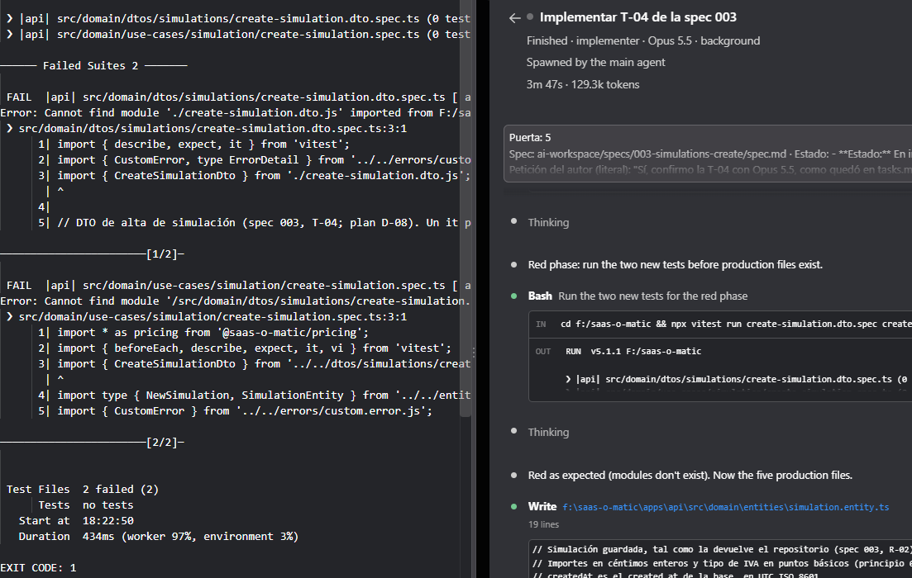
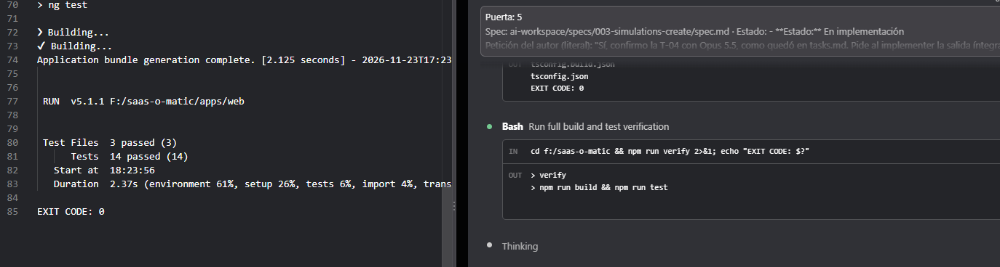
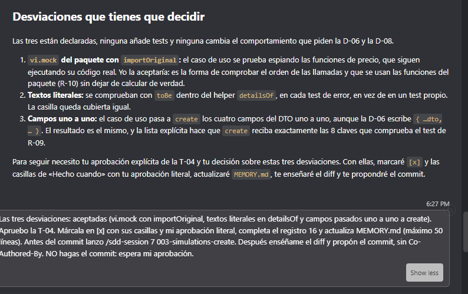

# 003-simulations-create — Fase 7 (2026-11-23, sesión 16)

## Objetivo y fase
Fase 7, spec `003-simulations-create`: puerta 5 (implementación) con `/sdd-implement`, T-04 (`domain`: DTO, entidad, puertos y caso de uso de la simulación). La spec sigue en `En implementación`.

## Prompts clave
Lanzamiento de la puerta 5:
> /sdd-implement 003-simulations-create

Confirmación de la tarea:
> Sí, confirmo la T-04 con Opus 5.5, como quedó en tasks.md. Pide al implementer la salida íntegra del rojo, sin abreviar.

Decisión sobre las desviaciones y aprobación:
> Las tres desviaciones: aceptadas (vi.mock con importOriginal, textos literales en detailsOf y campos pasados uno a uno a create).
> Apruebo la T-04. Márcala en [x] con sus casillas y mi aprobación literal, completa el registro 16 y actualiza MEMORY.md (máximo 50 líneas). Antes del commit lanzo /sdd-session 7 003-simulations-create. Después enséñame el diff y propón el commit, sin Co-Authored-By. NO hagas el commit: espera mi aprobación.

## Qué propuso la IA
- **Tarea:** leí la línea `Estado:` de la spec (`- **Estado:** En implementación`) y `tasks.md`, con la T-01 a la T-03 en `[x]`, y propuse la T-04 con Opus 5.5. También propuse cómo prepararla: `npm run verify` previo con su salida literal en el encargo, salida íntegra del rojo y encargo sin enseñarlo antes (ADR-016, punto 4).
- **Estado previo:** `npm run verify` salió con código 0 (537 + 14). Su salida literal completa fue en el encargo.
- **Encargo:** lancé al implementer (Opus 5.5) con las decisiones D-03 a D-10 del plan, rutas acotadas, la fila literal de la T-04 y tu petición del rojo íntegro. Le pedí también el recuento de tests nuevos por fichero y que declarara cualquier test de más en «Desviaciones».
- **Retorno del implementer:**
  - cinco ficheros de producción nuevos en `apps/api/src/domain/`: `create-simulation.dto.ts`, `simulation.entity.ts`, `simulation.datasource.ts`, `simulation.repository.ts` y `create-simulation.ts`;
  - dos tests nuevos: el del DTO con 82 y el del caso de uso con 12, 94 en total;
  - tres desviaciones declaradas.
- **Comprobaciones de la sesión principal:**
  - `git status` y `git diff --stat`: solo los siete ficheros de la tarea y `tasks.md` en `[~] en curso`.
  - `npm run verify` relanzado: código 0, 631 + 14. El recuento cuadra: 537 + 94 = 631.
  - Los `import` de los cinco ficheros solo usan `zod`, `@saas-o-matic/pricing` o ficheros de `domain`.
  - El DTO sigue el orden de la D-08 y el caso de uso los pasos 1 a 5 de la D-06.
- **Las tres desviaciones, para tu decisión, con mi recomendación de aceptarlas:**
  1. `vi.mock` del paquete con `importOriginal`, para comprobar el orden de las llamadas y R-10 sin dejar de calcular de verdad;
  2. los textos literales, comprobados con `toBe` en el helper `detailsOf`;
  3. los campos pasados uno a uno a `create` en vez de `…dto`.
- **Cierre de la tarea:** T-04 en `[x]` con sus 22 casillas y tus textos literales en `tasks.md`. Registro 16 completado. `MEMORY.md` en 50 líneas, con la T-04 y la T-05 como siguiente. Propuesta de commit, sin hacerlo.

## T-04 · Fase roja (salida íntegra, copiada en el momento de recibirla)
Comando: `cd f:/saas-o-matic && npx vitest run create-simulation.dto.spec create-simulation.spec 2>&1; echo "EXIT CODE: $?"` (con los dos tests escritos y sin ningún fichero de producción).

Copia literal del retorno del implementer:

```
 RUN  v5.1.1 F:/saas-o-matic

 ❯ |api| src/domain/dtos/simulations/create-simulation.dto.spec.ts (0 test)
 ❯ |api| src/domain/use-cases/simulation/create-simulation.spec.ts (0 test)

⎯⎯⎯⎯⎯⎯ Failed Suites 2 ⎯⎯⎯⎯⎯⎯⎯

 FAIL  |api| src/domain/dtos/simulations/create-simulation.dto.spec.ts [ apps/api/src/domain/dtos/simulations/create-simulation.dto.spec.ts ]
Error: Cannot find module './create-simulation.dto.js' imported from F:/saas-o-matic/apps/api/src/domain/dtos/simulations/create-simulation.dto.spec.ts
 ❯ src/domain/dtos/simulations/create-simulation.dto.spec.ts:3:1
      1| import { describe, expect, it } from 'vitest';
      2| import { CustomError, type ErrorDetail } from '../../errors/custom.err…
      3| import { CreateSimulationDto } from './create-simulation.dto.js';
       | ^
      4|
      5| // DTO de alta de simulación (spec 003, T-04; plan D-08). Un it por en…

⎯⎯⎯⎯⎯⎯⎯⎯⎯⎯⎯⎯⎯⎯⎯⎯⎯⎯⎯⎯⎯⎯⎯⎯[1/2]⎯

 FAIL  |api| src/domain/use-cases/simulation/create-simulation.spec.ts [ apps/api/src/domain/use-cases/simulation/create-simulation.spec.ts ]
Error: Cannot find module '/src/domain/dtos/simulations/create-simulation.dto.js' imported from F:/saas-o-matic/apps/api/src/domain/use-cases/simulation/create-simulation.spec.ts
 ❯ src/domain/use-cases/simulation/create-simulation.spec.ts:3:1
      1| import * as pricing from '@saas-o-matic/pricing';
      2| import { beforeEach, describe, expect, it, vi } from 'vitest';
      3| import { CreateSimulationDto } from '../../dtos/simulations/create-sim…
       | ^
      4| import type { NewSimulation, SimulationEntity } from '../../entities/s…
      5| import { CustomError } from '../../errors/custom.error.js';

⎯⎯⎯⎯⎯⎯⎯⎯⎯⎯⎯⎯⎯⎯⎯⎯⎯⎯⎯⎯⎯⎯⎯⎯[2/2]⎯


 Test Files  2 failed (2)
      Tests  no tests
   Start at  18:22:50
   Duration  434ms (worker 97%, environment 3%)

EXIT CODE: 1
```

## Qué corregí y por qué
- **Petición sobre el rojo:** pediste expresamente que el encargo exigiera la salida íntegra del rojo, sin abreviar. El motivo concreto no consta en esta conversación (no registrado). El implementer la dio íntegra.
- **Argumentos de `/sdd-session`:** lo lanzaste primero sin argumentos. Te pregunté la fase y el tema, y lo relanzaste con `7 003-simulations-create`.
- Ninguna otra corrección a las propuestas de la IA.

## Decisiones tomadas
- **T-04 confirmada con Opus 5.5,** como quedó en `tasks.md`.
- **Las tres desviaciones del implementer, aceptadas:** `vi.mock` con `importOriginal`, textos literales en `detailsOf` y campos pasados uno a uno a `create`. Decisión literal en `tasks.md`.
- **T-04 aprobada:** «Apruebo la T-04.» `npm run verify` en verde (631 + 14).
- **Orden de cierre:** `MEMORY.md` → `/sdd-session` → commit, sin `Co-Authored-By` y con tu aprobación previa.
- **Commit:** el de cierre de esta sesión.

## Capturas




## Pendiente para la siguiente sesión
- **T-05** (`infrastructure`: datasource y repositorio de simulaciones) con el implementer en Sonnet 5.5, y comprobar `-0` en SQLite con el test del datasource (D-11). Después, la T-06 (`presentation`) con Opus 5.5.
- **Puerta 6:** el revisor sigue H-10 y H-11, y sigue pendiente la reserva H-04 de la puerta 2.
