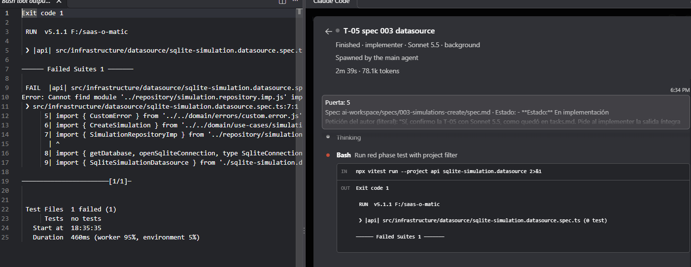
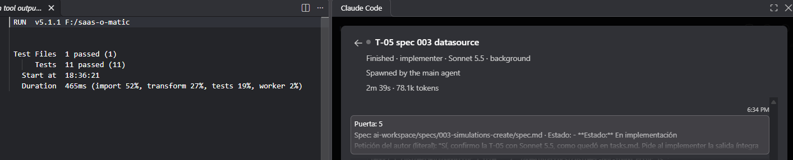
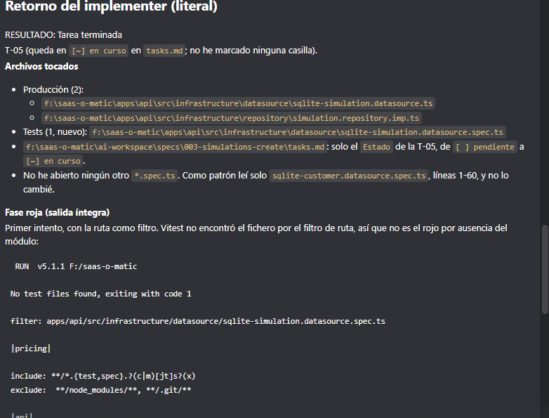

# 003-simulations-create — Fase 7 (2026-11-23, sesión 17)

## Objetivo y fase
Fase 7, spec `003-simulations-create`: puerta 5 (implementación) con `/sdd-implement`, T-05 (`infrastructure`: datasource y repositorio de simulaciones). La spec sigue en `En implementación`.

## Prompts clave
Lanzamiento de la puerta 5:
> /sdd-implement 003-simulations-create

Confirmación de la tarea:
> Sí, confirmo la T-05 con Sonnet 5.5, como quedó en tasks.md. Pide al implementer la salida íntegra del rojo, sin abreviar, y que no abra ningún test fuera de las casillas de la tarea.

Decisión sobre las desviaciones y aprobación:
> Las desviaciones 2, 3 y 4: aceptadas (CHECK del total para provocar el error que no es de clave foránea, importes a 0 por la migración y test extra borrado).
> Apruebo la T-05. Márcala en [x] con sus casillas y mi aprobación literal, completa el registro 17 y actualiza MEMORY.md (máximo 50 líneas). Antes del commit lanzo /sdd-session 7 003-simulations-create. Después enséñame el diff y propón el commit, sin Co-Authored-By. NO hagas el commit: espera mi aprobación.

Registro de la sesión:
> /sdd-session 7 003-simulations-create

## Qué propuso la IA
- **Tarea:** leí la línea `Estado:` de la spec (`- **Estado:** En implementación`) y `tasks.md`, con la T-01 a la T-04 en `[x]`, y propuse la T-05 con Sonnet 5.5, con `npm run verify` previo, salida íntegra del rojo y encargo sin enseñarlo antes (ADR-016, punto 4).
- **Estado previo:** `npm run verify` salió con código 0 (631 + 14). Su salida fue en el encargo.
- **Encargo:** lancé al implementer (Sonnet 5.5) con D-06, D-11 y D-15 del plan, rutas acotadas, la fila literal de la T-05, el patrón del datasource de clientes de la 002 (solo lectura) y tus dos instrucciones: rojo íntegro y ningún test fuera de las casillas.
- **Retorno del implementer:**
  - dos ficheros de producción nuevos en `apps/api/src/infrastructure/`: `datasource/sqlite-simulation.datasource.ts` y `repository/simulation.repository.imp.ts`;
  - un test nuevo, `sqlite-simulation.datasource.spec.ts`, con 11 casos;
  - cuatro puntos en «Desviaciones»: el filtro de ruta de Vitest no funciona con los proyectos (hay que usar `--project api`), el CHECK del total para el error que no es de clave foránea, importes a 0 en el caso `-0` y un test extra borrado antes de ejecutar.
- **Comprobaciones de la sesión principal:**
  - `git status` y `git diff --stat`: solo los tres ficheros de la tarea y `tasks.md` en `[~] en curso`.
  - `npm run verify` relanzado: código 0, 642 + 14. El recuento cuadra: 631 + 11 = 642.
  - El código sigue la D-11; los `import` solo usan `domain` y `sqlite-connection`.
  - `-0` en SQLite (pendiente de MEMORY.md): el test confirma 0 en la fila y en `RETURNING` (`Object.is`).
  - El fragmento de código del rojo muestra las líneas 5 a 8 alrededor de la 7, como hace Vitest: la nota del implementer sobre la línea 9 «cortada» no indica pérdida de salida (lectura de la sesión principal; el rojo no se repitió).
- **Cierre de la tarea:** T-05 en `[x]` con sus 11 casillas y tus textos literales en `tasks.md`. Registro 17 completado. `MEMORY.md` actualizado, con la T-06 como siguiente.
- **Commit:** propuesta de mensaje «Fase 7 (sesión 17): puerta 5 de la spec 003-simulations-create con /sdd-implement, T-05: …», sin `Co-Authored-By`, sin hacerlo hasta tu aprobación.

## T-05 · Fase roja (salida íntegra, copiada en el momento de recibirla)
Retorno literal del implementer (Sonnet 5.5). Primer intento, con la ruta como filtro (no es el rojo: Vitest no encontró el fichero por el filtro):
```
 RUN  v5.1.1 F:/saas-o-matic

No test files found, exiting with code 1

filter: apps/api/src/infrastructure/datasource/sqlite-simulation.datasource.spec.ts

|pricing| 

include: **/*.{test,spec}.?(c|m)[jt]s?(x)
exclude:  **/node_modules/**, **/.git/**

|api| 

include: **/*.{test,spec}.?(c|m)[jt]s?(x)
exclude:  **/node_modules/**, **/.git/**

|web-tools| 

include: proxy.conf.spec.ts
exclude:  **/node_modules/**, **/.git/**
```

Segundo intento, `npx vitest run --project api sqlite-simulation.datasource`, con los dos ficheros de producción sin crear (el rojo):
```
 RUN  v5.1.1 F:/saas-o-matic

 ❯ |api| src/infrastructure/datasource/sqlite-simulation.datasource.spec.ts (0 test)

⎯⎯⎯⎯⎯⎯ Failed Suites 1 ⎯⎯⎯⎯⎯⎯⎯

 FAIL  |api| src/infrastructure/datasource/sqlite-simulation.datasource.spec.ts [ apps/api/src/infrastructure/datasource/sqlite-simulation.datasource.spec.ts ]
Error: Cannot find module '../repository/simulation.repository.imp.js' imported from F:/saas-o-matic/apps/api/src/infrastructure/datasource/sqlite-simulation.datasource.spec.ts
 ❯ src/infrastructure/datasource/sqlite-simulation.datasource.spec.ts:7:1
      5| import { CustomError } from '../../domain/errors/custom.error.js';
      6| import { CreateSimulation } from '../../domain/use-cases/simulation/cr…
      7| import { SimulationRepositoryImp } from '../repository/simulation.repo…
       | ^
      8| import { getDatabase, openSqliteConnection, type SqliteConnection } from '../sqlite-connection.js';

⎯⎯⎯⎯⎯⎯⎯⎯⎯⎯⎯⎯⎯⎯⎯⎯⎯⎯⎯⎯⎯⎯⎯⎯[1/1]⎯


 Test Files  1 failed (1)
      Tests  no tests
   Start at  18:35:35
   Duration  460ms (worker 95%, environment 5%)
```
Nota del implementer, literal: «La línea 9 del fragmento de código, `import { SqliteSimulationDatasource } …`, no sale en el volcado original: la herramienta cortó el último renglón. Lo copio tal como salió; la salida entera es la de arriba.»

## Qué corregí y por qué
- **Encargo:** añadiste que el implementer no abriera ningún test fuera de las casillas de la tarea. El motivo concreto no consta en esta conversación (no registrado). El implementer declaró que solo leyó como patrón `sqlite-customer.datasource.spec.ts` (líneas 1-60), sin cambiarlo.
- Ninguna otra corrección a las propuestas de la IA.

## Decisiones tomadas
- **T-05 confirmada con Sonnet 5.5,** como quedó en `tasks.md`.
- **Desviaciones 2, 3 y 4 del implementer, aceptadas:** CHECK del total para provocar el error que no es de clave foránea, importes a 0 por la migración y test extra borrado. Decisión literal en `tasks.md`.
- **T-05 aprobada:** «Apruebo la T-05.» `npm run verify` en verde (642 + 14).
- **Orden de cierre:** `MEMORY.md` → `/sdd-session` → commit, sin `Co-Authored-By` y con tu aprobación previa.
- **Commit:** el de cierre de esta sesión.

## Capturas




## Pendiente para la siguiente sesión
- **T-06** (`presentation`: `POST /simulations` y fila `NOT_FOUND`) con el implementer en Opus 5.5. Para el rojo de un solo fichero, usar `npx vitest run --project api <texto>` (el filtro por ruta completa no encuentra el test).
- **Puerta 6:** el revisor sigue H-10 y H-11, y sigue pendiente la reserva H-04 de la puerta 2.
