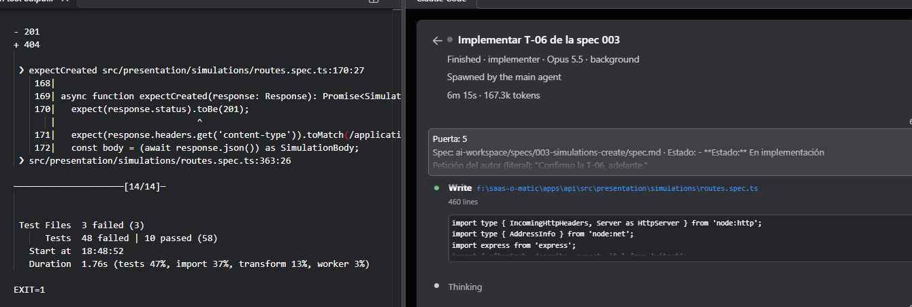
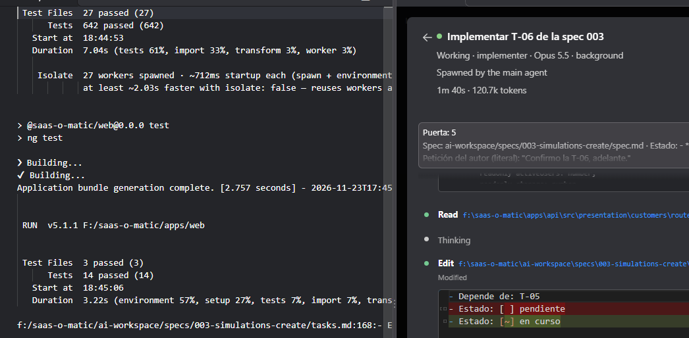

# 003-simulations-create — Fase 7 (2026-11-23, sesión 18)

## Objetivo y fase
Fase 7, spec `003-simulations-create`: puerta 5 (implementación) con `/sdd-implement`, T-06 (`presentation`: `POST /simulations` y fila `NOT_FOUND`). La spec sigue en `En implementación`.

## Prompts clave
Lanzamiento de la puerta 5:
> /sdd-implement 003-simulations-create

Confirmación de la tarea:
> Confirmo la T-06, adelante.

Decisión sobre las desviaciones y aprobación:
> Desviación 1: (a), el import y la constante NOT_FOUND_MESSAGE entran en «el test nuevo». Desviaciones 2 a 6: aceptadas.
> Apruebo la T-06. Márcala en [x] con sus casillas y mi aprobación literal, completa el registro 18 y actualiza MEMORY.md (máximo 50 líneas). Antes del commit lanzo /sdd-session 7 003-simulations-create. Después enséñame el diff y propón el commit, sin Co-Authored-By. NO hagas el commit: espera mi aprobación.

Registro de la sesión:
> /sdd-session 7 003-simulations-create

## Qué propuso la IA
- **Tarea:** leí la línea `Estado:` de la spec (`- **Estado:** En implementación`) y `tasks.md`, con la T-01 a la T-05 en `[x]`, y propuse la T-06 con Opus 5.5 (confirmado en la puerta 4), con `npm run verify` previo, salida íntegra del rojo y encargo sin enseñarlo antes (ADR-016, punto 4).
- **Estado previo:** `npm run verify` salió con código 0 (642 + 14). Su salida literal completa fue en el encargo (fichero del scratchpad).
- **Encargo:** lancé al implementer (Opus 5.5) con D-03, D-07, D-12, D-14, D-15 y D-16 del plan, rutas acotadas, la fila literal de la T-06 y el patrón de `presentation/customers/` de la 002; le pedí el rojo íntegro, el recuento de tests nuevos por fichero, los dos `git grep` con su salida, el `git diff` de `error-handler.spec.ts` y las desviaciones.
- **Retorno del implementer:**
  - cuatro ficheros de producción en `apps/api/src/presentation/`: `middlewares/error-handler.ts` (fila `NOT_FOUND: 404` y comentario literal de la D-12), `simulations/controller.ts` y `simulations/routes.ts` (nuevos, con `express.json({ strict: false })`, D-14) y `routes.ts` (monta `/simulations` antes de `errorHandler`);
  - tests: `error-handler.spec.ts` (spec 002, D-16 en `:39-46` y 1 test nuevo), `simulations/controller.spec.ts` (77, nuevo) y `simulations/routes.spec.ts` (46, nuevo): 124 nuevos;
  - los tres `git grep` sin resultados (código 1), el primero también con `--untracked`;
  - seis desviaciones: (1) `import` de `customerNotFoundError` y constante `NOT_FOUND_MESSAGE` en `error-handler.spec.ts`, fuera de las líneas que nombra la D-16; (2) C-13 por HTTP solo con -1 y 100001; (3) C-24 y C-35 por HTTP solo con los literales de la casilla y los decimales en `controller.spec.ts`; (4) segundo cliente ES de C-07 con el DNI `87654321X`; (5) clientes PT, FR e IT con `taxId` `123456789` y plan `business`; (6) el caso válido de `controller.spec.ts` usa el caso de uso y el paquete reales con el repositorio falso;
  - observación: la captura `fase-7-003-t06-verde.png` sin seguimiento no la creó él (es del autor).
- **Comprobaciones de la sesión principal:**
  - `git status` y `git diff --stat`: solo los cuatro ficheros de producción, los tres tests, `tasks.md` en `[~] en curso` y la captura del autor.
  - `npm run verify` relanzado: código 0, 766 + 14 (29 ficheros en la raíz). El recuento cuadra: 642 + 1 + 77 + 46 = 766.
  - El comentario de `error-handler.ts` es literal al de la D-12 y no hay más cambios en ese fichero; `simulations/routes.ts` no importa el driver de SQLite; `controller.spec.ts` tiene C-08 (72 cuerpos y el 404 sin `create`), C-28 y C-23.
  - Recomendé (a) para la desviación 1, por el patrón de constantes del propio fichero (`VALIDATION_MESSAGE`, `INTERNAL_MESSAGE`).
- **Decisión del autor:** desviación 1, (a); desviaciones 2 a 6, aceptadas.
- **Cierre de la tarea:** T-06 en `[x]` con sus 19 casillas y tus textos literales en `tasks.md`. Registro 18 completado. `MEMORY.md` actualizado: con la T-06 se terminan las seis tareas y lo siguiente es la puerta 6 (`/sdd-validate`).
- **Commit:** propuesta de mensaje «Fase 7 (sesión 18): puerta 5 de la spec 003-simulations-create con /sdd-implement, T-06: …», sin `Co-Authored-By`, sin hacerlo hasta tu aprobación.

## T-06 · Fase roja (salida íntegra, copiada en el momento de recibirla)
Retorno literal del implementer (Opus 5.5). Comando: `npx vitest run --project api error-handler simulations/controller simulations/routes` (código de salida 1).
```
 RUN  v5.1.1 F:/saas-o-matic

 ❯ |api| src/presentation/simulations/controller.spec.ts (0 test)
 ❯ |api| src/presentation/middlewares/error-handler.spec.ts (12 tests | 2 failed) 40ms
   ❯ STATUS_BY_CODE (1)
     × tiene las filas de D-11 (spec 002) y NOT_FOUND (spec 003: D-12) 23ms
   ❯ toHttpError (8)
     × spec 003: customerNotFoundError() da 404 NOT_FOUND sin la propiedad details (R-28, R-29; D-12) 2ms
 ❯ |api| src/presentation/simulations/routes.spec.ts (46 tests | 46 failed) 704ms
   ❯ POST /simulations (46)
     × C-01 (R-01, R-02, R-36): 201 con los diez campos en la raíz y los importes de C-01 150ms
     × C-34 (R-33): los nueve campos numéricos de la respuesta de C-01 son number enteros 27ms
     × C-02 (R-05 a R-07): cliente PT da base 14000, 2300 bps, IVA 3220 y total 17220 22ms
     × C-02 (R-05 a R-07): cliente FR da base 14000, 2000 bps, IVA 2800 y total 16800 18ms
     × C-02 (R-05 a R-07): cliente IT da base 14000, 2200 bps, IVA 3080 y total 17080 21ms
     × C-03 (R-04 a R-07, R-20): activeUsers 0 da 201 con 0, 2100, 0 y 0 17ms
     × C-04 (R-04 a R-07, R-20): activeUsers 100000 con un cliente ES 14ms
     × C-04 (R-04 a R-07, R-20): activeUsers 100000 con un cliente PT 14ms
     × C-06 (R-08): storage 0 y apiCalls 0 dan los importes de C-01 y se devuelven tal como llegan 14ms
     × C-06 (R-08): storage 1000000 y apiCalls 1000000000 dan los importes de C-01 y se devuelven tal como llegan 17ms
     × C-07 (R-09): un cliente ES starter y otro ES enterprise dan los mismos importes de C-01 27ms
     × C-18 (R-20): activeUsers 1e2 como texto JSON da 201 con 100, 67000, 14070 y 81070 12ms
     × C-18 (R-20): activeUsers 100.0 como texto JSON da 201 con 100, 67000, 14070 y 81070 14ms
     ❯ C-09 (R-11, R-24) (5)
       × {} da 400 con cuatro REQUIRED 8ms
       × sin customerId da 400 con un REQUIRED en ese campo 12ms
       × sin activeUsers da 400 con un REQUIRED en ese campo 13ms
       × sin storage da 400 con un REQUIRED en ese campo 11ms
       × sin apiCalls da 400 con un REQUIRED en ese campo 11ms
     × C-13 (R-15): activeUsers -1 da 400 con un elemento en activeUsers 15ms
     × C-13 (R-15): activeUsers 100001 da 400 con un elemento en activeUsers 12ms
     × C-22 (R-24, R-25): activeUsers -1 y sin customerId dan dos elementos, cada uno con field, code y message 8ms
     ❯ C-24 (R-15 a R-18, R-27, R-34): fuera de rango como texto JSON, un solo elemento de rango (8)
       × 1e400 (Infinity) en customerId da un TOO_BIG 9ms
       × 1e400 (Infinity) en activeUsers da un TOO_BIG 8ms
       × 1e400 (Infinity) en storage da un TOO_BIG 8ms
       × 1e400 (Infinity) en apiCalls da un TOO_BIG 7ms
       × -1e400 (-Infinity) en customerId da un TOO_SMALL 8ms
       × -1e400 (-Infinity) en activeUsers da un TOO_SMALL 7ms
       × -1e400 (-Infinity) en storage da un TOO_SMALL 7ms
       × -1e400 (-Infinity) en apiCalls da un TOO_SMALL 8ms
     × C-35 (R-34): customerId 9007199254740993 como texto JSON da 400 con un TOO_BIG en customerId 12ms
     × C-35 (R-34): customerId 9007199254740992 como texto JSON da 400 con un TOO_BIG en customerId 12ms
     ❯ C-36 (R-35): -0 como texto JSON (4)
       × activeUsers -0 da 201 con activeUsers 0 e importes a 0 12ms
       × storage -0 da 201 con el campo en 0 y los importes de C-01 11ms
       × apiCalls -0 da 201 con el campo en 0 y los importes de C-01 12ms
       × customerId -0 da 400 con un TOO_SMALL en customerId 11ms
     ❯ C-20 (R-22, R-11; plan D-14) (7)
       × (1) con Content-Type: application/json, [] da 400 con un único INVALID_TYPE sin field 9ms
       × (1) con Content-Type: application/json, null da 400 con un único INVALID_TYPE sin field 7ms
       × (1) con Content-Type: application/json, "texto" da 400 con un único INVALID_TYPE sin field 8ms
       × (1) con Content-Type: application/json, 42 da 400 con un único INVALID_TYPE sin field 7ms
       × (2) sin Content-Type y sin cuerpo: 400 con un único INVALID_TYPE sin field 9ms
       × (2) sin Content-Type y con un objeto válido como Uint8Array: 400 con un único INVALID_TYPE sin field 12ms
       × (3) con Content-Type: application/json y el cuerpo vacío: los cuatro REQUIRED de C-09 9ms
     × C-21 (R-23): { "customerId":  da 400 INVALID_JSON con M-12, sin details 10ms
     × C-25 (R-28, R-36): customerId 999 sin ese cliente da 404 NOT_FOUND sin details 13ms
     × C-37 (R-20, R-28): customerId 9007199254740991 (Number.MAX_SAFE_INTEGER) sin ese cliente da 404 NOT_FOUND sin details 13ms
     × C-26 (R-28, orden): customerId 999 sin cliente y activeUsers -1 dan 400 VALIDATION_ERROR, sin 404 11ms

⎯⎯⎯⎯⎯⎯ Failed Suites 1 ⎯⎯⎯⎯⎯⎯⎯

 FAIL  |api| src/presentation/simulations/controller.spec.ts [ apps/api/src/presentation/simulations/controller.spec.ts ]
Error: Cannot find module './controller.js' imported from F:/saas-o-matic/apps/api/src/presentation/simulations/controller.spec.ts
 ❯ src/presentation/simulations/controller.spec.ts:5:1
      3| import type { NewSimulation, SimulationEntity } from '../../domain/ent…
      4| import type { SimulationRepository } from '../../domain/repository/sim…
      5| import { SimulationController } from './controller.js';
       | ^
      6|
      7| // Textos literales: M-11 y M-14 (spec 002, plan D-03) y NOT_FOUND (sp…

⎯⎯⎯⎯⎯⎯⎯⎯⎯⎯⎯⎯⎯⎯⎯⎯⎯⎯⎯⎯⎯⎯⎯[1/14]⎯


⎯⎯⎯⎯⎯⎯ Failed Tests 48 ⎯⎯⎯⎯⎯⎯⎯

 FAIL  |api| src/presentation/middlewares/error-handler.spec.ts > STATUS_BY_CODE > tiene las filas de D-11 (spec 002) y NOT_FOUND (spec 003: D-12)
AssertionError: expected { VALIDATION_ERROR: 400, …(3) } to deeply equal { VALIDATION_ERROR: 400, …(4) }

- Expected
+ Received

  {
    "CONFLICT": 409,
    "INTERNAL_ERROR": 500,
    "INVALID_JSON": 400,
-   "NOT_FOUND": 404,
    "VALIDATION_ERROR": 400,
  }

 ❯ src/presentation/middlewares/error-handler.spec.ts:43:28
     41| describe('STATUS_BY_CODE', () => {
     42|   it('tiene las filas de D-11 (spec 002) y NOT_FOUND (spec 003: D-12)'…
     43|     expect(STATUS_BY_CODE).toEqual({
       |                            ^
     44|       VALIDATION_ERROR: 400,
     45|       INVALID_JSON: 400,

⎯⎯⎯⎯⎯⎯⎯⎯⎯⎯⎯⎯⎯⎯⎯⎯⎯⎯⎯⎯⎯⎯⎯[2/14]⎯

 FAIL  |api| src/presentation/middlewares/error-handler.spec.ts > toHttpError > spec 003: customerNotFoundError() da 404 NOT_FOUND sin la propiedad details (R-28, R-29; D-12)
AssertionError: expected 500 to be 404 // Object.is equality

- Expected
+ Received

- 404
+ 500

 ❯ src/presentation/middlewares/error-handler.spec.ts:89:20
     87|     const { status, body } = toHttpError(customerNotFoundError());
     88|
     89|     expect(status).toBe(404);
       |                    ^
     90|     expect(body).toEqual({ error: { code: 'NOT_FOUND', message: NOT_FO…
     91|     expect(body.error).not.toHaveProperty('details');

⎯⎯⎯⎯⎯⎯⎯⎯⎯⎯⎯⎯⎯⎯⎯⎯⎯⎯⎯⎯⎯⎯⎯[3/14]⎯

 FAIL  |api| src/presentation/simulations/routes.spec.ts > POST /simulations > C-01 (R-01, R-02, R-36): 201 con los diez campos en la raíz y los importes de C-01
AssertionError: expected 404 to be 201 // Object.is equality

- Expected
+ Received

- 201
+ 404

 ❯ expectCreated src/presentation/simulations/routes.spec.ts:170:27
    168|
    169| async function expectCreated(response: Response): Promise<SimulationBo…
    170|   expect(response.status).toBe(201);
       |                           ^
    171|   expect(response.headers.get('content-type')).toMatch(/application\/j…
    172|   const body = (await response.json()) as SimulationBody;
 ❯ src/presentation/simulations/routes.spec.ts:182:24

⎯⎯⎯⎯⎯⎯⎯⎯⎯⎯⎯⎯⎯⎯⎯⎯⎯⎯⎯⎯⎯⎯⎯[4/14]⎯

 FAIL  |api| src/presentation/simulations/routes.spec.ts > POST /simulations > C-34 (R-33): los nueve campos numéricos de la respuesta de C-01 son number enteros
AssertionError: expected 404 to be 201 // Object.is equality

- Expected
+ Received

- 201
+ 404

 ❯ expectCreated src/presentation/simulations/routes.spec.ts:170:27
    168|
    169| async function expectCreated(response: Response): Promise<SimulationBo…
    170|   expect(response.status).toBe(201);
       |                           ^
    171|   expect(response.headers.get('content-type')).toMatch(/application\/j…
    172|   const body = (await response.json()) as SimulationBody;
 ❯ src/presentation/simulations/routes.spec.ts:196:24

⎯⎯⎯⎯⎯⎯⎯⎯⎯⎯⎯⎯⎯⎯⎯⎯⎯⎯⎯⎯⎯⎯⎯[5/14]⎯

 FAIL  |api| src/presentation/simulations/routes.spec.ts > POST /simulations > C-02 (R-05 a R-07): cliente PT da base 14000, 2300 bps, IVA 3220 y total 17220
 FAIL  |api| src/presentation/simulations/routes.spec.ts > POST /simulations > C-02 (R-05 a R-07): cliente FR da base 14000, 2000 bps, IVA 2800 y total 16800
 FAIL  |api| src/presentation/simulations/routes.spec.ts > POST /simulations > C-02 (R-05 a R-07): cliente IT da base 14000, 2200 bps, IVA 3080 y total 17080
AssertionError: expected 404 to be 201 // Object.is equality

- Expected
+ Received

- 201
+ 404

 ❯ expectCreated src/presentation/simulations/routes.spec.ts:170:27
    168|
    169| async function expectCreated(response: Response): Promise<SimulationBo…
    170|   expect(response.status).toBe(201);
       |                           ^
    171|   expect(response.headers.get('content-type')).toMatch(/application\/j…
    172|   const body = (await response.json()) as SimulationBody;
 ❯ src/presentation/simulations/routes.spec.ts:214:24

⎯⎯⎯⎯⎯⎯⎯⎯⎯⎯⎯⎯⎯⎯⎯⎯⎯⎯⎯⎯⎯⎯⎯[6/14]⎯

 FAIL  |api| src/presentation/simulations/routes.spec.ts > POST /simulations > C-03 (R-04 a R-07, R-20): activeUsers 0 da 201 con 0, 2100, 0 y 0
AssertionError: expected 404 to be 201 // Object.is equality

- Expected
+ Received

- 201
+ 404

 ❯ expectCreated src/presentation/simulations/routes.spec.ts:170:27
    168|
    169| async function expectCreated(response: Response): Promise<SimulationBo…
    170|   expect(response.status).toBe(201);
       |                           ^
    171|   expect(response.headers.get('content-type')).toMatch(/application\/j…
    172|   const body = (await response.json()) as SimulationBody;
 ❯ src/presentation/simulations/routes.spec.ts:223:24

⎯⎯⎯⎯⎯⎯⎯⎯⎯⎯⎯⎯⎯⎯⎯⎯⎯⎯⎯⎯⎯⎯⎯[7/14]⎯

 FAIL  |api| src/presentation/simulations/routes.spec.ts > POST /simulations > C-04 (R-04 a R-07, R-20): activeUsers 100000 con un cliente ES
 FAIL  |api| src/presentation/simulations/routes.spec.ts > POST /simulations > C-04 (R-04 a R-07, R-20): activeUsers 100000 con un cliente PT
AssertionError: expected 404 to be 201 // Object.is equality

- Expected
+ Received

- 201
+ 404

 ❯ expectCreated src/presentation/simulations/routes.spec.ts:170:27
    168|
    169| async function expectCreated(response: Response): Promise<SimulationBo…
    170|   expect(response.status).toBe(201);
       |                           ^
    171|   expect(response.headers.get('content-type')).toMatch(/application\/j…
    172|   const body = (await response.json()) as SimulationBody;
 ❯ src/presentation/simulations/routes.spec.ts:235:24

⎯⎯⎯⎯⎯⎯⎯⎯⎯⎯⎯⎯⎯⎯⎯⎯⎯⎯⎯⎯⎯⎯⎯[8/14]⎯

 FAIL  |api| src/presentation/simulations/routes.spec.ts > POST /simulations > C-06 (R-08): storage 0 y apiCalls 0 dan los importes de C-01 y se devuelven tal como llegan
 FAIL  |api| src/presentation/simulations/routes.spec.ts > POST /simulations > C-06 (R-08): storage 1000000 y apiCalls 1000000000 dan los importes de C-01 y se devuelven tal como llegan
AssertionError: expected 404 to be 201 // Object.is equality

- Expected
+ Received

- 201
+ 404

 ❯ expectCreated src/presentation/simulations/routes.spec.ts:170:27
    168|
    169| async function expectCreated(response: Response): Promise<SimulationBo…
    170|   expect(response.status).toBe(201);
       |                           ^
    171|   expect(response.headers.get('content-type')).toMatch(/application\/j…
    172|   const body = (await response.json()) as SimulationBody;
 ❯ src/presentation/simulations/routes.spec.ts:253:24

⎯⎯⎯⎯⎯⎯⎯⎯⎯⎯⎯⎯⎯⎯⎯⎯⎯⎯⎯⎯⎯⎯⎯[9/14]⎯

 FAIL  |api| src/presentation/simulations/routes.spec.ts > POST /simulations > C-07 (R-09): un cliente ES starter y otro ES enterprise dan los mismos importes de C-01
AssertionError: expected 404 to be 201 // Object.is equality

- Expected
+ Received

- 201
+ 404

 ❯ expectCreated src/presentation/simulations/routes.spec.ts:170:27
    168|
    169| async function expectCreated(response: Response): Promise<SimulationBo…
    170|   expect(response.status).toBe(201);
       |                           ^
    171|   expect(response.headers.get('content-type')).toMatch(/application\/j…
    172|   const body = (await response.json()) as SimulationBody;
 ❯ src/presentation/simulations/routes.spec.ts:263:27

⎯⎯⎯⎯⎯⎯⎯⎯⎯⎯⎯⎯⎯⎯⎯⎯⎯⎯⎯⎯⎯⎯[10/14]⎯

 FAIL  |api| src/presentation/simulations/routes.spec.ts > POST /simulations > C-18 (R-20): activeUsers 1e2 como texto JSON da 201 con 100, 67000, 14070 y 81070
 FAIL  |api| src/presentation/simulations/routes.spec.ts > POST /simulations > C-18 (R-20): activeUsers 100.0 como texto JSON da 201 con 100, 67000, 14070 y 81070
AssertionError: expected 404 to be 201 // Object.is equality

- Expected
+ Received

- 201
+ 404

 ❯ expectCreated src/presentation/simulations/routes.spec.ts:170:27
    168|
    169| async function expectCreated(response: Response): Promise<SimulationBo…
    170|   expect(response.status).toBe(201);
       |                           ^
    171|   expect(response.headers.get('content-type')).toMatch(/application\/j…
    172|   const body = (await response.json()) as SimulationBody;
 ❯ src/presentation/simulations/routes.spec.ts:276:26

⎯⎯⎯⎯⎯⎯⎯⎯⎯⎯⎯⎯⎯⎯⎯⎯⎯⎯⎯⎯⎯⎯[11/14]⎯

 FAIL  |api| src/presentation/simulations/routes.spec.ts > POST /simulations > C-09 (R-11, R-24) > {} da 400 con cuatro REQUIRED
 FAIL  |api| src/presentation/simulations/routes.spec.ts > POST /simulations > C-09 (R-11, R-24) > sin customerId da 400 con un REQUIRED en ese campo
 FAIL  |api| src/presentation/simulations/routes.spec.ts > POST /simulations > C-09 (R-11, R-24) > sin activeUsers da 400 con un REQUIRED en ese campo
 FAIL  |api| src/presentation/simulations/routes.spec.ts > POST /simulations > C-09 (R-11, R-24) > sin storage da 400 con un REQUIRED en ese campo
 FAIL  |api| src/presentation/simulations/routes.spec.ts > POST /simulations > C-09 (R-11, R-24) > sin apiCalls da 400 con un REQUIRED en ese campo
 FAIL  |api| src/presentation/simulations/routes.spec.ts > POST /simulations > C-13 (R-15): activeUsers -1 da 400 con un elemento en activeUsers
 FAIL  |api| src/presentation/simulations/routes.spec.ts > POST /simulations > C-13 (R-15): activeUsers 100001 da 400 con un elemento en activeUsers
 FAIL  |api| src/presentation/simulations/routes.spec.ts > POST /simulations > C-22 (R-24, R-25): activeUsers -1 y sin customerId dan dos elementos, cada uno con field, code y message
 FAIL  |api| src/presentation/simulations/routes.spec.ts > POST /simulations > C-24 (R-15 a R-18, R-27, R-34): fuera de rango como texto JSON, un solo elemento de rango > 1e400 (Infinity) en customerId da un TOO_BIG
 FAIL  |api| src/presentation/simulations/routes.spec.ts > POST /simulations > C-24 (R-15 a R-18, R-27, R-34): fuera de rango como texto JSON, un solo elemento de rango > 1e400 (Infinity) en activeUsers da un TOO_BIG
 FAIL  |api| src/presentation/simulations/routes.spec.ts > POST /simulations > C-24 (R-15 a R-18, R-27, R-34): fuera de rango como texto JSON, un solo elemento de rango > 1e400 (Infinity) en storage da un TOO_BIG
 FAIL  |api| src/presentation/simulations/routes.spec.ts > POST /simulations > C-24 (R-15 a R-18, R-27, R-34): fuera de rango como texto JSON, un solo elemento de rango > 1e400 (Infinity) en apiCalls da un TOO_BIG
 FAIL  |api| src/presentation/simulations/routes.spec.ts > POST /simulations > C-24 (R-15 a R-18, R-27, R-34): fuera de rango como texto JSON, un solo elemento de rango > -1e400 (-Infinity) en customerId da un TOO_SMALL
 FAIL  |api| src/presentation/simulations/routes.spec.ts > POST /simulations > C-24 (R-15 a R-18, R-27, R-34): fuera de rango como texto JSON, un solo elemento de rango > -1e400 (-Infinity) en activeUsers da un TOO_SMALL
 FAIL  |api| src/presentation/simulations/routes.spec.ts > POST /simulations > C-24 (R-15 a R-18, R-27, R-34): fuera de rango como texto JSON, un solo elemento de rango > -1e400 (-Infinity) en storage da un TOO_SMALL
 FAIL  |api| src/presentation/simulations/routes.spec.ts > POST /simulations > C-24 (R-15 a R-18, R-27, R-34): fuera de rango como texto JSON, un solo elemento de rango > -1e400 (-Infinity) en apiCalls da un TOO_SMALL
 FAIL  |api| src/presentation/simulations/routes.spec.ts > POST /simulations > C-35 (R-34): customerId 9007199254740993 como texto JSON da 400 con un TOO_BIG en customerId
 FAIL  |api| src/presentation/simulations/routes.spec.ts > POST /simulations > C-35 (R-34): customerId 9007199254740992 como texto JSON da 400 con un TOO_BIG en customerId
 FAIL  |api| src/presentation/simulations/routes.spec.ts > POST /simulations > C-36 (R-35): -0 como texto JSON > customerId -0 da 400 con un TOO_SMALL en customerId
 FAIL  |api| src/presentation/simulations/routes.spec.ts > POST /simulations > C-20 (R-22, R-11; plan D-14) > (1) con Content-Type: application/json, [] da 400 con un único INVALID_TYPE sin field
 FAIL  |api| src/presentation/simulations/routes.spec.ts > POST /simulations > C-20 (R-22, R-11; plan D-14) > (1) con Content-Type: application/json, null da 400 con un único INVALID_TYPE sin field
 FAIL  |api| src/presentation/simulations/routes.spec.ts > POST /simulations > C-20 (R-22, R-11; plan D-14) > (1) con Content-Type: application/json, "texto" da 400 con un único INVALID_TYPE sin field
 FAIL  |api| src/presentation/simulations/routes.spec.ts > POST /simulations > C-20 (R-22, R-11; plan D-14) > (1) con Content-Type: application/json, 42 da 400 con un único INVALID_TYPE sin field
 FAIL  |api| src/presentation/simulations/routes.spec.ts > POST /simulations > C-20 (R-22, R-11; plan D-14) > (2) sin Content-Type y sin cuerpo: 400 con un único INVALID_TYPE sin field
 FAIL  |api| src/presentation/simulations/routes.spec.ts > POST /simulations > C-20 (R-22, R-11; plan D-14) > (2) sin Content-Type y con un objeto válido como Uint8Array: 400 con un único INVALID_TYPE sin field
 FAIL  |api| src/presentation/simulations/routes.spec.ts > POST /simulations > C-20 (R-22, R-11; plan D-14) > (3) con Content-Type: application/json y el cuerpo vacío: los cuatro REQUIRED de C-09
 FAIL  |api| src/presentation/simulations/routes.spec.ts > POST /simulations > C-21 (R-23): { "customerId":  da 400 INVALID_JSON con M-12, sin details
 FAIL  |api| src/presentation/simulations/routes.spec.ts > POST /simulations > C-25 (R-28, R-36): customerId 999 sin ese cliente da 404 NOT_FOUND sin details
 FAIL  |api| src/presentation/simulations/routes.spec.ts > POST /simulations > C-37 (R-20, R-28): customerId 9007199254740991 (Number.MAX_SAFE_INTEGER) sin ese cliente da 404 NOT_FOUND sin details
 FAIL  |api| src/presentation/simulations/routes.spec.ts > POST /simulations > C-26 (R-28, orden): customerId 999 sin cliente y activeUsers -1 dan 400 VALIDATION_ERROR, sin 404
SyntaxError: Unexpected token '<', "<!DOCTYPE "... is not valid JSON
⎯⎯⎯⎯⎯⎯⎯⎯⎯⎯⎯⎯⎯⎯⎯⎯⎯⎯⎯⎯⎯⎯[12/14]⎯

 FAIL  |api| src/presentation/simulations/routes.spec.ts > POST /simulations > C-36 (R-35): -0 como texto JSON > activeUsers -0 da 201 con activeUsers 0 e importes a 0
AssertionError: expected 404 to be 201 // Object.is equality

- Expected
+ Received

- 201
+ 404

 ❯ expectCreated src/presentation/simulations/routes.spec.ts:170:27
    168|
    169| async function expectCreated(response: Response): Promise<SimulationBo…
    170|   expect(response.status).toBe(201);
       |                           ^
    171|   expect(response.headers.get('content-type')).toMatch(/application\/j…
    172|   const body = (await response.json()) as SimulationBody;
 ❯ src/presentation/simulations/routes.spec.ts:353:26

⎯⎯⎯⎯⎯⎯⎯⎯⎯⎯⎯⎯⎯⎯⎯⎯⎯⎯⎯⎯⎯⎯[13/14]⎯

 FAIL  |api| src/presentation/simulations/routes.spec.ts > POST /simulations > C-36 (R-35): -0 como texto JSON > storage -0 da 201 con el campo en 0 y los importes de C-01
 FAIL  |api| src/presentation/simulations/routes.spec.ts > POST /simulations > C-36 (R-35): -0 como texto JSON > apiCalls -0 da 201 con el campo en 0 y los importes de C-01
AssertionError: expected 404 to be 201 // Object.is equality

- Expected
+ Received

- 201
+ 404

 ❯ expectCreated src/presentation/simulations/routes.spec.ts:170:27
    168|
    169| async function expectCreated(response: Response): Promise<SimulationBo…
    170|   expect(response.status).toBe(201);
       |                           ^
    171|   expect(response.headers.get('content-type')).toMatch(/application\/j…
    172|   const body = (await response.json()) as SimulationBody;
 ❯ src/presentation/simulations/routes.spec.ts:363:26

⎯⎯⎯⎯⎯⎯⎯⎯⎯⎯⎯⎯⎯⎯⎯⎯⎯⎯⎯⎯⎯⎯[14/14]⎯


 Test Files  3 failed (3)
      Tests  48 failed | 10 passed (58)
   Start at  18:48:52
   Duration  1.76s (tests 47%, import 37%, transform 13%, worker 3%)

EXIT=1
```

## Qué corregí y por qué
- Ninguna corrección a las propuestas de la IA. La desviación 1 la decidiste con la opción recomendada, (a).
- La IA no escribió la línea `CAPTURA:` al final de la respuesta en que elegiste la opción (a) de la desviación 1; lo detectó al preparar este registro.

## Decisiones tomadas
- **T-06 confirmada** con Opus 5.5, como quedó en `tasks.md`: «Confirmo la T-06, adelante.»
- **Desviación 1, opción (a):** el `import` y la constante `NOT_FOUND_MESSAGE` entran en «el test nuevo» de la D-16. **Desviaciones 2 a 6, aceptadas.** Decisión literal en `tasks.md`.
- **T-06 aprobada:** «Apruebo la T-06.» `npm run verify` en verde (766 + 14). Las seis tareas de la spec, hechas.
- **Orden de cierre:** `MEMORY.md` → `/sdd-session` → commit, sin `Co-Authored-By` y con tu aprobación previa.
- **Commit:** el de cierre de esta sesión.

## Capturas
No hubo líneas `CAPTURA:` en esta conversación; las dos capturas las hizo el autor.



## Pendiente para la siguiente sesión
- **Puerta 6** (`/sdd-validate 003-simulations-create`): `Estado:` pasa a `En revisión` al empezar. El encargo del revisor se te enseña antes de lanzarlo (ADR-016), con la salida literal de tests y build, `git status` y `git diff --stat` del día. Revisión manual de los `import` de C-29 y C-30; el revisor sigue H-10 y H-11 (corregidos sin revisión) y la reserva H-04 de la puerta 2.
- Seed opcional (`npm run seed`) tras la 003.
