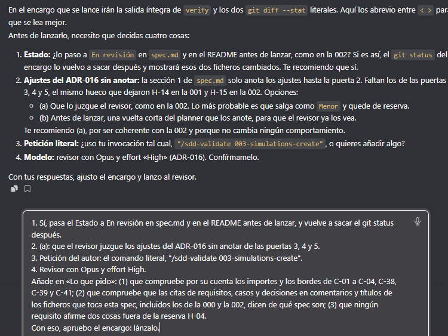
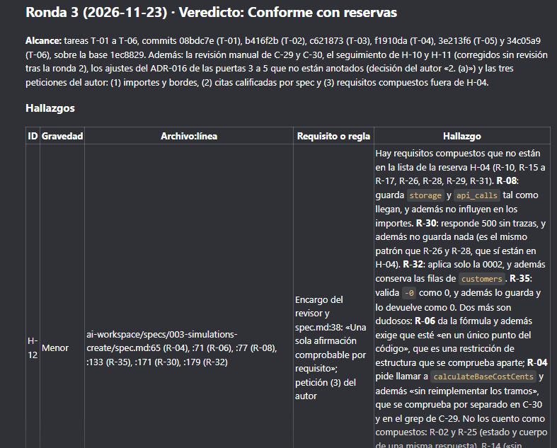
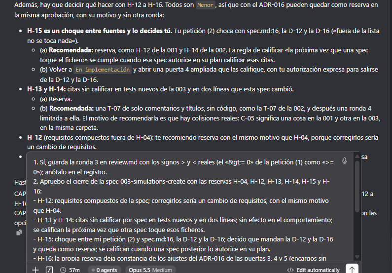

# 003-simulations-create — Fase 7 (2026-11-23, sesión 19)

## Objetivo y fase
Fase 7, spec `003-simulations-create`: puerta 6 (validación) con `/sdd-validate`, tras terminar la puerta 5 (T-01 a T-06 en `[x]`). La ronda 3 del revisor dio `Conforme con reservas` (H-12 a H-16, todas `Menor`) y el autor aprobó el cierre con las reservas H-04, H-12, H-13, H-14, H-15 y H-16. `Estado:` pasó a `En revisión` al empezar y a `Cerrada` tras la aprobación.

## Prompts clave
Invocación:

> /sdd-validate 003-simulations-create

Respuesta al encargo del revisor:

> 1. Sí, pasa el Estado a En revisión en spec.md y en el README antes de lanzar, y vuelve a sacar el git status después.
> 2. (a): que el revisor juzgue los ajustes del ADR-016 sin anotar de las puertas 3, 4 y 5.
> 3. Petición del autor: el comando literal, "/sdd-validate 003-simulations-create".
> 4. Revisor con Opus y effort High.
> Añade en «Lo que pido»: (1) que compruebe por su cuenta los importes y los bordes de C-01 a C-04, C-38, C-39 y C-41; (2) que compruebe que las citas de requisitos, casos y decisiones en comentarios y títulos de los ficheros que toca esta spec, incluidos los de la 000 y la 002, dicen de qué spec son; (3) que ningún requisito afirme dos cosas fuera de la reserva H-04.
> Con eso, apruebo el encargo: lánzalo.

Respuesta al veredicto (guardado de la ronda y aprobación del cierre):

> 1. Sí, guarda la ronda 3 en review.md con los signos > y < reales (el «&gt;= 0» de la petición (1) como «>= 0»); anótalo en el registro.
> 2. Apruebo el cierre de la spec 003-simulations-create con las reservas H-04, H-12, H-13, H-14, H-15 y H-16:
> - H-12: requisitos compuestos de la spec; corregirlos sería un cambio de requisitos, con el mismo motivo que H-04.
> - H-13 y H-14: citas sin calificar por spec en tests nuevos y en dos líneas; sin efecto en el comportamiento; se califican la próxima vez que otra spec toque esos ficheros.
> - H-15: choque entre mi petición (2) y spec.md:16, la D-12 y la D-16; decido que mandan la D-12 y la D-16 y queda como reserva; se califican cuando una spec posterior lo autorice en su plan.
> - H-16: la propia reserva deja constancia de los ajustes del ADR-016 de las puertas 3, 4 y 5 (encargos sin enseñar, lecturas acotadas y modelos), como la H-14 de la 001 y la H-15 de la 002.
> Motivo general: son Menor, sin efecto en el comportamiento, y otra tarea con su ronda cuesta más de lo que aporta con el plazo.
> 3. Pon Estado: Cerrada en spec.md y en el README, añade a review.md mi aprobación literal y actualiza MEMORY.md (máximo 50 líneas, con las reservas como pendientes y NOT_FOUND ya hecho, no pendiente de la 004).
> Antes del commit lanzo /sdd-session 7 003-simulations-create. Después enséñame el diff y propón el commit, sin Co-Authored-By. NO hagas el commit: espera mi aprobación.

## Qué propuso la IA
- **Puerta según el `Estado:`:** `En implementación`, con T-01 a T-06 en `[x]`, así que puerta 6.
  - Antes del encargo: `npm run verify` en verde (29 ficheros y 766 tests en la raíz; 3 y 14 en la web; exit 0) y `git status` limpio.
- **Encargo del revisor (ronda 3, modo puerta 6), enseñado antes de lanzarlo:** con las decisiones #1 a #25, D-01 a D-16, las aprobaciones y desviaciones aceptadas de T-01 a T-06, los seis commits (base 1ec8829), la revisión manual de C-29 y C-30 y el seguimiento de H-10 y H-11. Hizo cuatro preguntas: cuándo pasar el `Estado:` a `En revisión`, qué hacer con los ajustes del ADR-016 de las puertas 3 a 5 sin anotar (recomendada (a): que lo juzgue el revisor), la petición literal y el modelo.
- **Lanzamiento del revisor:** tras el OK, `Estado: En revisión` en `spec.md` y en el README (solo esa línea, comprobado con `git diff`). Se volvió a sacar el `git status`, que mostraba también la captura `fase-7-003-validar-encargo.png`. Las tres peticiones del autor fueron a «Lo que pido». Revisor con Opus y effort «High», con la salida de `verify` y los dos `git diff --stat` literales.
- **Retorno del revisor:** ronda 3, `Conforme con reservas`.
  - H-12 a H-16, todas `Menor`; H-15 señala un choque entre fuentes, que el revisor no resuelve.
  - H-10 y H-11 resueltos; importes y bordes recalculados por el revisor, que coinciden.
  - Revisión manual de C-29 (ampliada a 2000 y a los tramos) y de C-30: cumplen.
  - `git status` y `git diff --stat` posteriores: sin cambios del revisor.
- **Propuestas tras el veredicto:**
  - El retorno traía `&gt;= 0` (escapado en HTML); recomendada: guardarlo tal cual.
  - H-15, choque: recomendada (a), reserva.
  - H-13 y H-14: recomendada (b), una T-07 de solo comentarios y títulos, por las colisiones reales (C-05 de la 001 y de la 003 en la misma carpeta).
  - H-12 y H-16: recomendada reserva.

## Qué corregí y por qué
- **`&gt;= 0`:** pedí guardarlo con el signo real (`>= 0`), no tal cual como recomendaba la IA, y anotarlo en este registro. Hecho: la ronda 3 de `review.md` lleva `>= 0`.
- **H-13 y H-14:** reserva en lugar de la T-07 recomendada. Motivo: son Menor, sin efecto en el comportamiento, y otra tarea con su ronda cuesta más de lo que aporta con el plazo.
- **Peticiones añadidas al encargo:** (1) importes y bordes, (2) citas calificadas por spec y (3) requisitos compuestos fuera de H-04. Motivo: (no registrado).

## Decisiones tomadas
- Encargo de la ronda 3 aprobado con las tres peticiones añadidas; `Estado: En revisión` antes de lanzar; ajustes del ADR-016 de las puertas 3 a 5, (a): que los juzgue el revisor.
- Ronda 3 guardada al final de `review.md`, literal salvo `&gt;= 0` → `>= 0` (decisión del autor).
- Cierre aprobado con las reservas H-04, H-12, H-13, H-14, H-15 y H-16 (aprobación literal al final de `review.md`). H-15: mandan la D-12 y la D-16 sobre la petición (2).
- `Estado: Cerrada` en `spec.md` y en el README.
- `MEMORY.md` al día (50 líneas):
  - en «Estado actual», la 003 `Cerrada`;
  - en «Próximos pasos», las reservas como pendientes, y para la 004 solo el 404 de la ruta inexistente (la fila `NOT_FOUND` y el 404 del cliente ya están hechos en la 003);
  - siguiente spec, la 005;
  - dos aprendizajes: el `&gt;=` y el filtro `npx vitest run --project api <texto>`.
- Commit: el de cierre de esta sesión.

## Capturas

## Pendiente para la siguiente sesión
- Commit de cierre de la spec 003, con la aprobación del autor.
- Spec 005 `simulator`, siguiente según el orden del ADR-016.
- Reservas de la 003 (H-04, H-12 a H-16) en `MEMORY.md`, «Próximos pasos».
