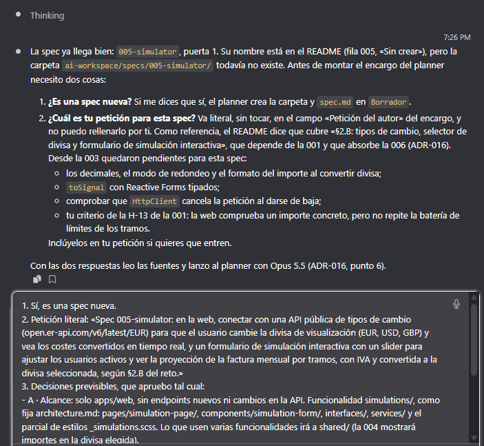
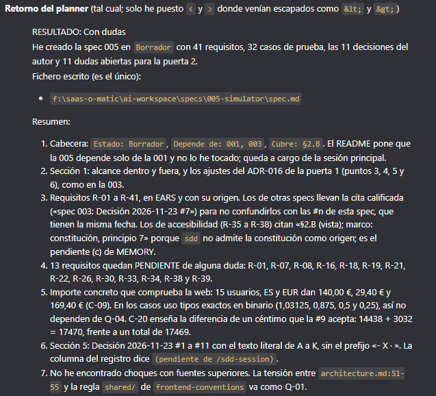
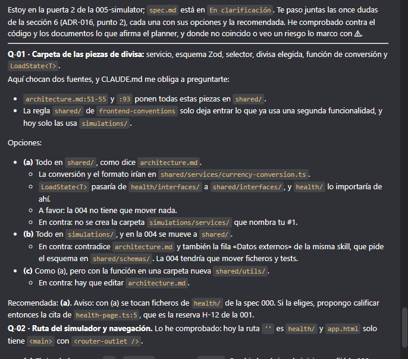
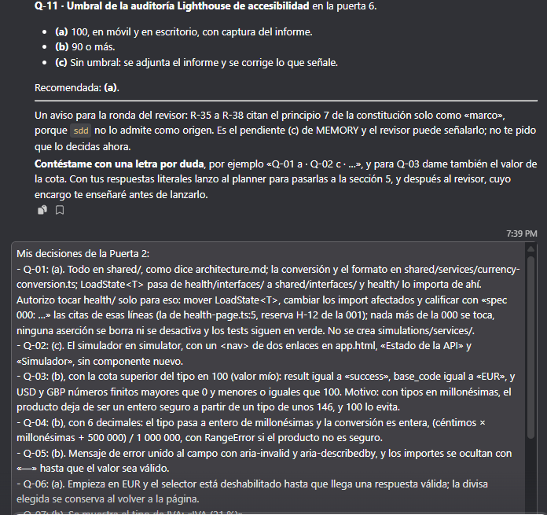
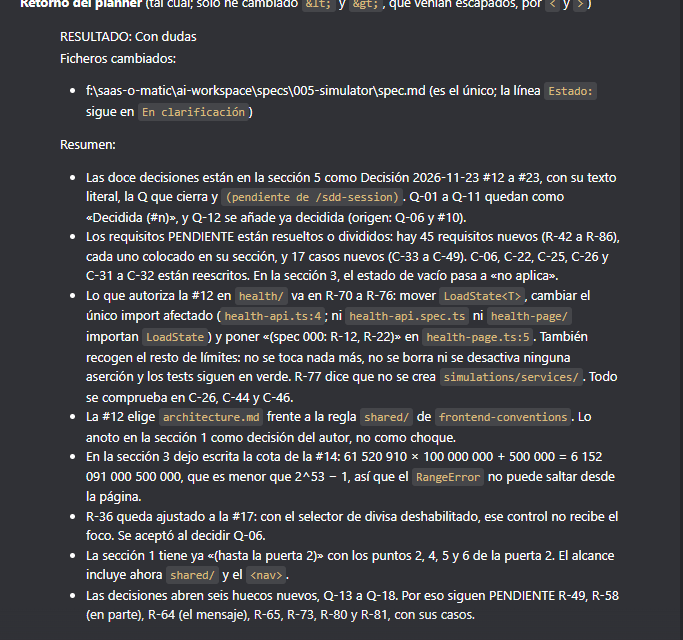
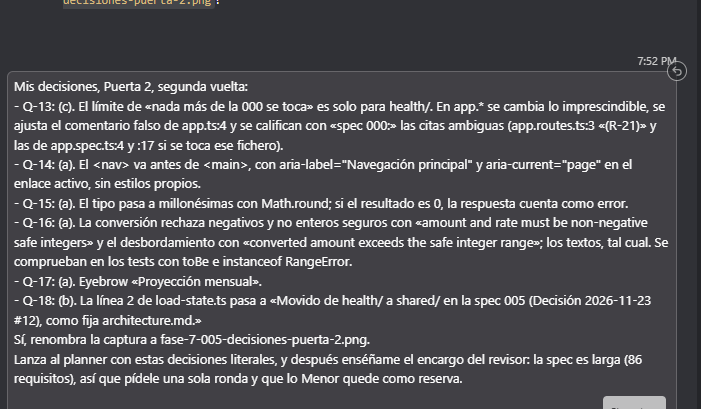
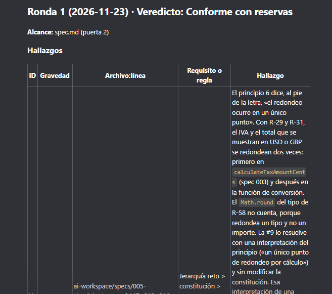
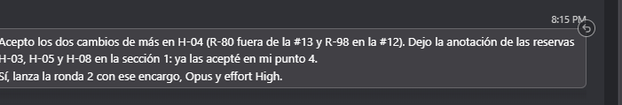
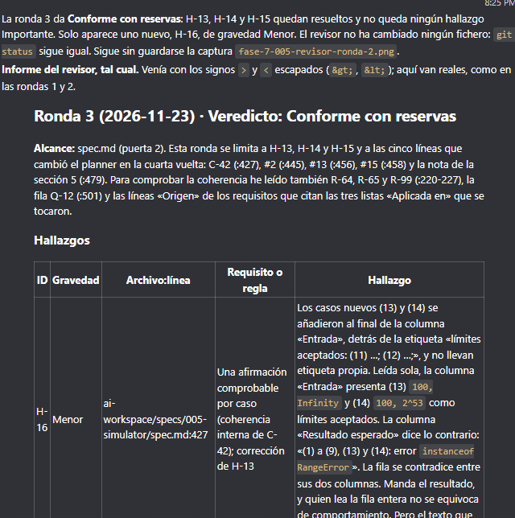

# 005-simulator — Fase 7 (2026-11-23, sesión 20)

## Objetivo y fase
Fase 7, spec `005-simulator`: puertas 1 (spec) y 2 (clarificación) con `/sdd-spec` y `/sdd-clarify`, coordinadas por `/sdd-flow`. Al terminar, la spec queda en `Aprobada`.

## Prompts clave
Los tres primeros `/sdd-spec` llegaron sin argumento, y la sesión principal preguntó cuál era la spec sin elegirla. El cuarto llegó con el argumento:

> /sdd-spec 005-simulator

Respuesta del autor a si era una spec nueva y cuál era su petición, con sus decisiones previsibles:

> 1. Sí, es una spec nueva.
> 2. Petición literal: «Spec 005-simulator: en la web, conectar con una API pública de tipos de cambio (open.er-api.com/v6/latest/EUR) para que el usuario cambie la divisa de visualización (EUR, USD, GBP) y vea los costes convertidos en tiempo real, y un formulario de simulación interactiva con un slider para ajustar los usuarios activos y ver la proyección de la factura mensual por tramos, con IVA y convertida a la divisa seleccionada, según §2.B del reto.»
> 3. Decisiones previsibles, que apruebo tal cual:
> - A · Alcance: solo apps/web, sin endpoints nuevos ni cambios en la API. Funcionalidad simulations/, como fija architecture.md: pages/simulation-page/, components/simulation-form/, interfaces/, services/ y el parcial de estilos _simulations.scss. Lo que usen varias funcionalidades irá a shared/ (la 004 mostrará importes en la divisa elegida).
> - B · Cálculo: en el navegador, con calculateBaseCostCents, getTaxRateBps y calculateTotalCents de packages/pricing (ADR-010). No se llama a POST /simulations: este formulario es una proyección y no guarda nada. Los límites de los tramos no se repiten en la web (criterio de la H-13 de la 001): la web comprueba un importe concreto, no la batería de límites.
> - C · Divisas: EUR (base), USD y GBP, las que nombra el reto. Selector con las tres.
> - D · API de tipos de cambio: open.er-api.com/v6/latest/EUR, llamada por un único servicio con HttpClient; su respuesta se valida con Zod en el borde (principio 5); la petición se cancela al darse de baja y un test lo comprueba.
> - E · Estados: carga y error visibles, como en health/ (role="status" y role="alert"), con el texto de error en español para el usuario.
> - F · País para el IVA: selector con ES, PT, FR e IT (los de la 003); por defecto ES.
> - G · Controles: slider de usuarios activos de 0 a 100 000 (el máximo de la 003) y un campo numérico sincronizado con él; valor inicial 15.
> - H · Formulario: Reactive Forms tipados con toSignal, como pide frontend-conventions; sin lógica de tramos en la página.
> - I · Conversión: los importes se calculan en céntimos de euro enteros con packages/pricing. La conversión a USD o GBP es una función pura única que multiplica por el tipo y redondea al céntimo más próximo, con el medio céntimo hacia arriba. Interpreto el principio 6 como «un único punto de redondeo por cálculo»: el IVA se redondea en packages/pricing (calculateTaxAmountCents) y la conversión de lo que se muestra, en su función; no se modifica la constitución. Cada importe que se muestra (base, IVA y total) se convierte por separado desde su céntimo de euro con la misma función; el total mostrado no se calcula sumando las partes convertidas, así que la suma puede diferir en un céntimo, y se acepta y se anota en la spec. Se muestra con dos decimales y con el formato de la divisa (Intl.NumberFormat, es-ES).
> - J · Fallo de la API de tipos de cambio: se muestra el error y la divisa queda en EUR, sin conversión; el formulario sigue funcionando. Los tipos se piden una vez al abrir la página.
> - K · Estilo: guía de estilo del ADR-015; Lighthouse en la Puerta 6 (hay vista).
> Lo que quede por decidir va a «Dudas abiertas» con opciones y una recomendada.
> Lanza al planner con Opus 5.5, con estas decisiones literales.

Aprobación de la puerta 1:

> Apruebo la Puerta 1 · spec de la 005-simulator. Pon Estado: En clarificación en spec.md y en el README, y en la fila 005 del README, Depende de: 001, 003. La captura se queda como fase-7-005-decisiones-autor.png.

Decisiones de la puerta 2, primera vuelta:

> Mis decisiones de la Puerta 2:
> - Q-01: (a). Todo en shared/, como dice architecture.md; la conversión y el formato en shared/services/currency-conversion.ts; LoadState<T> pasa de health/interfaces/ a shared/interfaces/ y health/ lo importa de ahí. Autorizo tocar health/ solo para eso: mover LoadState<T>, cambiar los import afectados y calificar con «spec 000: …» las citas de esas líneas (la de health-page.ts:5, reserva H-12 de la 001); nada más de la 000 se toca, ninguna aserción se borra ni se desactiva y los tests siguen en verde. No se crea simulations/services/.
> - Q-02: (c). El simulador en simulator, con un <nav> de dos enlaces en app.html, «Estado de la API» y «Simulador», sin componente nuevo.
> - Q-03: (b), con la cota superior del tipo en 100 (valor mío): result igual a «success», base_code igual a «EUR», y USD y GBP números finitos mayores que 0 y menores o iguales que 100. Motivo: con tipos en millonésimas, el producto deja de ser un entero seguro a partir de un tipo de unos 146, y 100 lo evita.
> - Q-04: (b), con 6 decimales: el tipo pasa a entero de millonésimas y la conversión es entera, (céntimos × millonésimas + 500 000) / 1 000 000, con RangeError si el producto no es seguro.
> - Q-05: (b). Mensaje de error unido al campo con aria-invalid y aria-describedby, y los importes se ocultan con «—» hasta que el valor sea válido.
> - Q-06: (a). Empieza en EUR y el selector está deshabilitado hasta que llega una respuesta válida; la divisa elegida se conserva al volver a la página.
> - Q-07: (b). Se muestra el tipo de IVA: «IVA (21 %)».
> - Q-08: (a). Los textos de la propuesta, tal cual.
> - Q-09: (a). Solo tarjetas (.card con prefijo) y eyebrow con título.
> - Q-10: (c). aria-live="polite" solo en el total, aun sabiendo que se anuncia en cada paso del slider.
> - Q-11: (a). 100 en accesibilidad, en móvil y en escritorio, con captura del informe.
> - Q-12: (a). Mientras cargan los tipos, los importes van en EUR y el selector, deshabilitado, muestra EUR; al llegar una respuesta válida se recupera la divisa conservada; si falla, la divisa vuelve a EUR y se pierde la elección. No cambia mi #10.
> Lanza al planner con estas decisiones literales.

Autorización de un cambio en `.claude/`:

> Autorizo un cambio aparte en .claude/skills/frontend-conventions/SKILL.md, solo en la regla de shared/: añadir la excepción «salvo las piezas que architecture.md ya destina a shared/ y que una funcionalidad posterior ya prevé usar», para alinearla con mi Q-01 (a). Solo ese cambio en .claude/; hazlo al cerrar la spec 005, enséñame el diff y espera mi aprobación.

Decisiones de la puerta 2, segunda vuelta:

> Mis decisiones, Puerta 2, segunda vuelta:
> - Q-13: (c). El límite de «nada más de la 000 se toca» es solo para health/. En app.* se cambia lo imprescindible, se ajusta el comentario falso de app.ts:4 y se califican con «spec 000:» las citas ambiguas (app.routes.ts:3 «(R-21)» y las de app.spec.ts:4 y :17 si se toca ese fichero).
> - Q-14: (a). El <nav> va antes de <main>, con aria-label="Navegación principal" y aria-current="page" en el enlace activo, sin estilos propios.
> - Q-15: (a). El tipo pasa a millonésimas con Math.round; si el resultado es 0, la respuesta cuenta como error.
> - Q-16: (a). La conversión rechaza negativos y no enteros seguros con «amount and rate must be non-negative safe integers» y el desbordamiento con «converted amount exceeds the safe integer range»; los textos, tal cual. Se comprueban en los tests con toBe e instanceof RangeError.
> - Q-17: (a). Eyebrow «Proyección mensual».
> - Q-18: (b). La línea 2 de load-state.ts pasa a «Movido de health/ a shared/ en la spec 005 (Decisión 2026-11-23 #12), como fija architecture.md.»
> Sí, renombra la captura a fase-7-005-decisiones-puerta-2.png.
> Lanza al planner con estas decisiones literales, y después enséñame el encargo del revisor: la spec es larga (86 requisitos), así que pídele una sola ronda y que lo Menor quede como reserva.

Corrección de la sección 1 y lanzamiento de la ronda 1:

> Sí, amplía la línea del punto 2 de la sección 1 de spec.md para que nombre también Q-13 a Q-18; enséñame el diff de esa línea y no toques nada más de la spec.
> Sí, lanza al revisor con ese encargo, Opus con effort High. Mi frase sobre «86 requisitos» va literal; añade en «Resultado de la puerta anterior» que la spec tiene ya 98 (R-01 a R-98).

Decisiones sobre la ronda 1:

> 1. Sí, guarda la ronda 1 en review.md con los signos > y < reales.
> 2. H-01: (a). Redacta el ADR-017 en decisions.md con mi lectura del principio 6, «un único punto de redondeo por cálculo» (el IVA en packages/pricing y la conversión de lo que se muestra en su función pura), como el ADR-013 con el principio 5; incluye que la división de céntimos entre 100 es solo para dar formato al importe y no es un cálculo (H-12). Enséñame el diff antes de escribirlo, y R-30 pasará a citarlo. No se modifica la constitución.
> 3. H-02: que el planner añada los casos de límite que enumera el revisor en C-16, C-41 y C-42, sin cambiar requisitos.
> 4. Menores: que el planner corrija en la misma vuelta H-04, H-06 (R-31 solo con USD o GBP y tipos válidos), H-09, H-10 y H-11; y H-07: -0 se trata como 0, igual que la 001, con requisito propio y un caso. Acepto como reservas, cada una con su motivo: H-03 (requisitos compuestos; corregirlo cambia requisitos), H-05 (app.config.ts no se toca en esta spec) y H-08 (el formulario sigue funcionando en EUR mientras no haya respuesta). H-12 se cierra con el ADR-017.
> 5. Lanza después una ronda 2 del revisor limitada a H-01, H-02, H-04, H-06, H-07, H-09, H-10 y H-11 y a lo que se toque, y enséñame su encargo antes.

Aprobación del ADR-017:

> Apruebo el ADR-017 con un cambio: quita la frase «el revisor no marca esta interpretación como hallazgo»; la interpretación queda aceptada por el autor y nada más. Escríbelo al final de decisions.md, tras el ADR-016. Después sigue el orden previsto: lanza al planner con mis puntos 2 a 4 (R-30 cita el ADR-017) y enséñame el encargo de la ronda 2.

Cambios de más del planner y lanzamiento de la ronda 2:

> Acepto los dos cambios de más en H-04 (R-80 fuera de la #13 y R-98 en la #12). Dejo la anotación de las reservas H-03, H-05 y H-08 en la sección 1: ya las acepté en mi punto 4.
> Sí, lanza la ronda 2 con ese encargo, Opus y effort High.

Decisiones sobre la ronda 2:

> 1. Sí, añade la ronda 2 a review.md con los signos > y < reales.
> 2. (a). Que el planner corrija las tres en esta vuelta: H-13, añadir a C-42 los casos (100, Infinity) y (100, 2^53), que deben dar el RangeError con el mensaje de R-65; H-14, quitar C-48 y C-49 de la #13, C-42 de la #15 y C-11 de la #2; H-15, una excepción en la nota de la sección 5 para la #23, que es formulación mía y no una opción de la sección 6. Después, ronda 3 del revisor limitada a H-13, H-14 y H-15, y enséñame su encargo antes.
> 3. La captura «Captura de pantalla 2026-11-23 201525.png» renómbrala a fase-7-005-encargo-ronda-2-aprobado.png. Las anunciadas decisiones-ronda-1 y planner-arreglos-ronda-1 se anotan como no existentes.

Lanzamiento de la ronda 3:

> Sí, lanza la ronda 3 con ese encargo, Opus y effort High.

Decisión sobre la ronda 3 (primer mensaje):

> Sí, guarda la ronda 3 y que el planner corrija H-16 (b)

Aprobación de la puerta 2:

> 1. Sí, añade la ronda 3 a review.md con los signos > y < reales.
> 2. H-16: (b). Que el planner ponga «no válidos:» delante de (13) y (14) en la columna «Entrada» de C-42, sin tocar nada más; enséñame el diff y anota que el revisor no ha visto esta corrección y debe seguirla en la Puerta 6.
> 3. Con esa corrección hecha, apruebo la Puerta 2 · clarificación de la spec 005-simulator con las reservas H-03 (requisitos compuestos; corregirlo cambia requisitos), H-05 (app.config.ts no se toca en esta spec) y H-08 (el formulario sigue funcionando en EUR mientras no haya respuesta), y con H-12 cerrada por el ADR-017 y H-16 corregida sin que el revisor la vea. Pon Estado: Aprobada en spec.md y en el README, y añade a review.md mi aprobación literal.
> 4. Actualiza MEMORY.md (máximo 50 líneas, con las reservas como pendientes y el ADR-017). Antes del commit lanzo /sdd-session 7 005-simulator. Después enséñame el diff y propón un solo commit de las puertas 1 y 2, sin Co-Authored-By. NO hagas el commit: espera mi aprobación.

## Qué propuso la IA
**Antes de la puerta 1**
- Explicó por qué los tres primeros `/sdd-spec` llegaban vacíos: `$ARGUMENTS` estaba vacío, probablemente porque se elegía el comando en el menú y se pulsaba Intro sin escribir el argumento.
- Pidió confirmar que la spec era nueva y la petición literal del autor. Recordó los pendientes de la 003 para la 005.

**Puerta 1**
- Comprobó las decisiones A a K contra `architecture.md`, `frontend-conventions` y `packages/pricing`, y encontró dos puntos que conviene saber:
  - La tensión entre `architecture.md:51-55` y la regla `shared/` de `frontend-conventions`, que el planner debía llevar a «Dudas abiertas».
  - El riesgo de que la interpretación del principio 6 que hace la #9 la señalara el revisor. Propuso registrarla en un ADR, como el ADR-013.
- Lanzó al planner con Opus 5.5 sin enseñar antes el encargo (ADR-016, punto 4). Añadió de su parte:
  - la numeración de A a K como #1 a #11;
  - la anotación de los ajustes del ADR-016;
  - las decisiones de la 000, la 003 y la 001 que se aplicaban;
  - el ejemplo del hueco de `shared/`.
- Comprobó el retorno del planner:
  - el recuento de PENDIENTE (14, no 13);
  - el cálculo de C-20;
  - el desajuste del campo «Depende de» frente al README.

**Puerta 2**
- Presentó juntas las dudas Q-01 a Q-11, cada una con su recomendada, tras comprobar `app.routes.ts`, `app.html`, `style-guide.md` y los tramos.
- Corrigió la cota de ejemplo que había propuesto el planner (1000). Esa cota no protegía la conversión: el límite está en un tipo de unos 146, así que recomendó 100.
- Planteó Q-12 dentro de Q-06.
- Presentó juntas Q-13 a Q-18 tras comprobar las citas de `app.ts`, `app.routes.ts`, `app.spec.ts`, `load-state.ts` y `health-page.ts`.
- Avisó de que la spec había crecido a 86 requisitos, y después a 98 y a 99.
- Reconoció como error propio que el encargo no ampliara la línea del punto 2 del ADR-016, y la amplió con el OK del autor.
- Enseñó antes de lanzarlos los encargos de las rondas 1, 2 y 3 del revisor, y propuso qué hacer con cada hallazgo:
  - **Ronda 1:** ADR-017 para H-01 y H-12; el planner para H-02; arreglar los Menores de texto; reservas para H-03, H-05 y H-08.
  - **Ronda 2:** corregir H-13, H-14 y H-15 y lanzar una ronda 3 limitada a ellos.
  - **Ronda 3:** corregir H-16 sin otra ronda.
- Redactó el borrador del ADR-017 y lo enseñó antes de escribirlo, señalando las tres partes que no salían de las palabras del autor.
- Comprobó con `node` los valores de límite de C-16 (16), C-41 (2) y C-41 (3).
- Comprobó H-13 y H-15 en la spec antes de presentarlos.

## Qué corregí y por qué
**Nombres y textos**
- **Captura de la puerta 1:** se queda como `fase-7-005-decisiones-autor.png`, no como el nombre anunciado.
- **Q-03:** la cota del tipo es 100, y no la del ejemplo del planner. Motivo del autor: «con tipos en millonésimas, el producto deja de ser un entero seguro a partir de un tipo de unos 146, y 100 lo evita».
- **ADR-017:** quitó la frase «el revisor no marca esta interpretación como hallazgo». Motivo del autor: «la interpretación queda aceptada por el autor y nada más».
- **Encargo de la ronda 1:** su frase de los «86 requisitos» va literal; el número real (98) se añade en «Resultado de la puerta anterior».

**Ampliaciones de alcance**
- Añadió Q-12 con número propio, con su formulación (a).
- Pidió ampliar la línea del punto 2 del ADR-016 para que nombre también Q-13 a Q-18.
- Aceptó los dos cambios de más del planner en H-04 y dejó en la sección 1 la anotación de las reservas.
- Autorizó un cambio en `.claude/skills/frontend-conventions/SKILL.md`, solo en la regla `shared/` y al cerrar la spec, para alinearla con su Q-01 (a).

**Rondas y capturas**
- Pidió una ronda 3 limitada a H-13, H-14 y H-15.
- Pidió anotar que H-16 se corrigió sin que la viera el revisor y que debe seguirse en la puerta 6.
- Renombró o descartó capturas: tres tenían « .png» de más y una tenía el nombre por defecto de Windows.

## Decisiones tomadas
- **Spec y alcance**
  - La spec `005-simulator` es nueva y depende de 001 y 003; el README se actualizó.
  - Decisiones previsibles A a K → Decisión 2026-11-23 #1 a #11.
- **Dudas de la puerta 2**
  - Q-01 a Q-12 → #12 a #23.
  - Q-13 a Q-18 → #24 a #29.
- **Hallazgos de la ronda 1**
  - H-01 y H-12 → #30 y ADR-017, «Un único punto de redondeo por cálculo», interpretación del autor del principio 6, en `decisions.md`.
  - H-06 → #31: R-31 solo con USD o GBP y tipos válidos.
  - H-07 → #32: `-0` se trata como 0, con R-99 y C-54.
- **Revisor:** tres rondas en la puerta 2.
  - Ronda 1: `Conforme con reservas`, con H-01 y H-02 Importantes y H-03 a H-12 Menores.
  - Ronda 2: `Conforme con reservas`, con H-13 Importante y H-14 y H-15 Menores.
  - Ronda 3: `Conforme con reservas`, con H-16 Menor.
  - H-16 se corrigió después en C-42 sin otra ronda.
- **Reservas aceptadas:**
  - H-03: requisitos compuestos; corregirlo cambia requisitos.
  - H-05: `app.config.ts` no se toca en esta spec.
  - H-08: el formulario sigue funcionando en EUR mientras no haya respuesta.
- **Estado y cifras:** `Aprobada` en `spec.md` y en el README. La spec queda con 99 requisitos y 54 casos.
- **Cambio en `.claude/` autorizado para el cierre de la 005:** regla `shared/` de `frontend-conventions`.
- **Método:** ajustes del ADR-016 aplicados y anotados en la sección 1:
  - puerta 1: puntos 3, 4, 5 y 6;
  - puerta 2: puntos 1, 2, 4, 5 y 6.
- **Commit:** el de cierre de esta sesión.

## Capturas

Anunciadas y no existentes: `fase-7-005-decisiones-ronda-1.png`, `fase-7-005-planner-arreglos-ronda-1.png` y `fase-7-005-revisor-ronda-2.png`, descartadas por el autor. `fase-7-005-decisiones-previsibles-a-k.png` se guardó como `fase-7-005-decisiones-autor.png` por decisión del autor.

## Pendiente para la siguiente sesión
- **Puerta 3 de la 005 (`plan.md`):** el autor fija el formato antes de lanzar al planner.
- **Marcadores de la sección 5 de `spec.md`:** sustituir los `(pendiente de /sdd-session)` por la ruta de este registro, con el OK del autor, antes del commit.
- **Reservas de la puerta 2:** H-03, H-05 y H-08. H-16 se sigue en la puerta 6.
- **Al cerrar la 005:** el cambio autorizado en la regla `shared/` de `frontend-conventions`, con diff y aprobación del autor.
- **Commit de las puertas 1 y 2:** propuesto tras este registro y pendiente de la aprobación del autor.
