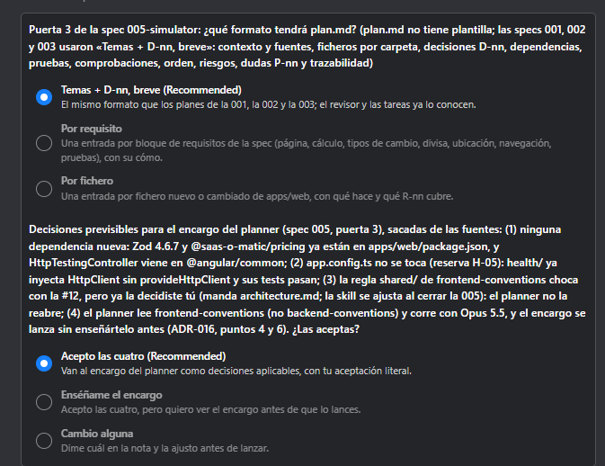
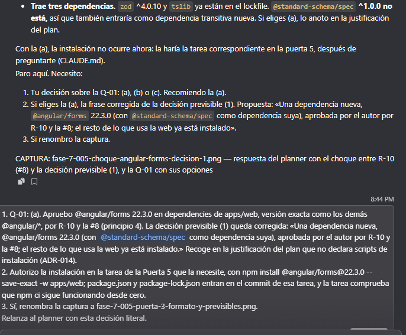
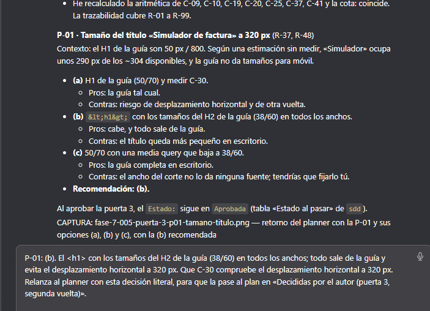
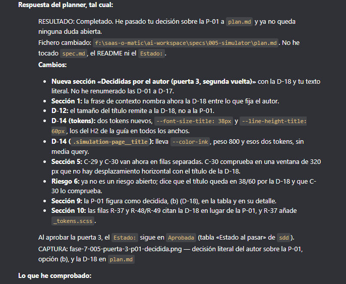
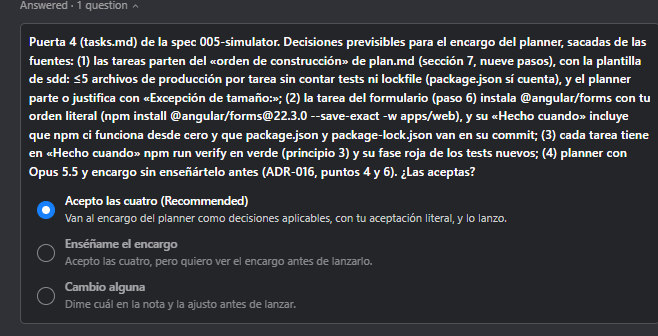

# 005-simulator — Fase 7 (2026-11-23, sesión 21)

## Objetivo y fase
Fase 7. Puertas 3 (plan) y 4 (tareas) de la spec `005-simulator`, con `/sdd-plan 005-simulator`. La spec empezó en `Estado: Aprobada` y terminó en `Planificada`. Las dos puertas se cierran en un solo commit, por decisión del autor.

## Prompts clave
Invocación inicial:
> /sdd-plan 005-simulator

Respuestas del autor a las dos preguntas antes de lanzar al planner (puerta 3):
> Formato: «Temas + D-nn, breve (Recommended)»
> Decisiones previsibles: «Acepto las cuatro (Recommended)»

Decisión sobre la Q-01 del planner:
> 1. Q-01: (a). Apruebo @angular/forms 22.3.0 en dependencies de apps/web, versión exacta como los demás @angular/*, por R-10 y la #8 (principio 4). La decisión previsible (1) queda corregida: «Una dependencia nueva, @angular/forms 22.3.0 (con @standard-schema/spec como dependencia suya), aprobada por el autor por R-10 y la #8; el resto de lo que usa la web ya está instalado.» Recoge en la justificación del plan que no declara scripts de instalación (ADR-014).
> 2. Autorizo la instalación en la tarea de la Puerta 5 que la necesite, con npm install @angular/forms@22.3.0 --save-exact -w apps/web; package.json y package-lock.json entran en el commit de esa tarea, y la tarea comprueba que npm ci sigue funcionando desde cero.
> 3. Sí, renombra la captura a fase-7-005-puerta-3-formato-y-previsibles.png.
> Relanza al planner con esta decisión literal.

Decisión sobre la P-01:
> P-01: (b). El <h1> con los tamaños del H2 de la guía (38/60) en todos los anchos; todo sale de la guía y evita el desplazamiento horizontal a 320 px. Que C-30 compruebe el desplazamiento horizontal a 320 px.
> Relanza al planner con esta decisión literal, para que la pase al plan en «Decididas por el autor (puerta 3, segunda vuelta)».

Aprobación de la puerta 3:
> Apruebo la Puerta 3 · plan de la spec 005-simulator: plan.md con D-01 a D-18 (D-06 a D-17, propuestas por el planner; D-18, mi decisión sobre la P-01), y la instalación de @angular/forms 22.3.0 autorizada en la tarea de la Puerta 5 que la necesite. El Estado: sigue en Aprobada. Pon en la cabecera de plan.md «aprobado por el autor el 2026-11-23».
> No cierres todavía: seguimos con la Puerta 4 y cerramos las dos puertas en un solo commit.

Respuesta a las decisiones previsibles de la puerta 4:
> Acepto las cuatro (Recommended)

Aprobación de la puerta 4:
> 1. T-01 y T-08 sin fase roja: aceptado, por los motivos que da tasks.md.
> 2. Modelos del implementer: confirmados (Opus 5.5 en T-02, T-03, T-04, T-06 y T-07; Sonnet 5.5 en T-01, T-05, T-08 y T-09).
> 3. Las capturas: fase-7-005-tareas-decisiones-autor.png se da por la anunciada, y fase-7-005-plan-aprobado.png es mía.
> Apruebo la Puerta 4 · tareas de la spec 005-simulator: tasks.md con T-01 a T-09. Pon Estado: Planificada en spec.md y en la fila 005 del README.
> Cierra las puertas 3 y 4: actualiza MEMORY.md (máximo 50 líneas) y espera a que lance /sdd-session 7 005-simulator. Luego enséñame el diff y propón un solo commit, sin Co-Authored-By. NO hagas el commit: espera mi aprobación.

Anotación de los ajustes del ADR-016 en la spec:
> Sí, añade las tres líneas a la sección 1 de spec.md, tras la línea 42, antes de /sdd-session. Enséñame el diff de spec.md; no toques nada más de la spec.

## Qué propuso la IA
- **Puerta 3.** La sesión principal propuso el formato «Temas + D-nn, breve», el de las specs 001 a 003, y cuatro decisiones previsibles (ADR-016, punto 3):
  - (1) ninguna dependencia nueva;
  - (2) `app.config.ts` no se toca (H-05), porque `health/` ya inyecta `HttpClient` sin `provideHttpClient`;
  - (3) la regla `shared/` de `frontend-conventions` no se reabre (#12);
  - (4) el planner sigue `frontend-conventions`, corre con Opus 5.5 y el encargo se lanza sin enseñarlo antes.
- **Planner, primera vuelta (Opus 5.5):** devolvió `Con dudas` sin escribir `plan.md`. Encontró un choque: R-10 (#8) pide Reactive Forms, que son de `@angular/forms`, y ese paquete no está instalado. Eso contradice la decisión previsible (1). Abrió la Q-01 con tres opciones: (a) aprobar la dependencia, (b) cambiar los requisitos o (c) dejarlo como reserva. Recomendó la (a).
- **La sesión principal comprobó el choque** en `node_modules` y en el lockfile, y consultó `npm view @angular/forms@22.3.0`, solo lectura: sin scripts, dependencias de pares compatibles, y `@standard-schema/spec` como dependencia transitiva nueva.
- **Planner, segunda vuelta:** escribió `plan.md` con D-01 a D-17 y una duda nueva, la P-01: el tamaño del título a 320 px. Opciones: (a) 50/70, (b) 38/60 en todos los anchos o (c) una media query. Recomendó la (b).
- **Comprobaciones de la sesión principal:** que D-01 a D-05 son literales; los tamaños de `style-guide.md:18-19`; y que `_shared.scss` y `_simulations.scss` ya estaban en `architecture.md:34` y R-34, así que no chocaban con la Q-14.
- **Planner, tercera vuelta:** añadió la D-18 en «Decididas por el autor (puerta 3, segunda vuelta)» y ajustó la D-12, la D-14, C-30, el riesgo 6, la sección 9 y la trazabilidad.
- **Puerta 4.** La sesión principal propuso cuatro decisiones previsibles:
  - (1) tareas según la sección 7 del plan, con un máximo de 5 archivos de producción y `package.json` contando;
  - (2) la T-06 instala con la orden literal del autor, con `npm ci` desde cero y el lockfile en su commit;
  - (3) `npm run verify` en verde y fase roja de los tests nuevos;
  - (4) planner con Opus 5.5 y encargo sin enseñarlo antes.
- **Planner, puerta 4:** escribió `tasks.md` con T-01 a T-09, cobertura de R-01 a R-99 y ninguna `Excepción de tamaño:`. Propuso los modelos del implementer por tarea y dejó la T-01 y la T-08 sin fase roja. La sesión principal comprobó la cobertura requisito a requisito y que no había escapes HTML.
- **Al cerrar,** la sesión principal propuso anotar en la sección 1 de `spec.md` los ajustes del ADR-016 de las puertas 3 y 4, para no repetir las reservas H-14, H-15 y H-16 de las specs anteriores.

## Qué corregí y por qué
- **La decisión previsible (1),** «ninguna dependencia nueva», era errónea. La sesión principal solo había mirado `package.json` sin cruzarlo con R-10, y lo paró el planner. El autor la corrigió con la Q-01 (a): `@angular/forms` 22.3.0 queda aprobada por R-10 y la #8.
- **La captura `…formato-y-previsibles.pn.png`** se guardó con «.pn» de más y se renombró con el OK del autor.
- **La captura anunciada como `fase-7-005-puerta-4-previsibles.png`** la da el autor por `fase-7-005-tareas-decisiones-autor.png`.

## Decisiones tomadas
- Formato de `plan.md`: «Temas + D-nn, breve» (D-01).
- Dependencia nueva `@angular/forms` 22.3.0, exacta, con `@standard-schema/spec`. Se instala en la T-06 con `npm install @angular/forms@22.3.0 --save-exact -w apps/web` y se comprueba `npm ci` desde cero (D-02).
- `app.config.ts` no se toca (D-03). La regla `shared/` no se reabre (D-04). El planner sigue `frontend-conventions` con Opus 5.5 (D-05).
- P-01 (b): `<h1>` con 38/60 en todos los anchos, y C-30 comprueba que no hay desplazamiento horizontal a 320 px (D-18).
- Puerta 3 aprobada con D-01 a D-18. El `Estado:` sigue en `Aprobada`.
- Puerta 4 aprobada con T-01 a T-09.
  - La T-01 y la T-08 van sin fase roja.
  - Modelos del implementer: Opus 5.5 en T-02, T-03, T-04, T-06 y T-07; Sonnet 5.5 en T-01, T-05, T-08 y T-09.
  - `Estado: Planificada` en `spec.md` y en el README.
- Sección 1 de `spec.md`: tres líneas nuevas con los ajustes del ADR-016 de las puertas 3 y 4.
- Commit: el de cierre de esta sesión.

## Capturas

 

Las demás capturas `fase-7-005-*` son de la sesión 20 (puertas 1 y 2).

## Pendiente para la siguiente sesión
- Puerta 5 de la spec 005: empezar por la T-01 (Sonnet 5.5). Al empezar, `Estado:` pasa a `En implementación`.
- T-06: instalar `@angular/forms` con la orden autorizada y comprobar `npm ci` desde cero.
- Riesgos 1 y 2 del plan, sin comprobar en el workspace: `outputFromObservable` con `startWith` y `vi.mock` con el ejecutor de tests de Angular. Si falla alguno, la tarea para.
- Puerta 6: comprobaciones manuales (C-29, C-30, C-32, C-44 y las demás de la sección 5 del plan), H-16 en C-42 y Lighthouse con 100 de accesibilidad.
- Al cerrar la 005: cambio de la regla `shared/` en `frontend-conventions`, ya autorizado.
