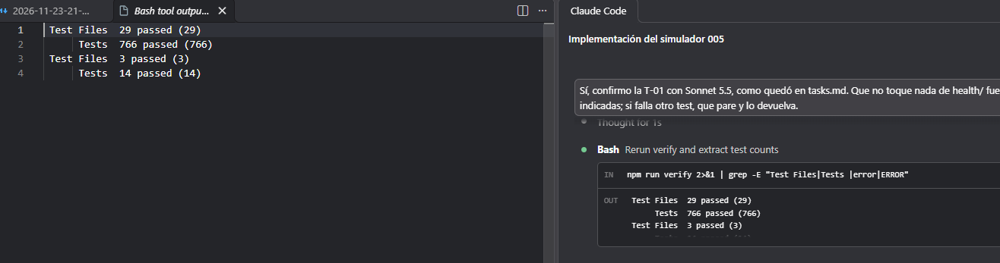

# 005-simulator — Fase 7 (2026-11-24, sesión 01)

## Objetivo y fase
Fase 7, spec `005-simulator`, puerta 5 (implementación) con `/sdd-implement`: la T-01 («shared: traslado de `LoadState<T>` y cambios de `health/`»), la primera tarea de la spec.

## Prompts clave
Invocación (atajo de la puerta 5):
> /sdd-implement 005-simulator

Confirmación de la tarea y del modelo:
> Sí, confirmo la T-01 con Sonnet 5.5, como quedó en tasks.md. Que no toque nada de health/ fuera de las líneas indicadas; si falla otro test, que pare y lo devuelva.

Aprobación de la tarea:
> Apruebo la T-01. Márcala en [x] con sus casillas y mi aprobación literal; la casilla del renombrado se comprueba tras el commit con git show -M --stat, anótalo en el registro. Completa el registro de la sesión y actualiza MEMORY.md (máximo 50 líneas). Antes del commit lanzo /sdd-session 7 005-simulator. Después enséñame el diff y propón el commit, sin Co-Authored-By. NO hagas el commit: espera mi aprobación.

Respuesta al borrador de este registro:
> Sí, guárdalo y mantén la línea de spec.md

## Qué propuso la IA
- **Inicio:** leyó el `Estado:` de `spec.md` (`Planificada`) y `tasks.md`, con las nueve tareas en `[ ]`. Propuso la T-01 porque no depende de nada, la T-04 la necesita y es la primera del orden de construcción. Mantuvo Sonnet 5.5, el modelo confirmado en la puerta 4.
- **Tras la confirmación:**
  - Pasó el `Estado:` a `En implementación` en `spec.md` y en la fila 005 del README, por ser la primera tarea.
  - Lanzó `npm run verify` desde la raíz: en verde, 766 tests en 29 ficheros en la raíz y 14 en 3 en la web. Guardó la salida completa para el encargo.
- **Encargo del implementer** (Sonnet 5.5, sin enseñarlo antes: ADR-016, punto 4):
  - La petición literal del autor, las Decisiones 2026-11-23 #12 y #29 literales, la D-16 y la D-17 del plan y R-70 a R-76 y R-98.
  - «Rutas a leer» acotadas, la fila literal de la T-01 y la salida literal de `npm run verify`.
  - Un aviso: sin `git add`, `git diff -M --stat` puede no ver el renombrado. En ese caso debía dar el `diff` literal entre `git show HEAD:…` y el fichero nuevo.
- **Retorno del implementer:** «Tarea terminada», sin desviaciones ni bloqueos.
  - Cambió los 4 archivos de producción y dejó la T-01 en `[~]`.
  - Confirmó que sin `git add` git no ve el par como renombrado y dio el `diff`: solo cambia la línea 2.
  - Ese `diff` venía con los signos `<` y `>` escapados en HTML (`&lt;`, `&gt;`). Se enseñó al autor tal como llegó y no se guardó en ningún fichero.
- **Comprobaciones de la sesión principal:**
  - `git status` y `git diff --stat`: solo cambian los 4 archivos de la tarea, la línea `Estado` de la T-01 en `tasks.md` y el `Estado:` de `spec.md` y el README, que cambió la sesión principal.
  - `git diff` de `health-api.ts` y `health-page.ts`: solo las líneas 4 y 5.
  - `diff` propio entre el fichero de `HEAD` y el nuevo: solo la línea 2.
  - Volvió a lanzar `npm run verify`: en verde, 766 + 14.
- **Aviso al autor:** la casilla de `git diff -M --stat` no se puede comprobar sin preparar los ficheros. Propuso comprobarla tras el commit con `git show -M --stat`.
- **Tras la aprobación:**
  - Marcó la T-01 `[x]` con sus casillas, «Modelo: Sonnet 5.5, confirmado por el autor» y la aprobación literal.
  - Añadió en la sección 1 de `spec.md`, sin que se lo pidieran, la línea de los ajustes del ADR-016 de la puerta 5 (puntos 4 y 6), para no repetir las reservas H-14 de la 001 y H-16 de la 003. Se lo dijo al autor y se ofreció a quitarla.
  - Actualizó `MEMORY.md` (50 líneas): estado de la 005 y la T-01, reserva H-12 de la 001 resuelta en parte, aprendizaje del renombrado y «Siguiente: T-02».
  - Propuso el mensaje del commit.

## Qué corregí y por qué
- Al confirmar la tarea añadí un límite: no tocar nada de `health/` fuera de las líneas indicadas y parar si falla otro test. Fue a la petición literal del encargo.
- La casilla del renombrado (`git diff -M --stat`) se comprueba tras el commit con `git show -M --stat`, porque sin `git add` git no lo ve. Lo decidí al aprobar la tarea.
- Correcciones a propuestas de la IA: (no registrado).

## Decisiones tomadas
- T-01 aprobada por el autor el 2026-11-24 (literal en `tasks.md`: «Apruebo la T-01.»).
- `Estado: En implementación` en `spec.md` y en la fila 005 del README, al empezar la primera tarea.
- `LoadState<T>` pasa a `apps/web/src/app/shared/interfaces/load-state.ts` con la línea 2 de la D-16, y se borra `health/interfaces/load-state.ts`.
- En `health/` solo cambian la línea 4 de `health-api.ts` (el `import`) y la línea 5 de `health-page.ts` («(spec 000: R-12, R-22)»). Con eso queda resuelta la parte de `health-page.ts:5` de la reserva H-12 de la 001. La de `health-page.spec.ts:9` sigue abierta: la #12 la deja fuera de la 005.
- **Renombrado:** antes del commit se comprobó con `diff` contra `git show HEAD:apps/web/src/app/health/interfaces/load-state.ts`, y solo cambia la línea 2. Tras el commit se comprueba con `git show -M --stat` (decisión del autor). Su resultado no puede ir en este commit y se enseña al autor justo después.
- El autor mantiene la línea de los ajustes del ADR-016 de la puerta 5 en la sección 1 de `spec.md` («Sí, guárdalo y mantén la línea de spec.md»).
- `npm run verify` en verde antes y después: 766 + 14.
- Commit: el de cierre de esta sesión.

## Capturas

No hubo ninguna línea `CAPTURA:` en esta sesión.

## Pendiente para la siguiente sesión
- Tras el commit, comprobar con `git show -M --stat` que el traslado sale como renombrado (casilla de C-45 de la T-01).
- Puerta 5 de la spec 005: la T-02 (shared: conversión entera y formato de divisa), sin dependencias, con Opus 5.5.
