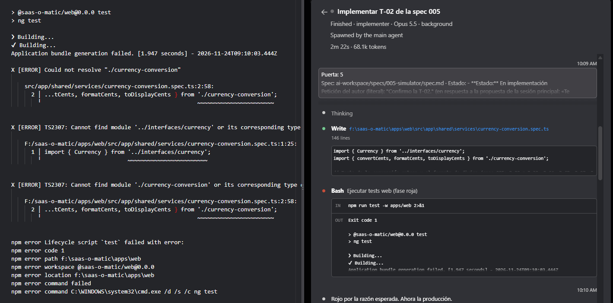
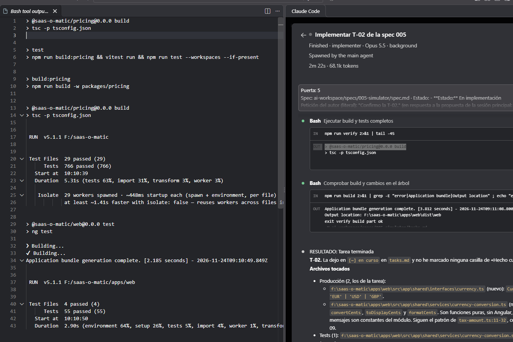

# 005-simulator — Fase 7 (2026-11-24, sesión 02)

## Objetivo y fase
Fase 7, spec `005-simulator`, puerta 5 (implementación) con `/sdd-implement`: la T-02 («shared: conversión entera y formato de divisa»).

## Prompts clave
Invocación (atajo de la puerta 5):
> /sdd-implement 005-simulator

Confirmación de la tarea:
> Confirmo la T-02.

Aprobación de la tarea:
> Apruebo la T-02. Márcala en [x] con sus casillas y mi aprobación literal; el «>» del registro, con el signo real, como en los registros anteriores. Completa el registro de la sesión y actualiza MEMORY.md (máximo 50 líneas). Antes del commit lanzo /sdd-session 7 005-simulator. Después enséñame el diff y propón el commit, sin Co-Authored-By. NO hagas el commit: espera mi aprobación.

Decisión sobre la captura con el nombre por defecto:
> La captura «Captura de pantalla 2026-11-24 101449.png» es el verde de la T-02 (766 + 55): renómbrala a fase-7-005-t02-verde.png y enlázala en «Capturas» del registro; el mensaje del commit dirá «dos capturas».

Registro de la sesión:
> /sdd-session 7 005-simulator

## Qué propuso la IA
- **Inicio:** leyó el `Estado:` de `spec.md` (`En implementación`) y `tasks.md`, con la T-01 en `[x]`. Propuso la T-02, que no depende de nada y es la siguiente del orden de construcción, con Opus 5.5, el modelo confirmado en la puerta 4.
- **Antes del encargo:** lanzó `npm run verify` desde la raíz. Salió en verde, con 766 + 14 tests.
- **Encargo del implementer** (Opus 5.5, sin enseñarlo antes: ADR-016, punto 4):
  - la petición literal del autor;
  - las Decisiones 2026-11-23 #9, #15, #27, #30 (ADR-017) y #32, literales;
  - la D-09, la D-10, la D-15 y la D-17 del plan;
  - «Rutas a leer» acotadas, la fila literal de la T-02 y la salida de `npm run verify`;
  - la petición de dar la salida íntegra del rojo y de cuadrar los tests nuevos con los casos.
- **Retorno del implementer:** «Tarea terminada».
  - Creó los 2 archivos de producción y el spec, y dejó la T-02 en `[~]`.
  - Hay 41 tests nuevos y la web pasa de 14 a 55.
  - Desviaciones declaradas:
    - la función auxiliar `captureError` del spec;
    - las entradas de C-20 (14000, 2940 y 16940), que dedujo de la spec;
    - el test de 14000, que además comprueba que el texto contiene `140,00`.
- **Comprobaciones de la sesión principal:**
  - `git status` y `git diff --stat`: solo cambian los ficheros de la tarea y la línea `Estado` de la T-02 en `tasks.md`.
  - Cuadró los 41 tests con la lista de casos de la tarea.
  - Rehízo a mano las entradas de C-20:
    - con 1,03125: 14000 → 14 437,5 → 14438; 2940 → 3 031,875 → 3032; 16940 → 17 469,375 → 17469;
    - con 0,875: 14000 → 12250; 2940 → 2 572,5 → 2573; 16940 → 14 822,5 → 14823.

    Coinciden con C-20.
  - Volvió a lanzar `npm run verify` y salió en verde, con 766 + 55 tests.
  - Abrió este registro con la fase roja en cuanto llegó (regla de `tasks.md`).
- **Al autor:** le enseñó `git status`, `git diff --stat` y el retorno literal. Le preguntó si guardar el `>` con el signo real y le pidió aprobación explícita.
- **Tras la aprobación:**
  - Marcó la T-02 `[x]` con sus nueve casillas, «Modelo: Opus 5.5, confirmado por el autor» y la aprobación literal.
  - Dejó el `>` de la fase roja con el signo real.
  - Antes de escribir en `MEMORY.md` que el renombrado de la T-01 estaba confirmado, lo comprobó con `git show -M --stat 73c9e0b`. Sale `.../{health => shared}/interfaces/load-state.ts | 2 +-`.
  - Actualizó `MEMORY.md` (T-02 hecha, 766 + 55; siguiente, la T-03) sin pasar de 50 líneas.
  - Avisó de que `git status` mostraba una captura con el nombre por defecto de Windows. No la renombró ni la borró sin el OK del autor.
  - Enseñó el diff y propuso el mensaje del commit.

## Fase roja de la T-02 (retorno literal del implementer, copiado en el momento de recibirlo)
Orden: `npm run test -w apps/web`. Falla porque los dos módulos aún no existían. El retorno llegó con los signos `>` escapados en HTML (`&gt;`). Aquí se copian con el signo real, por decisión del autor («el «>» del registro, con el signo real, como en los registros anteriores»).

```
> @saas-o-matic/web@0.0.0 test
> ng test

❯ Building...
✔ Building...
Application bundle generation failed. [1.947 seconds] - 2026-11-24T09:10:03.444Z

X [ERROR] Could not resolve "./currency-conversion"

    src/app/shared/services/currency-conversion.spec.ts:2:58:
      2 │ ...tCents, formatCents, toDisplayCents } from './currency-conversion';
        ╵                                               ~~~~~~~~~~~~~~~~~~~~~~~


X [ERROR] TS2307: Cannot find module '../interfaces/currency' or its corresponding type declarations. [plugin angular-compiler]

    F:/saas-o-matic/apps/web/src/app/shared/services/currency-conversion.spec.ts:1:25:
      1 │ import { Currency } from '../interfaces/currency';
        ╵                          ~~~~~~~~~~~~~~~~~~~~~~~~


X [ERROR] TS2307: Cannot find module './currency-conversion' or its corresponding type declarations. [plugin angular-compiler]

    F:/saas-o-matic/apps/web/src/app/shared/services/currency-conversion.spec.ts:2:58:
      2 │ ...tCents, formatCents, toDisplayCents } from './currency-conversion';
        ╵                                               ~~~~~~~~~~~~~~~~~~~~~~~


npm error Lifecycle script `test` failed with error:
npm error code 1
npm error path f:\saas-o-matic\apps\web
npm error workspace @saas-o-matic/web@0.0.0
npm error location f:\saas-o-matic\apps\web
npm error command failed
npm error command C:\WINDOWS\system32\cmd.exe /d /s /c ng test
```

## Qué corregí y por qué
- **El `>` de la fase roja:** se guarda con el signo real y no como `&gt;`, como en los registros anteriores.
- **La captura del verde:** se había guardado con el nombre por defecto de Windows. Indiqué cuál era y pedí renombrarla a `fase-7-005-t02-verde.png` y enlazarla en «Capturas».
- Correcciones a propuestas de la IA: (no registrado).

## Decisiones tomadas
- T-02 aprobada por el autor el 2026-11-24 (literal en `tasks.md`: «Apruebo la T-02.»).
- Archivos de producción nuevos:
  - `apps/web/src/app/shared/interfaces/currency.ts`: `Currency`.
  - `apps/web/src/app/shared/services/currency-conversion.ts`: `convertCents`, `toDisplayCents` y `formatCents` (D-09).
- Tests nuevos: 41, en `currency-conversion.spec.ts`.
- Se aceptan las desviaciones declaradas por el implementer (`captureError`, entradas de C-20 deducidas de la spec y comprobación de `140,00`), con la aprobación de la tarea.
- El `Estado:` de `spec.md` y la fila 005 del README no cambian: siguen en `En implementación`.
- `npm run verify` en verde: antes, 766 + 14; después, 766 + 55.
- Renombrado de la T-01 confirmado tras su commit con `git show -M --stat` (pendiente de la sesión 01).
- Commit: el de cierre de esta sesión.

## Capturas





No hubo ninguna línea `CAPTURA:` en esta sesión.

## Pendiente para la siguiente sesión
- Puerta 5 de la spec 005: la T-03 (shared: esquema y servicio de tipos de cambio), sin dependencias, con Opus 5.5.
