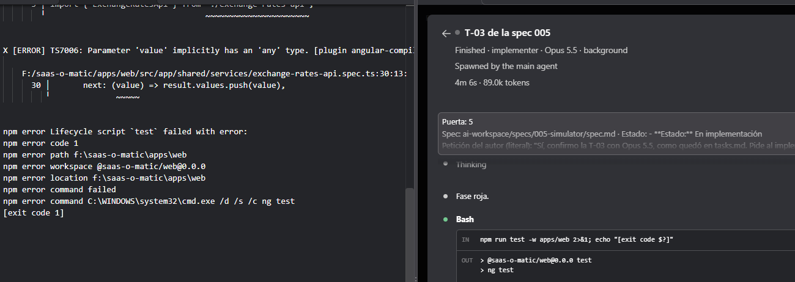
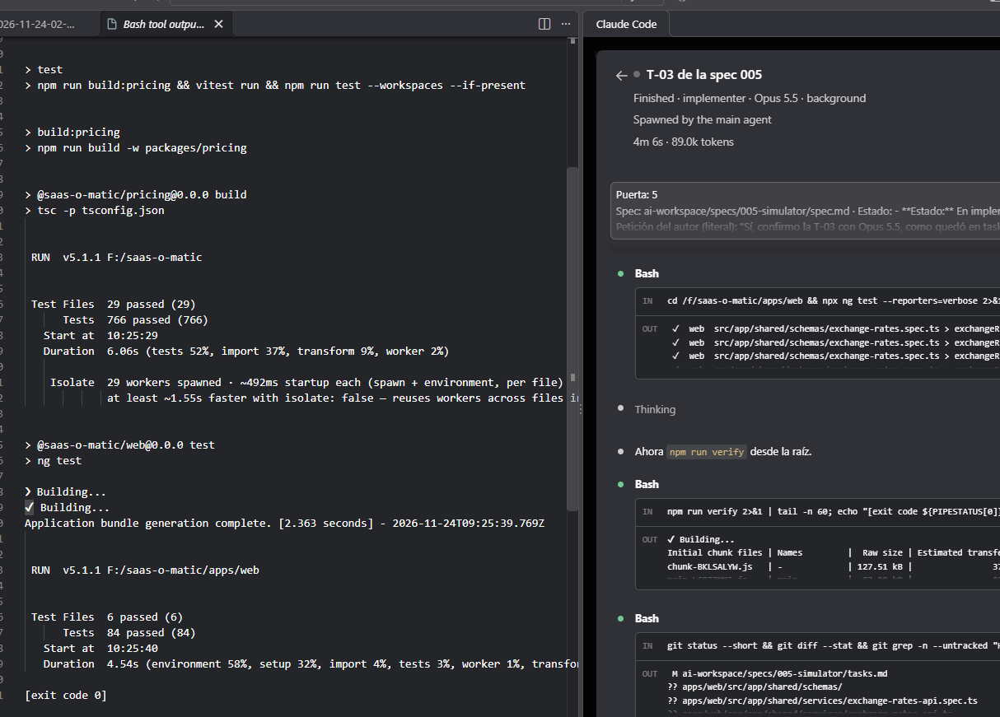

# 005-simulator — Fase 7 (2026-11-24, sesión 03)

## Objetivo y fase
Fase 7, spec `005-simulator`, puerta 5 (implementación) con `/sdd-implement`: la T-03 («shared: esquema y servicio de tipos de cambio»).

## Prompts clave
Primera invocación (con el nombre de la spec incompleto):
> /sdd-implement 005-simula

Invocación (atajo de la puerta 5):
> /sdd-implement 005-simulator

Confirmación de la tarea:
> Sí, confirmo la T-03 con Opus 5.5, como quedó en tasks.md. Pide al implementer la salida íntegra del rojo, sin abreviar, y que cada una de las 16 variantes de C-16 se pruebe aparte, con su valor literal.

Aprobación de la tarea:
> Desviaciones 1 a 4 de la T-03: aceptadas (test de control, bucle for…of en C-16, refine sin mensaje propio). La fase roja en el registro, sin los códigos de color y con los signos reales, como en las sesiones anteriores; anótalo.
> Apruebo la T-03. Márcala en [x] con sus casillas y mi aprobación literal, completa el registro 03 y actualiza MEMORY.md (máximo 50 líneas). Antes del commit lanzo /sdd-session 7 005-simulator. Después enséñame el diff y propón el commit, sin Co-Authored-By. NO hagas el commit: espera mi aprobación.

Registro de la sesión:
> /sdd-session 7 005-simulator

## Qué propuso la IA
- **Inicio:** la primera invocación llegó con `005-simula`. Como no existe esa carpeta y la puerta no es la 1, paró y preguntó si era `005-simulator`, sin elegir por su cuenta. Con `/sdd-implement 005-simulator` leyó el `Estado:` (`En implementación`) y `tasks.md`, con la T-01 y la T-02 en `[x]`. Propuso la T-03: no depende de nada, la T-04 depende de ella y es la siguiente en el orden de construcción. El modelo, Opus 5.5, es el confirmado en la puerta 4.
- **Antes del encargo:** lanzó `npm run verify` desde la raíz y salió en verde, con 766 + 55. Solo guardó las últimas 60 líneas de la salida, y así se pasaron en el encargo.
- **Encargo del implementer** (Opus 5.5, sin enseñarlo antes: ADR-016, punto 4):
  - la petición literal del autor, con lo que exige: el rojo íntegro y cada variante de C-16 aparte con su número y su valor literal;
  - las Decisiones 2026-11-23 #4, #12, #14, #15 y #26, literales;
  - la D-06 y la D-07 del plan;
  - «Rutas a leer» acotadas, la fila literal de la T-03, las filas literales C-16, C-37, C-38 y C-53, y la salida de `npm run verify`;
  - que declare la respuesta válida de partida y cuadre los tests nuevos con los casos.
- **Retorno del implementer:** «Tarea terminada».
  - Creó los 2 archivos de producción y sus 2 specs, y dejó la T-03 en `[~]`.
  - Hay 29 tests nuevos y la web pasa de 55 a 84.
  - Desviaciones declaradas:
    1. respuesta de partida con USD 1.03125 y GBP 0.875, los tipos de C-38;
    2. un test de control de esa respuesta;
    3. C-16 con un bucle `for…of` y no con `it.each`, porque `$name` corta el título a 40 caracteres;
    4. `refine` sin mensaje propio.
- **Comprobaciones de la sesión principal:**
  - `git status` y `git diff --stat`: solo cambian los 4 ficheros de la tarea y la línea `Estado` de la T-03 en `tasks.md`.
  - Leyó los 4 ficheros y cuadró los 29 tests con la lista: 1 + 16 + 1 + 4 + 2 en el esquema y 5 en el servicio. Comprobó que el esquema sigue la D-07 y el servicio la D-06, y que cada variante de C-16 lleva su número y su valor de la fila C-16.
  - Volvió a lanzar `npm run verify` y salió en verde, con 766 + 84 tests.
  - Abrió este registro con la fase roja en cuanto llegó (regla de `tasks.md`).
- **Al autor:** le enseñó `git status`, `git diff --stat` y el retorno literal. Le preguntó si guardar la fase roja con los signos reales y sin los códigos de color, y le pidió aprobación explícita.
- **Tras la aprobación:**
  - Marcó la T-03 `[x]` con sus siete casillas, «Modelo: Opus 5.5, confirmado por el autor» y la aprobación literal.
  - Actualizó `MEMORY.md` (T-03 hecha, 766 + 84; siguiente, la T-04) sin pasar de 50 líneas.
  - Enseñó el diff y propuso el mensaje del commit.

## Fase roja de la T-03 (retorno literal del implementer, copiado en el momento de recibirlo)
Orden: `cd /f/saas-o-matic && npm run test -w apps/web 2>&1; echo "[exit code $?]"`. Falla porque los dos módulos aún no existían; el TS7006 es consecuencia de eso (sin el módulo, `fetch()` no tiene tipo) y desaparece al crearlo sin tocar el test. El retorno llegó con los signos `>` y `&` escapados en HTML (`&gt;`, `&amp;`) y con los códigos de color de la terminal sin su carácter de escape. Aquí se copian con el signo real y sin los códigos de color, como en las sesiones anteriores, por decisión del autor («La fase roja en el registro, sin los códigos de color y con los signos reales, como en las sesiones anteriores; anótalo.»).

```
> @saas-o-matic/web@0.0.0 test
> ng test

❯ Building...
✔ Building...
Application bundle generation failed. [2.696 seconds] - 2026-11-24T09:23:48.029Z

X [ERROR] Could not resolve "./exchange-rates"

    src/app/shared/schemas/exchange-rates.spec.ts:1:36:
      1 │ import { exchangeRatesSchema } from './exchange-rates';
        ╵                                     ~~~~~~~~~~~~~~~~~~


X [ERROR] Could not resolve "./exchange-rates-api"

    src/app/shared/services/exchange-rates-api.spec.ts:3:33:
      3 │ import { ExchangeRatesApi } from './exchange-rates-api';
        ╵                                  ~~~~~~~~~~~~~~~~~~~~~~


X [ERROR] TS2307: Cannot find module './exchange-rates' or its corresponding type declarations. [plugin angular-compiler]

    F:/saas-o-matic/apps/web/src/app/shared/schemas/exchange-rates.spec.ts:1:36:
      1 │ import { exchangeRatesSchema } from './exchange-rates';
        ╵                                     ~~~~~~~~~~~~~~~~~~


X [ERROR] TS2307: Cannot find module './exchange-rates-api' or its corresponding type declarations. [plugin angular-compiler]

    F:/saas-o-matic/apps/web/src/app/shared/services/exchange-rates-api.spec.ts:3:33:
      3 │ import { ExchangeRatesApi } from './exchange-rates-api';
        ╵                                  ~~~~~~~~~~~~~~~~~~~~~~


X [ERROR] TS7006: Parameter 'value' implicitly has an 'any' type. [plugin angular-compiler]

    F:/saas-o-matic/apps/web/src/app/shared/services/exchange-rates-api.spec.ts:30:13:
      30 │       next: (value) => result.values.push(value),
         ╵              ~~~~~


npm error Lifecycle script `test` failed with error:
npm error code 1
npm error path f:\saas-o-matic\apps\web
npm error workspace @saas-o-matic/web@0.0.0
npm error location f:\saas-o-matic\apps\web
npm error command failed
npm error command C:\WINDOWS\system32\cmd.exe /d /s /c ng test
[exit code 1]
```

## Qué corregí y por qué
- **La spec de la invocación:** la primera vez escribí `005-simula`; la volví a lanzar con `005-simulator`.
- **El encargo:** pedí que el implementer diera la salida íntegra del rojo, sin abreviar, y que cada una de las 16 variantes de C-16 se probara aparte, con su valor literal.
- **La fase roja del registro:** se guarda sin los códigos de color y con los signos reales, como en las sesiones anteriores.
- Correcciones a propuestas de la IA: (no registrado).

## Decisiones tomadas
- T-03 aprobada por el autor el 2026-11-24 (literal en `tasks.md`: «Apruebo la T-03.»).
- Archivos de producción nuevos:
  - `apps/web/src/app/shared/schemas/exchange-rates.ts`: `exchangeRatesSchema` y `ExchangeRates` (D-07): `z.number().gt(0).lte(100)` sin coerción, `Math.round(× 1 000 000)` y `refine` que rechaza el 0; objeto no estricto que solo entrega `{ USD, GBP }` en millonésimas.
  - `apps/web/src/app/shared/services/exchange-rates-api.ts`: `ExchangeRatesApi.fetch()` (D-06), con `http.get<unknown>` y `parse`, sin estado.
- Tests nuevos: 29, 24 en `exchange-rates.spec.ts` y 5 en `exchange-rates-api.spec.ts`.
- Se aceptan las desviaciones 1 a 4 del implementer: el autor lo dice literalmente («Desviaciones 1 a 4 de la T-03: aceptadas (test de control, bucle for…of en C-16, refine sin mensaje propio).»).
- El `Estado:` de `spec.md` y la fila 005 del README no cambian: siguen en `En implementación`.
- `npm run verify` en verde: antes, 766 + 55; después, 766 + 84.
- Commit: el de cierre de esta sesión.

## Capturas




No hubo ninguna línea `CAPTURA:` en esta sesión.

## Pendiente para la siguiente sesión
- Puerta 5 de la spec 005: la T-04 (shared: estado de los tipos y divisa elegida), que depende de T-01, T-02 y T-03, con Opus 5.5.
