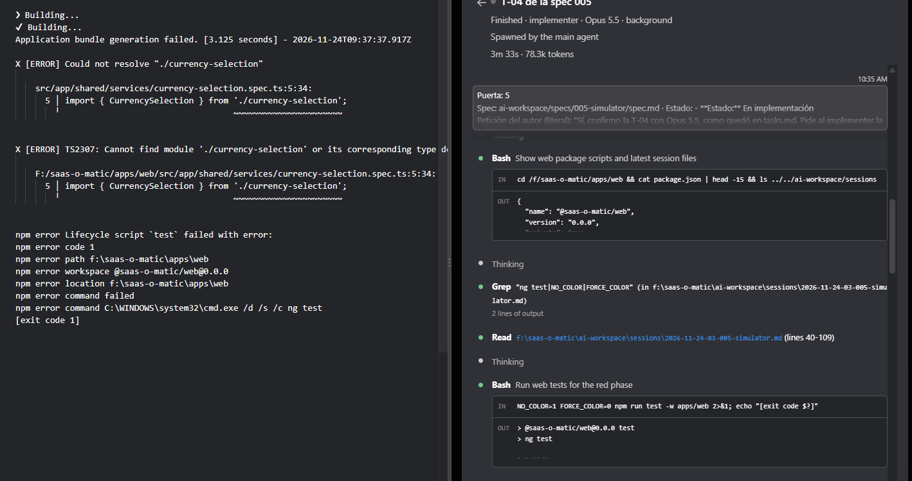
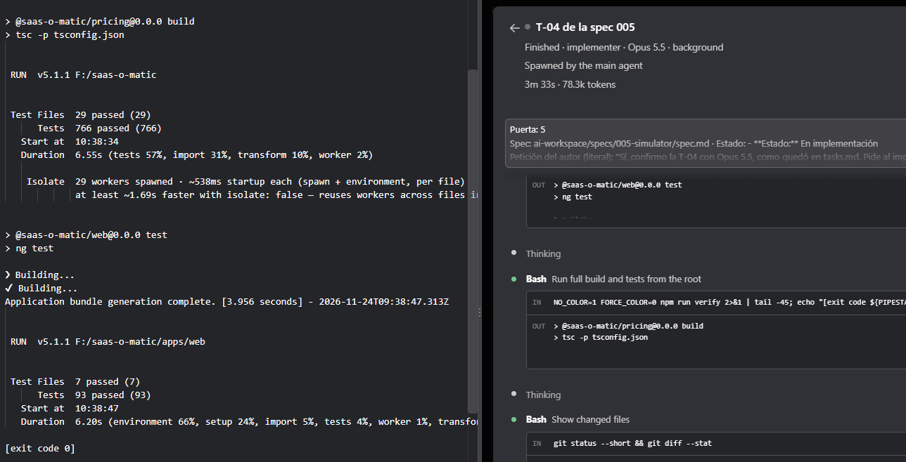

# 005-simulator — Fase 7 (2026-11-24, sesión 04)

## Objetivo y fase
Fase 7, spec `005-simulator`, puerta 5 (implementación) con `/sdd-implement`: la T-04 («shared: estado de los tipos y divisa elegida»).

## Prompts clave
Invocación (atajo de la puerta 5):
> /sdd-implement 005-simulator

Confirmación de la tarea:
> Sí, confirmo la T-04 con Opus 5.5, como quedó en tasks.md. Pide al implementer la salida íntegra del rojo, sin abreviar, y que cada caso de la divisa conservada, la descartada y la cancelación sea un test aparte.

Aprobación de la tarea:
> Signos escapados: sí, copia la fase roja con los signos reales y anótalo. Desviaciones 1 a 4 de la T-04: aceptadas; la 4 (un segundo load con el primero pendiente) no puede darse por la D-08, anótalo en el registro.
> Apruebo la T-04. Márcala en [x] con sus casillas y mi aprobación literal, completa el registro 04 y actualiza MEMORY.md (máximo 50 líneas). Antes del commit lanzo /sdd-session 7 005-simulator. Después enséñame el diff y propón el commit, sin Co-Authored-By. NO hagas el commit: espera mi aprobación.

Registro de la sesión:
> /sdd-session 7 005-simulator

## Qué propuso la IA
- **Inicio:** leyó el `Estado:` (`En implementación`) y `tasks.md`, con T-01 a T-03 en `[x]`. Propuso la T-04: depende de T-01, T-02 y T-03, ya hechas, y es la siguiente en el orden de construcción. El modelo, Opus 5.5, es el confirmado en la puerta 4.
- **Antes del encargo:** lanzó `npm run verify` desde la raíz y salió en verde, con 766 + 84. Pasó en el encargo las últimas 60 líneas de la salida, sin los códigos de color.
- **Encargo del implementer** (Opus 5.5, sin enseñarlo antes: ADR-016, punto 4):
  - la petición literal del autor, con lo que exige: el rojo íntegro y la divisa conservada, la descartada y la cancelación en tests aparte;
  - la D-06 y la D-08 del plan, las Decisiones 2026-11-23 #3 y #4 y el ADR-017;
  - «Rutas a leer» acotadas (R-20, R-22, R-23, R-26, R-28, R-59 a R-63, R-67 y los casos C-17, C-19, C-22, C-23, C-39 y C-40), la fila literal de la T-04 y la salida de `npm run verify`;
  - además, los tres errores (500, red y esquema) en tests aparte, el número exacto de tests nuevos cuadrado con el recuento y las desviaciones declaradas.
- **Retorno del implementer:** «Tarea terminada».
  - Creó el archivo de producción y su spec, y dejó la T-04 en `[~]`.
  - Hay 9 tests nuevos y la web pasa de 84 a 93.
  - Desviaciones declaradas:
    1. comprobaciones de más en tres tests (estado antes del primer `load`, `selected()` en `'EUR'` tras el error, `expectNone` tras `select`), sin ser tests aparte;
    2. `selected` expuesto con `asReadonly()`, como `state`, siguiendo `HealthApi`; el texto de R-22, constante del módulo sin exportar;
    3. un `EnvironmentInjector` por `load` para simular cada apertura, destruido antes de la siguiente, y los vivos en el `afterEach`;
    4. sin tratamiento de un `load` lanzado con otro pendiente, porque ni la spec ni el plan lo prevén.
- **Comprobaciones de la sesión principal:**
  - `git status` y `git diff --stat`: solo cambian los 2 ficheros de la tarea y la línea `Estado` de la T-04 en `tasks.md`.
  - Leyó `currency-selection.ts` y comprobó que sigue la D-06 y la D-08. Contó 9 `it(` en el spec, que cuadran con 84 → 93. Comprobó que la cita «Decisión 2026-11-23 #19» del comentario es correcta: la #19 fija los textos de R-22.
  - Volvió a lanzar `npm run verify` y salió en verde, con 766 + 93 tests (código de salida 0).
  - Este registro no se abrió al llegar la fase roja, como pide la regla de `tasks.md`: se creó tras la aprobación del autor, con la fase roja copiada del retorno del implementer, que se conservaba íntegro en la conversación.
- **Al autor:** le enseñó `git status`, `git diff --stat` y el retorno literal. Le preguntó si guardar la fase roja con los signos reales, si aceptaba las desviaciones 1 a 4, y le pidió aprobación explícita.
- **Tras la aprobación:**
  - Marcó la T-04 `[x]` con sus nueve casillas, «Modelo: Opus 5.5, confirmado por el autor» y la aprobación literal.
  - Actualizó `MEMORY.md` (T-04 hecha, 766 + 93; siguiente, la T-05) sin pasar de 50 líneas.
  - Enseñó el diff y propuso el mensaje del commit.
  - Con `/sdd-session 7 005-simulator`, completó este registro (paso 7) y enlazó las dos capturas de la T-04.

## Fase roja de la T-04 (retorno literal del implementer)
Orden: `cd /f/saas-o-matic && NO_COLOR=1 FORCE_COLOR=0 npm run test -w apps/web 2>&1; echo "[exit code $?]"`. Falla porque `currency-selection.ts` aún no existía. El retorno llegó con los signos `>` y `&` escapados en HTML (`&gt;`, `&amp;`); aquí se copian con el signo real, por decisión del autor («Signos escapados: sí, copia la fase roja con los signos reales y anótalo.»). Esta vez no traía códigos de color, porque el implementer lanzó la orden con `NO_COLOR=1 FORCE_COLOR=0`.

```
> @saas-o-matic/web@0.0.0 test
> ng test

❯ Building...
✔ Building...
Application bundle generation failed. [3.125 seconds] - 2026-11-24T09:37:37.917Z

X [ERROR] Could not resolve "./currency-selection"

    src/app/shared/services/currency-selection.spec.ts:5:34:
      5 │ import { CurrencySelection } from './currency-selection';
        ╵                                   ~~~~~~~~~~~~~~~~~~~~~~


X [ERROR] TS2307: Cannot find module './currency-selection' or its corresponding type declarations. [plugin angular-compiler]

    F:/saas-o-matic/apps/web/src/app/shared/services/currency-selection.spec.ts:5:34:
      5 │ import { CurrencySelection } from './currency-selection';
        ╵                                   ~~~~~~~~~~~~~~~~~~~~~~


npm error Lifecycle script `test` failed with error:
npm error code 1
npm error path f:\saas-o-matic\apps\web
npm error workspace @saas-o-matic/web@0.0.0
npm error location f:\saas-o-matic\apps\web
npm error command failed
npm error command C:\WINDOWS\system32\cmd.exe /d /s /c ng test
[exit code 1]
```

## Qué corregí y por qué
- **El encargo:** pedí que el implementer diera la salida íntegra del rojo, sin abreviar, y que la divisa conservada, la descartada y la cancelación fueran cada una un test aparte.
- **La fase roja del registro:** se guarda con los signos reales, no con los escapados en HTML.
- **La desviación 4:** la acepto. Un segundo `load` con el primero pendiente no puede darse por la D-08: cada apertura de la página llama a `load` con su `DestroyRef`, y al salir de la página se destruye y cancela la petición antes de que se abra la siguiente.
- Correcciones a propuestas de la IA: (no registrado).

## Decisiones tomadas
- T-04 aprobada por el autor el 2026-11-24 (literal en `tasks.md`: «Apruebo la T-04.»).
- Archivo de producción nuevo: `apps/web/src/app/shared/services/currency-selection.ts`, `CurrencySelection` (`providedIn: 'root'`; D-06, D-08):
  - `state` y `selected` son señales de solo lectura;
  - `displayCurrency` y `displayRateMicros` son `computed`: EUR y `null` mientras no hay datos o cuando la divisa elegida es EUR;
  - `select(currency)`;
  - `load(destroyRef)` con `takeUntilDestroyed`; en el error, el texto literal de R-22 y `selected` vuelve a `'EUR'` (R-63).
- Tests nuevos: 9, en `currency-selection.spec.ts`. Los tres errores, la divisa conservada, la divisa descartada y la cancelación tienen cada uno su test.
- Se aceptan las desviaciones 1 a 4 del implementer: el autor lo dice literalmente («Desviaciones 1 a 4 de la T-04: aceptadas; la 4 (un segundo load con el primero pendiente) no puede darse por la D-08, anótalo en el registro.»).
- El `Estado:` de `spec.md` y la fila 005 del README no cambian: siguen en `En implementación`.
- `npm run verify` en verde: antes, 766 + 84; después, 766 + 93.
- Commit: el de cierre de esta sesión.

## Capturas




No hubo ninguna línea `CAPTURA:` en esta sesión.

## Pendiente para la siguiente sesión
- Puerta 5 de la spec 005: la T-05 (shared: componente selector de divisa), que depende de la T-02, con Sonnet 5.5.
