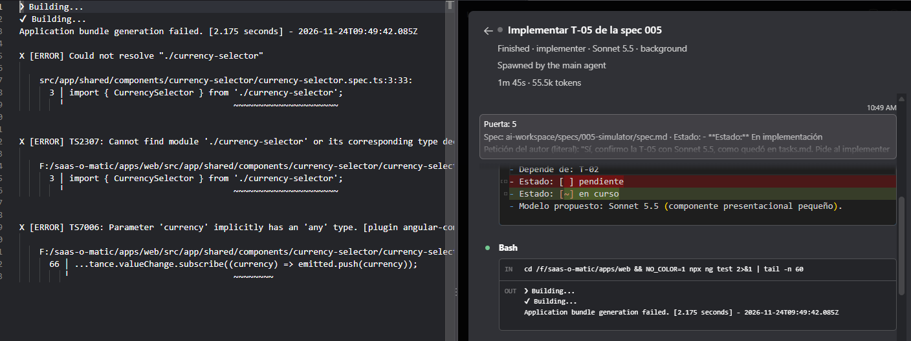
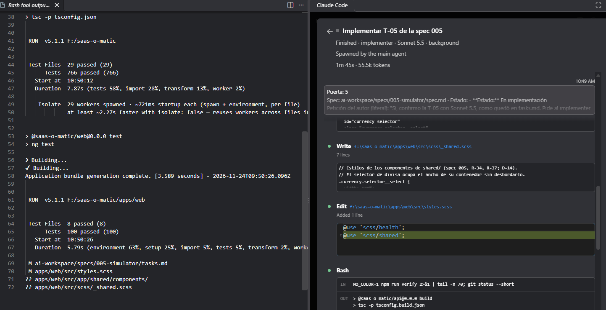

# 005-simulator — Fase 7 (2026-11-24, sesión 05)

## Objetivo y fase
Fase 7, spec `005-simulator`, puerta 5 (implementación) con `/sdd-implement`: la T-05 («shared: componente selector de divisa»).

## Prompts clave
Invocación (atajo de la puerta 5):
> /sdd-implement 005-simulator

Confirmación de la tarea:
> Sí, confirmo la T-05 con Sonnet 5.5, como quedó en tasks.md. Pide al implementer la salida íntegra del rojo, sin abreviar, y que no cree ningún .scss dentro de la carpeta del componente.

Aprobación de la tarea:
> Signos escapados: sí, copia la fase roja con los signos reales y anótalo, como en la T-04. Los tres detalles de implementación de la T-05 (el (change) con changeCurrency, el [selected] en cada opción y el test de disabled sin indicar): aceptados.
> Apruebo la T-05. Márcala en [x] con sus casillas y mi aprobación literal, completa el registro 05 y actualiza MEMORY.md (máximo 50 líneas). Antes del commit lanzo /sdd-session 7 005-simulator. Después enséñame el diff y propón el commit, sin Co-Authored-By. NO hagas el commit: espera mi aprobación.

Registro de la sesión:
> /sdd-session 7 005-simulator

## Qué propuso la IA
- **Inicio:** leyó el `Estado:` (`En implementación`) y `tasks.md`, con T-01 a T-04 en `[x]`. Propuso la T-05: depende de la T-02, ya hecha. El modelo, Sonnet 5.5, es el confirmado en la puerta 4.
- **Antes del encargo:** lanzó `npm run verify` desde la raíz y salió en verde, con 766 + 93. Pasó en el encargo la cola de la salida, sin los códigos de color.
- **Encargo del implementer** (Sonnet 5.5, sin enseñarlo antes: ADR-016, punto 4):
  - la petición literal del autor, con lo que exige: el rojo íntegro y ningún `.scss` (ni `styleUrl`) en la carpeta del componente;
  - la D-10, la D-12 y la D-14 del plan, las Decisiones 2026-11-23 #3, #17, #19 y #23, el ADR-015 y el principio 7;
  - «Rutas a leer» acotadas (R-25, R-34 a R-36, R-50, R-59 a R-61, R-66, R-68 y los casos C-21 y C-43), la fila literal de la T-05 y la salida de `npm run verify`;
  - además, los recuentos antes y después y las desviaciones declaradas.
- **Retorno del implementer:** «Tarea terminada».
  - Creó los tres ficheros nuevos de producción y el spec, añadió el `@use` en `styles.scss` y dejó la T-05 en `[~]`.
  - Hay 7 tests nuevos y la web pasa de 93 a 100.
  - Detalles de implementación declarados, que la fila no fija:
    1. `(change)="changeCurrency($event)"`, un método `protected` que emite el valor del `<select>` como `Currency`;
    2. `[selected]="value() === '…'"` en cada opción, para que el valor mostrado sea el de `value`;
    3. un test de más: `disabled` sin indicar (el valor por defecto), junto a `true` y `false`.
- **Comprobaciones de la sesión principal:**
  - `git status` y `git diff --stat`: solo cambian los ficheros de la tarea, la línea `Estado` de la T-05 en `tasks.md` y una línea en `styles.scss`.
  - En `shared/components/currency-selector/` solo hay `.ts`, `.html` y `.spec.ts`: ningún `.scss` ni `styleUrl`.
  - Contó 7 `it(` en el spec, que cuadran con 93 → 100.
  - Volvió a lanzar `npm run verify` y salió en verde, con 766 + 100 tests (código de salida 0).
  - Este registro se abrió al llegar la fase roja, como pide la regla de `tasks.md`, con el rojo tal como llegó; tras el OK del autor se cambiaron los signos escapados por los reales.
- **Al autor:** le enseñó `git status`, `git diff --stat` y el retorno literal. Le preguntó si guardar la fase roja con los signos reales y si aceptaba los tres detalles de implementación, y le pidió aprobación explícita.
- **Tras la aprobación:**
  - Marcó la T-05 `[x]` con sus siete casillas, «Modelo: Sonnet 5.5, confirmado por el autor» y la aprobación literal.
  - Actualizó `MEMORY.md` (T-05 hecha, 766 + 100; siguiente, la T-06) sin pasar de 50 líneas.
  - Enseñó el diff y propuso el mensaje del commit.
  - Con `/sdd-session 7 005-simulator`, completó este registro (paso 7) y enlazó las dos capturas de la T-05.

## Fase roja de la T-05 (retorno literal del implementer)
Orden: `NO_COLOR=1 npx ng test` en `apps/web`, antes de escribir producción. Falla porque `currency-selector.ts` aún no existía; el TS7006 es consecuencia del mismo `import`. El retorno llegó con el signo `>` escapado en HTML (`=&gt;`); aquí se copia con el signo real, por decisión del autor («Signos escapados: sí, copia la fase roja con los signos reales y anótalo, como en la T-04.»).

```
❯ Building...
✔ Building...
Application bundle generation failed. [2.175 seconds] - 2026-11-24T09:49:42.085Z

X [ERROR] Could not resolve "./currency-selector"

    src/app/shared/components/currency-selector/currency-selector.spec.ts:3:33:
      3 │ import { CurrencySelector } from './currency-selector';
        ╵                                  ~~~~~~~~~~~~~~~~~~~~

X [ERROR] TS2307: Cannot find module './currency-selector' or its corresponding type declarations. [plugin angular-compiler]

    F:/saas-o-matic/apps/web/src/app/shared/components/currency-selector/currency-selector.spec.ts:3:33:
      3 │ import { CurrencySelector } from './currency-selector';
        ╵                                  ~~~~~~~~~~~~~~~~~~~~~

X [ERROR] TS7006: Parameter 'currency' implicitly has an 'any' type. [plugin angular-compiler]

    F:/saas-o-matic/apps/web/src/app/shared/components/currency-selector/currency-selector.spec.ts:66:53:
      66 │ ...tance.valueChange.subscribe((currency) => emitted.push(currency));
         ╵                                 ~~~~~~~~
```

## Qué corregí y por qué
- **El encargo:** pedí que el implementer diera la salida íntegra del rojo, sin abreviar, y que no creara ningún `.scss` dentro de la carpeta del componente.
- **La fase roja del registro:** se guarda con los signos reales, no con los escapados en HTML.
- Correcciones a propuestas de la IA: (no registrado).

## Decisiones tomadas
- T-05 aprobada por el autor el 2026-11-24 (literal en `tasks.md`: «Apruebo la T-05.»).
- Archivos de producción:
  - `apps/web/src/app/shared/components/currency-selector/currency-selector.ts` (nuevo): `CurrencySelector` (`app-currency-selector`), presentacional y sin servicios (D-12), con `value` (`input.required<Currency>()`), `disabled` (`input<boolean>(false)`) y `valueChange` (`output<Currency>()`).
  - `currency-selector.html` (nuevo): `<label for="currency-selector">Divisa</label>` y `<select>` nativo con `[disabled]` y las tres opciones de R-66.
  - `apps/web/src/scss/_shared.scss` (nuevo): `.currency-selector__select` con `width: 100%` y `max-width: 100%` (D-14).
  - `apps/web/src/styles.scss`: `@use 'scss/shared';` después de `health`.
- Tests nuevos: 7, en `currency-selector.spec.ts`.
- Se aceptan los tres detalles de implementación del implementer: el autor lo dice literalmente («Los tres detalles de implementación de la T-05 (el (change) con changeCurrency, el [selected] en cada opción y el test de disabled sin indicar): aceptados.»).
- El `Estado:` de `spec.md` y la fila 005 del README no cambian: siguen en `En implementación`.
- `npm run verify` en verde: antes, 766 + 93; después, 766 + 100.
- Commit: el de cierre de esta sesión.

## Capturas




No hubo ninguna línea `CAPTURA:` en esta sesión.

## Pendiente para la siguiente sesión
- Puerta 5 de la spec 005: la T-06 (simulations: `@angular/forms` y componente del formulario), con Opus 5.5; instala `@angular/forms` 22.3.0 con la orden literal del autor y exige `npm ci` desde cero.
