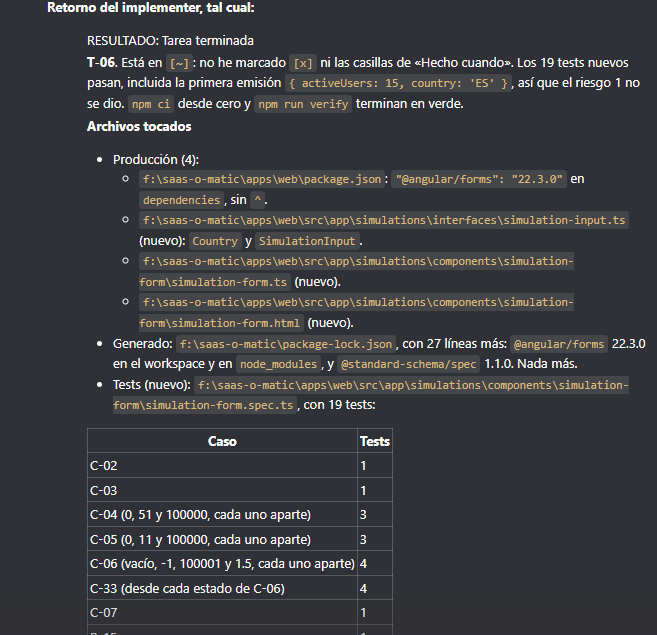
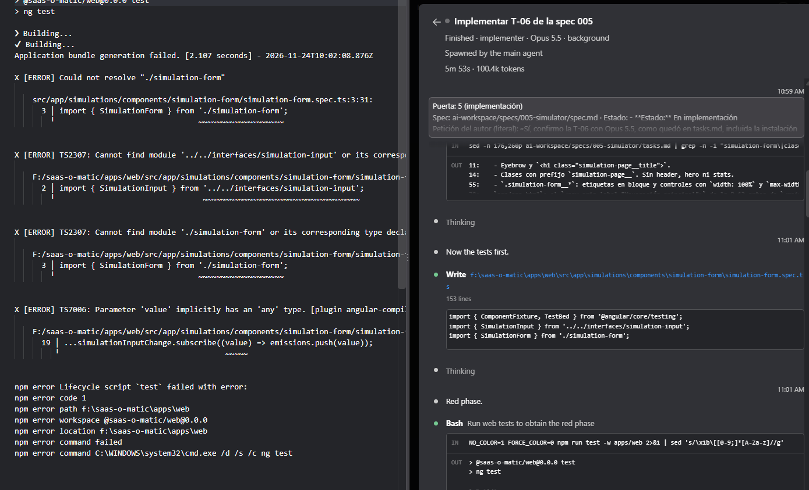
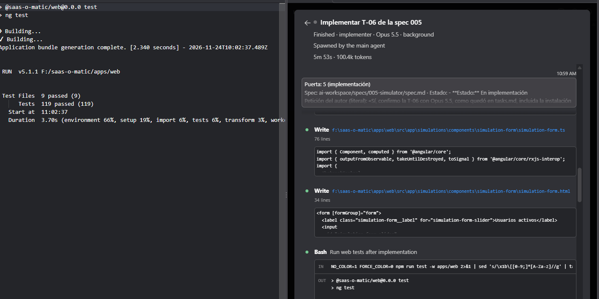

# 005-simulator — Fase 7 (2026-11-24, sesión 06)

## Objetivo y fase
Fase 7, spec `005-simulator`, puerta 5 (implementación) con `/sdd-implement`: la T-06 («simulations: `@angular/forms` y componente del formulario»).

## Prompts clave
Invocación (atajo de la puerta 5):
> /sdd-implement 005-simulator

Confirmación de la tarea:
> Sí, confirmo la T-06 con Opus 5.5, como quedó en tasks.md, incluida la instalación con mi orden literal. Pide al implementer la salida íntegra del rojo, sin abreviar, que dé la salida de npm ci desde cero, y que si falla la primera emisión de outputFromObservable, pare y lo devuelva.

Aprobación de la tarea:
> Signos escapados: sí, copia el rojo y la salida de npm ci con los signos reales y anótalo. Desviaciones 1 a 7 de la T-06: aceptadas; la 5 (doble emisión al mover el slider) no rompe nada con computed, anótalo en el registro.
> Apruebo la T-06. Márcala en [x] con sus casillas y mi aprobación literal, completa el registro 06 y actualiza MEMORY.md (máximo 50 líneas). package.json y package-lock.json van en el commit de esta tarea. Antes del commit lanzo /sdd-session 7 005-simulator. Después enséñame el diff y propón el commit, sin Co-Authored-By. NO hagas el commit: espera mi aprobación.

Registro de la sesión:
> /sdd-session 7 005-simulator

## Qué propuso la IA
- **Inicio:** leyó el `Estado:` (`En implementación`) y `tasks.md`, con T-01 a T-05 en `[x]`. Propuso la T-06: no tiene dependencias y la T-07 depende de ella. El modelo, Opus 5.5, es el confirmado en la puerta 4.
- **Antes del encargo:** lanzó `npm run verify` desde la raíz y salió en verde, con 766 + 100. Pasó en el encargo la cola de la salida, sin los códigos de color.
- **Encargo del implementer** (Opus 5.5, sin enseñarlo antes: ADR-016, punto 4):
  - la petición literal del autor, con lo que exige: el rojo íntegro, la salida de `npm ci` desde cero y parar si falla la primera emisión de `outputFromObservable` (riesgo 1 del plan);
  - la D-02 (con la autorización literal de la instalación), la D-10, la D-11, los riesgos 1, 5 y 7 del plan, las reglas comunes de `tasks.md` y el ADR-014;
  - «Rutas a leer» acotadas (R-02 a R-10, R-15, R-35, R-36, R-42 a R-44, R-47, R-50 y los casos C-02 a C-07, C-28, C-33 y C-34), `frontend-conventions`, `architecture.md` y el selector de divisa de la T-05 como ejemplo;
  - la fila literal de la T-06 y la salida de `npm run verify`;
  - además: ninguna otra instalación, parar si el lockfile trae algo más o un paquete declara scripts de instalación, los recuentos antes y después y las desviaciones declaradas.
- **Retorno del implementer:** «Tarea terminada».
  - Instaló con la orden literal: `added 2 packages`. Creó los tres ficheros nuevos de producción y el spec, y dejó la T-06 en `[~]`.
  - Hay 19 tests nuevos y la web pasa de 100 a 119. El riesgo 1 no se dio.
  - Borró `node_modules` y `apps/api/node_modules` y lanzó `npm ci` desde la raíz: `added 367 packages`, sin cambios en el lockfile.
  - Desviaciones declaradas:
    1. clases `simulation-form__label`, `simulation-form__control` y `simulation-form__error` en el `.html`, para que la T-08 tenga a qué dar estilo (D-14, `plan.md:248`);
    2. el campo numérico sin los atributos `min` y `max`, para no duplicar los validadores (los límites están en `Validators.min` y `Validators.max`; el slider sí los lleva, R-02);
    3. el validador de entero devuelve `null` con el vacío, que ya cubre `Validators.required`;
    4. `activeUsers` es `FormControl<number | null>` sin `nonNullable`; el slider y el país sí lo son;
    5. al mover el slider, `simulationInputChange` emite dos veces el mismo valor (una por el slider y otra al sincronizar el campo); sin `distinctUntilChanged`, que no piden ni la fila ni el plan;
    6. «junto al campo» se comprueba con `nextElementSibling`;
    7. los tests de C-04 y C-05 comprueban además la emisión, y el de R-15 que no hay ningún `<button>`.
- **Comprobaciones de la sesión principal:**
  - `git status` y `git diff --stat`: solo cambian `apps/web/package.json`, `package-lock.json` (27 líneas), la línea `Estado` de la T-06 en `tasks.md` y los cuatro ficheros nuevos de `simulations/`.
  - Todos los `@angular/*` de `apps/web/package.json` siguen en 22.3.0, y `@angular/forms` no lleva `^`.
  - En el lockfile solo entran `@angular/forms` 22.3.0 y `@standard-schema/spec` 1.1.0, y ninguno lleva `hasInstallScript`.
  - No hay `UntypedFormControl` ni `markForCheck` en `simulations/`.
  - Los textos de las opciones de país coinciden con R-08, y las clases de la desviación 1 con `plan.md:248`.
  - Volvió a lanzar `npm run verify` y salió en verde, con 766 + 119 tests.
  - Este registro no se abrió al llegar la fase roja, como pide la regla de `tasks.md`: se creó tras la aprobación del autor, con el rojo y la salida de `npm ci` copiados del retorno del implementer.
- **Al autor:** le enseñó `git status`, `git diff --stat` y el retorno literal. Le señaló la desviación 5 (la T-07 calcularía dos veces seguidas) y le preguntó si guardar el rojo y `npm ci` con los signos reales. Le pidió aprobación explícita.
- **Tras la aprobación:**
  - Marcó la T-06 `[x]` con sus casillas, «Modelo: Opus 5.5, confirmado por el autor» y la aprobación literal.
  - Creó este registro y actualizó `MEMORY.md` (T-06 hecha, 766 + 119; siguiente, la T-07) sin pasar de 50 líneas.
  - Enseñó el diff y propuso el mensaje del commit.
  - Con `/sdd-session 7 005-simulator`, completó este registro (paso 7) y enlazó las tres capturas de la T-06.

## Instalación (retorno literal del implementer)
Orden literal del autor, desde la raíz: `npm install @angular/forms@22.3.0 --save-exact -w apps/web`.

```
added 2 packages, and audited 371 packages in 3s

122 packages are looking for funding
  run `npm fund` for details

found 0 vulnerabilities
```

`@angular/forms` no declara scripts. `@standard-schema/spec` declara `lint`, `format`, `check` y `build`, ninguno de instalación (ADR-014).

## Fase roja de la T-06 (retorno literal del implementer)
Orden: `npm run test -w apps/web`, sin códigos ANSI, antes de escribir producción (con `@angular/forms` ya instalado). Falla porque `simulation-form.ts` y `simulation-input.ts` aún no existían; el TS7006 es consecuencia del mismo `import`. El retorno llegó con los signos `>` escapados en HTML (`&gt;`); aquí se copia con los signos reales, por decisión del autor («Signos escapados: sí, copia el rojo y la salida de npm ci con los signos reales y anótalo.»).

```
> @saas-o-matic/web@0.0.0 test
> ng test

❯ Building...
✔ Building...
Application bundle generation failed. [2.107 seconds] - 2026-11-24T10:02:08.876Z

X [ERROR] Could not resolve "./simulation-form"

    src/app/simulations/components/simulation-form/simulation-form.spec.ts:3:31:
      3 │ import { SimulationForm } from './simulation-form';
        ╵                                ~~~~~~~~~~~~~~~~~~~


X [ERROR] TS2307: Cannot find module '../../interfaces/simulation-input' or its corresponding type declarations. [plugin angular-compiler]

    F:/saas-o-matic/apps/web/src/app/simulations/components/simulation-form/simulation-form.spec.ts:2:32:
      2 │ import { SimulationInput } from '../../interfaces/simulation-input';
        ╵                                 ~~~~~~~~~~~~~~~~~~~~~~~~~~~~~~~~~~~


X [ERROR] TS2307: Cannot find module './simulation-form' or its corresponding type declarations. [plugin angular-compiler]

    F:/saas-o-matic/apps/web/src/app/simulations/components/simulation-form/simulation-form.spec.ts:3:31:
      3 │ import { SimulationForm } from './simulation-form';
        ╵                                ~~~~~~~~~~~~~~~~~~~


X [ERROR] TS7006: Parameter 'value' implicitly has an 'any' type. [plugin angular-compiler]

    F:/saas-o-matic/apps/web/src/app/simulations/components/simulation-form/simulation-form.spec.ts:19:63:
      19 │ ...simulationInputChange.subscribe((value) => emissions.push(value));
         ╵                                     ~~~~~


npm error Lifecycle script `test` failed with error:
npm error code 1
npm error path f:\saas-o-matic\apps\web
npm error workspace @saas-o-matic/web@0.0.0
npm error location f:\saas-o-matic\apps\web
npm error command failed
npm error command C:\WINDOWS\system32\cmd.exe /d /s /c ng test
```

## `npm ci` desde cero (retorno literal del implementer)
Antes, el implementer borró `node_modules` y `apps/api/node_modules`, los únicos que había, y comprobó con `ls` que no quedaba ninguno. Orden, desde la raíz: `npm ci`. La salida no traía signos escapados.

```
added 367 packages, and audited 371 packages in 25s

122 packages are looking for funding
  run `npm fund` for details

found 0 vulnerabilities
```

El lockfile no cambió con `npm ci`: el diff sigue en 27 líneas.

## Qué corregí y por qué
- **El encargo:** pedí que el implementer diera la salida íntegra del rojo, sin abreviar, y la de `npm ci` desde cero, y que parara si fallaba la primera emisión de `outputFromObservable`.
- **El rojo del registro:** se guarda con los signos reales, no con los escapados en HTML.
- Correcciones a propuestas de la IA: (no registrado).

## Decisiones tomadas
- T-06 aprobada por el autor el 2026-11-24 (literal en `tasks.md`: «Apruebo la T-06.»).
- Dependencia: `@angular/forms` 22.3.0 exacta en `dependencies` de `apps/web`, con `@standard-schema/spec` 1.1.0 en el lockfile (D-02). `package.json` y `package-lock.json` van en el commit de esta tarea.
- Archivos de producción:
  - `apps/web/package.json`: `"@angular/forms": "22.3.0"`.
  - `apps/web/src/app/simulations/interfaces/simulation-input.ts` (nuevo): `Country` y `SimulationInput` (D-10).
  - `simulation-form.ts` (nuevo): `SimulationForm` (`app-simulation-form`) con `FormGroup` tipado (`slider`, `activeUsers` y `country`), validadores de la D-11, sincronía con `takeUntilDestroyed()`, señal del estado del campo con `toSignal` y `simulationInputChange = outputFromObservable(...)` con `startWith`.
  - `simulation-form.html` (nuevo): slider, campo numérico, selector de país y texto de error, con `<label for>`, `aria-invalid`, `aria-describedby` e `id` con el prefijo `simulation-form-`.
- Tests nuevos: 19, en `simulation-form.spec.ts`.
- Se aceptan las desviaciones 1 a 7 del implementer: el autor lo dice literalmente («Desviaciones 1 a 7 de la T-06: aceptadas»).
- Desviación 5 (doble emisión al mover el slider), anotada por decisión del autor: «la 5 (doble emisión al mover el slider) no rompe nada con computed».
- El `Estado:` de `spec.md` y la fila 005 del README no cambian: siguen en `En implementación`.
- `npm run verify` en verde: antes, 766 + 100; después, 766 + 119.
- Commit: el de cierre de esta sesión.

## Capturas






Línea `CAPTURA:` de esta sesión: `fase-7-005-t06-retorno-implementer.png`, que existe.

## Pendiente para la siguiente sesión
- Puerta 5 de la spec 005: la T-07 (simulations: página del simulador y ruta `simulator`), con Opus 5.5. Riesgo 2 del plan: si `vi.mock` de un paquete no funciona en `apps/web`, la tarea para y lo devuelve (D-15).
