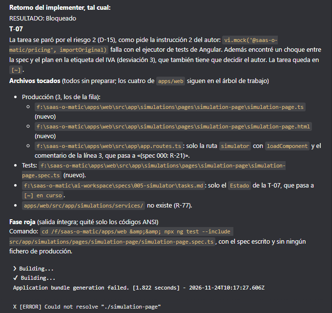
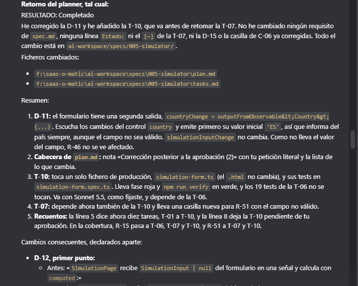
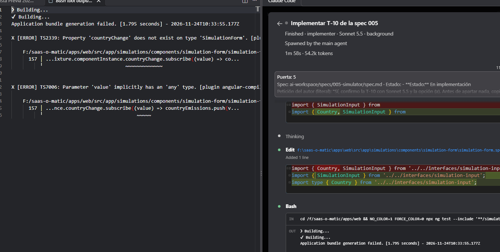
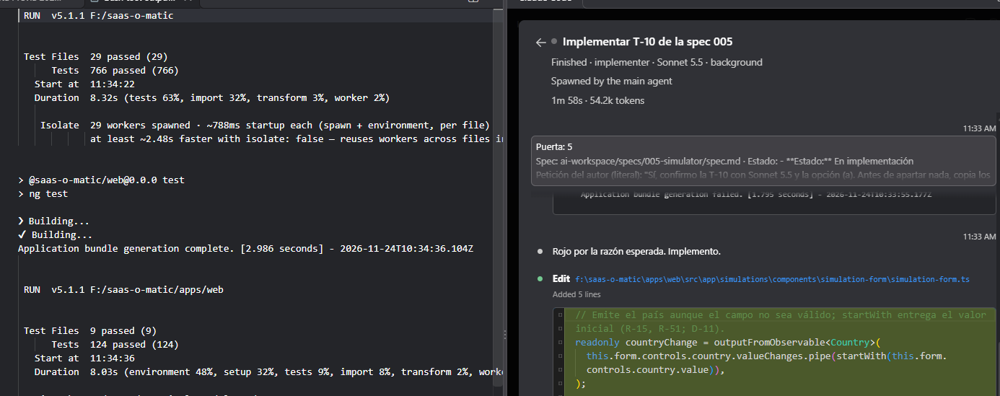

# 005-simulator — Fase 7 (2026-11-24, sesión 07)

## Objetivo y fase
Fase 7, spec `005-simulator`, puerta 5 (implementación) con `/sdd-implement`:
- La T-07 («simulations: página del simulador y ruta `simulator`») quedó bloqueada.
- Hubo puertas 3 y 4 ampliadas.
- Se hizo la T-10 («simulations: salida del país en el formulario»).

## Prompts clave
Invocación (atajo de la puerta 5):
> /sdd-implement 005-simulator

Confirmación de la T-07:
> Sí, confirmo la T-07 con Opus 5.5, como quedó en tasks.md. Pide al implementer la salida íntegra del rojo, sin abreviar, y que si falla vi.mock con el ejecutor de Angular o la primera emisión del formulario, pare y lo devuelva.

Decisiones sobre el bloqueo de la T-07:
> Signos escapados: sí, copia con los signos reales y anótalo. Desviaciones 2 y 5 de la T-07: aceptadas (la prueba de diagnóstico con vi, ya deshecha, no debía hacerse).
> Bloqueo 1: (B). Quita el espía de la T-07 y da R-46 por cubierto con los «—» de C-06 más la revisión del código en la Puerta 6, porque el formulario emite null con un valor no válido y la página nunca recibe ese valor. Autorizo corregir tú, sin vuelta del planner, la D-15 del plan.md y la casilla de C-06 de la T-07, con una nota «Corrección posterior a la aprobación» con mi autorización literal, como con D-04 y D-07 de la 002.
> Bloqueo 2: (a). El formulario informa siempre del país, con una salida aparte. Lanza al planner en una puerta 3 y 4 ampliadas: corrige la D-11 del plan y añade una T-10, pequeña, con Sonnet 5.5, que se hace antes de retomar la T-07. Enséñame el retorno antes de aprobar.
> La T-07 se queda en [~] hasta que se resuelvan las dos cosas.

Aprobación de las puertas 3 y 4 ampliadas:
> 1. Apruebo las puertas 3 y 4 ampliadas de la 005: la D-11 corregida (salida countryChange), la D-12 en lo declarado y la T-10, pequeña, con Sonnet 5.5, antes de retomar la T-07. La señal del país de la página arranca en null y entra 'ES' al conectarse; acepto la nota 1. El Estado: sigue en En implementación.
> 2. Sí, corrige las dos líneas de la T-07 que aún citan el espía, con la misma nota «Corrección posterior a la aprobación».
> 3. Orden: lanzo ahora la T-10 con /sdd-implement. El commit de la T-10 incluye solo sus ficheros, plan.md y tasks.md, preparados por nombre; los ficheros de la T-07 en curso no entran. Antes del commit lanzo /sdd-session 7 005-simulator.

Segunda invocación:
> /sdd-implement 005-simulator

Confirmación de la T-10:
> Sí, confirmo la T-10 con Sonnet 5.5 y la opción (a). Antes de apartar nada, copia los tres ficheros nuevos de simulation-page/ y el app.routes.ts modificado al scratchpad y comprueba con diff que las copias son idénticas; deja app.routes.ts como en HEAD. Después de lanzar la T-10 y de que yo confirme el commit, los devuelves y compruebas con diff que quedan idénticos, y que git status solo muestra los ficheros de la T-07. Pide al implementer la salida íntegra del rojo, sin abreviar.

Aprobación de la T-10:
> Signos escapados: sí, con los signos reales y anótalo. Desviaciones 1 a 3 de la T-10: aceptadas.
> Apruebo la T-10. Márcala en [x] con sus casillas y mi aprobación literal, completa el registro 07 y actualiza MEMORY.md (máximo 50 líneas). Antes del commit lanzo /sdd-session 7 005-simulator. El commit incluye solo los ficheros de la T-10, plan.md, tasks.md, el registro y las capturas, preparados por nombre. Después enséñame el diff y propón el commit, sin Co-Authored-By. NO hagas el commit: espera mi aprobación.
> Cuando confirme el commit, devuelve los ficheros de la T-07 y comprueba con diff que quedan idénticos.

Registro de la sesión:
> /sdd-session 7 005-simulator

## Qué propuso la IA
- **Inicio:** leyó el `Estado:` (`En implementación`) y `tasks.md`, con T-01 a T-06 en `[x]`. Propuso la T-07 con Opus 5.5, el modelo confirmado en la puerta 4.
- **Antes del encargo de la T-07:** lanzó `npm run verify` desde la raíz y salió en verde (766 + 119). Pasó la cola de la salida, sin los códigos de color.
- **Encargo del implementer de la T-07** (Opus 5.5, sin enseñarlo antes: ADR-016, punto 4):
  - la petición literal;
  - D-06, D-08 a D-15, D-17 y D-18, y los riesgos 1 a 3 del plan;
  - rutas acotadas a los requisitos y casos de la T-07;
  - la fila literal de la T-07 y la salida de `npm run verify`;
  - además: el rojo íntegro, parar sin buscar alternativa si falla `vi.mock` (riesgo 2) o la primera emisión (riesgo 1), cuadrar el recuento y declarar las desviaciones.
- **Retorno de la T-07:** «Bloqueado» por el riesgo 2. Además, un choque entre spec y plan: R-51 frente a la D-11, porque con el campo no válido la página no sabe el país. La T-07 quedó en `[~]`.
- **Propuesta para el bloqueo 1:**
  - (A), recomendada: un `InjectionToken` con un espía.
  - (B): los «—» más la revisión del código en la puerta 6.
  - (C): Vitest directo.

  La búsqueda en la documentación de Angular no dio resultados.
- **Propuesta para el bloqueo 2:** recomendó la (a) del implementer.
- **Bloqueo 1, aplicado por la sesión principal:**
  - nota «Corrección posterior a la aprobación» en la cabecera de `plan.md`;
  - D-15 corregida;
  - casilla de C-06 de la T-07 corregida con su nota.

  Señaló que otras dos líneas de la T-07 seguían citando el espía.
- **Bloqueo 2:** lanzó al planner (Opus 5.5) en las puertas 3 y 4 ampliadas, con el encargo sin enseñar antes.
  - Retorno «Completado»: D-11 con la segunda salida `countryChange`; D-12 y secciones 2, 5, 7, 8 y 10 ajustadas por consecuencia y declaradas; T-10 nueva; la T-07 con la T-10 en «Depende de» y una casilla nueva de R-51.
  - Solo cambiaron `plan.md` y `tasks.md`.
  - Propuso que la señal del país de la página arranque en `null` (nota 1).
- **Propuesta de la T-10** (Sonnet 5.5):
  - Avisó de que `npm run verify` salía en rojo por el spec de la T-07 en curso (`Test Files  1 failed | 9 passed (10)`).
  - Opciones: (a), recomendada, apartar los ficheros de la T-07 al scratchpad; (b) aceptar el fallo conocido.
- **Opción (a), aplicada:**
  - Copió al scratchpad (`t07-backup/`) `simulation-page.ts`, `.html`, `.spec.ts` y `app.routes.ts`. Comprobó con `diff -q` que las cuatro copias eran idénticas.
  - Quitó del árbol los tres ficheros nuevos y las carpetas vacías `pages/simulation-page/` y `pages/`.
  - Dejó `app.routes.ts` como en `HEAD`.
  - `npm run verify` salió en verde (766 + 119).
- **Encargo del implementer de la T-10:** Sonnet 5.5, sin enseñarlo antes, con el rojo íntegro y parar si la primera emisión no es `'ES'`.
- **Retorno de la T-10:** «Tarea terminada».
  - 5 tests nuevos; los 19 de la T-06 sin cambios, y el diff del spec no quita ninguna línea.
  - `npm run verify` relanzado por la sesión principal: 766 + 124, en verde.

## Fase roja de la T-07 (retorno literal del implementer)
Comando: `cd /f/saas-o-matic/apps/web && npx ng test --include src/app/simulations/pages/simulation-page/simulation-page.spec.ts`, con el spec escrito y sin ningún fichero de producción. En el retorno, `&&` llegó escapado como `&amp;&amp;`; se copia con el signo real.
```
❯ Building...
✔ Building...
Application bundle generation failed. [1.822 seconds] - 2026-11-24T10:17:27.606Z

X [ERROR] Could not resolve "./simulation-page"

    src/app/simulations/pages/simulation-page/simulation-page.spec.ts:7:31:
      7 │ import { SimulationPage } from './simulation-page';
        ╵                                ~~~~~~~~~~~~~~~~~~~


X [ERROR] TS2307: Cannot find module './simulation-page' or its corresponding type declarations. [plugin angular-compiler]

    F:/saas-o-matic/apps/web/src/app/simulations/pages/simulation-page/simulation-page.spec.ts:7:31:
      7 │ import { SimulationPage } from './simulation-page';
        ╵                                ~~~~~~~~~~~~~~~~~~~


EXIT CODE: 1
```
Nota del implementer: una primera ejecución dio además `TS2345` en `flush(body)`, porque `body` era `unknown`. Cambió el parámetro a `object` y repitió. La salida de arriba es la de la repetición.

## Fallo de `vi.mock` (riesgo 2; retorno literal del implementer)
Tras escribir la producción:
```
❯ Building...
✔ Building...
Application bundle generation complete. [2.664 seconds] - 2026-11-24T10:18:21.320Z


 RUN  v5.1.1 F:/saas-o-matic/apps/web

 ❯ |web| src/app/simulations/pages/simulation-page/simulation-page.spec.ts (0 test)

⎯⎯⎯⎯⎯⎯ Failed Suites 1 ⎯⎯⎯⎯⎯⎯⎯

 FAIL  |web| src/app/simulations/pages/simulation-page/simulation-page.spec.ts [ src/app/simulations/pages/simulation-page/simulation-page.spec.ts ]
Error: [vitest] There was an error when mocking a module. If you are using "vi.mock" factory, make sure there are no top level variables inside, since this call is hoisted to top of the file. Read more: https://vitest.dev/api/vi.html#vi-mock
 ❯ src/app/simulations/pages/simulation-page/simulation-page.ts:2:1
 ❯ src/app/simulations/pages/simulation-page/simulation-page.spec.ts:7:25
      5| import { calculateBaseCostCents } from '@saas-o-matic/pricing';
      6| import { routes } from '../../../app.routes';
      7| import { SimulationPage } from './simulation-page';
       |                         ^
      8|
      9| // Espía sobre calculateBaseCostCents que sigue calculando de verdad, …

Caused by: ReferenceError: Cannot access '__vi_import_1__' before initialization
 ❯ src/app/simulations/pages/simulation-page/simulation-page.spec.ts:12:3
 ❯ src/app/simulations/pages/simulation-page/simulation-page.ts:2:1
 ❯ src/app/simulations/pages/simulation-page/simulation-page.spec.ts:7:25

⎯⎯⎯⎯⎯⎯⎯⎯⎯⎯⎯⎯⎯⎯⎯⎯⎯⎯⎯⎯⎯⎯⎯⎯[1/1]⎯


 Test Files  1 failed (1)
      Tests  no tests
   Start at  11:18:21
   Duration  1.67s (environment 71%, setup 27%, transform 2%, worker 1%)

EXIT CODE: 1
```

## Fase roja de la T-10 (retorno literal del implementer)
Comando: `npx ng test --include '**/simulation-form.spec.ts' --watch=false` en `apps/web`, con los tests nuevos escritos y sin `countryChange`. En el retorno, `=>` llegó escapado como `=&gt;`; se copia con el signo real. Según el implementer, las líneas con `...` ya vienen cortadas por Angular.
```
❯ Building...
✔ Building...
Application bundle generation failed. [1.795 seconds] - 2026-11-24T10:33:55.177Z

X [ERROR] TS2339: Property 'countryChange' does not exist on type 'SimulationForm'. [plugin angular-compiler]

    F:/saas-o-matic/apps/web/src/app/simulations/components/simulation-form/simulation-form.spec.ts:157:30:
      157 │ ...ixture.componentInstance.countryChange.subscribe((value) => co...
          ╵                             ~~~~~~~~~~~~~

X [ERROR] TS7006: Parameter 'value' implicitly has an 'any' type. [plugin angular-compiler]

    F:/saas-o-matic/apps/web/src/app/simulations/components/simulation-form/simulation-form.spec.ts:157:55:
      157 │ ...nce.countryChange.subscribe((value) => countryEmissions.push(value));
          ╵                                 ~~~~~~~~~~~~~
```
A diferencia del rojo de la T-07, esta salida no termina en una línea `EXIT CODE`.

## Qué corregí y por qué
- **Bloqueo 1:** el autor eligió (B) y no la (A) recomendada. Motivo literal: «porque el formulario emite null con un valor no válido y la página nunca recibe ese valor».
- **Bloqueo 2:** eligió la (a) con una salida aparte, no con `activeUsers` anulable.
- **Signos escapados** en los tres retornos (`&amp;&amp;`, `&lt;…&gt;`, `=&gt;`): copiados con los signos reales, con OK del autor.
- **Desviación 2 de la T-07:** la prueba de diagnóstico con `import { vi }` no debía hacerse, porque la instrucción era parar sin buscar alternativa. El autor la aceptó porque ya estaba deshecha.
- **Ficheros de la T-07:** el autor pidió comprobar con `diff` que las copias eran idénticas antes de apartar nada, y comprobarlo otra vez al devolverlos.

## Decisiones tomadas
- **Bloqueo 1 (B):** sin `vi.mock` ni espía. R-46 queda cubierto con los «—» de C-06 y la revisión del código en la puerta 6. La sesión principal corrigió, cada una con su nota «Corrección posterior a la aprobación» y la autorización literal:
  - la D-15 de `plan.md`;
  - la casilla de C-06 de la T-07;
  - la línea de «Tests» de la T-07;
  - la casilla del riesgo de la T-07.
- **Bloqueo 2 (a), puertas 3 y 4 ampliadas, aprobadas:**
  - D-11 con `countryChange` y la D-12 en lo declarado.
  - La señal del país de la página arranca en `null` y entra `'ES'` al conectarse (nota 1).
  - T-10 con Sonnet 5.5. La aprobación literal está en la nota (2) de `plan.md` y en la línea 8 de `tasks.md`.
  - El `Estado:` sigue en `En implementación`.
- **T-10 aprobada**, con las desviaciones 1 a 3 aceptadas:
  1. `import type { Country }` en una línea aparte, para que el diff solo añada.
  2. Los tests nuevos en el mismo `describe`, con los helpers `connectCountry` y `changeCountry`.
  3. La fase roja con `ng test --include` sobre un solo fichero.

  Queda en `[x]` con sus 7 casillas y la aprobación literal.
- **Opción (a) para la T-10:** los ficheros de la T-07 se apartan al scratchpad y se devuelven tras confirmar el commit.
- **La T-07 sigue en `[~]`.**
- `MEMORY.md` al día (50 líneas).
- Commit: el de cierre de esta sesión.

## Capturas





## Pendiente para la siguiente sesión
- **Después del commit de la T-10:** devolver los ficheros de la T-07 desde el scratchpad (`t07-backup/`). Comprobar con `diff` que quedan idénticos y que `git status` solo muestra los de la T-07.
- **Retomar la T-07 con Opus 5.5:**
  - quitar del spec el `vi.mock` y el espía (D-15 corregida);
  - consumir `countryChange` en la página (D-12; la señal del país en `null` hasta que entra `'ES'`);
  - la casilla nueva de R-51 con el campo no válido.
- **Preguntas abiertas al autor:**
  - si se corrige también la línea «Modelo propuesto» de la T-07, que aún cita `vi.mock`;
  - si `MEMORY.md` entra en el commit de la T-10, porque no figura en la lista del autor y CLAUDE.md pide que se actualice antes de cada commit.
