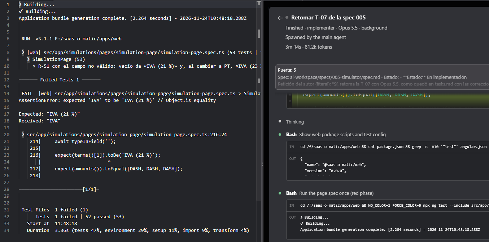
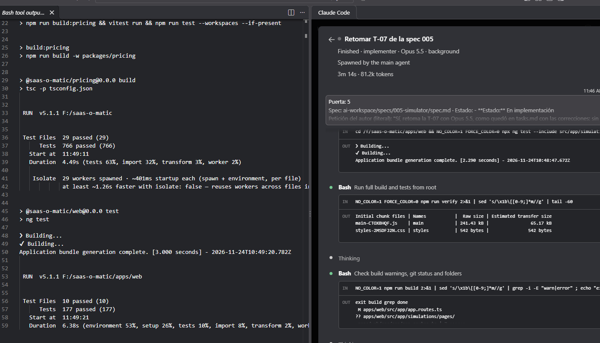

# 005-simulator — Fase 7 (2026-11-24, sesión 08)

## Objetivo y fase
Fase 7, spec `005-simulator`, puerta 5 (implementación). Se retoma la T-07 («simulations: página del simulador y ruta `simulator`») después del bloqueo de la sesión 07. Cambian dos cosas respecto a la primera vuelta:
- la D-15 está corregida, sin `vi.mock` ni espía;
- la página ya puede usar la salida `countryChange` de la T-10.

## Prompts clave
Retomar la T-07:
> Sí, retoma la T-07 con Opus 5.5, como quedó en tasks.md con las correcciones: sin vi.mock ni espía (decisión B), consumiendo countryChange, con la casilla nueva de R-51. Los ficheros de la T-07 ya están en el árbol: que el implementer los modifique, no los rehaga. Pide la salida íntegra de la primera ejecución del spec, sin abreviar, y que si falla el riesgo 1 o cualquier test, pare y lo devuelva.

Aprobación de la T-07:
> Signos escapados: sí, con los signos reales y anótalo. Desviaciones 1 a 4 de la T-07: aceptadas. Corrige también la línea «Modelo propuesto» de la T-07 que aún cita vi.mock, con la misma nota «Corrección posterior a la aprobación».
> Apruebo la T-07. Márcala en [x] con sus casillas y mi aprobación literal, completa el registro 08 y actualiza MEMORY.md (máximo 50 líneas). Antes del commit lanzo /sdd-session 7 005-simulator. Después enséñame el diff y propón el commit, sin Co-Authored-By. NO hagas el commit: espera mi aprobación

Registro de la sesión:
> /sdd-session 7 005-simulator

## Qué propuso la IA
- **Antes del encargo:** lanzó `npm run verify` desde la raíz. Salió en rojo solo por el `vi.mock` del spec de la página (`Test Files  1 failed | 9 passed (10)`, `Tests  124 passed (124)`); los 766 tests de la raíz pasaron. Pasó esa salida en el encargo.
- **Encargo del implementer** (Opus 5.5, sin enseñarlo antes: ADR-016, punto 4):
  - Modificar los ficheros existentes, sin rehacerlos.
  - Empezar por el spec: quitar el `vi.mock` y el espía, añadir el test nuevo de R-51 y conectar la página a `countryChange`. Ejecutarlo una vez sin tocar la producción y devolver la salida íntegra.
  - Parar si falla otro test que no sea el nuevo, si falla algo después de implementar o si se da el riesgo 1. No hacer pruebas de diagnóstico.
  - No tocar `app.routes.ts`.
- **Retorno del implementer:** «Tarea terminada». El spec de la página tiene 53 tests: los 52 de la primera vuelta y 1 nuevo de R-51.
- **Comprobaciones de la sesión principal**, contra las copias del scratchpad (`t07-backup/`):
  - `app.routes.ts` es idéntico a la copia.
  - `simulation-page.ts` y `.html` solo tienen cambios puntuales sobre la versión anterior: la señal `country`, `updateCountry`, la etiqueta del IVA tomada de esa señal y `(countryChange)` en la plantilla.
  - El spec ya no contiene `vi.` ni `calculateBaseCostCents`.
  - `npm run verify`, relanzado: 766 + 177, en verde.
- **Desviaciones:** la sesión principal relacionó la desviación 1 con la nota 1 ya aceptada y la 2 con la D-12 corregida. Recordó que seguía pendiente decidir la línea «Modelo propuesto».
- **Al cerrar:**
  - Marcó la T-07 en `[x]` con sus 23 casillas y la aprobación literal.
  - Corrigió la línea del modelo con la nota «Corrección posterior a la aprobación».
  - Actualizó `MEMORY.md` (50 líneas) y propuso el commit, preparando los ficheros por nombre.

## Primera ejecución del spec (retorno literal del implementer)
Orden: `npx ng test --include src/app/simulations/pages/simulation-page/simulation-page.spec.ts`, lanzada en `apps/web` con el spec ya cambiado y la producción sin tocar. En el retorno, `>` llegó escapado como `&gt;`; aquí se copia con el signo real.
```
❯ Building...
✔ Building...
Application bundle generation complete. [2.264 seconds] - 2026-11-24T10:48:18.288Z


 RUN  v5.1.1 F:/saas-o-matic/apps/web

 ❯ |web| src/app/simulations/pages/simulation-page/simulation-page.spec.ts (53 tests | 1 failed) 1461ms
   ❯ SimulationPage (53)
     × R-51 con el campo no válido: vacío da «IVA (21 %)» y, al cambiar a PT, «IVA (23 %)», con «—» en los importes 22ms

⎯⎯⎯⎯⎯⎯⎯ Failed Tests 1 ⎯⎯⎯⎯⎯⎯⎯

 FAIL  |web| src/app/simulations/pages/simulation-page/simulation-page.spec.ts > SimulationPage > R-51 con el campo no válido: vacío da «IVA (21 %)» y, al cambiar a PT, «IVA (23 %)», con «—» en los importes
AssertionError: expected 'IVA' to be 'IVA (21 %)' // Object.is equality

Expected: "IVA (21 %)"
Received: "IVA"

 ❯ src/app/simulations/pages/simulation-page/simulation-page.spec.ts:216:24
    214|     await typeInField('');
    215|
    216|     expect(terms()[1]).toBe('IVA (21 %)');
       |                        ^
    217|     expect(amounts()).toEqual([DASH, DASH, DASH]);
    218|

⎯⎯⎯⎯⎯⎯⎯⎯⎯⎯⎯⎯⎯⎯⎯⎯⎯⎯⎯⎯⎯⎯⎯⎯[1/1]⎯


 Test Files  1 failed (1)
      Tests  1 failed | 52 passed (53)
   Start at  11:48:18
   Duration  3.36s (tests 47%, environment 29%, setup 11%, import 9%, transform 4%)
```

## Qué corregí y por qué
- **Signos escapados** del retorno (`&gt;`, `&lt;…&gt;`): se copian con los signos reales, con OK del autor.
- **Línea «Modelo propuesto» de la T-07:** todavía citaba `vi.mock`. La sesión principal la corrigió, por orden del autor, con la nota «Corrección posterior a la aprobación».

## Decisiones tomadas
- La T-07 queda en `[x]` con sus 23 casillas. La aprobación literal del autor está en `tasks.md`, y la línea del modelo, corregida con su nota.
- **Desviaciones aceptadas:**
  1. La etiqueta dice «IVA» sin tipo solo mientras la señal del país vale `null`, antes de la primera emisión de `countryChange` (nota 1, ya aceptada).
  2. Los importes toman el país de `SimulationInput.country` y la etiqueta lo toma de la señal nueva. Con el campo válido, los dos coinciden.
  3. La conexión a `countryChange` se prueba por su efecto en el DOM.
  4. Sin pruebas de diagnóstico.
- Lo manual de la sección 5 del plan y la revisión de R-46 quedan para la puerta 6.
- Commit: el de cierre de esta sesión.

## Capturas



## Pendiente para la siguiente sesión
- Puerta 5 de la 005: T-08 (estilos y tokens, con Sonnet 5.5) y T-09 (navegación en la carcasa, con Sonnet 5.5). Las dos dependen de la T-07.
- Después, la puerta 6.
