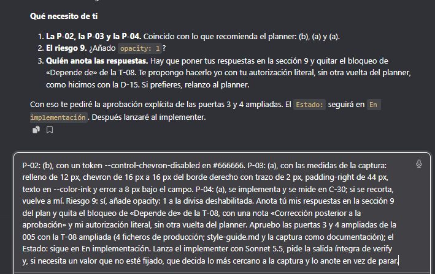
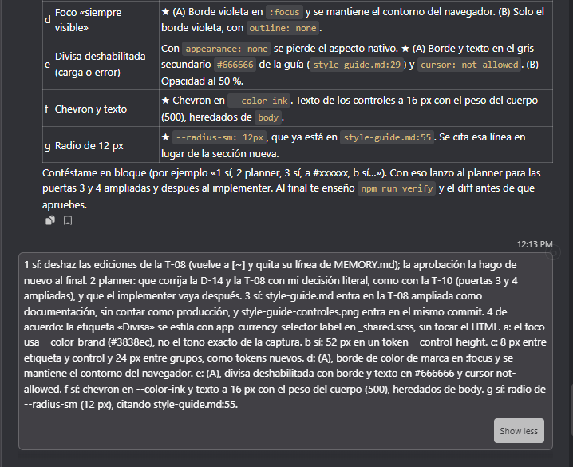
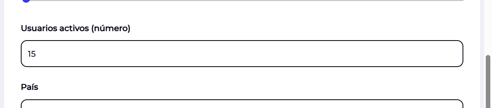
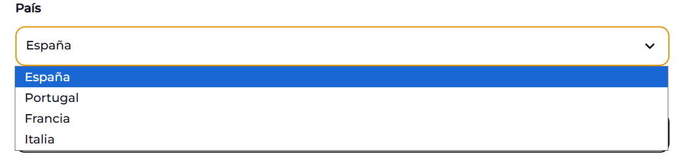
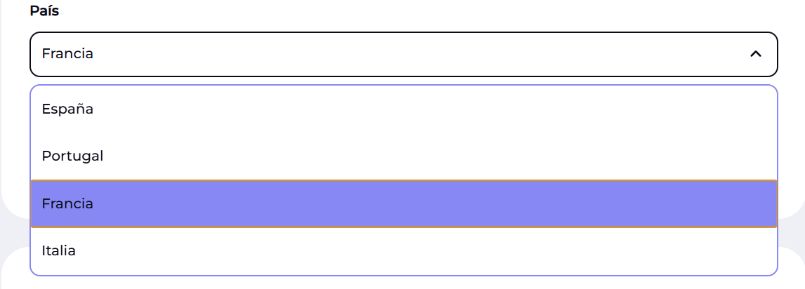

# 005-simulator — Fase 7 (2026-11-24, sesión 09)

## Objetivo y fase
Fase 7, spec `005-simulator`, puerta 5 (implementación): T-08 («estilos del simulador, controles del formulario y tokens»). La T-08 se aprobó en una primera vuelta y el autor la reabrió antes del commit con su decisión sobre los controles. Hubo dos ampliaciones de las puertas 3 y 4: las notas (3) y (4) de `plan.md` y, después, la nota (5), que las sustituye y añade la lista de opciones redondeada con `appearance: base-select` como mejora progresiva. La T-08 no tiene tests nuevos ni fase roja. `Estado:` de la spec: `En implementación` durante toda la sesión.

Registro abierto por la sesión principal al aprobar la T-08, con el retorno literal del implementer de la última vuelta, por petición del autor; `/sdd-session` lo completa en este mismo fichero.

## Prompts clave
Inicio de la puerta 5:
> /sdd-implement 005-simulator

Confirmación de la T-08:
> Sí, confirmo la T-08 con Sonnet 5.5, como quedó en tasks.md. Que cada token nuevo cite la línea de style-guide.md de la que sale, y que no toque _base.scss ni _health.scss.

Aprobación de la primera vuelta:
> Apruebo la T-08 con las desviaciones 1 a 4 aceptadas.

Reapertura y primera ampliación (notas (3) y (4) de `plan.md`): (no registrado en la parte de la conversación que conserva la sesión principal; los textos literales están citados por el autor en esas notas).

Decisión del autor que sustituye a las anteriores (texto pegado entero en el chat):
> Decisión mía sobre los controles del simulador, que sustituye a mis mensajes anteriores sobre este tema; referencia: mi captura de los desplegables de Roams, guardada como ai-workspace/docs/style-guide-controles.png. Primero deshaz las ediciones de la T-08 (vuelve a [~] y quita su línea de MEMORY.md); la aprobación la hago de nuevo al final. Que el planner corrija la D-14 y la T-08 con esta decisión literal y la deje ampliada (4 ficheros de producción: _tokens.scss, _simulations.scss, _shared.scss y styles.scss; style-guide.md y style-guide-controles.png como documentación y en el mismo commit), como con la T-10, en puertas 3 y 4 ampliadas, y que el implementer, con Sonnet 5.5, vaya después; el Estado: sigue en En implementación. Solo .scss, sin cambiar el HTML ni los tests: desplegables (país y divisa) y campo numérico con fondo blanco, borde de 2 px (token --control-border-width) casi negro (--color-ink), esquinas de --radius-sm (12 px, style-guide.md:55), 52 px de alto (token --control-height), Montserrat 16 px con peso 500, texto en --color-ink, relleno de 12 px y el mismo ancho todos, con box-sizing border-box; en los desplegables appearance none con un chevron a la derecha de 16 px a 16 px del borde y trazo de 2 px, en --color-ink (padding-right de 44 px), y un token --control-chevron-disabled en #666666 para el deshabilitado; con el foco, borde en --color-brand (#3838ec) y se mantiene el contorno del navegador, sin reglas de outline; etiquetas en negrita 700 y --color-ink encima del control, con 8 px (--space-sm) entre etiqueta y control y 24 px (--space-md) entre grupos, y el texto de error a 8 px bajo el campo; la etiqueta «Divisa» se estila con app-currency-selector label en _shared.scss; slider con accent-color --color-brand; divisa deshabilitada con borde y texto en --color-muted (#666666), cursor not-allowed y opacity: 1; lista de opciones redondeada con appearance: base-select como mejora progresiva en los tres desplegables, con @supports y la lista nativa como respaldo: ::picker(select) con fondo blanco, esquinas de 12 px, borde de 2 px en un tono derivado de --color-brand con color-mix, opciones con relleno de 12 px y, al resaltarlas, fondo derivado de --color-brand con color-mix, y ::picker-icon para el chevron; quita de la T-08 la casilla «ninguna regla de option» y la de la lista nativa; la P-04 (el texto de «Dólar estadounidense (USD)» a 320 px) se implementa y se mide en C-30 en la Puerta 6, y si se recorta vuelve a mí; añade a style-guide.md, al final, una sección «Controles de formulario» con estos valores y la captura como fuente, como decisión del autor posterior a la guía (ADR-015); cada valor nuevo va como token en _tokens.scss con su cita de la guía; anota tú mis respuestas en la sección 9 del plan y quita el bloqueo de «Depende de» de la T-08, con una nota «Corrección posterior a la aprobación» y mi autorización literal, sin abrir más rondas de dudas: si falta un valor, que el implementer decida lo más cercano a la captura y lo anote; que vuelva a pasar npm run verify y enséñame el diff antes de aprobar.

Respuestas del autor al cuadro de opciones:
> «tres desplegables»: Los dos: país y divisa (Recomendado)
> Registro en plan.md: Nota (5) nueva (Recomendado)

Aprobación de las puertas 3 y 4 ampliadas (nota (5)):
> Apruebo las puertas 3 y 4 ampliadas de la 005, con la nota (5), la D-14 reescrita y la T-08 ampliada; el Estado: sigue en En implementación. Contraste de la lista abierta: que el implementer elija el tono más cercano a la captura que cumpla 3:1 sobre blanco para el borde y el resaltado y 4,5:1 para el texto sobre el resaltado, lo calcule y lo anote en «Desviaciones»; si no encuentra ninguno parecido a la captura que cumpla, que pare y lo devuelva. Corrige la fila de C-06 de la sección 5 con una nota «Corrección posterior a la aprobación» y mi autorización literal. Lanza al implementer con Sonnet 5.5; pide la salida íntegra de npm run verify y, si falla el build por la sintaxis nueva, que pare y lo devuelva.

Aprobación de la T-08:
> Apruebo la T-08 con sus desviaciones 1 a 8 aceptadas (la 1, el borde y el resaltado de la lista al 60 % por mi regla de 3:1; la 4, sin marca en la opción elegida). Copia el retorno al registro con los signos reales. Márcala en [x] con sus casillas y mi aprobación literal, completa el registro y actualiza MEMORY.md (máximo 50 líneas). style-guide.md y style-guide-controles.png entran en el commit. Antes del commit lanzo /sdd-session 7 005-simulator. Después enséñame el diff y propón el commit, sin Co-Authored-By. NO hagas el commit: espera mi aprobación.

Cambio del autor posterior a la aprobación:
> Las dos líneas de align-items: center son mías: las añadí a mano al mirar la lista de opciones en el navegador, para centrar el texto de los desplegables. Opción (a): se quedan, pero mueve la de _simulations.scss al bloque @supports (appearance: base-select), dentro de select.simulation-form__control, con el sangrado correcto, y anótalas en tasks.md y en el registro como cambio mío posterior a la aprobación de la T-08, con esta autorización literal; vuelve a pasar npm run verify y enséñame el diff antes del commit.

Registro de la sesión:
> /sdd-session 7 005-simulator

> Sí, guárdalo en ai-workspace/sessions/2026-11-24-09-005-simulator.md. Si en screenshots hay ya fase-7-005-simulador-con-estilos.png y fase-7-005-simulador-320px.png, enlázalas también en «Capturas». Después enséñame el diff y propón el commit, con style-guide.md y style-guide-controles.png incluidos, sin Co-Authored-By. NO hagas el commit: espera mi aprobación.

## Qué propuso la IA
- Primera vuelta de la T-08: la sesión principal propuso la T-08 con Sonnet 5.5, lanzó `npm run verify` como línea base (766 + 177, en verde) y el encargo sin enseñarlo antes (ADR-016, punto 4). El implementer añadió cinco tokens con su cita, `_simulations.scss` y su `@use`. La sesión principal comprobó cada cita contra `style-guide.md` (matiz: en `--color-brand`, la `:23` dice «azul de marca» sin el hexadecimal) y relanzó `verify`, porque el implementer había recortado su salida «íntegra». Tras la aprobación marcó `[x]`, actualizó `MEMORY.md` y propuso el commit.
- Primera ampliación (notas (3) y (4)): (no registrado en la parte de la conversación que conserva la sesión principal).
- Segunda ampliación (nota (5)):
  - Antes de lanzar al planner, la sesión principal comprobó el árbol: el primer paso de la petición ya estaba hecho de la vuelta anterior (T-08 en `[~]` y `MEMORY.md` sin su línea), igual que P-02 a P-04, el riesgo 9 y «Depende de». Vio que el HTML solo tiene dos `<select>` (`simulation-form.html:27` y `currency-selector.html:2`) frente a «tres desplegables» y preguntó en un cuadro de opciones por eso y por cómo registrar la decisión.
  - El planner (Opus 5.5) escribió la nota (5); reescribió la D-14 con el bloque `@supports`, `background-image: none` y el chevron en `::picker-icon`; añadió los riesgos 12 a 16, y reescribió la T-08 sin la casilla de `option`. Avisó de que el contraste de la lista podía no llegar a 3:1 y de una errata fuera del encargo (la fila de C-06).
  - La sesión principal paró para pedir la aprobación de las puertas 3 y 4 ampliadas antes de lanzar al implementer. Propuso la regla de contraste (el tono más cercano a la captura que cumpla 3:1 y 4,5:1) y la corrección de C-06.
  - Tras la aprobación, la sesión principal anotó la aprobación literal en la nota (5) y en la T-08 y corrigió la fila de C-06 con la nota (6). Después relanzó `verify` (766 + 177; CSS de 3,87 kB) y lanzó al implementer con Sonnet 5.5.

### Retorno literal del implementer (última vuelta, nota (5))
Implementer con Sonnet 5.5. En el retorno, `>` y `&` llegaron escapados como `&gt;` y `&amp;`; aquí se copian con el signo real, por petición del autor («Copia el retorno al registro con los signos reales»). El implementer quitó de su salida de `verify` los códigos de color ANSI, como él mismo dice.

> RESULTADO: Tarea terminada (T-08 se queda en `[~]`)
>
> **T-08**
>
> **Archivos tocados**
> - Producción (4, en `apps/web/src/`):
>   - `scss/themes/_tokens.scss`
>   - `scss/_simulations.scss`
>   - `scss/_shared.scss`
>   - `styles.scss` (sin cambios nuevos míos; su `@use` ya estaba del árbol)
> - Documentación: `ai-workspace/docs/style-guide.md`. La línea 97 está reescrita y las líneas 101 a 105 son nuevas. Las líneas 1 a 80 no cambian; `git diff HEAD` muestra solo líneas añadidas.
> - Tests: ninguno, así que no hay fase roja. No toqué HTML, `_base.scss`, `_health.scss`, `plan.md`, `tasks.md` ni `MEMORY.md`.
> - Los diffs completos de `_simulations.scss` y `_shared.scss` están en el árbol (`git diff` y fichero nuevo). Los bloques `@supports` son idénticos en estructura. Para `_shared.scss` se añade `&:disabled { background-image: none }` y `&:disabled::picker-icon` con `--control-chevron-disabled`.
>
> **Tokens nuevos y su cita**
>
> | Token | Valor | Cita en `style-guide.md` |
> |---|---|---|
> | `--control-option-padding` | `12px` | `:103` |
> | `--control-picker-border-color` | `color-mix(in srgb, var(--color-brand) 60%, var(--color-white))` (#8888f4) | `:102` |
> | `--control-option-highlight-color` | el mismo `color-mix` al 60 % (#8888f4) | `:104` |
>
> Las citas de la vuelta anterior (`:87`, `:88`, `:89`, `:92`, `:94`, `:96`, `:98`) siguen apuntando a su línea.
>
> **Respaldo (`grep -n` de `option`, `::picker`, `base-select`, `outline`)**
> - Todas las reglas están dentro del `@supports` (`_simulations.scss:80-120`, `_shared.scss:48-99`).
> - Fuera del bloque solo hay comentarios (`_simulations.scss:3-4`, `_shared.scss:2-3`).
> - No hay ninguna regla de `outline`.
> - `.currency-selector__select:disabled` sigue con `opacity: 1` (`_shared.scss:42`).
>
> **Tests y build**
> - Comando: `npm run verify` desde la raíz, exit 0.
> - Raíz: 29 ficheros y 766 tests en verde. Web: 10 ficheros y 177 tests en verde. Igual que antes.
> - El CSS pasó de 3,87 kB a 6,38 kB. El optimizador de Angular conserva `@supports (appearance: base-select)`, `::picker(select)`, `::picker-icon`, `:open` y `color-mix`.
> - No hubo avisos de build por la sintaxis nueva.
> - Salida íntegra guardada en `C:\Users\MIGUEL~1\AppData\Local\Temp\claude\6b8d3e8e5868f188\518b8b92-e566-42cc-8473-0efc33466a16\scratchpad\t08b-verify-despues.txt` (86 líneas). Es la misma que sigue; he quitado los códigos de color:
>
> ```
> > verify
> > npm run build && npm run test
>
> > build
> > npm run build:pricing && npm run build --workspaces --if-present
>
> > build:pricing
> > npm run build -w packages/pricing
>
> > @saas-o-matic/pricing@0.0.0 build
> > tsc -p tsconfig.json
>
> > @saas-o-matic/api@0.0.0 build
> > tsc -p tsconfig.build.json
>
> > @saas-o-matic/web@0.0.0 build
> > ng build
>
> ❯ Building...
> ✔ Building...
> Initial chunk files | Names           |  Raw size | Estimated transfer size
> main-CTOXBHQF.js    | main            | 241.43 kB |                65.17 kB
> styles-HRGMSD3S.css | styles          |   6.38 kB |                 1.13 kB
>
>                     | Initial total   | 247.81 kB |                66.30 kB
>
> Lazy chunk files    | Names           |  Raw size | Estimated transfer size
> chunk-CJKbeh35.js   | simulation-page | 481.30 kB |                89.70 kB
> chunk-YucPR4vU.js   | health-page     |   1.41 kB |               713 bytes
> chunk-D7-317Sz.js   | -               | 988 bytes |               988 bytes
>
> Application bundle generation complete. [3.899 seconds] - 2026-11-24T11:43:46.760Z
>
> Output location: F:\saas-o-matic\apps\web\dist\web
>
> > @saas-o-matic/pricing@0.0.0 build
> > tsc -p tsconfig.json
>
> > test
> > npm run build:pricing && vitest run && npm run test --workspaces --if-present
>
> > build:pricing
> > npm run build -w packages/pricing
>
> > @saas-o-matic/pricing@0.0.0 build
> > tsc -p tsconfig.json
>
>  RUN  v5.1.1 F:/saas-o-matic
>
>  Test Files  29 passed (29)
>       Tests  766 passed (766)
>    Start at  12:43:50
>    Duration  4.74s (tests 49%, import 40%, transform 9%, worker 2%)
>
>     Isolate  29 workers spawned · ~362ms startup each (spawn + environment, per file)
>              at least ~1.14s faster with isolate: false — reuses workers across files instead of one per file
>
> > @saas-o-matic/web@0.0.0 test
> > ng test
>
> ❯ Building...
> ✔ Building...
> Application bundle generation complete. [3.044 seconds] - 2026-11-24T11:44:01.346Z
>
>  RUN  v5.1.1 F:/saas-o-matic/apps/web
>
>  Test Files  10 passed (10)
>       Tests  177 passed (177)
>    Start at  12:44:01
>    Duration  6.08s (environment 65%, setup 18%, tests 10%, import 6%, transform 1%, worker 1%)
> ```
>
> `git status` y `git diff --stat` de `apps/` muestran solo `_tokens.scss`, `_shared.scss`, `styles.scss` y `_simulations.scss` (este último, nuevo). No hay HTML ni tests.
>
> **Desviaciones y valores no fijados (riesgo 16)**
> 1. **Contraste, regla del autor.** Calculado con la luminancia relativa de WCAG, con `color-mix` en `srgb` sobre `#3838ec` y blanco:
>
>    | Porcentaje | Color resultante | Contraste sobre blanco | Contraste con `--color-ink` |
>    |---|---|---|---|
>    | 60 % (elegido) | #8888f4 (exacto 135,6 / 135,6 / 243,6) | 3,070:1 | 6,28:1 |
>    | 59 % | | 3,005:1 sin redondear | |
>    | 59 % redondeado a 8 bits | | no comprobado | |
>
>    Elegí 60 % porque 59 % queda en el límite y depende del redondeo. Resultado: borde de la lista 3,07:1 (≥ 3:1), resaltado 3,07:1 (≥ 3:1) y texto sobre el resaltado 6,28:1 (≥ 4,5:1). Uso el mismo 60 % para el borde y el resaltado porque la regla da el mismo mínimo a los dos.
>    **Aviso para el autor, no es bloqueo:** el tono más claro que cumple 3:1 es mucho más oscuro que el borde lavanda de la captura, que mide aproximadamente 1,5:1 (alrededor del 25 %). Es de la misma familia de color y se parece al borde del control enfocado de la captura. Lo he considerado «parecido» y no he parado. Si el autor lo considera demasiado distinto, la decisión es suya.
> 2. **Separación de la lista y el control:** `margin-block: var(--space-sm)` (8 px), sin token nuevo. La captura muestra unos 8 px.
> 3. **Giro del chevron con la lista abierta:** `select:open::picker-icon { rotate: 180deg }`, sin transición, como la captura (hacia arriba).
> 4. **Marca de la opción elegida:** `option::checkmark { display: none }`, como la captura, que no muestra marca. La opción elegida solo se distingue por el texto del control cerrado. Es el punto que el riesgo 16 deja al revisor en la puerta 6.
> 5. **Resaltado de la opción:** `option:hover, option:focus`. No lo he podido comprobar en un navegador real; queda para la puerta 6.
> 6. **Posición del chevron con `base-select`** (riesgo 13):
>    - `padding-right` de 16 px (`--control-chevron-offset`).
>    - `::picker-icon` de 16 px con `margin-inline-start` de 12 px (`--control-padding-x`), `content: ''` y `background` con el SVG.
>    - El texto acaba a 16 + 16 + 12 = 44 px, como el respaldo.
>    - También `justify-content: space-between` y `gap: 0`, para no depender de los valores de la hoja de estilos del navegador.
>    - Esto no se ha visto en un navegador real.
> 7. **`style-guide.md`:**
>    - He escrito las líneas 101 a 105 con el 60 % y los contrastes. Las líneas `:102` y `:104` repiten `#8888f4` y 3:1 / 6,3:1.
>    - La línea 97 remite a «desde `:101`».
> 8. **Comentarios y líneas en `_tokens.scss` y `_simulations.scss`:**
>    - Actualicé los comentarios de las cabeceras de `_simulations.scss` y `_shared.scss`: ya no dicen «ni de `option`».
>    - Los comentarios de los tokens nuevos citan `:102`, `:103` y `:104`.
>
> **Para la sesión principal**
> - MEMORY.md: sin cambios míos. Anotar al cerrar la T-08 los tokens, el 60 % y el aviso de la desviación 1.
> - `Estado:` de la spec: sigue en `En implementación`.
> - Tras la aprobación del autor: marcar `[x]` y las casillas de la T-08.
> - Pasan a la puerta 6: C-27, C-29, C-30, C-32 y la fila de la nota (5). Es decir, la lista redondeada y su respaldo en un navegador de cada tipo, y la posición del chevron.
> - Comprobar `git status` y `git diff --stat`: `style-guide-controles.png` y las capturas ya estaban en el árbol.

### Comprobaciones de la sesión principal
- **`git status` y `git diff --stat`.** En `apps/` solo cambian `_tokens.scss`, `_simulations.scss` (nuevo), `_shared.scss` y `styles.scss`. No hay cambios en el HTML, los tests, `_base.scss` ni `_health.scss`.
- **Contraste, recalculado.** Con `#8888f4` en 8 bits salen 3,055:1 sobre blanco y 6,31:1 con `#0d0d1a`. El 59 % (`#8a8af4`) da 2,990:1. Las cifras del implementer (3,07 y 6,28) difieren en la centésima, sin efecto en la regla del autor.
- **Citas.** Cada token de `_tokens.scss` cita una línea de `style-guide.md` que dice ese valor. `git diff HEAD` de `style-guide.md`: 26 líneas añadidas y ninguna quitada.
- **`npm run verify`, relanzado por la sesión principal.** Exit 0, sin avisos. Salida íntegra, sin los códigos de color:

```
> verify
> npm run build && npm run test


> build
> npm run build:pricing && npm run build --workspaces --if-present


> build:pricing
> npm run build -w packages/pricing


> @saas-o-matic/pricing@0.0.0 build
> tsc -p tsconfig.json


> @saas-o-matic/api@0.0.0 build
> tsc -p tsconfig.build.json


> @saas-o-matic/web@0.0.0 build
> ng build

❯ Building...
✔ Building...
Initial chunk files | Names           |  Raw size | Estimated transfer size
main-CTOXBHQF.js    | main            | 241.43 kB |                65.17 kB
styles-HRGMSD3S.css | styles          |   6.38 kB |                 1.13 kB

                    | Initial total   | 247.81 kB |                66.30 kB

Lazy chunk files    | Names           |  Raw size | Estimated transfer size
chunk-CJKbeh35.js   | simulation-page | 481.30 kB |                89.70 kB
chunk-YucPR4vU.js   | health-page     |   1.41 kB |               713 bytes
chunk-D7-317Sz.js   | -               | 988 bytes |               988 bytes

Application bundle generation complete. [4.230 seconds] - 2026-11-24T11:45:45.113Z

Output location: F:\saas-o-matic\apps\web\dist\web


> @saas-o-matic/pricing@0.0.0 build
> tsc -p tsconfig.json


> test
> npm run build:pricing && vitest run && npm run test --workspaces --if-present


> build:pricing
> npm run build -w packages/pricing


> @saas-o-matic/pricing@0.0.0 build
> tsc -p tsconfig.json


 RUN  v5.1.1 F:/saas-o-matic


 Test Files  29 passed (29)
      Tests  766 passed (766)
   Start at  12:45:50
   Duration  10.35s (tests 64%, import 28%, transform 5%, worker 3%)

    Isolate  29 workers spawned · ~853ms startup each (spawn + environment, per file)
             at least ~2.68s faster with isolate: false — reuses workers across files instead of one per file


> @saas-o-matic/web@0.0.0 test
> ng test

❯ Building...
✔ Building...
Application bundle generation complete. [3.181 seconds] - 2026-11-24T11:46:06.880Z


 RUN  v5.1.1 F:/saas-o-matic/apps/web


 Test Files  10 passed (10)
      Tests  177 passed (177)
   Start at  12:46:07
   Duration  6.78s (environment 62%, setup 19%, tests 11%, import 6%, worker 1%, transform 1%)
```

## Qué corregí y por qué
- Reabrí la T-08 ya aprobada, antes del commit, con mi decisión sobre los controles y mi captura de referencia. Lo hice dos veces: primero las notas (3) y (4), y después la (5), que sustituye a las anteriores y añade la lista redondeada con `base-select`.
- «Tres desplegables» era una errata: son dos, país y divisa (respuesta en el cuadro de opciones).
- Regla de contraste de la lista abierta: ≥ 3:1 sobre blanco en el borde y el resaltado y ≥ 4,5:1 en el texto sobre el resaltado. Si no hay un tono parecido a la captura que cumpla, la tarea para. Motivo: el principio 7 (WCAG 2.2 AA), del que avisó el planner.
- Fila de C-06 de la sección 5 del plan: seguía citando el espía que quitó la D-15. Se corrige con la nota (6).
- Desviaciones 1 y 4 aceptadas a sabiendas: el borde y el resaltado van al 60 %, más oscuros que el lavanda de la captura, por la regla de 3:1; la opción elegida va sin marca.
- Fallos de la IA en esta sesión: el implementer de la primera vuelta dio por «íntegra» una salida de `verify` que había recortado, y la sesión principal la relanzó. La sesión principal no terminó con `CAPTURA:` ninguna de las respuestas en que el autor eligió o corrigió algo (el cuadro de opciones, la regla de contraste, `align-items`).

### Cambio del autor posterior a la aprobación
A las 12:48, entre la comprobación de la sesión principal (12:46) y la aprobación, aparecieron dos líneas `align-items: center;` que no eran del implementer ni de la sesión principal: una en `_simulations.scss:45`, en `.simulation-form__control` y fuera del `@supports`, mal sangrada, y otra en `_shared.scss`, dentro del `@supports`, en `.currency-selector__select`. La sesión principal las detectó porque el CSS compilado pasó de 6,38 kB (`styles-HRGMSD3S.css`) a 6,42 kB (`styles-RWSDKSEL.css`), y preguntó al autor antes de proponer el commit. Respuesta literal del autor:
> Las dos líneas de align-items: center son mías: las añadí a mano al mirar la lista de opciones en el navegador, para centrar el texto de los desplegables. Opción (a): se quedan, pero mueve la de _simulations.scss al bloque @supports (appearance: base-select), dentro de select.simulation-form__control, con el sangrado correcto, y anótalas en tasks.md y en el registro como cambio mío posterior a la aprobación de la T-08, con esta autorización literal; vuelve a pasar npm run verify y enséñame el diff antes del commit.

La sesión principal movió la línea de `_simulations.scss` dentro del bloque, tras `padding-right`, como en `_shared.scss`, lo anotó en la T-08 de `tasks.md` y relanzó `npm run verify`: exit 0, sin avisos; `styles-FUC42ITP.css | styles | 6.42 kB | 1.14 kB`; raíz `Test Files  29 passed (29)` · `Tests  766 passed (766)`; web `Test Files  10 passed (10)` · `Tests  177 passed (177)`. Las dos líneas quedan en `_simulations.scss:87` y `_shared.scss:55`, las dos dentro del `@supports`.

## Decisiones tomadas
- T-08 hecha (Sonnet 5.5), con las desviaciones 1 a 8 aceptadas (aprobación literal en «Prompts clave» y en `tasks.md`).
- Tokens nuevos de la nota (5): `--control-option-padding: 12px`, y `--control-picker-border-color` y `--control-option-highlight-color` con `color-mix(in srgb, var(--color-brand) 60%, var(--color-white))` (`#8888f4`; 3,055:1 sobre blanco y 6,31:1 con `--color-ink`).
- Lista redondeada bajo `@supports (appearance: base-select)` en los dos desplegables, con el respaldo nativo fuera del bloque. Un solo chevron en `::picker-icon`, que gira 180° con la lista abierta; sin `::checkmark`; 8 px entre el control y la lista; `align-items: center` dentro del bloque (cambio del autor).
- `style-guide.md`: la línea 97 describe la mejora progresiva y las líneas 101 a 105 añaden los detalles de la lista; las líneas 1 a 80 no cambian. `style-guide.md` y `style-guide-controles.png` entran en el commit de la T-08 como documentación.
- `plan.md`: nota (5) aprobada y nota (6), con la fila de C-06 corregida. `tasks.md`: T-08 en `[x]` con sus 14 casillas, las aprobaciones literales y el cambio del autor.
- `MEMORY.md` al día (50 líneas).
- Commit: el de cierre de esta sesión.

## Capturas
- 
- 
- 
- 
- 

En esta conversación no se anunció ninguna captura con `CAPTURA:`. Las descripciones salen del nombre de cada fichero. El autor pidió enlazar también `fase-7-005-simulador-con-estilos.png` y `fase-7-005-simulador-320px.png` si existían: al guardar este registro no estaban en `ai-workspace/screenshots/`.

## Pendiente para la siguiente sesión
- Commit de la T-08 con el autor.
- T-09 (navegación en la carcasa), con Sonnet 5.5.
- Puerta 6: C-27, C-29, C-30 y C-32 (Lighthouse en móvil y escritorio, con captura de cada informe); la fila de la nota (5), es decir, la lista redondeada y su respaldo en un navegador de cada tipo, la posición del chevron y el contraste medido; P-04 a 320 px (si «Dólar estadounidense (USD)» se recorta, vuelve al autor); la opción elegida sin marca (desviación 4), y la revisión de R-46 en el código.
