# 005-simulator — Fase 7 (2026-11-24, sesión 11)

## Objetivo y fase
Fase 7, spec `005-simulator`, puerta 6 (validación) con `/sdd-validate`. Antes de la ronda del revisor, la medida manual de C-30 encontró el texto de la divisa fuera del control a 320 px, y el autor decidió corregirlo en unas puertas 3 y 4 ampliadas con una T-11 de solo CSS (Sonnet 5.5), para volver después a la puerta 6. Registro abierto por la sesión principal al obtener la fase roja de la T-11; `/sdd-session` lo completa al cerrar.

## Prompts clave
Invocación (atajo de la puerta 6):
> /sdd-validate 005-simulator

Decisión sobre C-30:
> Decido la opción 1 con el remedio (a): corregir C-30 antes de la ronda del revisor. La spec vuelve a «En implementación» y se hacen las puertas 3 y 4 ampliadas con una T-11 de solo CSS (Sonnet 5.5, encargo sin enseñar): los controles de País y Divisa pasan de altura fija a altura mínima (--control-height como min-height con relleno vertical) para que «Dólar estadounidense (USD)» ocupe dos líneas dentro del control a 320 px, sin recortar y sin tocar R-66 ni la #19. Vigilar: que ambos controles mantengan la misma altura en la fila, que el chevron no se descoloque, que la lista abierta muestre también el texto completo a 320 px, que a escritorio no cambie nada y actualizar style-guide.md (ADR-015). El rojo es la medida con DevTools a 320 px con USD, antes y después, con capturas. Después, vuelve a esta puerta con `npm run verify` y Lighthouse otra vez.
> Mientras tanto, hazme tú con DevTools lo que no es solo mío: la captura de los dos informes de Lighthouse (abriendo los report.html) y el recorrido de la lista con flechas e Intro, con captura. Firefox lo haré yo con la T-11 aplicada. Deja el SEO (meta-description) como está.

Decisiones sobre las dudas del planner:
> Decisiones sobre las dudas del planner (T-11):
> - P-05: (a). País y Divisa, la misma regla; solo crece el que lo necesita.
> - P-06: (a). El campo numérico conserva su height; la regla se parte en dos.
> - P-07: (a). Basta con que el texto quede entero dentro del control; a 320 px con USD serán tres líneas.
> - P-08: (a). Se mide en la T-11, desmarcando el bloque @supports en DevTools; si el control cerrado sin base-select corta el texto, vuelve a mí como la P-04 (a).
> - Token --control-padding-y de 9 px: aceptado.
> - Enlaces del <nav> pegados: no entra en esta ampliación (R-90 pide el <nav> sin estilos). Pásaselo al revisor como observación y anótalo como entrada de la spec 004 (cabecera común del boceto, con los estilos de la guía).
> Relanza al planner para que anote estas respuestas y cierre la T-11, y enséñame el diff antes de aprobar las puertas 3 y 4 ampliadas.

Aprobación de las puertas 3 y 4 ampliadas:
> Apruebo las puertas 3 y 4 ampliadas de la 005-simulator (nota (7), D-14 ampliada y T-11), con mis decisiones P-05 a P-08 en (a) y el token --control-padding-y de 9 px. Anota mi aprobación literal en la cabecera de tasks.md y sigue con tu orden: fase roja (medida a 320 px con USD con la producción como en HEAD, con captura), registro de la sesión y encargo al implementer (Sonnet 5.5, sin enseñar). Pide al implementer la salida íntegra, sin reescribir ninguna línea, y que no toque el campo numérico ni nada del <nav>.

Decisión P-08 y aprobación de la T-11:
> Decisión P-08: (a). Acepto el corte del texto en el control cerrado sin base-select (a 320 px con USD) como reserva del autor: con base-select se cumple C-30 y la lista nativa muestra el texto entero. Que quede escrito como limitación conocida y aceptada, con la medida y la captura sin base-select, en spec.md (o donde corresponda según el procedimiento), en el registro de la sesión y en el encargo del revisor, para que no la trate como hallazgo nuevo. Acepto las desviaciones 1 y 2 del implementer. Aprueba la T-11: marca [x] y sus casillas (la de la medida sin base-select, con esta reserva), usa verify.txt (literal) en el registro, actualiza MEMORY.md (máximo 50 líneas), deja la captura fase-7-005-p6-opcion-c30.png o dime por qué ya no hace falta, y enséñame el diff. Luego, antes del commit, /sdd-session 7 005-simulator.
> La comprobación en Firefox (lista nativa, chevron y 320 px) la hago yo con la T-11 ya aplicada; avísame cuando esté lista para probarla.

Registro de la sesión:
> /sdd-session 7 005-simulator


## Qué propuso la IA
- **Inicio de la puerta 6:** `Estado:` a `En revisión` en `spec.md` y en el README; `npm run verify` en verde (766 + 180); `git status` limpio salvo el estado. Los puertos 3000 y 4200 ya estaban ocupados por un `tsx watch` y un `ng serve` de este repositorio que no arrancó la sesión principal: se usaron tal cual, sin pararlos.
- **Lighthouse (C-32)** en `/simulator`, servidor de desarrollo: accesibilidad 100 en móvil y en escritorio; SEO 90 por `meta-description` (fuera de R-39 y R-85; el autor lo deja como está). Capturas: `fase-7-005-lighthouse-movil.png` y `fase-7-005-lighthouse-escritorio.png`.
- **C-29 (teclado, Chrome):** campo numérico, País y Divisa con borde `#3838ec` y `outline: auto` del navegador a la vez. Lista de País abierta con Intro, recorrida con la flecha y elegida con Intro (valor `PT`, «IVA (23 %)», 32,20 € y 172,20 €). Capturas: `fase-7-005-p6-lista-teclado-abierta.png` y `fase-7-005-p6-lista-teclado-elegida.png`.
- **Contrastes de la nota (5):** borde de la lista `#8888f4` sobre blanco 3,055:1; texto `#0d0d1a` sobre el resaltado 6,31:1; `#666666` sobre blanco 5,74:1.
- **C-30 a 320 px con USD:** sin desplazamiento horizontal, pero «Dólar estadounidense (USD)» (unos 230 px) no cabe en el control (unos 194 px) y con `base-select` se parte en tres líneas que se salen del control. Se presentaron tres opciones ((1) corregir antes de la ronda, con los remedios (a) a (d); (2) lanzar ya al revisor; (3) aceptarlo como reserva). La spec volvió a `En implementación` (spec.md y README).
- **Observación:** los dos enlaces del `<nav>` salen pegados («Estado de la APISimulador»; Angular quita el espacio entre elementos). Por decisión del autor, fuera de la T-11: observación para el revisor y entrada de la spec 004 en MEMORY.md.
- **Planner (Opus 5.5), puertas 3 y 4 ampliadas:** primera vuelta `Con dudas` (P-05 a P-08, recomendada la (a) en todas, y el token `--control-padding-y` de 9 px); segunda vuelta `Completado`, con las respuestas literales del autor. Solo cambiaron `plan.md` y `tasks.md`. Los dos retornos traían `<nav>` y `<select>` escapados en HTML; se enseñaron con los signos reales.
- **Tras la aprobación de las puertas 3 y 4 ampliadas:** aprobación literal en la cabecera de `tasks.md`; fase roja con la producción como en `HEAD`; registro abierto; implementer lanzado con Sonnet 5.5 y encargo sin enseñar (ADR-016, puntos 4 y 6), con las dos instrucciones del autor (salida íntegra; nada del campo numérico ni del `<nav>`).
- **Tras la decisión P-08 y la aprobación de la T-11:** T-11 en `[x]` con 13 de sus 14 casillas (la sesión principal marcó por error la de «C-30, C-32 y el resto de la puerta 6 se repiten» y la desmarcó antes de enseñar el diff, con la nota «se hace en la puerta 6, tras el commit»); limitación de la P-08 escrita en `plan.md` (nota (8) de la cabecera y resultado en la fila P-08), no en `spec.md`, porque cambiar una spec aprobada es un cambio de requisitos y esta reserva no cambia ninguno; salida de `verify.txt` copiada al registro con `cat` y comprobada byte a byte; MEMORY.md (50 líneas) con la línea de la 005, el paso siguiente y la entrada de la 004. La captura `fase-7-005-p6-opcion-c30.png` no podía hacerla la sesión principal (es del chat).
- **`/sdd-session`:** dos capturas anunciadas no existían; la de la P-08 estaba guardada como `fase-f7-005-t11-p08-limitacion-aceptada.png` y se renombró con OK del autor. El registro tenía 32 códigos ANSI y 4 retornos de carro de la copia de `verify.txt`: se quitaron, como en los registros anteriores, y se comprobó que el bloque coincide con `verify.txt` sin ellos.

## Fase roja de la T-11 (sesión principal, DevTools en Chrome, producción como en `HEAD`)
`git diff --stat -- apps packages` vacío antes de medir.
- **320 px, USD, con `base-select`:** los tres controles miden 52 px (`height: 52px`, `padding: 0px 16px 0px 12px` en los desplegables, `line-height: 30px`); en Divisa, `clientHeight` 48 y `scrollHeight` 69: el contenido desborda; ancho del texto unos 230 px frente a unos 177 px libres. En la captura, el texto en tres líneas que se salen por arriba y por abajo. Sin desplazamiento horizontal (`scrollWidth` 305). Captura: `fase-7-005-t11-rojo-320-usd-base-select.png`.
- **320 px, USD, sin `base-select`** (los 2 bloques `@supports (appearance: base-select)` quitados de la hoja cargada, equivalente a desmarcarlos en DevTools): `appearance: none`, `white-space: pre`, `padding: 0px 44px 0px 12px`, 52 px, `scrollHeight` 48: el texto queda cortado («Dólar estadounidens…»). País en 52 px. Captura: `fase-7-005-t11-rojo-320-usd-sin-base-select.png`.
- **Escritorio (1280 px), antes:** campo numérico, País y Divisa en 52 px, arriba en 355, 469 y 583 px, `line-height` 30 px. Captura: `fase-7-005-t11-antes-escritorio.png`.
- Medidas en bruto en el scratchpad de la sesión (`rojo-320-base-select.json`, `rojo-escritorio.json`).

## T-11: retorno del implementer (Sonnet 5.5, encargo sin enseñar)
- **Retorno:** tarea terminada, T-11 en `[~]` y sin casillas marcadas.
  - Producción: `_tokens.scss` (`--control-padding-y` con cita de `style-guide.md:106`), `_simulations.scss` (regla común partida; campo numérico con `height` y `padding: 0 …` en su regla; `select.simulation-form__control` con `min-height`, `padding-block` y `padding-inline`) y `_shared.scss` (`.currency-selector__select` igual).
  - Documentación: `style-guide.md:89` reescrita y `:106` nueva.
  - Desviaciones: (1) `padding-inline: var(--control-padding-x)` añadido, porque se retira el abreviado `padding: 0 …`; (2) dentro de `@supports` no tocó nada ni añadió `white-space`; (3) las medidas «después», de la sesión principal.
  - `npm run verify`, código 0, 766 + 180. La copia del retorno no es literal (signos escapados en HTML, una barra distinta en la línea `RUN` y sin las secuencias ANSI en las líneas de `ng test`; el implementer lo declaró). La fuente literal es su fichero `verify.txt` del scratchpad (13:50).
- **Comprobaciones de la sesión principal:** `git status` y `git diff` de `apps/` solo con los 3 `.scss`; `style-guide.md` solo cambia `:89` y añade `:106` (106 líneas); el campo numérico conserva `height` y `padding: 0 var(--control-padding-x)`; `<nav>`, HTML y tests sin cambios.

## T-11: medida «después» (sesión principal, DevTools en Chrome)
- **320 px, USD, con `base-select`:** Divisa 112 px (`min-height: 52px`, `padding: 9px 16px 9px 12px`), `clientHeight` 108 = `scrollHeight` 108: sin desbordamiento; el texto entero en tres líneas dentro del control, chevron (`::picker-icon` de 16 px, `align-items: center`) centrado en vertical. País 52 px y campo numérico 52 px. Sin desplazamiento horizontal (`scrollWidth` 305). Captura: `fase-7-005-t11-despues-320-usd-base-select.png`.
- **Lista abierta a 320 px con `base-select`** (abierta con Intro): la lista se ensancha a su contenido, de x = 42 a x = 296 (dentro de los 320 px); cada opción mide 254 px de ancho sin desbordar (`scrollWidth` = `clientWidth`) y «Dólar estadounidense (USD)» se lee entero en una línea. Captura: `fase-7-005-t11-despues-320-lista-abierta.png`.
- **320 px, USD, sin `base-select`** (2 bloques `@supports` quitados de la hoja cargada): `appearance: none`, `white-space: pre`, `padding: 9px 44px 9px 12px`, 52 px, `scrollHeight` 48; el texto sigue **cortado** («Dólar estadounidens…»); chevron en `calc(100% - 16px) 50%`. País y campo numérico en 52 px. Captura: `fase-7-005-t11-despues-320-usd-sin-base-select.png`. Por la P-08 (a), vuelve al autor.
- **Escritorio (1280 px), después:** los tres controles en 52 px y arriba en 355, 469 y 583 px, como antes. Captura: `fase-7-005-t11-despues-escritorio.png`.
- Medidas en bruto en el scratchpad (`despues-320-base-select.json`, `despues-escritorio.json`).

## Limitación conocida y aceptada por el autor (P-08 (a))
- Sin `base-select` (medido con los dos bloques `@supports (appearance: base-select)` quitados de la hoja cargada, en Chrome, a 320 px con USD), el control cerrado de Divisa corta el texto («Dólar estadounidens…»): 52 px, `white-space: pre`, `padding: 9px 44px 9px 12px`, `scrollHeight` 48. Captura: `fase-7-005-t11-despues-320-usd-sin-base-select.png`. Con `base-select`, C-30 se cumple (112 px, texto entero en tres líneas).
- El autor lo acepta como reserva y limitación conocida (decisión literal arriba). Queda en `plan.md` (nota (8) y fila P-08) y en la T-11 de `tasks.md`; no en `spec.md`, porque cambiar una spec aprobada es un cambio de requisitos y esta reserva no cambia ninguno. Se pasa al revisor en el encargo de la puerta 6 como limitación aceptada, no como hallazgo nuevo.
- T-11 aprobada por el autor: `[x]` con sus casillas; desviaciones 1 y 2 aceptadas. La última casilla (C-30, C-32 y el resto de la puerta 6, otra vez) queda sin marcar hasta volver a la puerta 6.

## Salida literal de `npm run verify` de la T-11 (fichero `verify.txt` del implementer, 13:50; sin los códigos de color ANSI ni los retornos de carro del indicador de progreso, como en las sesiones anteriores; el resto, literal)
```

> verify
> npm run build && npm run test


> build
> npm run build:pricing && npm run build --workspaces --if-present


> build:pricing
> npm run build -w packages/pricing


> @saas-o-matic/pricing@0.0.0 build
> tsc -p tsconfig.json


> @saas-o-matic/api@0.0.0 build
> tsc -p tsconfig.build.json


> @saas-o-matic/web@0.0.0 build
> ng build

❯ Building...
✔ Building...
Initial chunk files | Names           |  Raw size | Estimated transfer size
main-JUAD55US.js    | main            | 261.99 kB |                70.49 kB
styles-YIQ4RRZY.css | styles          |   6.74 kB |                 1.20 kB

                    | Initial total   | 268.73 kB |                71.69 kB

Lazy chunk files    | Names           |  Raw size | Estimated transfer size
chunk-2vm8kKrW.js   | simulation-page | 481.62 kB |                89.68 kB
chunk-CszHQFiD.js   | health-page     |   1.41 kB |               719 bytes
chunk-D7-317Sz.js   | -               | 988 bytes |               988 bytes

Application bundle generation complete. [5.054 seconds] - 2026-11-24T12:50:26.681Z

Output location: F:\saas-o-matic\apps\web\dist\web


> @saas-o-matic/pricing@0.0.0 build
> tsc -p tsconfig.json


> test
> npm run build:pricing && vitest run && npm run test --workspaces --if-present


> build:pricing
> npm run build -w packages/pricing


> @saas-o-matic/pricing@0.0.0 build
> tsc -p tsconfig.json


 RUN  v5.1.1 F:/saas-o-matic


 Test Files  29 passed (29)
      Tests  766 passed (766)
   Start at  13:50:31
   Duration  6.78s (tests 62%, import 34%, worker 2%, transform 2%)

    Isolate  29 workers spawned · ~700ms startup each (spawn + environment, per file)
             at least ~2.20s faster with isolate: false — reuses workers across files instead of one per file


> @saas-o-matic/web@0.0.0 test
> ng test

❯ Building...
✔ Building...
Application bundle generation complete. [3.061 seconds] - 2026-11-24T12:50:43.990Z


 RUN  v5.1.1 F:/saas-o-matic/apps/web


 Test Files  10 passed (10)
      Tests  180 passed (180)
   Start at  13:50:44
   Duration  7.21s (environment 58%, setup 22%, tests 12%, import 6%, transform 1%, worker 1%)

```

## Qué corregí y por qué
- **C-30:** elegiste corregirlo antes de la ronda del revisor (opción 1, remedio (a)), y no lanzar al revisor ni aceptarlo como reserva; el motivo no consta («no registrado»).
- **P-07:** la petición decía «dos líneas»; tras la duda del planner, «el texto entero dentro del control», que a 320 px con USD son tres líneas.
- **Enlaces del `<nav>`:** fuera de la ampliación, porque R-90 pide el `<nav>` sin estilos; observación al revisor y entrada de la spec 004.
- **P-08:** limitación aceptada, porque «con base-select se cumple C-30 y la lista nativa muestra el texto entero».
- **Instrucciones al implementer:** salida íntegra sin reescribir ninguna línea; nada del campo numérico ni del `<nav>`.
- **Registro:** «hay caracteres que se ven mal»: los códigos ANSI y los retornos de carro de `verify.txt` copiados con `cat`; se quitaron, como se decidió en la T-03.
- **Captura de la P-08:** guardada como `fase-f7-…`, renombrada con tu OK; la de C-30, descartada.

## Decisiones tomadas
- **Estado:** `En revisión` al empezar la puerta 6; vuelve a `En implementación` por la decisión sobre C-30 (en `spec.md` y en el README) y sigue así hasta volver a la puerta 6.
- **Lighthouse:** 100 en accesibilidad en móvil y escritorio; el SEO (`meta-description`) se deja como está.
- **Puertas 3 y 4 ampliadas aprobadas:** nota (7) de `plan.md`, D-14 ampliada («Desplegables con altura mínima») y T-11; P-05 a P-08 en (a); token `--control-padding-y` de 9 px.
- **T-11 aprobada**, con las desviaciones 1 y 2. Sin `base-select`, el corte del texto queda como limitación conocida y aceptada (P-08 (a), nota (8) de `plan.md`).
- **Enlaces del `<nav>` pegados:** observación para el revisor y entrada de la spec 004 en MEMORY.md.
- **Capturas:** `fase-7-005-p6-opcion-c30.png` descartada; `fase-f7-005-t11-p08-limitacion-aceptada.png` renombrada.
- **Commit:** el de cierre de esta sesión.

## Capturas
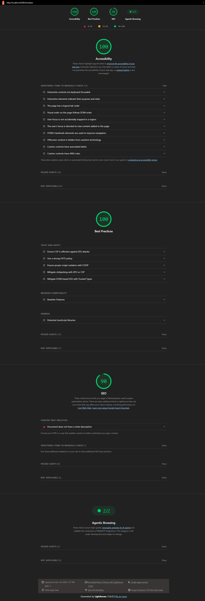
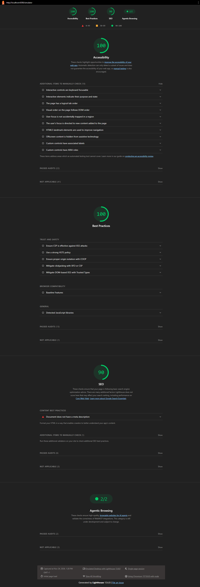
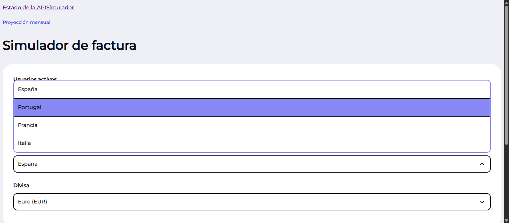
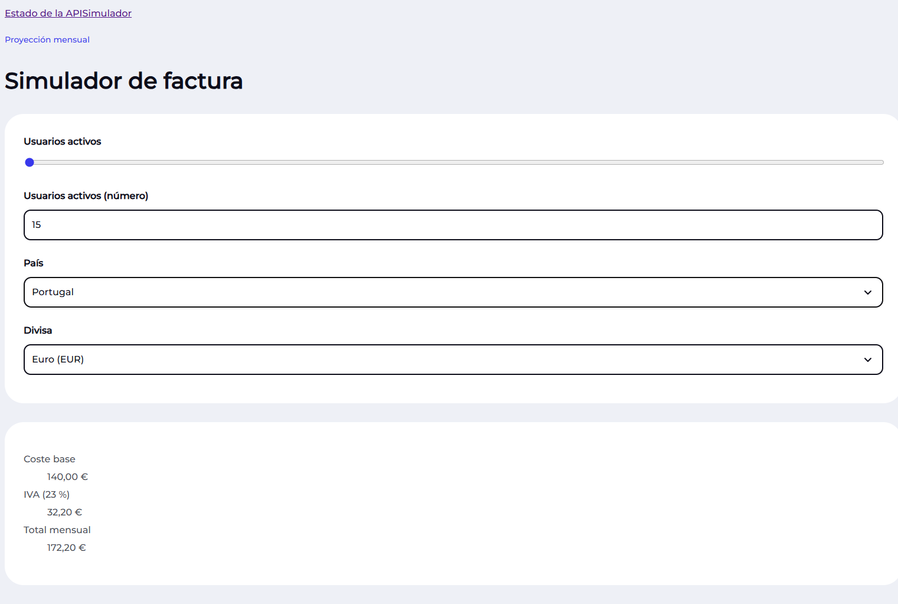
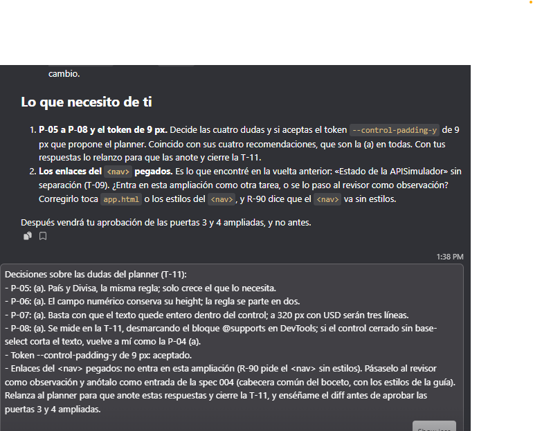
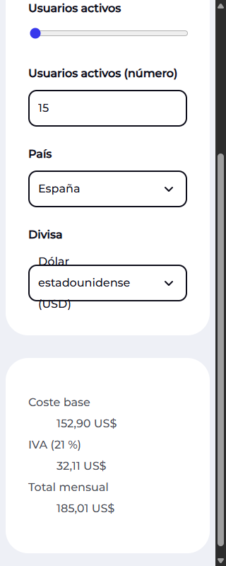

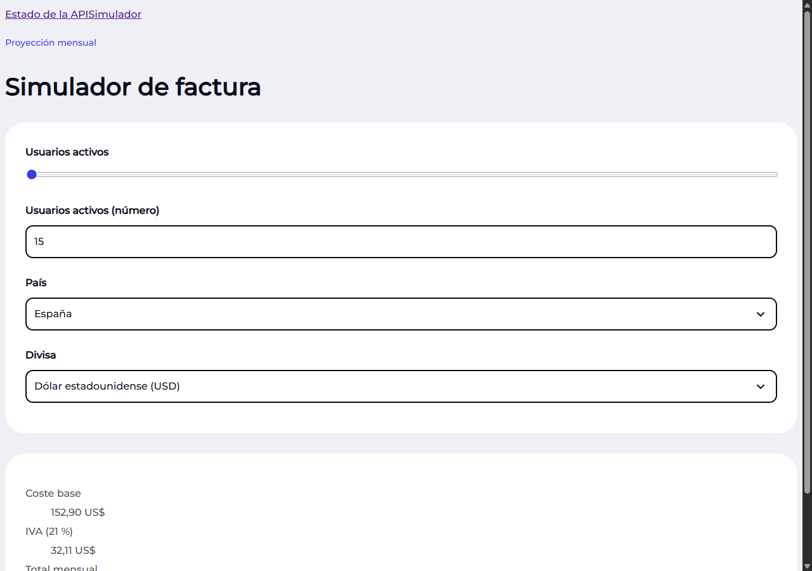
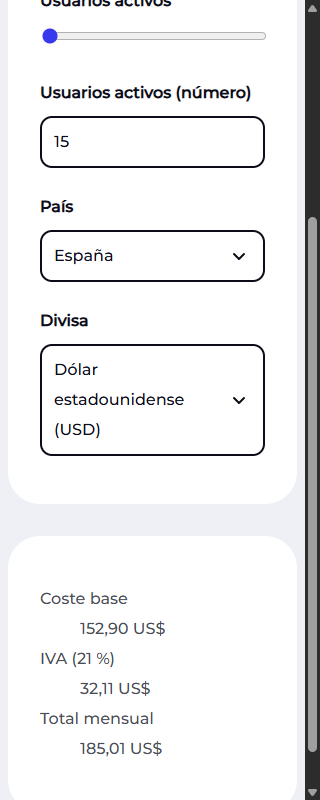
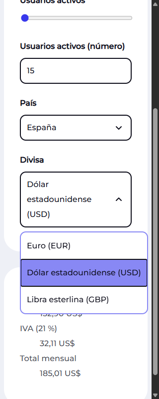
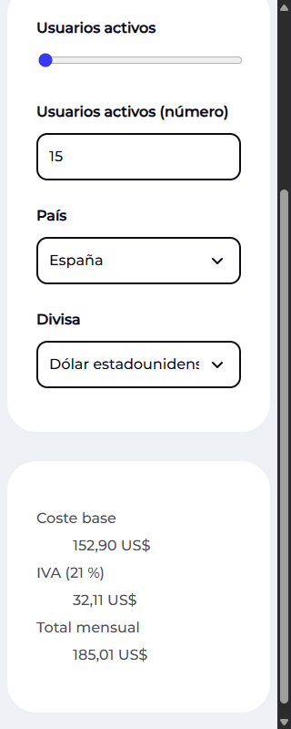

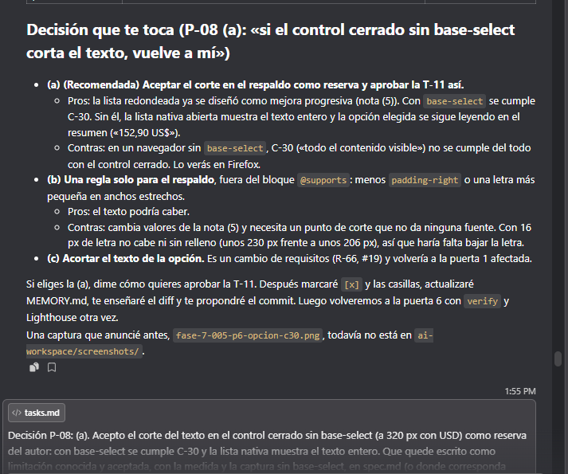
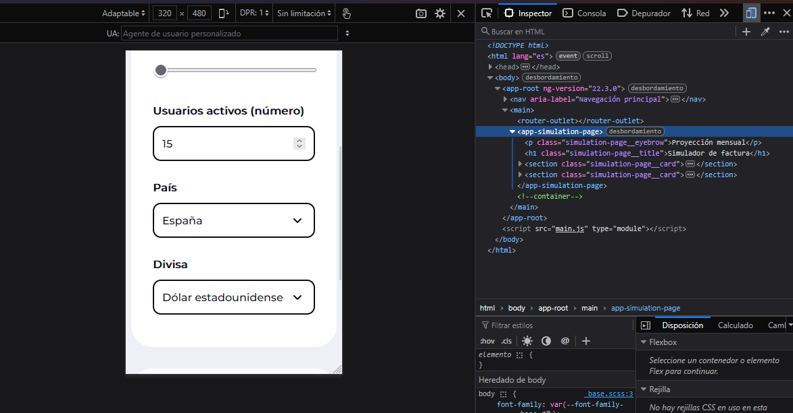
- Anunciada y no existente: `fase-7-005-p6-opcion-c30.png` (elección de la opción 1 con el remedio (a) para C-30), descartada por el autor.

## Pendiente para la siguiente sesión
- Commit de la T-11 (propuesto tras guardar este registro, sin `Co-Authored-By`).
- Comprobación del autor en Firefox, hecha en parte (`fase-7-005-t11-firefox-320.png`): a 320 px, el control cerrado de Divisa corta «Dólar estadounidense» sin «(USD)» (la limitación aceptada de la P-08) y el chevron queda centrado. Falta la lista nativa abierta. En esa captura, el inspector de Firefox marca «desbordamiento» en `<body>`, `<app-root>` y `<app-simulation-page>`: queda por comprobar si es el desplazamiento vertical o uno horizontal (en Chrome, `scrollWidth` 305 en 320 px); si es horizontal, afecta a C-30 y lo decide el autor.
- Volver a la puerta 6: `Estado:` a `En revisión`, `npm run verify`, Lighthouse otra vez (móvil y escritorio, con captura), C-30 repetido, revisión de R-46 en el código y encargo del revisor (enseñado antes) con la limitación de la P-08 como aceptada, los enlaces del `<nav>` como observación, H-16 de la puerta 2 a seguir y las reservas H-03, H-05 y H-08; la última casilla de la T-11.
- Al cerrar la 005: el cambio autorizado en la regla `shared/` de `frontend-conventions`, con su diff y tu aprobación.
