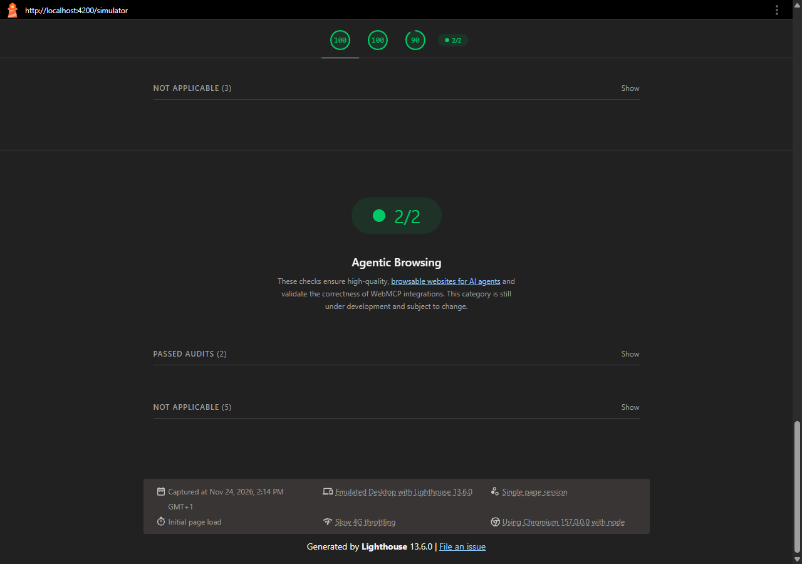
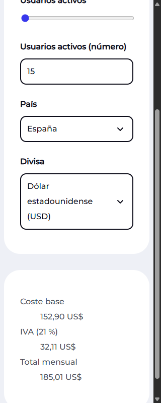
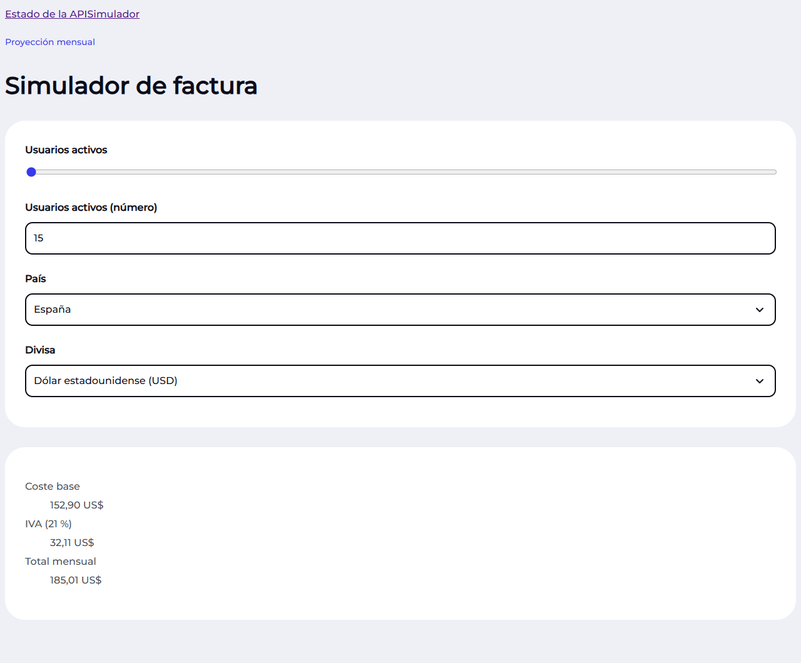
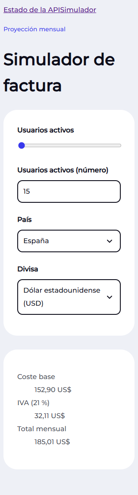
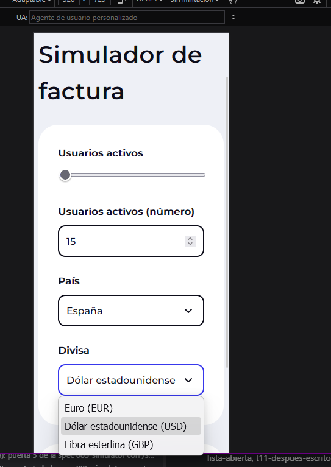

# 005-simulator — Fase 7 (2026-11-24, sesión 12)

## Objetivo y fase
Fase 7, spec `005-simulator`, puerta 6 (validación) con `/sdd-validate`, tras el commit de la T-11: `npm run verify`, Lighthouse en móvil y escritorio, C-30 a 320 px con USD, revisión de R-46 en el código, ronda 4 del revisor y cierre de la spec con `Conforme con reservas`. Registro abierto por la sesión principal durante la puerta 6 con las anotaciones que pidió el autor; completado aquí con `/sdd-session`.

## Prompts clave
Invocación (atajo de la puerta 6):
> /sdd-validate 005-simulator

Chrome de automatización, Lighthouse, C-30 y Firefox:
> He cerrado el Chrome, sigue con Lighthouse y C-30
>
> Autorizo terminar el proceso de Chrome del perfil chrome-devtools-mcp (es el de automatización, no mi navegador). Sigue con Lighthouse en móvil y escritorio y la medida de C-30 a 320 px con USD, guardando las capturas de los informes como fase-7-005-lighthouse-movil-final y fase-7-005-lighthouse-escritorio-final (sin sobrescribir las existentes) y las dos del §4 con la versión final.
> Firefox: el «desbordamiento» del inspector es el desplazamiento vertical de la página (no hay barra horizontal en la captura fase-7-005-t11-firefox-320); lo confirmo con scrollWidth <= clientWidth. Te paso la captura de la lista nativa abierta cuando la tenga; no esperes por ella para el encargo.
> Marca la última casilla de la T-11 cuando termines y enséñame el encargo del revisor antes de lanzarlo.

Aprobación del encargo del revisor, con retoques:
> Apruebo el encargo del revisor con cuatro retoques: (1) corrige la línea del Estado («Estado: En revisión», sin el resto de formato); (2) en el punto de Firefox, no digas que lo confirma el autor: «según la captura, sin medir con scrollWidth», o mídelo tú con DevTools a 320 px; (3) la lista nativa abierta en Firefox está sin verificar: te la paso ahora; hasta entonces, el encargo la marca «sin verificar»; (4) añade la línea de «Evidencia visual» con las capturas de la puerta 6 y de la T-11 (p6-lista-teclado-abierta, p6-lista-teclado-elegida, p6-c30-320-usd-final, t11-despues-320-lista-abierta, t11-despues-escritorio y las dos de Lighthouse final), aclarando que lo visual lo comprobó la sesión principal.
> Las «dos del §4» son fase-7-005-simulador-con-estilos y fase-7-005-simulador-320px (el simulador final a escritorio y a 320 px con un resultado visible), no las de Lighthouse; hazlas con DevTools antes de lanzar al revisor. En el envío real, bloques íntegros de verify-p6.txt y git status. Enséñame el encargo final solo si cambia algo más que esto; si no, lánzalo.

Ronda 4 y cierre:
> Guarda la ronda 4 al final de review.md como «## Ronda 4», con los signos reales (<nav>, LoadState<T>) y anótalo en el registro.
> Apruebo cerrar la 005 como «Conforme con reservas». Reservas aceptadas, con su motivo: H-17 (ajustes del ADR-016 sin anotar en la spec: mismo patrón que H-14, H-15 y H-16; va a la pasada única del miércoles); H-21 (R-10 frente a C-08 sobre toSignal: la D-11 aprobada fija lo implementado y cambiar el texto exige /sdd-change); H-22 (comentario falso de _tokens.scss:2: solo comentario, para la pasada del miércoles); H-23 («diez tareas» en tasks.md:5: una línea de texto, para la pasada del miércoles); H-24 (el test de simulations/ importa app.routes: precedente de la 000; queda anotado como entrada para la spec 004).
> H-18 se resuelve con evidencia: te paso la captura de la lista nativa abierta en Firefox y la guardas como fase-7-005-t11-firefox-lista-abierta; hasta que esté, la casilla sigue marcada y lo anotas en el registro como pendiente de su captura.
> H-19 y H-20: rehaz las capturas sin tocar código y sustituyendo las actuales, que no están commiteadas: C-30 a 320 × 800 px con la barra vertical (que se vea Divisa en tres líneas, 112 px) y los pies de los dos informes de Lighthouse con el modo visible (móvil y escritorio).
> Comprueba tú C-45, C-46, C-49 y C-52 con git diff bc0caa1 63bf78d y git show -M, y anótalo en el registro (el revisor no pudo verlo).
> Después, cierra la spec (Estado: Cerrada, README y MEMORY.md, máximo 50 líneas), enséñame el diff y, antes del commit, yo lanzo /sdd-session 7 005-simulator.

Registro de la sesión:
> /sdd-session 7 005-simulator.
>
> /sdd-session 7 005-simulator

## Qué propuso la IA
- **Inicio de la puerta 6:** `Estado:` literal `- **Estado:** En implementación`, con T-01 a T-11 en `[x]`; pasa a `En revisión` en `spec.md` y en el README. `npm run verify` en verde, código 0 (29 ficheros y 766 tests en la raíz; 10 y 180 en la web), con la salida guardada en `verify-p6.txt` del scratchpad.
- **R-46 en el código:** cumple. Las llamadas a `packages/pricing` con el valor del campo están en `eurCents` (`simulation-page.ts:37-48`), tras `if (input === null) return null`, y el formulario solo emite entrada con el campo válido (`simulation-form.ts:67-76`); `getTaxRateBps(country)` en `taxLabel` recibe solo el país.
- **Bloqueo de DevTools:** la herramienta no arrancaba porque seguía abierto un Chrome con su perfil (`chrome-devtools-mcp\chrome-profile`). La sesión principal no lo cerró sin permiso; con la autorización del autor terminó ese proceso (35032) y su árbol con `taskkill /T`.
- **Lighthouse en `/simulator`** (servidor de desarrollo): en móvil y en escritorio, Accessibility 100, Best Practices 100, SEO 90 y Agentic Browsing 100; 49 superadas y 1 fallida, `meta-description`.
- **C-30 a 320 px con USD y `base-select`:** Divisa en 112 px, `clientHeight` 108 = `scrollHeight` 108; País y campo numérico en 52 px; `scrollWidth` 305 = `clientWidth` 305; total 185,01 US$. Última casilla de la T-11 (`tasks.md:331`) marcada con estas cifras.
- **Capturas del §4:** la de escritorio salió primero a página completa, con el borde derecho de las tarjetas cortado; con DevTools se vio que no era un desbordamiento (tarjetas de x = 8 a x = 1272, `scrollWidth` = `clientWidth` = 1280) y se rehízo como captura de ventana de 1280 × 1060. La de 320 px, a 320 × 1140 sin barra vertical (`scrollWidth` 320 = `clientWidth` 320). Las dos con USD y 15 usuarios.
- **Encargo del revisor:** enseñado antes de lanzarlo; lanzado con los cuatro retoques del autor, dos medidas más (320 × 1140 sin barra y la posición de las tarjetas a 1280 px) y los bloques íntegros de `verify-p6.txt`, `git status` y `git diff --stat`.
- **Ronda 4 del revisor (Opus):** `Conforme con reservas`, sin Bloqueante ni Importante; ocho Menores, de H-17 a H-24; H-16 resuelto. `git status` y `git diff --stat` iguales antes y después: el revisor no cambió nada. La sesión principal comprobó H-18, H-19, H-20, H-22 y H-23 antes de enseñarlo; H-19 era un error suyo: la captura de página completa de C-30 se volvió a maquetar a 320 px sin barra y se recortó a 305 px.
- **Cierre:** ronda 4 y aprobación literal del autor en `review.md`; capturas de H-19 y H-20 rehechas; C-45, C-46, C-49 y C-52 comprobadas con git; `Estado: Cerrada` en `spec.md` y en el README; `MEMORY.md` en 50 líneas. La sesión principal avisó de que la regla 3 de «Cierre de una spec» exige que no quede ninguna captura pendiente, y preguntó por el cambio pendiente en la regla `shared/` de `frontend-conventions`.

## Anotaciones de la puerta 6 (sesión principal)

### Ronda 4 del revisor guardada con los signos reales
El retorno del revisor traía dos signos escapados en HTML: `&lt;nav&gt;` (observación del autor) y `LoadState&lt;T&gt;` (casilla «Sin `httpResource`»). Por orden del autor, la ronda 4 se guardó al final de `review.md` como «## Ronda 4» con `<nav>` y `LoadState<T>`; el resto, literal.

### H-18: lista nativa abierta en Firefox, resuelta con la captura del autor
La casilla de la lista abierta de la T-11 (`tasks.md:324`) sigue marcada por decisión del autor y quedó pendiente de su captura hasta que el autor la copió a `ai-workspace/screenshots/fase-7-005-t11-firefox-lista-abierta.png`. Comprobada por la sesión principal: vista adaptable de Firefox a 320 px («320 × 725» en la barra), USD elegido y lista nativa abierta con «Euro (EUR)», «Dólar estadounidense (USD)» (resaltada) y «Libra esterlina (GBP)» enteras, dentro de la página. El control cerrado muestra «Dólar estadounidense» sin «(USD)»: la limitación aceptada de la P-08 (a). Observación sin investigar: en Firefox, el botón del slider sale gris y no del color de marca.

### H-19 y H-20: capturas rehechas sin tocar código (sustituyen a las anteriores, sin commitear)
- `fase-7-005-p6-c30-320-usd-final.png`: ventana de 320 × 800 px con la barra vertical, USD; Divisa en tres líneas, 112 px, `clientHeight` 108 = `scrollHeight` 108; `clientWidth` 305 = `scrollWidth` 305. La primera versión era una captura de página completa, que se volvió a maquetar a 320 px sin barra y se recortó a 305 px (por eso no coincidía con la medida).
- `fase-7-005-lighthouse-movil-final.png`: pie del informe con «Emulated Moto G Power with Lighthouse 13.6.0» y las puntuaciones 100 · 100 · 90 · 2/2.
- `fase-7-005-lighthouse-escritorio-final.png`: pie del informe con «Emulated Desktop with Lighthouse 13.6.0» y las mismas puntuaciones.

### C-45, C-46, C-49 y C-52 comprobados con git por la sesión principal (el revisor no tenía Bash)
- **C-45 (R-73, R-98):** `git show -M --stat 73c9e0b` da `.../{health => shared}/interfaces/load-state.ts | 2 +-`. `git diff -M bc0caa1 63bf78d` sobre los dos caminos: «similarity index 68%», «rename from apps/web/src/app/health/interfaces/load-state.ts», «rename to apps/web/src/app/shared/interfaces/load-state.ts»; solo cambia la línea 2 (`-// Nace en health/; pasa a shared/interfaces/ cuando lo use una segunda funcionalidad (frontend-conventions).` / `+// Movido de health/ a shared/ en la spec 005 (Decisión 2026-11-23 #12), como fija architecture.md.`). Cumple.
- **C-46 (R-74 a R-76):** `git diff -M --stat bc0caa1 63bf78d -- apps/web/src/app/health` solo lista `interfaces/load-state.ts` (el traslado), `pages/health-page/health-page.ts` (1 línea: la 5, «(spec 000: R-12, R-22)») y `services/health-api.ts` (1 línea: la 4, el `import` desde `../../shared/interfaces/load-state`). Ningún `.spec.ts` de `health/` cambia. Tests en verde (180). Cumple.
- **C-49 (R-81, R-91, R-92):** `git diff bc0caa1 63bf78d` de `app.routes.ts`, `app.html`, `app.ts` y `app.config.ts`: la ruta `simulator` con `loadComponent`; el comentario de `app.routes.ts:3` pasa a «(spec 000: R-21)»; el `<nav>` de 4 líneas antes de `<main>`, con `app.html:1` sin cambios; en `app.ts`, `RouterLink` y `RouterLinkActive` en el `import` y en `imports`, y el comentario «Componente raíz: carcasa con la navegación principal y las rutas.». `app.config.ts` no cambia. Cumple.
- **C-52 (R-93 a R-95):** en el diff de `app.spec.ts`, las únicas líneas quitadas son los dos comentarios, que pasan a «(spec 000: T-14)» y «(decisión del autor 2026-11-22, spec 000: T-18)». El resto añade el comentario de `TestBed` «(spec 005: R-95)», un auxiliar y los tests C-47, C-48 y C-50. Ningún `it` ni `expect` quitado, ni `skip`, `todo` o `xit`. Cumple.

## Salida literal de `npm run verify` de la puerta 6 (fichero `verify-p6.txt` del scratchpad; sin los códigos de color ANSI ni los retornos de carro del indicador de progreso, como en las sesiones anteriores; el resto, literal)
```

> verify
> npm run build && npm run test


> build
> npm run build:pricing && npm run build --workspaces --if-present


> build:pricing
> npm run build -w packages/pricing


> @saas-o-matic/pricing@0.0.0 build
> tsc -p tsconfig.json


> @saas-o-matic/api@0.0.0 build
> tsc -p tsconfig.build.json


> @saas-o-matic/web@0.0.0 build
> ng build

❯ Building...
✔ Building...
Initial chunk files | Names           |  Raw size | Estimated transfer size
main-JUAD55US.js    | main            | 261.99 kB |                70.49 kB
styles-YIQ4RRZY.css | styles          |   6.74 kB |                 1.20 kB

                    | Initial total   | 268.73 kB |                71.69 kB

Lazy chunk files    | Names           |  Raw size | Estimated transfer size
chunk-2vm8kKrW.js   | simulation-page | 481.62 kB |                89.68 kB
chunk-CszHQFiD.js   | health-page     |   1.41 kB |               719 bytes
chunk-D7-317Sz.js   | -               | 988 bytes |               988 bytes

Application bundle generation complete. [4.987 seconds] - 2026-11-24T13:11:38.651Z

Output location: F:\saas-o-matic\apps\web\dist\web


> @saas-o-matic/pricing@0.0.0 build
> tsc -p tsconfig.json


> test
> npm run build:pricing && vitest run && npm run test --workspaces --if-present


> build:pricing
> npm run build -w packages/pricing


> @saas-o-matic/pricing@0.0.0 build
> tsc -p tsconfig.json


 RUN  v5.1.1 F:/saas-o-matic


 Test Files  29 passed (29)
      Tests  766 passed (766)
   Start at  14:11:43
   Duration  6.40s (tests 61%, import 33%, transform 3%, worker 2%)

    Isolate  29 workers spawned · ~583ms startup each (spawn + environment, per file)
             at least ~1.83s faster with isolate: false — reuses workers across files instead of one per file


> @saas-o-matic/web@0.0.0 test
> ng test

❯ Building...
✔ Building...
Application bundle generation complete. [3.291 seconds] - 2026-11-24T13:11:55.353Z


 RUN  v5.1.1 F:/saas-o-matic/apps/web


 Test Files  10 passed (10)
      Tests  180 passed (180)
   Start at  14:11:55
   Duration  7.39s (environment 57%, setup 20%, tests 15%, import 7%, transform 1%, worker 1%)
```

## Qué corregí y por qué
- **Chrome de automatización:** la sesión principal no lo cerró sin permiso; autorizaste terminarlo porque «es el de automatización, no mi navegador».
- **«Las dos del §4»:** la sesión principal no sabía a qué se referían; aclaraste que son `fase-7-005-simulador-con-estilos` y `fase-7-005-simulador-320px`, no las de Lighthouse.
- **Encargo del revisor, cuatro retoques:** la línea del Estado sin formato; en Firefox, «según la captura, sin medir con scrollWidth», en lugar de decir que lo confirmabas tú; la lista nativa, «sin verificar»; la línea de «Evidencia visual». El motivo no consta («no registrado»).
- **H-19 y H-20:** rehacer las capturas sin tocar código, sustituyendo las que no estaban commiteadas.
- **H-18:** se resuelve con tu captura de la lista nativa abierta, no como reserva.
- **C-45, C-46, C-49 y C-52:** las comprueba la sesión principal con git, porque el revisor no pudo verlas.
- **Tema de `/sdd-session`:** la primera invocación llevaba «005-simulator.» con un punto; la sesión principal paró y la repetiste sin él.

## Decisiones tomadas
- **Estado:** `En revisión` al empezar la puerta 6; `Cerrada` tras tu aprobación, en `spec.md` y en el README.
- **Lighthouse:** 100 en accesibilidad en móvil y escritorio; el SEO 90 por `meta-description` se deja como está.
- **Ronda 4:** guardada con los signos reales (`<nav>`, `LoadState<T>`), con tu aprobación literal al final de `review.md`.
- **Cierre con `Conforme con reservas`:** H-17, H-22 y H-23, para la pasada única del miércoles; H-21, porque manda la D-11 y cambiar el texto exige `/sdd-change`; H-24, precedente de la 000 y entrada de la spec 004.
- **H-18, H-19 y H-20:** resueltas con evidencia; H-18, con la captura de la lista nativa abierta en Firefox del autor.
- **Capturas:** `fase-7-005-lighthouse-movil-final.png` y `fase-7-005-lighthouse-escritorio-final.png` sin sobrescribir las de la sesión 11; las dos del §4 con la versión final.
- **Commit:** el de cierre de esta sesión.

## Capturas







## Pendiente para la siguiente sesión
- El cambio autorizado en la regla `shared/` de `frontend-conventions`: en otro commit, no en el de cierre de la 005, el miércoles con su `/sdd-session` (decisión del autor: «la spec (:32) ya deja constancia de que es decisión del autor y tocar .claude/ requiere mi autorización expresa y es un cambio de otra naturaleza»).
- Pasada única del miércoles: H-17, H-22 y H-23 de la 005.
- Commit de cierre de la 005 (sin `Co-Authored-By`).
- Siguiente spec: 004 `customers`, con la entrada H-24.
