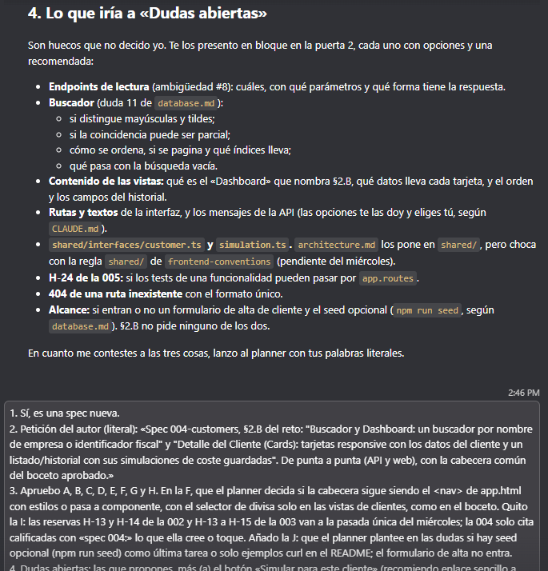
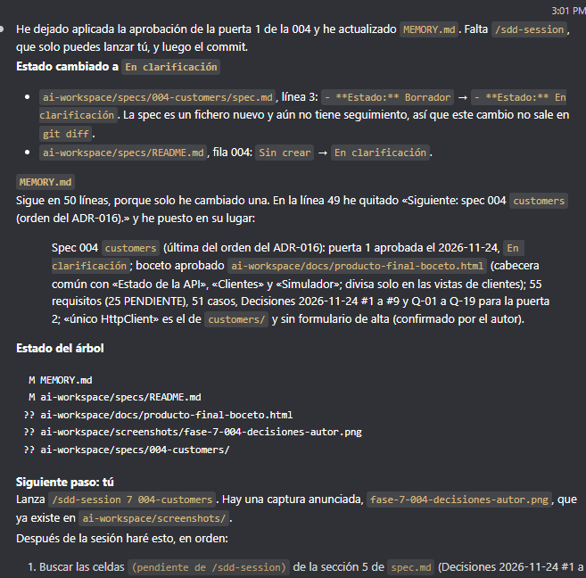
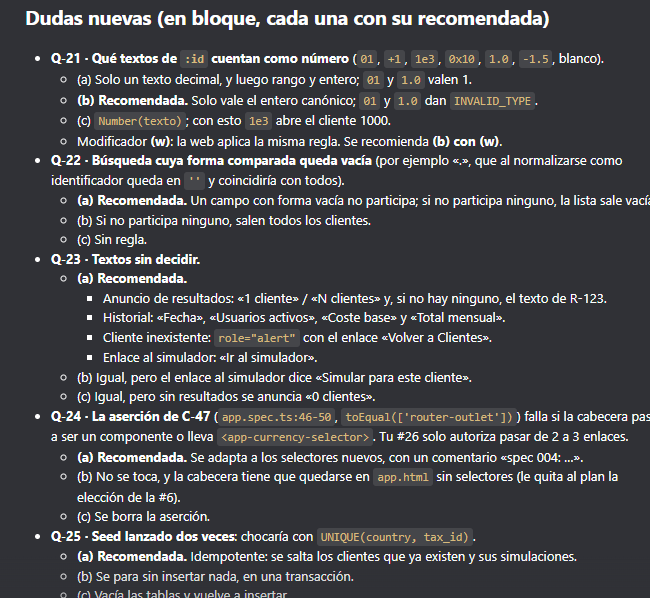
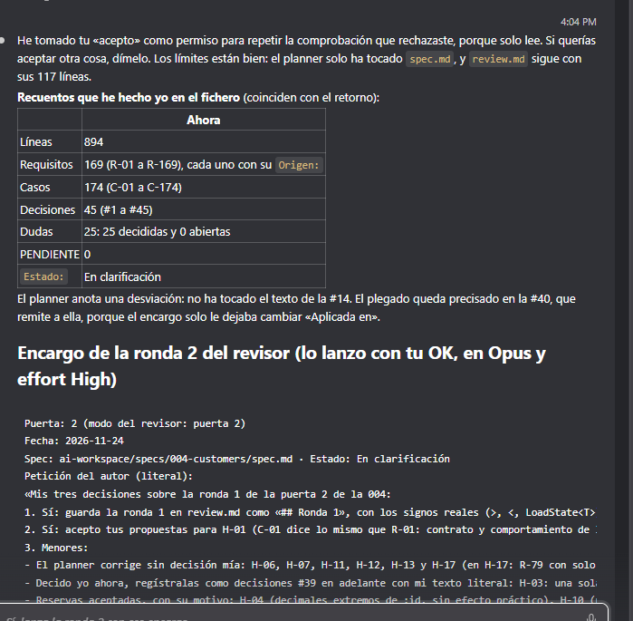
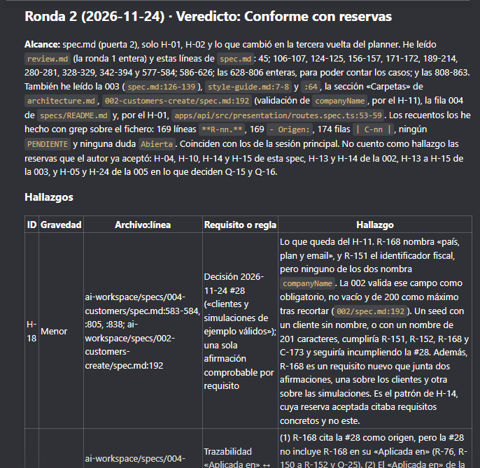

# 004-customers — Fase 7 (2026-11-24, sesión 13)

## Objetivo y fase
Fase 7, spec `004-customers`. La sesión empezó con la puerta 1 (spec) lanzada con `/sdd-spec` y siguió con la puerta 2 (clarificación) con `/sdd-clarify`, coordinadas por `/sdd-flow`. Al terminar, la spec queda en `Aprobada`.

## Prompts clave
Invocación inicial:

> /sdd-spec 004-customers

Respuesta del autor a la propuesta de decisiones previsibles:

> 1. Sí, es una spec nueva: 004-customers (Puerta 1 · spec; planner Opus 5.5; nace en Borrador; depende de 002, 003 y 005, cerradas).
>
> 2. Petición del autor (literal): «Spec 004-customers, §2.B del reto: "Buscador y Dashboard: un buscador por nombre de empresa o identificador fiscal" y "Detalle del Cliente (Cards): tarjetas responsive con los datos del cliente y un listado/historial con sus simulaciones de coste guardadas". De punta a punta (API y web), con la cabecera común del boceto aprobado.»
>
> 3. Decisiones previsibles: apruebo A, B, C, D, E, F, G y H tal cual. En la F, el planner decide si la cabecera sigue siendo el <nav> de app.html con estilos o pasa a componente, con el selector de divisa solo en las vistas de clientes. Quito la I: las reservas H-13 y H-14 de la 002 y H-13 a H-15 de la 003 van a la pasada única del miércoles; la 004 solo cita calificadas con «spec 004:» lo que ella cree o toque. Añado la J: que el planner plantee en las dudas si hay seed opcional (npm run seed) como última tarea o solo ejemplos curl en el README; el formulario de alta no entra.
>
> Boceto aprobado: ai-workspace/docs/producto-final-boceto.html (datos ilustrativos; no fija rutas, textos ni campos). Cabecera común (<nav>: «Estado de la API», «Clientes», «Simulador»; selector de divisa a la derecha, solo en las vistas de clientes) y tres páginas separadas: (1) buscador con tarjetas de cliente y su última simulación; (2) detalle con tarjeta de datos e historial de simulaciones en la divisa elegida; (3) el simulador de la 005, ya cerrado. El estilo de la cabecera sustituye al <nav> sin estilos de la 005 (R-90 solo ataba a esa spec).
>
> Leer además: ai-workspace/docs/{reto,constitution,architecture,database,style-guide,decisions}.md, style-guide-mapa.png y style-guide-controles.png; specs 002, 003 y 005 con su review.md; skills frontend-conventions y backend-conventions.
>
> 4. Dudas abiertas, en bloque en la puerta 2, cada una con opciones y una recomendada: las que propones, más (a) el botón «Simular para este cliente» (recomiendo enlace sencillo a /simulator sin precarga) y (b) guardar la simulación desde el simulador (recomiendo no, porque cambiaría la 005 cerrada). shared/interfaces/customer.ts y simulation.ts: ya decidido que van en shared/, según architecture.md, por la decisión #12 de la 005 (no reabrir el choque con frontend-conventions).
>
> Tareas ordenadas por valor (para la puerta 4): API de lectura, buscador y dashboard, detalle con historial, y al final cabecera con estilos y seed, para poder cerrar con lo hecho si el tiempo aprieta.
>
> Lanza UN solo planner y no abras otras sesiones sobre ai-workspace/specs/004-customers/. Antes de enseñarme el retorno, cuenta en el fichero spec.md los requisitos, los casos y las dudas, y dame esos números junto al retorno: el resumen tiene que coincidir con el fichero. Encargo sin enseñar (ADR-016). Lanza al planner con mis palabras literales.

Elección del autor cuando la sesión principal encontró la puerta 1 ya hecha en disco:

> Elijo (a): doy por buena la puerta 1 que ya existe en disco (spec.md de 450 líneas, Estado: En clarificación, fila 004 del README en «En clarificación»). No relances al planner. La hizo el planner que lancé antes de rebobinar esta conversación; no hay otra sesión escribiendo.
> Cuenta en spec.md los requisitos, los casos y las dudas y dime los números. Debe haber 78 requisitos (R-01 a R-78), 78 casos (C-01 a C-78) y 20 dudas (Q-01 a Q-20), con las decisiones #1 a #11. El resumen que dio el planner (55, 51 y Q-01 a Q-19) NO coincide con el fichero: corrige la línea de la 004 en MEMORY.md con los números reales, anota la discrepancia en el registro en una o dos líneas y deja la captura fase-7-004-p1-retorno-planner como prueba.
> Puerta 1: apruebo este fichero. Punto 7: «único HttpClient» es el de customers/. Punto 8: sin formulario de alta. Sigue con la puerta 2 (/sdd-clarify 004-customers) en esta misma sesión, con un único registro y un único commit, como en las specs 001, 002, 003 y 005.
> Mis respuestas literales a las dudas, según el texto del fichero: Q-01 (a); Q-02 (a) con el máximo de q en 200; Q-03 (a), sin migración; Q-04 orden (a), paginación (a), búsqueda vacía (a); Q-05 (a); Q-06 (a) con espera de 300 ms, (i) y anuncio de resultados; Q-07 dashboard (a), tarjeta (a), acceso (i); Q-08 datos (a), orden (a), campos (b), fecha (b); Q-09 (a); Q-10 (a); Q-11 (a); Q-12 (a); Q-13 carpeta (a), parcial (a), menú (i), (x), Lighthouse (q); Q-14 (a); Q-15 (a); Q-16 (b); Q-17 (c); Q-18 (b); Q-19 (a); Q-20 (a). Regístralas en la sección 5 de spec.md. Una sola ronda del revisor (ADR-016, punto 1).
> Enséñame el veredicto del revisor literal, sin guardarlo ni cambiar el Estado hasta mi OK, con los recuentos del fichero. Antes del commit, /sdd-session 7 004-customers, sin Co-Authored-By.

Respuestas a las dudas nuevas del planner:

> Respuestas del autor a la puerta 2 de la 004-customers: Q-21 (b) con (w); Q-22 (a); Q-23 (a); Q-24 (a); Q-25 (a). Confirmo las seis lecturas del planner (R-05, R-89, R-18, R-108, R-81 y R-136). Sobre la #24 no hay choque: la cabecera la usan las tres páginas, así que cumple la regla de shared/ de frontend-conventions; si el plan la hace componente, va en shared/components/; el plan elige entre el <nav> de app.html y el componente. Apruebo que la tarea del seed añada `npm run seed` a «Comandos» de CLAUDE.md.
> Relanza al mismo planner para que pase estas cinco dudas a «Decidida» en la sección 5 de spec.md y cierre los 9 PENDIENTE (R-86, R-94, R-100, R-109, R-128, R-129, R-145, R-153 y R-155 con sus casos). Después cuenta en el fichero requisitos, casos y dudas y dame los números, y enséñame el encargo del revisor antes de lanzarlo (una sola ronda, ADR-016, punto 1). Veredicto literal, sin guardarlo ni cambiar el Estado hasta mi OK. Antes del commit, /sdd-session 7 004-customers, sin Co-Authored-By.

Añadido al encargo de la ronda 1 del revisor:

> Reservas ya aceptadas por el autor, que no son hallazgo de esta puerta: las H-13 y H-14 de la 002 y las H-13 a H-15 de la 003 (citas sin calificar en specs cerradas; van a la pasada única del miércoles); la H-05 y la H-24 de la 005 solo en lo que la 004 decide explícitamente (Q-15 y Q-16).

Mensaje que se cruzó con el retorno del revisor:

> Aprobado el encargo del revisor de la puerta 2 de la 004 (ya lanzado, con la línea de reservas ya aceptadas por el autor). Confirmo las dos lecturas del planner: R-161 informa de cuántos clientes insertó, y C-158 es un test unitario. Corrige la línea del Estado del encargo si aún no lo está («Estado: En clarificación»). Cuando vuelva el revisor, enséñame el veredicto literal, con los recuentos del fichero (requisitos, casos, dudas), sin guardarlo ni cambiar el Estado hasta mi OK. No muevas ni cortes nada de la spec sin avisarme antes.

Nota para la puerta 3:

> Nota para la puerta 3 (plan): si la cabecera es un componente de shared/components/, no puede inyectar servicios y debe recibir el estado (divisa elegida, ruta activa, estado de los tipos de cambio) por input(); el plan lo decide. Apúntalo en el registro.

Decisiones sobre la ronda 1 y sobre la ronda 2: van literales en la sección «Aprobación del autor» de `ai-workspace/specs/004-customers/review.md` («Mis tres decisiones sobre la ronda 1 de la puerta 2 de la 004: …» y «Mis decisiones sobre la ronda 2 de la puerta 2 de la 004: …»).

Retoque del encargo de la ronda 2:

> Lanza la ronda 2 del revisor con el encargo que me has enseñado, con un retoque: en «Seguimiento de la ronda anterior», H-04, H-10, H-14 y H-15 se marcan «Abierto (reserva aceptada por el autor)», con su motivo, no «Rechazado por el autor»; yo las acepté como reserva, no las rechacé. Sobre tu frase de la comprobación «que rechazaste»: no rechacé ninguna comprobación; no hay nada pendiente por esa vía. Cuando vuelva el revisor, enséñame el veredicto literal, con los recuentos del fichero y sin guardarlo ni cambiar el Estado hasta mi OK.

Cierre de la puerta 2:

> OK: cierra la puerta 2 de la 004-customers. El diff de la cuarta vuelta es el que pedí (H-18, H-19 y H-20) y no hay nada más. Haz las tres cosas: Estado «Aprobada» en spec.md y en la fila 004 del README; sección «Aprobación del autor» al final de review.md con mis palabras literales (las dos decisiones sobre las rondas 1 y 2) y las reservas H-04, H-10, H-14, H-15 y H-21, cada una con su motivo; MEMORY.md al día (máximo 50 líneas), con esas reservas como pendientes, y enséñame su diff. Cuando lo tengas listo te aviso para lanzar /sdd-session 7 004-customers y, luego, el commit sin Co-Authored-By. Después sigue con la puerta 3.

## Qué propuso la IA
- **Decisiones previsibles de la puerta 1 (ADR-016, punto 3):**
  - A, alcance de punta a punta.
  - B, API como en la 002 y la 003.
  - C, piezas de `customers/` según `architecture.md`.
  - D, importes guardados convertidos con `shared/` de la 005 y el ADR-017.
  - E, estados de carga, error y vacío.
  - F, enlace «Clientes» y arreglo de los enlaces pegados del `<nav>`.
  - G, guía del ADR-015 y Lighthouse.
  - H, tests de cada endpoint sin repetir los tramos.
  - I, recoger reservas al pasar.

  Además, una lista de huecos para «Dudas abiertas».
- **Puerta 1 ya hecha.** Al recibir la respuesta, la sesión principal vio que `spec.md` ya existía en `En clarificación` (con el README y `MEMORY.md` modificados). No relanzó al planner y propuso dos opciones: (a) dar por buena la puerta 1 existente (recomendada) o (b) rehacerla.
- **Recuento de la puerta 1** en el fichero: 78 requisitos (26 PENDIENTE), 78 casos, 20 dudas y Decisiones #1 a #11. El 200 de la Q-02 se comprobó contra la Decisión 2026-11-23 #14 de la 002.
- **Puerta 2, planner (Opus 5.5) en cuatro vueltas:**
  1. Q-01 a Q-20 → #12 a #31. Devolvió «Con dudas» con Q-21 a Q-25, seis lecturas para confirmar y dos observaciones: la cabecera en `shared/components/` frente a la regla `shared/`, y `npm run seed` fuera de «Comandos».
  2. #32 a #38.
  3. Correcciones de la ronda 1 y #39 a #45.
  4. Vuelta corta para H-18 a H-20.
- **Puerta 2, revisor (Opus, effort High):**
  - Ronda 1: «Conforme con reservas», con H-01 y H-02 Importantes y H-03 a H-17 Menores. La IA propuso que C-01 dijera lo mismo que R-01 (H-01) y que se añadieran casos en `/simulations` (H-02), y separó los Menores en huecos del autor y correcciones de redacción.
  - Ronda 2: «Conforme con reservas», con H-01 y H-02 resueltos y H-18 a H-21 Menores.
- **Comprobaciones de la sesión principal:**
  - Después de cada agente, `git status` y `git diff --stat` y los recuentos hechos en el fichero.
  - Antes de la cuarta vuelta, una copia de `spec.md` al scratchpad para compararla con `diff`, porque la carpeta no tiene seguimiento.
  - Los signos `&gt;` y `&lt;` de los retornos del revisor se pasaron a los reales.

## Qué corregí y por qué
- **Discrepancia de la puerta 1.** El retorno del planner (lanzado antes de rebobinar la conversación) decía 55 requisitos, 51 casos y Q-01 a Q-19. El fichero tiene 78, 78 y Q-01 a Q-20, con las #1 a #11. Se corrigió la línea de la 004 en `MEMORY.md` y la prueba es la captura `fase-7-004-p1-retorno-planner.png`.
- **Decisiones previsibles.** Quité la I y añadí la J (seed o `curl`; sin formulario de alta). En la F, la cabecera la decide el planner.
- **La #24 no es un choque.** La cabecera la usan las tres páginas, así que cumple la regla `shared/`.
- **Encargo de la ronda 1 del revisor.** Añadí la línea de reservas ya aceptadas. La IA lo lanzó tomando ese añadido como OK. Después pedí corregir la línea del Estado del encargo, pero la ronda ya se había hecho: se lanzó con la línea 3 copiada tal cual (`- **Estado:** En clarificación`) y el encargo de la ronda 2 llevó `Estado: En clarificación`.
- **Veredicto literal.** La IA enseñó primero el veredicto de la ronda 1 con las tablas de checklists resumidas, y después las copió literales.
- **Ronda 2.** Las reservas se marcan «Abierto (reserva aceptada por el autor)», no «Rechazado por el autor». Tampoco hubo ninguna comprobación rechazada por mí: la IA lo había dicho así y retiró la frase.
- **Nombre de una captura.** `fase-7-004-p2-decisiones-ronda-1.png .png` se renombró a `fase-7-004-p2-decisiones-ronda-1.png`.
- Por qué: (no registrado), salvo en lo anotado arriba.

## Decisiones tomadas
- **Puerta 1** aprobada sobre el fichero existente, con 78 requisitos, 78 casos, Q-01 a Q-20 y Decisiones 2026-11-24 #1 a #11. «Único HttpClient» es el de `customers/`. Sin formulario de alta.
- **Puerta 2:** Decisiones 2026-11-24 #12 a #45 en la sección 5 de `spec.md`. Son Q-01 a Q-25, las seis lecturas confirmadas, lo dicho sobre la #24 y el seed, las decisiones del autor sobre H-03, H-05, H-08, H-09 y H-16, la confirmación de R-161 y C-158, y la aceptación de H-01, H-02 y H-17.
- **Resultado:** 170 requisitos, 175 casos, 45 decisiones, 25 dudas decididas y 0 abiertas, 0 PENDIENTE.
- **`review.md`:** ronda 1 y ronda 2 (las dos «Conforme con reservas»), guardadas con los signos reales y las tablas completas, y «Aprobación del autor» con sus dos textos literales.
- **Reservas aceptadas, con su motivo:** H-04, H-10, H-14, H-15 y H-21.
- **`Estado: Aprobada`** en `spec.md` y en la fila 004 de `specs/README.md`.
- **`MEMORY.md`** al día, en 50 líneas.
- **Ajustes del ADR-016 aplicados:**
  - Punto 1: rondas del revisor; la ronda 2 solo por los Importantes y la cuarta vuelta sin ronda.
  - Punto 2: dudas en bloque.
  - Punto 3: decisiones previsibles.
  - Punto 4: encargos del planner sin enseñar; los del revisor, enseñados.
  - Punto 5: «Rutas a leer» acotadas.
  - Punto 6: planner con Opus 5.5 y revisor con Opus en effort High.
- Commit: el de cierre de esta sesión.

## Capturas
- 
- 
- 
- 
- 
- Anunciadas y no existentes (descartadas por el autor): `fase-7-004-decisiones-puerta-2.png`, `fase-7-004-decisiones-puerta-2-segunda-vuelta.png`, `fase-7-004-p2-veredicto-revisor-ronda-1.png` y `fase-7-004-p2-aprobacion-puerta-2.png`.

## Pendiente para la siguiente sesión
- **Puerta 3 (`/sdd-plan 004-customers`).** En «Decisiones aplicables», la nota del autor: si la cabecera es un componente de `shared/components/`, no puede inyectar servicios y recibe por `input()` la divisa elegida, la ruta activa y el estado de los tipos de cambio; el plan lo decide. Antes de lanzar, preguntar al autor el formato de `plan.md`.
- **Puerta 4:** tareas ordenadas por valor: API de lectura, buscador y dashboard, detalle con historial, y al final la cabecera con estilos y el seed (que añade `npm run seed` a «Comandos» de `CLAUDE.md`).
- **Reservas de la 004 pendientes:** H-04, H-10, H-14, H-15 (en la pasada del miércoles) y H-21.
- **Celdas `(pendiente de /sdd-session)`** de la sección 5 de `spec.md`: proponer la ruta de este registro y sustituirlas solo con el OK del autor.
