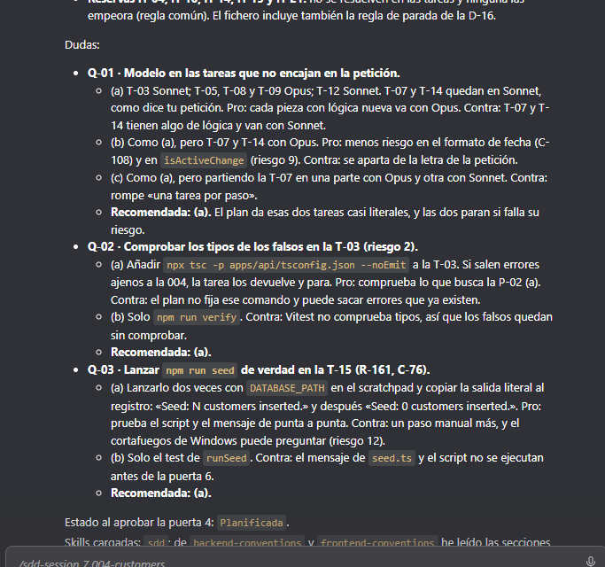
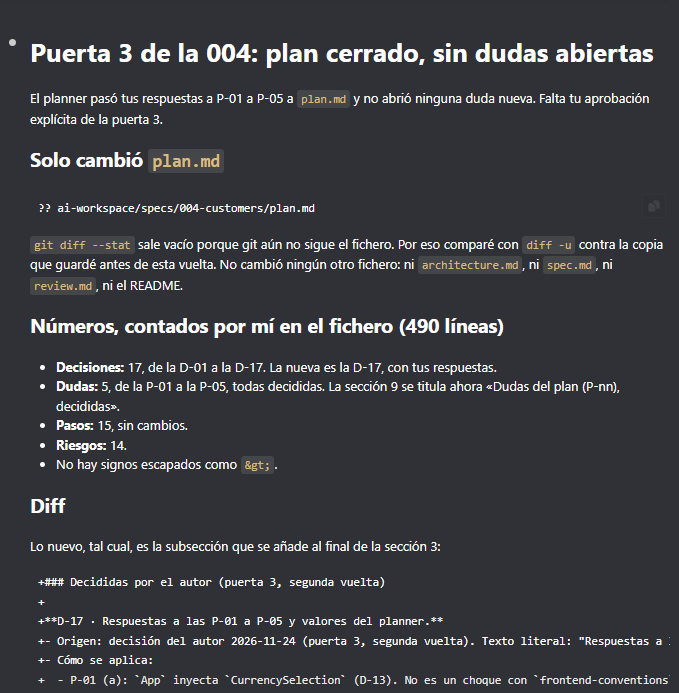
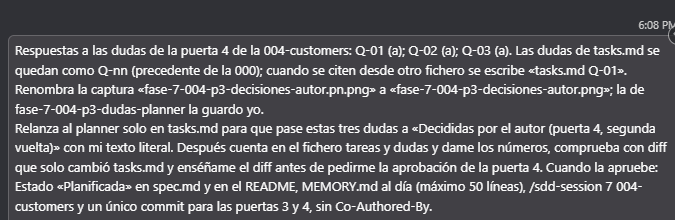

# 004-customers — Fase 7 (2026-11-24, sesión 14)

## Objetivo y fase
Fase 7, spec `004-customers`, puertas 3 (plan) y 4 (tareas), con `/sdd-plan` y `/sdd-tasks`, en la misma sesión y para un mismo commit, como en las specs 002, 003 y 005. La spec empezó en `Aprobada` y acabó en `Planificada`.

## Prompts clave
> /sdd-plan 004-customers
> Confirmo la puerta 3 con el planner Opus 5.5, encargo sin enseñar (ADR-016). Plan breve, en formato «Temas + D-nn». Decisiones aplicables: mi nota «si la cabecera es un componente de shared/components/, no puede inyectar servicios y debe recibir el estado (divisa elegida, ruta activa, estado de los tipos de cambio) por input(); el plan lo decide», la #45 (los ficheros de cada recurso pueden crecer con las lecturas) y las reservas aceptadas H-04, H-10, H-14, H-15 y H-21. El plan agrupa los 170 requisitos en pasos, no uno por requisito, y deja el orden por valor para la puerta 4: API de lectura, buscador y dashboard, detalle con historial, y al final cabecera con estilos y seed. Antes de enseñarme el retorno, cuenta en el fichero los pasos y las dudas, y dame los números junto al retorno. Dudas en bloque, cada una con una recomendada.

> Respuestas a las dudas de la puerta 3 de la 004-customers: P-01 (a), y para mí no choca con frontend-conventions porque App es la carcasa y no un componente de una funcionalidad; P-02 (a); P-03 (a); P-04 (a) con (ii), y autorizo añadir el seed a architecture.md; P-05 (a). Apruebo los dos valores que propone el planner (rejilla del buscador con mínimo de 17 rem y fondo suave de las píldoras). Confirmo que la cabecera se queda en app.html, no como componente (D-02: mi nota no se activa).
> Relanza al planner para que pase estas cinco dudas a «Decididas por el autor (puerta 3, segunda vuelta)» con mi texto literal y cierre el plan; solo puede escribir en plan.md. Después cuenta en el fichero decisiones, dudas y pasos y dame los números, comprueba con git diff que solo cambió plan.md y enséñame el diff antes de pedirme la aprobación de la puerta 3. La captura fase-7-004-p3-dudas-planner la guardo yo. Antes del commit, /sdd-session 7 004-customers, sin Co-Authored-By.

> sigue

> Apruebo la puerta 3 de la 004-customers con este plan.md (490 líneas, D-01 a D-17, 15 pasos, 5 dudas decididas, 14 riesgos). Actualiza MEMORY.md (máximo 50 líneas) y enséñame su diff, pero NO hagas commit todavía: sigo directamente con la puerta 4 (/sdd-tasks 004-customers) y las puertas 3 y 4 van en la misma sesión y el mismo commit, como en las specs 002, 003 y 005.
> Para la puerta 4: tareas a partir de los 15 pasos del plan, en el orden por valor (pasos 1 a 5, API de lectura; 6 a 10, buscador y dashboard; 11 a 13, detalle con historial; 14 y 15, cabecera con estilos y seed), una tarea por paso salvo que el planner justifique agrupar. Marca en tasks.md cuáles son el mínimo imprescindible (los pasos 1 a 13) y cuáles van al final (14 y 15). Opus 5.5 para lo que tenga lógica (DTOs, regla de búsqueda, datasources, casos de uso, servicio y detalle) y Sonnet 5.5 para lo sencillo (tarjetas, estilos, cabecera, seed), como en la 005. Antes de enseñarme el retorno, cuenta en el fichero las tareas y las dudas y dame los números. Dudas en bloque, cada una con una recomendada.

> Respuestas a las dudas de la puerta 4 de la 004-customers: Q-01 (a); Q-02 (a); Q-03 (a). Las dudas de tasks.md se quedan como Q-nn (precedente de la 000); cuando se citen desde otro fichero se escribe «tasks.md Q-01». Renombra la captura «fase-7-004-p3-decisiones-autor.pn.png» a «fase-7-004-p3-decisiones-autor.png»; la de fase-7-004-p3-dudas-planner la guardo yo.
> Relanza al planner solo en tasks.md para que pase estas tres dudas a «Decididas por el autor (puerta 4, segunda vuelta)» con mi texto literal. Después cuenta en el fichero tareas y dudas y dame los números, comprueba con diff que solo cambió tasks.md y enséñame el diff antes de pedirme la aprobación de la puerta 4. Cuando la apruebe: Estado «Planificada» en spec.md y en el README, MEMORY.md al día (máximo 50 líneas), /sdd-session 7 004-customers y un único commit para las puertas 3 y 4, sin Co-Authored-By.

> Apruebo la puerta 4 de la 004-customers con este tasks.md (451 líneas, 15 tareas, 3 dudas decididas). Haz los cuatro pasos: Estado «Planificada» en spec.md y en la fila 004 del README; MEMORY.md al día (máximo 50 líneas) y enséñame su diff; yo lanzo /sdd-session 7 004-customers; un único commit para las puertas 3 y 4, sin Co-Authored-By.
> Cuando esté hecho, sigue con /sdd-implement 004-customers desde la T-01 (Opus 5.5), con encargo sin enseñar (ADR-016) y pidiendo al implementer la salida íntegra del rojo, sin abreviar ni reescribir ninguna línea. Para cada tarea, antes de enseñarme el retorno, comprueba con git status y git diff --stat que solo cambiaron los ficheros permitidos.

## Qué propuso la IA
- **Antes de lanzar:** la sesión principal comprobó que la spec estaba en `Aprobada` y sin `plan.md`, y que por tanto tocaba la puerta 3. Revisó el formato de los planes de la 003 y la 005 y cómo se decidió el de la 005.
- **Encargo de la puerta 3:** se lanzó sin enseñarlo (ADR-016). Llevaba la petición literal del autor, la nota de la cabecera, la fila literal de la #45 y las reservas con sus motivos literales (`review.md:256-260`). Nombraba `backend-conventions` y `frontend-conventions` y fijaba el formato «Temas + D-nn» con las diez secciones de la 003 y la 005.
- **Planner, puerta 3, primera vuelta (Opus 5.5):** devolvió `Con dudas`. `plan.md` quedó con:
  - D-01 a D-16, 15 pasos en 4 bloques y 14 riesgos;
  - la búsqueda (plegado y orden) en `domain`, en JS;
  - la cabecera en `app.html`, no como componente, de modo que la nota de la D-02 no se activa;
  - el seed por HTTP;
  - P-01 a P-05, cada una con su recomendada: que `App` inyecte `CurrencySelection`, los falsos tipados de la 002, el título de C-47, dónde vive el seed y su mensaje, y qué significa «al final cabecera con estilos»;
  - dos valores propios: la rejilla de 17 rem y el fondo suave de las píldoras.
- **Comprobaciones de la sesión principal:** que el analizador de consulta de Express 5 es `simple` (`application.js:97`), los falsos de `create-customer.spec.ts:28` y `controller.spec.ts:23`, el título de `app.spec.ts:40`, el mensaje en inglés de `app.ts:11` y `architecture.md:77`. También contó decisiones, dudas, pasos y riesgos en el fichero: aparece «D-17», pero es una cita de la D-17 de la spec 005.
- **Segunda vuelta de la puerta 3:** antes de lanzarla, la sesión principal guardó una copia del plan en el scratchpad, porque `plan.md` es nuevo y `git diff` no lo ve. El planner añadió la D-17, con las respuestas literales del autor, y marcó P-01 a P-05 como decididas. Quedó así: 490 líneas, D-01 a D-17, 15 pasos, 5 dudas decididas y 14 riesgos. Se enseñó el diff (`diff -u` contra la copia) y el texto literal de la D-17 coincidía.
- **Tras aprobar la puerta 3:** `MEMORY.md` al día (50 líneas), sin commit.
- **Encargo de la puerta 4:** la sesión principal no nombró las `SKILL.md` de convenciones, y el planner devolvió `Encargo incompleto`. Se completó con las dos skills (backend para los pasos 1 a 5 y 15, frontend para los pasos 6 a 14) y se reanudó.
- **Planner, puerta 4:** devolvió `Con dudas`. `tasks.md` quedó con:
  - T-01 a T-15, una por paso. La T-03 junta puertos y repositorio por el riesgo 1, y la T-07 junta el formato con la tarjeta.
  - Mínimo imprescindible T-01 a T-13; al final, T-14 y T-15.
  - Ninguna `Excepción de tamaño:`.
  - Modelos por tarea, con Q-01 a Q-03: modelo de las tareas que no encajan en la petición, `tsc --noEmit` en la T-03 y `npm run seed` de verdad en la T-15.
- **Comprobaciones de la puerta 4:** la sesión principal comprobó con grep la cobertura de R-01 a R-170, uno a uno; ninguno faltaba. Señaló que las Q-nn de `tasks.md` coinciden en número con las Q-01 a Q-25 de `spec.md` y que hay precedente en la 000.
- **Captura:** al revisar `git status`, la sesión principal vio que la captura se había guardado como `fase-7-004-p3-decisiones-autor.pn.png`.
- **Segunda vuelta de la puerta 4:** con una copia previa de `tasks.md`, el planner pasó las decisiones a «Decididas por el autor (puerta 4, segunda vuelta)» y quitó «propuesto» de los modelos. Quedó así: 451 líneas, 15 tareas y 3 dudas decididas. Se enseñó el diff y el texto literal coincidía.
- **Tras aprobar la puerta 4:** `Estado: Planificada` en `spec.md:3` y en la fila 004 del README, y `MEMORY.md` al día (50 líneas), con el diff enseñado.

## Qué corregí y por qué
- **Encargo de la puerta 4 incompleto:** faltaban las `SKILL.md` de convenciones, que en la puerta 3 sí iban. La sesión principal lo completó con las dos, como pide `/sdd-flow`, y lo anotó en `MEMORY.md`.
- **Nombre de la captura:** se guardó con «.pn» de más (`fase-7-004-p3-decisiones-autor.pn.png`). Se renombró con la orden del autor.
- **La lectura del diff del plan desde el scratchpad,** con `Read`, la rechazó el autor («sigue»). El motivo no consta (no registrado). Se mostró con `diff -u` por Bash.

## Decisiones tomadas
- **Puerta 3, D-17:** P-01 (a), P-02 (a), P-03 (a), P-04 (a) con (ii), P-05 (a).
  - `architecture.md` queda autorizado para el seed en el paso 15.
  - Se aprueban los valores de 17 rem y del fondo suave de las píldoras.
  - La cabecera va en `app.html` y la nota de la D-02 no se activa.
- **Puerta 3 aprobada** con `plan.md` (490 líneas, D-01 a D-17, 15 pasos, 5 dudas decididas y 14 riesgos). La spec sigue en `Aprobada`.
- **Puerta 4:** tasks.md Q-01 (a), Q-02 (a) y Q-03 (a). Las dudas de `tasks.md` se quedan como Q-nn y desde otro fichero se citan «tasks.md Q-01».
- **Puerta 4 aprobada** con `tasks.md` (451 líneas, 15 tareas y 3 dudas decididas). `Estado: Planificada` en `spec.md` y en el README.
- **Ajustes del ADR-016 aplicados:**
  - encargos del planner sin enseñar;
  - dudas en bloque, cada una con una recomendada;
  - planner con Opus 5.5;
  - las puertas 3 y 4 en una misma sesión y un mismo commit.
- Commit: el de cierre de esta sesión.

## Capturas

## Pendiente para la siguiente sesión
- **Puerta 5 de la 004 con `/sdd-implement 004-customers`, desde la T-01:**
  - implementer con Opus 5.5 y encargo sin enseñar;
  - salida íntegra del rojo, sin abreviar ni reescribir ninguna línea;
  - en cada tarea, `git status` y `git diff --stat` antes de enseñar el retorno.
- **Al empezar la T-01,** `Estado:` pasa a `En implementación`.
- **Reservas de la 004 abiertas:** H-04, H-10, H-14, H-15 y H-21.
