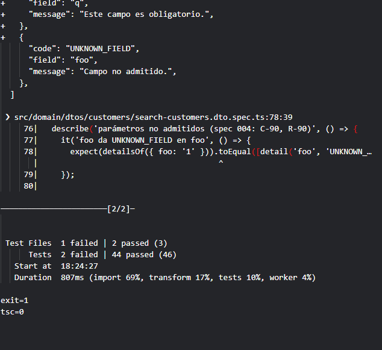
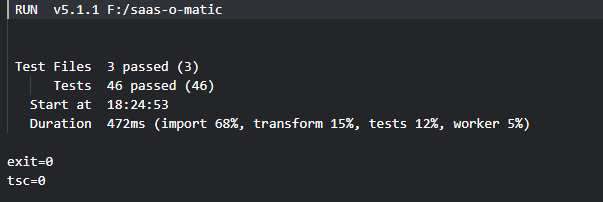

# 004-customers — Fase 7 (2026-11-24, sesión 15)

Registro abierto por la sesión principal al recibir la fase roja de la T-01, como pide la regla de `tasks.md`, y completado con `/sdd-session` al cerrar la tarea.

## Objetivo y fase
Fase 7, spec `004-customers`, puerta 5 (implementación), con `/sdd-implement`. Tarea T-01, `domain`: DTO de consulta, regla de búsqueda y entidad. Implementer con Opus 5.5 y encargo sin enseñar antes (ADR-016, puntos 4 y 6). La spec pasó la sesión en `En implementación`; las demás tareas, T-02 a T-15, siguen pendientes.

## Prompts clave
> /sdd-implement 004-customers

> Sí, confirmo la T-01 con Opus 5.5, como quedó en tasks.md. Pide al implementer la salida íntegra del rojo, sin abreviar ni reescribir ninguna línea, y que no toque ningún fichero fuera de los cuatro de producción y los tres tests de la T-01.

> Apruebo la T-01 (domain: DTO de consulta, regla de búsqueda y entidad) con las desviaciones 1 a 3, aceptadas. No repitas el rojo: vale el del retorno (es «Cannot find module»); anota en el registro que el transcrito del subagente estaba vacío y que el rojo se copió del retorno, con los signos reales (&& y 2>&1). Regla para las demás tareas: repites el rojo solo si es de aserciones o si algo del retorno no cuadra.
> Marca [x] la T-01 y sus casillas, con mi aprobación literal en tasks.md; actualiza MEMORY.md (máximo 50 líneas) y enséñame su diff. Yo lanzo /sdd-session 7 004-customers y luego te doy el OK al commit, sin Co-Authored-By.

> /sdd-session 7 004-customers

## Qué propuso la IA
- **Primera invocación sin argumento:** `/sdd-implement` llegó sin spec. La sesión principal no eligió ninguna y enseñó la tabla del README. Avisó de que `spec.md` y el README tenían sin commitear el cambio de `Planificada` a `En implementación`.
- **Antes de lanzar:**
  - Comprobó el `git diff` de los dos ficheros: solo cambiaba la línea de estado y la celda de la fila 004.
  - Vio que las quince tareas seguían en `[ ]` y propuso la T-01 con Opus 5.5.
  - Preguntó si mantener `En implementación` sin commitear. Al confirmar el autor la T-01 sin responder a eso, lo mantuvo, porque es el estado que corresponde al empezar la primera tarea, y se lo dijo. Después encontró el origen en el registro de la sesión 14: el autor pidió seguir con `/sdd-implement` tras aprobar la puerta 4.
- **Línea base:** `npm run verify` desde la raíz, en verde (766 + 180). La salida se guardó en el scratchpad y su final fue literal en el encargo.
- **Encargo del implementer, sin enseñar antes (ADR-016):**
  - las dos obligaciones literales del autor;
  - las decisiones #13, #14, #15, #32, #33, #37, #40 y #44 con su texto;
  - D-04, D-05, el primer punto de D-07 y D-16 del plan;
  - las reservas H-04 y H-14;
  - la fila literal de la T-01;
  - las rutas acotadas, con `backend-conventions`.
- **Al volver el implementer** (T-01 en `[~]`, 46 tests nuevos, 812 + 180 en verde, desviaciones 1 a 3), la sesión principal:
  - abrió este registro con el rojo literal, antes de enseñar el retorno;
  - comprobó con `git status` y `git diff --stat` que solo cambiaron los siete ficheros de la tarea y la línea «Estado» de `tasks.md`, además de `spec.md` y el README, que ya estaban cambiados antes;
  - cuadró los tests nuevos con `grep`: 11, 13 y 11 `it` más 0, 4 y 2 `it.each`, que coinciden con 11 + 21 + 14 = 46 y con la diferencia de 766 a 812; no hay ningún `skip`, `todo` ni `xit`;
  - confirmó que `customer-search.ts` solo importa de `domain` (`git grep --untracked`);
  - leyó el verde final en el fichero de salida.
- **Transcrito vacío:** la sesión principal vio que el transcrito del subagente estaba vacío (0 bytes) y no podía contrastar el rojo. Ofreció repetirlo con la producción como en `HEAD`.
- **Tras la aprobación:**
  - en `tasks.md`, T-01 en `[x]` con sus 8 casillas y la aprobación literal;
  - en `MEMORY.md`, la T-01 hecha y la regla del rojo, en 50 líneas, con el diff enseñado;
  - el commit, propuesto sin `Co-Authored-By`.
- **Comando en segundo plano:** un comando de Bash para marcar las casillas con `sed`, junto a un heredoc de `python` vacío, se quedó colgado y pasó a segundo plano sin cambiar `tasks.md`. Las casillas se marcaron después con `Edit`.

## Qué corregí y por qué
- **No repetir el rojo:** vale el del retorno, porque es un «Cannot find module». Lo anotado aquí es el transcrito vacío y los signos reales.
- **Regla nueva para las demás tareas:** el rojo se repite solo si es de aserciones o si algo del retorno no cuadra.
- **Mensaje de la línea base:** la sesión principal escribió «766 + 14» antes de corregirlo en el mismo mensaje a 766 + 180. (no registrado: corrección del autor; la detectó la propia IA)

## Decisiones tomadas
- **T-01 aprobada** con las desviaciones 1 a 3 aceptadas:
  1. tests no enumerados en la tarea: `-0` y `00`, la consulta sin prototipo, `foldText` y `toSearchTerms` por separado, y `q` solo con blancos;
  2. los `details[]` de `params` y `query`, traducidos por separado y juntados;
  3. `q` con `.optional()` y `?? ''`.
- **Fase roja:** se copia del retorno del implementer, sin repetirla en la sesión principal.
- **Regla del rojo** para las demás tareas de la 004: se repite solo si es de aserciones o si algo del retorno no cuadra.
- **Estado de la spec:** `En implementación` en `spec.md` y en la fila 004 del README.
- **Commit:** el de cierre de esta sesión.

## T-01 · Fase roja (salida íntegra del retorno del implementer)
El comando lo ejecutó el implementer. El transcrito del subagente estaba vacío (0 bytes), así que el rojo se copió de su retorno; la sesión principal no lo repitió, por decisión del autor (es un «Cannot find module»). En el retorno los signos del comando venían escapados en HTML (`&amp;&amp;`, `2&gt;&amp;1`); aquí van con los signos reales (`&&` y `2>&1`). La salida no traía escapes. Según el implementer, las líneas que acaban en «…» las recorta Vitest.

Regla del autor para las demás tareas de la 004 (literal): «Regla para las demás tareas: repites el rojo solo si es de aserciones o si algo del retorno no cuadra.»

Comando: `cd /f/saas-o-matic && npx vitest run --project api customer-id.dto search-customers.dto customer-search 2>&1; echo "exit=$?"`

```
 RUN  v5.1.1 F:/saas-o-matic

 ❯ |api| src/domain/dtos/customers/customer-id.dto.spec.ts (0 test)
 ❯ |api| src/domain/use-cases/customer/customer-search.spec.ts (0 test)
 ❯ |api| src/domain/dtos/customers/search-customers.dto.spec.ts (0 test)

⎯⎯⎯⎯⎯⎯ Failed Suites 3 ⎯⎯⎯⎯⎯⎯⎯

 FAIL  |api| src/domain/dtos/customers/customer-id.dto.spec.ts [ apps/api/src/domain/dtos/customers/customer-id.dto.spec.ts ]
Error: Cannot find module './customer-id.dto.js' imported from F:/saas-o-matic/apps/api/src/domain/dtos/customers/customer-id.dto.spec.ts
 ❯ src/domain/dtos/customers/customer-id.dto.spec.ts:3:1
      1| import { describe, expect, it } from 'vitest';
      2| import { CustomError, type ErrorDetail } from '../../errors/custom.err…
      3| import { CustomerIdDto } from './customer-id.dto.js';
       | ^
      4|
      5| // DTO de :id de GET /customers/:id y GET /customers/:id/simulations (…

⎯⎯⎯⎯⎯⎯⎯⎯⎯⎯⎯⎯⎯⎯⎯⎯⎯⎯⎯⎯⎯⎯⎯⎯[1/3]⎯

 FAIL  |api| src/domain/dtos/customers/search-customers.dto.spec.ts [ apps/api/src/domain/dtos/customers/search-customers.dto.spec.ts ]
Error: Cannot find module './search-customers.dto.js' imported from F:/saas-o-matic/apps/api/src/domain/dtos/customers/search-customers.dto.spec.ts
 ❯ src/domain/dtos/customers/search-customers.dto.spec.ts:3:1
      1| import { describe, expect, it } from 'vitest';
      2| import { CustomError, type ErrorDetail } from '../../errors/custom.err…
      3| import { SearchCustomersDto } from './search-customers.dto.js';
       | ^
      4|
      5| // DTO de la consulta de GET /customers (spec 004, T-01; plan D-04).

⎯⎯⎯⎯⎯⎯⎯⎯⎯⎯⎯⎯⎯⎯⎯⎯⎯⎯⎯⎯⎯⎯⎯⎯[2/3]⎯

 FAIL  |api| src/domain/use-cases/customer/customer-search.spec.ts [ apps/api/src/domain/use-cases/customer/customer-search.spec.ts ]
Error: Cannot find module './customer-search.js' imported from F:/saas-o-matic/apps/api/src/domain/use-cases/customer/customer-search.spec.ts
 ❯ src/domain/use-cases/customer/customer-search.spec.ts:3:1
      1| import { describe, expect, it } from 'vitest';
      2| import type { CustomerEntity } from '../../entities/customer.entity.js…
      3| import { compareCustomers, foldText, matchesCustomer, toSearchTerms } …
       | ^
      4|
      5| // Regla pura de búsqueda (spec 004, T-01; plan D-05). Sin servidor ni…

⎯⎯⎯⎯⎯⎯⎯⎯⎯⎯⎯⎯⎯⎯⎯⎯⎯⎯⎯⎯⎯⎯⎯⎯[3/3]⎯


 Test Files  3 failed (3)
      Tests  no tests
   Start at  18:23:50
   Duration  371ms (worker 94%, environment 6%)

exit=1
```

Verde final: `npm run verify` desde la raíz, exit 0. Recuentos: antes 766 + 180, después 812 + 180 (46 tests nuevos: 11 en `search-customers.dto.spec.ts`, 21 en `customer-id.dto.spec.ts` y 14 en `customer-search.spec.ts`).

## Capturas
- 
- 
- No hubo ninguna línea `CAPTURA:` en esta conversación. Las dos capturas son del autor.

## Pendiente para la siguiente sesión
- **Commit de cierre** de esta sesión, con el OK del autor y sin `Co-Authored-By`. Antes, el `git diff` de cada fichero modificado.
- **T-02** de la spec 004 (`infrastructure`: tres lecturas en el datasource), con Opus 5.5, según `tasks.md`.
- **Rojo:** se aplica la regla nueva; se repite solo si es de aserciones o si algo del retorno no cuadra.
