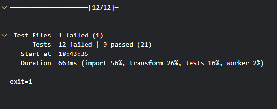
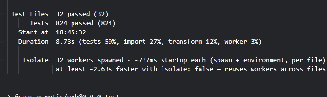

# 004-customers — Fase 7 (2026-11-24, sesión 16)

Registro abierto por la sesión principal al recibir la fase roja de la T-02, como pide la regla de `tasks.md`, y completado con `/sdd-session` al cerrar la tarea.

## Objetivo y fase
Fase 7, spec `004-customers`, puerta 5 (implementación), con `/sdd-implement`. Tarea T-02, `infrastructure`: tres lecturas en el datasource. Implementer con Opus 5.5 y encargo sin enseñar antes (ADR-016, puntos 4 y 6). La spec sigue en `En implementación`.

## Prompts clave
> /sdd-implement 004-customers

> Sí, confirmo la T-02 con Opus 5.5, como quedó en tasks.md. Pide al implementer la salida íntegra del rojo, sin abreviar ni reescribir ninguna línea, y que no toque ningún fichero fuera de los dos de producción y el test de la T-02.

> Apruebo la T-02 (infrastructure: tres lecturas en el datasource) con las desviaciones 1 a 5 aceptadas, incluida la 2: el DELETE FROM simulations del beforeEach del spec de la 002 es necesario por la clave foránea, no quita ninguna aserción (167 añadidas y 0 quitadas) y encaja con la D-16, que prohíbe quitar o desactivar aserciones. No repitas el rojo (es «is not a function», no de aserciones); anota en el registro que el transcrito del subagente estaba vacío y que el rojo se copió del retorno, con los signos reales. Anota también como observación para el revisor las citas «spec 004: R-80; plan D-06» (R-144).
> Marca [x] la T-02 y sus casillas, con mi aprobación literal en tasks.md; actualiza MEMORY.md (máximo 50 líneas) y enséñame su diff. Yo lanzo /sdd-session 7 004-customers y luego te doy el OK al commit, sin Co-Authored-By.

> haz el comit

> /sdd-session 7 004-customers

## Fase roja de la T-02 (literal)
Copiada del retorno del implementer, con los signos reales: el retorno traía `&gt;` en lugar de `>`. El transcrito del subagente tenía 0 bytes, así que no se pudo contrastar. Según la regla del autor de la T-01, el rojo no se repite: es «is not a function», no de aserciones, y el recuento cuadra (de 9 a 21 tests en el fichero; de 812 a 824 en la raíz). Las líneas cortadas con «…» las corta el propio Vitest.

```
 RUN  v5.1.1 F:/saas-o-matic

 ❯ |api| src/infrastructure/datasource/sqlite-customer.datasource.spec.ts (21 tests | 12 failed) 57ms
   ❯ SqliteCustomerDatasource (20)
     ❯ findAllWithLastSimulation (spec 004: R-03, R-05, R-06, R-80; D-06) (7)
       × sin clientes devuelve [] 5ms
       × C-80 · un cliente sin simulaciones trae lastSimulation null y sus siete campos 1ms
       × C-05 · lastSimulation es la de 40 usuarios, creada después, con sus diez campos 2ms
       × C-05 · manda created_at aunque la más reciente tenga menor id 1ms
       × C-05 · con el mismo created_at, la de mayor id 1ms
       × C-06 · una fila con importes distintos de packages/pricing sale tal como se guardó 1ms
       × cada cliente trae solo su última simulación, y el que no tiene, null (R-03, R-80) 2ms
     ❯ findById (spec 004: R-79; D-06) (2)
       × devuelve el cliente con sus siete campos, sin lastSimulation 1ms
       × devuelve undefined si no hay fila 1ms
     ❯ findSimulationsByCustomerId (spec 004: R-04, R-06, R-81, R-82; D-06) (3)
       × C-82 · de la más reciente a la más antigua y, con el mismo created_at, mayor id primero 2ms
       × R-06 · los importes salen tal como se guardaron 2ms
       × R-81 · un cliente sin simulaciones da [] 1ms

⎯⎯⎯⎯⎯⎯ Failed Tests 12 ⎯⎯⎯⎯⎯⎯⎯

 FAIL  |api| src/infrastructure/datasource/sqlite-customer.datasource.spec.ts > SqliteCustomerDatasource > findAllWithLastSimulation (spec 004: R-03, R-05, R-06, R-80; D-06) > sin clientes devuelve []
TypeError: datasource.findAllWithLastSimulation is not a function
 ❯ src/infrastructure/datasource/sqlite-customer.datasource.spec.ts:179:31
    177|   describe('findAllWithLastSimulation (spec 004: R-03, R-05, R-06, R-8…
    178|     it('sin clientes devuelve []', async () => {
    179|       await expect(datasource.findAllWithLastSimulation()).resolves.to…
       |                               ^
    180|     });
    181|

⎯⎯⎯⎯⎯⎯⎯⎯⎯⎯⎯⎯⎯⎯⎯⎯⎯⎯⎯⎯⎯⎯⎯[1/12]⎯

 FAIL  |api| src/infrastructure/datasource/sqlite-customer.datasource.spec.ts > SqliteCustomerDatasource > findAllWithLastSimulation (spec 004: R-03, R-05, R-06, R-80; D-06) > C-80 · un cliente sin simulaciones trae lastSimulation null y sus siete campos
TypeError: datasource.findAllWithLastSimulation is not a function
 ❯ src/infrastructure/datasource/sqlite-customer.datasource.spec.ts:185:39
    183|       const customer = await datasource.create(dtoOf());
    184|
    185|       const result = await datasource.findAllWithLastSimulation();
       |                                       ^
    186|       expect(result).toEqual([{ ...customer, lastSimulation: null }]);
    187|     });

⎯⎯⎯⎯⎯⎯⎯⎯⎯⎯⎯⎯⎯⎯⎯⎯⎯⎯⎯⎯⎯⎯⎯[2/12]⎯

 FAIL  |api| src/infrastructure/datasource/sqlite-customer.datasource.spec.ts > SqliteCustomerDatasource > findAllWithLastSimulation (spec 004: R-03, R-05, R-06, R-80; D-06) > C-05 · lastSimulation es la de 40 usuarios, creada después, con sus diez campos
TypeError: datasource.findAllWithLastSimulation is not a function
 ❯ src/infrastructure/datasource/sqlite-customer.datasource.spec.ts:200:39
    198|       });
    199|
    200|       const result = await datasource.findAllWithLastSimulation();
       |                                       ^
    201|       expect(result).toEqual([{ ...customer, lastSimulation: latest }]…
    202|     });

⎯⎯⎯⎯⎯⎯⎯⎯⎯⎯⎯⎯⎯⎯⎯⎯⎯⎯⎯⎯⎯⎯⎯[3/12]⎯

 FAIL  |api| src/infrastructure/datasource/sqlite-customer.datasource.spec.ts > SqliteCustomerDatasource > findAllWithLastSimulation (spec 004: R-03, R-05, R-06, R-80; D-06) > C-05 · manda created_at aunque la más reciente tenga menor id
TypeError: datasource.findAllWithLastSimulation is not a function
 ❯ src/infrastructure/datasource/sqlite-customer.datasource.spec.ts:210:39
    208|       expect(older.id).toBeGreaterThan(latest.id);
    209|
    210|       const [only] = await datasource.findAllWithLastSimulation();
       |                                       ^
    211|       expect(only!.lastSimulation).toEqual(latest);
    212|     });

⎯⎯⎯⎯⎯⎯⎯⎯⎯⎯⎯⎯⎯⎯⎯⎯⎯⎯⎯⎯⎯⎯⎯[4/12]⎯

 FAIL  |api| src/infrastructure/datasource/sqlite-customer.datasource.spec.ts > SqliteCustomerDatasource > findAllWithLastSimulation (spec 004: R-03, R-05, R-06, R-80; D-06) > C-05 · con el mismo created_at, la de mayor id
TypeError: datasource.findAllWithLastSimulation is not a function
 ❯ src/infrastructure/datasource/sqlite-customer.datasource.spec.ts:221:39
    219|       expect(second.id).toBeGreaterThan(first.id);
    220|
    221|       const [only] = await datasource.findAllWithLastSimulation();
       |                                       ^
    222|       expect(only!.lastSimulation).toEqual(second);
    223|     });

⎯⎯⎯⎯⎯⎯⎯⎯⎯⎯⎯⎯⎯⎯⎯⎯⎯⎯⎯⎯⎯⎯⎯[5/12]⎯

 FAIL  |api| src/infrastructure/datasource/sqlite-customer.datasource.spec.ts > SqliteCustomerDatasource > findAllWithLastSimulation (spec 004: R-03, R-05, R-06, R-80; D-06) > C-06 · una fila con importes distintos de packages/pricing sale tal como se guardó
TypeError: datasource.findAllWithLastSimulation is not a function
 ❯ src/infrastructure/datasource/sqlite-customer.datasource.spec.ts:230:39
    228|       insertSimulation(customer.id, { baseCostCents: 100, taxRateBps: …
    229|
    230|       const [only] = await datasource.findAllWithLastSimulation();
       |                                       ^
    231|       expect(only!.lastSimulation).toMatchObject({
    232|         baseCostCents: 100,

⎯⎯⎯⎯⎯⎯⎯⎯⎯⎯⎯⎯⎯⎯⎯⎯⎯⎯⎯⎯⎯⎯⎯[6/12]⎯

 FAIL  |api| src/infrastructure/datasource/sqlite-customer.datasource.spec.ts > SqliteCustomerDatasource > findAllWithLastSimulation (spec 004: R-03, R-05, R-06, R-80; D-06) > cada cliente trae solo su última simulación, y el que no tiene, null (R-03, R-80)
TypeError: datasource.findAllWithLastSimulation is not a function
 ❯ src/infrastructure/datasource/sqlite-customer.datasource.spec.ts:246:40
    244|
    245|       // Sin ORDER BY en el SQL (lo ordena domain, D-05): se compara p…
    246|       const result = (await datasource.findAllWithLastSimulation()).so…
       |                                        ^
    247|       expect(result).toEqual([
    248|         { ...withSimulation, lastSimulation: latest },

⎯⎯⎯⎯⎯⎯⎯⎯⎯⎯⎯⎯⎯⎯⎯⎯⎯⎯⎯⎯⎯⎯⎯[7/12]⎯

 FAIL  |api| src/infrastructure/datasource/sqlite-customer.datasource.spec.ts > SqliteCustomerDatasource > findById (spec 004: R-79; D-06) > devuelve el cliente con sus siete campos, sin lastSimulation
TypeError: datasource.findById is not a function
 ❯ src/infrastructure/datasource/sqlite-customer.datasource.spec.ts:259:38
    257|       insertSimulation(customer.id);
    258|
    259|       const found = await datasource.findById(customer.id);
       |                                      ^
    260|       expect(found).toEqual(customer);
    261|       expect(found).not.toHaveProperty('lastSimulation');

⎯⎯⎯⎯⎯⎯⎯⎯⎯⎯⎯⎯⎯⎯⎯⎯⎯⎯⎯⎯⎯⎯⎯[8/12]⎯

 FAIL  |api| src/infrastructure/datasource/sqlite-customer.datasource.spec.ts > SqliteCustomerDatasource > findById (spec 004: R-79; D-06) > devuelve undefined si no hay fila
TypeError: datasource.findById is not a function
 ❯ src/infrastructure/datasource/sqlite-customer.datasource.spec.ts:266:31
    264|     it('devuelve undefined si no hay fila', async () => {
    265|       const customer = await datasource.create(dtoOf());
    266|       await expect(datasource.findById(customer.id + 1)).resolves.toBe…
       |                               ^
    267|     });
    268|   });

⎯⎯⎯⎯⎯⎯⎯⎯⎯⎯⎯⎯⎯⎯⎯⎯⎯⎯⎯⎯⎯⎯⎯[9/12]⎯

 FAIL  |api| src/infrastructure/datasource/sqlite-customer.datasource.spec.ts > SqliteCustomerDatasource > findSimulationsByCustomerId (spec 004: R-04, R-06, R-81, R-82; D-06) > C-82 · de la más reciente a la más antigua y, con el mismo created_at, mayor id primero
TypeError: datasource.findSimulationsByCustomerId is not a function
 ❯ src/infrastructure/datasource/sqlite-customer.datasource.spec.ts:281:39
    279|       insertSimulation(other.id, { createdAt: '2026-11-26T10:00:00.000…
    280|
    281|       const result = await datasource.findSimulationsByCustomerId(cust…
       |                                       ^
    282|       expect(result).toEqual([newest, sameSecond, sameFirst, middle, o…
    283|     });

⎯⎯⎯⎯⎯⎯⎯⎯⎯⎯⎯⎯⎯⎯⎯⎯⎯⎯⎯⎯⎯⎯[10/12]⎯

 FAIL  |api| src/infrastructure/datasource/sqlite-customer.datasource.spec.ts > SqliteCustomerDatasource > findSimulationsByCustomerId (spec 004: R-04, R-06, R-81, R-82; D-06) > R-06 · los importes salen tal como se guardaron
TypeError: datasource.findSimulationsByCustomerId is not a function
 ❯ src/infrastructure/datasource/sqlite-customer.datasource.spec.ts:294:31
    292|       });
    293|
    294|       await expect(datasource.findSimulationsByCustomerId(customer.id)…
       |                               ^
    295|     });
    296|

⎯⎯⎯⎯⎯⎯⎯⎯⎯⎯⎯⎯⎯⎯⎯⎯⎯⎯⎯⎯⎯⎯[11/12]⎯

 FAIL  |api| src/infrastructure/datasource/sqlite-customer.datasource.spec.ts > SqliteCustomerDatasource > findSimulationsByCustomerId (spec 004: R-04, R-06, R-81, R-82; D-06) > R-81 · un cliente sin simulaciones da []
TypeError: datasource.findSimulationsByCustomerId is not a function
 ❯ src/infrastructure/datasource/sqlite-customer.datasource.spec.ts:299:31
    297|     it('R-81 · un cliente sin simulaciones da []', async () => {
    298|       const customer = await datasource.create(dtoOf());
    299|       await expect(datasource.findSimulationsByCustomerId(customer.id)…
       |                               ^
    300|     });
    301|   });

⎯⎯⎯⎯⎯⎯⎯⎯⎯⎯⎯⎯⎯⎯⎯⎯⎯⎯⎯⎯⎯⎯[12/12]⎯


 Test Files  1 failed (1)
      Tests  12 failed | 9 passed (21)
   Start at  18:43:35
   Duration  663ms (import 56%, transform 26%, tests 16%, worker 2%)

exit=1
```

## Notas pedidas por el autor al aprobar la T-02
- El transcrito del subagente estaba vacío (0 bytes). El rojo se copió del retorno, con los signos reales (`>` y `=>` en lugar de `&gt;` y `=&gt;`), y no se repitió: es «is not a function», no de aserciones.
- Observación para el revisor (R-144): en `sqlite-customer.datasource.ts`, los comentarios nuevos citan «spec 004: R-80; plan D-06» y «spec 004: R-05, R-80; plan D-05 y D-06». Las D van dentro del paréntesis de la spec 004, pero escritas como «plan D-nn».

## Qué propuso la IA
- **Antes de lanzar:**
  - Leyó el `Estado:` literal de `spec.md` («En implementación»).
  - Vio en `tasks.md` que la T-01 estaba en `[x]` y la T-02 en `[ ]`.
  - Propuso la T-02 con Opus 5.5, el modelo que fija la tarea, y esperó tu confirmación.
- **Línea base:** `npm run verify` desde la raíz, en verde (812 + 180). La salida se guardó en el scratchpad y fue íntegra en el encargo.
- **Encargo del implementer, sin enseñar antes (ADR-016):**
  - la petición literal del autor y sus dos instrucciones expresas: el rojo íntegro, sin abreviar ni reescribir y con los signos reales; y no tocar ningún fichero fuera de los tres de la T-02 y la línea «Estado» de `tasks.md`;
  - D-03, D-06, D-16 y el paso 2 del plan;
  - las reglas comunes de `tasks.md`;
  - la fila literal de la T-02;
  - las rutas acotadas a requisitos y casos, con `backend-conventions`, `database.md` y `architecture.md`;
  - el filtro `npx vitest run --project api <texto>`;
  - la petición de cuadrar el recuento de tests.
- **Al volver el implementer** (T-02 en `[~]`, 12 tests nuevos, 824 + 180 en verde, desviaciones 1 a 5), la sesión principal:
  - ejecutó `git status` y `git diff --stat`: solo los tres ficheros de la tarea y la línea «Estado» de `tasks.md`;
  - leyó el diff de producción: en `sqlite-simulation.datasource.ts` solo los dos `export`; en el SQL, `?` en `findById` y `findSimulationsByCustomerId` y ningún valor concatenado;
  - contó los `it` nuevos con `grep` (12, de 9 a 21 en el fichero y de 812 a 824 en la raíz), sin `skip`, `todo` ni `xit`;
  - leyó los recuentos del verde en el fichero de salida del implementer.
- **Transcrito vacío:**
  - Al contrastar el rojo con el transcrito del subagente, la sesión principal leyó primero la columna equivocada de `ls -la` y lo tomó por un fichero de 197121 bytes.
  - Las búsquedas salían a cero. Con `wc -c` comprobó que tenía 0 bytes, como en la T-01.
  - Aplicó tu regla de la T-01 y no repitió el rojo: es «is not a function» y el recuento cuadra.
  - Abrió este registro con el rojo copiado del retorno, cambiando `&gt;` por `>`, antes de enseñarte el retorno.
- **Dos puntos para que decidieras:**
  - la desviación 2 frente a la D-16: `DELETE FROM simulations` en el `beforeEach` de un test de la 002, que «solo gana tests»;
  - las citas «plan D-nn» dentro de «spec 004:» (R-144).
- **Tras la aprobación:**
  - en `tasks.md`, T-02 en `[x]` con sus 6 casillas, la aprobación literal, las desviaciones aceptadas, el recuento y la observación de R-144;
  - en este registro, las dos notas pedidas;
  - `MEMORY.md` con la T-02, en 50 líneas (comprobado con `wc -l`), y su diff;
  - la propuesta del commit, sin `Co-Authored-By`.
- **Ante «haz el comit»:** no hizo el commit, porque este registro seguía sin completar y el orden de `CLAUDE.md` es MEMORY.md → `/sdd-session` → commit. Ofreció (a), completar antes el registro (recomendada), o (b), hacer el commit ya y completarlo en otro commit.

## Qué corregí y por qué
- Desviación 2: la sesión principal la planteó como posible choque con la D-16, que dice que el spec de la 002 «solo gana tests». La aceptaste, porque la línea es necesaria por la clave foránea, no quita ninguna aserción (167 añadidas y 0 quitadas) y encaja con la D-16, que prohíbe quitar o desactivar aserciones.
- Pediste el commit antes de `/sdd-session`. Cuando la sesión principal paró, lanzaste `/sdd-session 7 004-customers`, es decir, la opción (a).

## Decisiones tomadas
- T-02 aprobada con las desviaciones 1 a 5 (aprobación literal en `tasks.md`).
- El rojo no se repite: el del retorno vale, con los signos reales.
- Las citas «plan D-06» quedan como observación para el revisor (R-144) y no se corrigen en esta tarea.
- Commit: el de cierre de esta sesión.

## Capturas
- En esta sesión no se anunció ninguna línea `CAPTURA:`. Las dos capturas las guardó el autor.




## Pendiente para la siguiente sesión
- **T-03** (puertos y repositorio de `customers`), con Sonnet 5.5 según `tasks.md`:
  - los falsos de la 002 ganan las tres lecturas (P-02 (a));
  - `tsc --noEmit` de `apps/api` (tasks.md Q-01 (a));
  - sin fase roja.
- En la puerta 6, el revisor mira la observación de R-144 sobre las citas «plan D-nn».
