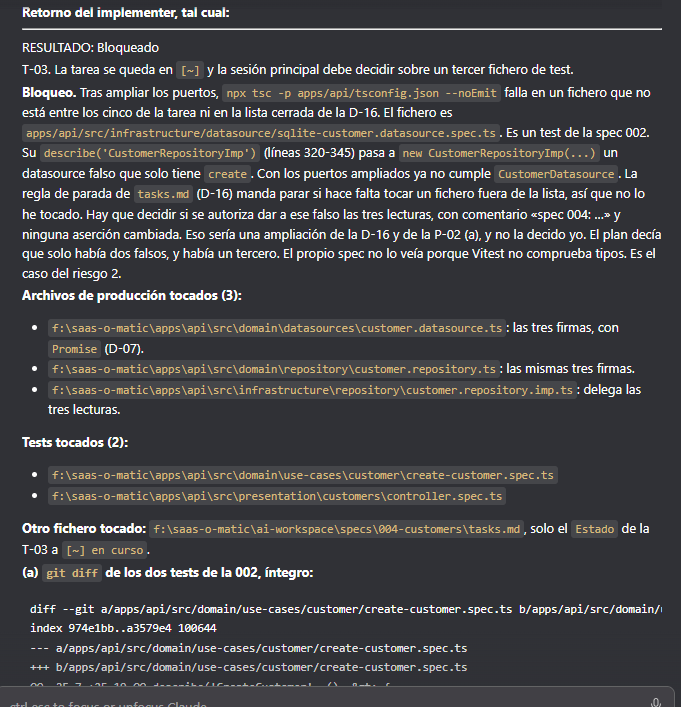
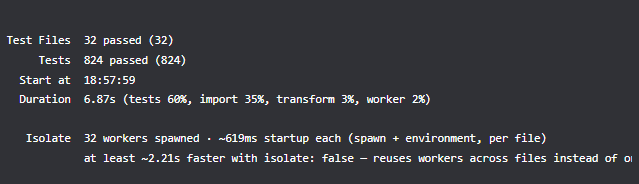

# 004-customers — Fase 7 (2026-11-24, sesión 17)

Registro abierto por la sesión principal al recibir el retorno de la T-03, que no tiene fase roja, y que `/sdd-session` completa al cerrar la tarea.

## Objetivo y fase
Fase 7, spec `004-customers`, puerta 5 (implementación), con `/sdd-implement`. Tarea T-03: puertos y repositorio de `customers`. Implementer con Sonnet 5.5 y encargo sin enseñar antes (ADR-016, puntos 4 y 6). La spec sigue en `En implementación`.

## Prompts clave
> /sdd-implement 004-customers

> Sí, confirmo la T-03 con Sonnet 5.5, como quedó en tasks.md. Esta tarea no tiene fase roja. Pide al implementer el git diff de los dos tests de la 002 y la salida íntegra de `npx tsc -p apps/api/tsconfig.json --noEmit` y de `npm run verify`, sin abreviar ni reescribir ninguna línea, y que no toque ningún fichero fuera de los tres de producción y los dos tests.

> Elijo la (a): autorizo el tercer falso, el de sqlite-customer.datasource.spec.ts:333 (describe de CustomerRepositoryImp, spec 002). Gana las tres lecturas, que lanzan si se llaman, con un comentario «spec 004: P-02 (a), D-16: …» y sin cambiar ninguna aserción. Queda como decisión del autor, con mi texto literal, en la aprobación de la T-03 (la D-16 y la P-02 (a) cubrían dos falsos y había tres); no hace falta rehacer el plan. Reanuda al mismo implementer para que lo haga y repita `npx tsc -p apps/api/tsconfig.json --noEmit` (debe salir con código 0) y `npm run verify`, con la salida íntegra y la excepción de los códigos de color. Guarda el retorno en el registro con los signos reales (=>, <, &, &&). Anota para el revisor que la D-16 y el riesgo 2 no contaban con el tercer falso y que lo sacó tsc.
> Cuando vuelva, enséñame el git diff de los tres tests y la salida de tsc antes de pedirme la aprobación de la T-03.

> Apruebo la T-03 (puertos y repositorio de customers) con las desviaciones 1 y 2 aceptadas. La autorización del tercer falso (sqlite-customer.datasource.spec.ts:333) queda como decisión mía, con mi texto literal, en la aprobación de la T-03. El registro vale como está: la evidencia son tus salidas repetidas de tsc (código 0), verify (824 + 180) y git diff; no hace falta pegar más.
> Marca [x] la T-03 y sus casillas, con mi aprobación literal en tasks.md; actualiza MEMORY.md (máximo 50 líneas), con una línea sobre el tercer falso que sacó tsc, y enséñame su diff. Yo lanzo /sdd-session 7 004-customers y luego te doy el OK al commit, sin Co-Authored-By.

> /sdd-session 7 004-customers

## Línea base (sesión principal, antes de lanzar)
- `npx tsc -p apps/api/tsconfig.json --noEmit`: salida vacía, código 0.
- `npm run verify`: código 0, raíz «Tests  824 passed (824)» y web «Tests  180 passed (180)».

## Nota para el revisor (pedida por el autor)
- La D-16 y el riesgo 2 del plan contaban dos falsos de la 002 que dejan de cumplir el puerto (`create-customer.spec.ts:28` y `customers/controller.spec.ts:23`), pero había tres. El tercero es el datasource falso del `describe('CustomerRepositoryImp')` de `sqlite-customer.datasource.spec.ts:333`. Lo sacó `tsc --noEmit`, porque `npm run verify` seguía en verde (Vitest no comprueba tipos y `tsconfig.build.json` excluye los tests). El autor lo autorizó con su texto literal (arriba, en «Prompts clave»), que va en la aprobación de la T-03.

## Retorno 1 del implementer (Bloqueado), con los signos reales
El retorno traía `=&gt;`, `&lt;`, `&gt;` y `&amp;`. Aquí van como `=>`, `<`, `>` y `&`, con OK del autor.

````
RESULTADO: Bloqueado

T-03. La tarea se queda en `[~]` y la sesión principal debe decidir sobre un tercer fichero de test.

**Bloqueo.** Tras ampliar los puertos, `npx tsc -p apps/api/tsconfig.json --noEmit` falla en un fichero que no está entre los cinco de la tarea ni en la lista cerrada de la D-16. El fichero es `apps/api/src/infrastructure/datasource/sqlite-customer.datasource.spec.ts`. Es un test de la spec 002. Su `describe('CustomerRepositoryImp')` (líneas 320-345) pasa a `new CustomerRepositoryImp(...)` un datasource falso que solo tiene `create`. Con los puertos ampliados ya no cumple `CustomerDatasource`. La regla de parada de `tasks.md` (D-16) manda parar si hace falta tocar un fichero fuera de la lista, así que no lo he tocado. Hay que decidir si se autoriza dar a ese falso las tres lecturas, con comentario «spec 004: …» y ninguna aserción cambiada. Eso sería una ampliación de la D-16 y de la P-02 (a), y no la decido yo. El plan decía que solo había dos falsos, y había un tercero. El propio spec no lo veía porque Vitest no comprueba tipos. Es el caso del riesgo 2.

**Archivos de producción tocados (3):**
- `f:\saas-o-matic\apps\api\src\domain\datasources\customer.datasource.ts`: las tres firmas, con `Promise` (D-07).
- `f:\saas-o-matic\apps\api\src\domain\repository\customer.repository.ts`: las mismas tres firmas.
- `f:\saas-o-matic\apps\api\src\infrastructure\repository\customer.repository.imp.ts`: delega las tres lecturas.

**Tests tocados (2):**
- `f:\saas-o-matic\apps\api\src\domain\use-cases\customer\create-customer.spec.ts`
- `f:\saas-o-matic\apps\api\src\presentation\customers\controller.spec.ts`

**Otro fichero tocado:** `f:\saas-o-matic\ai-workspace\specs\004-customers\tasks.md`, solo el `Estado` de la T-03 a `[~] en curso`.

**(a) `git diff` de los dos tests de la 002, íntegro:**
```
diff --git a/apps/api/src/domain/use-cases/customer/create-customer.spec.ts b/apps/api/src/domain/use-cases/customer/create-customer.spec.ts
index 974e1bb..a3579e4 100644
--- a/apps/api/src/domain/use-cases/customer/create-customer.spec.ts
+++ b/apps/api/src/domain/use-cases/customer/create-customer.spec.ts
@@ -25,7 +25,19 @@ describe('CreateCustomer', () => {
       createdAt: '2026-11-23T10:00:00.000Z',
     };
     const create = vi.fn<CustomerRepository['create']>().mockResolvedValue(entity);
-    const repository: CustomerRepository = { create };
+    // spec 004: P-02 (a), D-16: las tres lecturas del puerto lanzan si se llaman.
+    const repository: CustomerRepository = {
+      create,
+      findAllWithLastSimulation: () => {
+        throw new Error('spec 004: no se espera findAllWithLastSimulation');
+      },
+      findById: () => {
+        throw new Error('spec 004: no se espera findById');
+      },
+      findSimulationsByCustomerId: () => {
+        throw new Error('spec 004: no se espera findSimulationsByCustomerId');
+      },
+    };
 
     const result = await new CreateCustomer(repository).execute(dto!);
 
diff --git a/apps/api/src/presentation/customers/controller.spec.ts b/apps/api/src/presentation/customers/controller.spec.ts
index 3de7e84..d24f223 100644
--- a/apps/api/src/presentation/customers/controller.spec.ts
+++ b/apps/api/src/presentation/customers/controller.spec.ts
@@ -24,6 +24,16 @@ function fakeRepository(failWith?: unknown): CustomerRepository & { calls: CreateCustomerDto[] } {
   const calls: CreateCustomerDto[] = [];
   return {
     calls,
+    // spec 004: P-02 (a), D-16: las tres lecturas del puerto lanzan si se llaman.
+    findAllWithLastSimulation: () => {
+      throw new Error('spec 004: no se espera findAllWithLastSimulation');
+    },
+    findById: () => {
+      throw new Error('spec 004: no se espera findById');
+    },
+    findSimulationsByCustomerId: () => {
+      throw new Error('spec 004: no se espera findSimulationsByCustomerId');
+    },
     async create(dto: CreateCustomerDto): Promise<CustomerEntity> {
       calls.push(dto);
       if (failWith !== undefined) throw failWith;
```

**(b) `npx tsc -p apps/api/tsconfig.json --noEmit` tras el cambio:** código de salida 2. Antes de empezar era 0 y sin salida. Salida íntegra:
```
apps/api/src/infrastructure/datasource/sqlite-customer.datasource.spec.ts(333,50): error TS2345: Argument of type '{ create: (received: CreateCustomerDto) => Promise<{ id: number; companyName: string; taxId: string; email: string; country: string; plan: string; createdAt: string; }>; }' is not assignable to parameter of type 'CustomerDatasource'.
  Type '{ create: (received: CreateCustomerDto) => Promise<{ id: number; companyName: string; taxId: string; email: string; country: string; plan: string; createdAt: string; }>; }' is missing the following properties from type 'CustomerDatasource': findAllWithLastSimulation, findById, findSimulationsByCustomerId
```
No hay errores en los dos tests que toca la tarea. El único error es el del tercer fichero, que es de la 002 y se debe a los puertos de esta tarea.

**(c) `npm run verify` tras el cambio:** código de salida 0. Es el mismo resultado que antes, porque Vitest no comprueba tipos y `tsconfig.build.json` excluye los tests. [Salida omitida en este registro: código 0, raíz 824 y web 180, sin cambios respecto a la línea base.]

**Recuentos:** raíz 32 ficheros y 824 tests, antes y después. Web 10 ficheros y 180 tests, antes y después. No hay tests nuevos.

**Desviaciones:**
1. El tercer fichero descrito arriba. No se ha tocado.
2. Los mensajes de los falsos que lanzan («spec 004: no se espera …») son míos. El plan no fija su texto, solo que lancen y que lleven el comentario.
3. `npm run verify` queda en verde con el bloqueo sin resolver, así que solo `tsc` lo detecta. Las casillas de «Hecho cuando» sobre `tsc` y los falsos de los tests de la 002 no se pueden dar por cumplidas hasta que se decida.

**Para la sesión principal:**
- Decidir si se autoriza tocar `sqlite-customer.datasource.spec.ts:333` (falso de datasource con las tres lecturas que lanzan, comentario «spec 004: …», ninguna aserción cambiada). Eso exige ampliar la lista de la D-16 y la P-02 (a), o resolverlo como otra decisión del autor. Después hay que repetir `tsc` y `verify`.
- `MEMORY.md`: nada todavía. No se han cumplido las casillas, así que no hay nada que marcar.
- `Estado:` de `spec.md`: no cambia, ya está en `En implementación`.
- No se marca `[x]` en la T-03 ni sus casillas.
- Observación para el revisor: la D-16 y el riesgo 2 no contaban con un tercer falso. Lo ha sacado `tsc`.
````

La sesión principal repitió `tsc` y obtuvo el mismo error, con código 2. El `verify` de este retorno no se copia porque se rehízo en la segunda vuelta.

## Retorno 2 del implementer (Tarea terminada), con los signos reales
Las mismas sustituciones de signos. El bloque `(a)` de este retorno trae los mismos dos hunks de la vuelta 1 más el del tercer falso. Aquí no se repite: el diff literal es el de la sesión principal, en la sección siguiente. El bloque `(c)` tampoco se repite: el implementer reconoce que una línea suya no es literal («wind» por «transform»).

````
RESULTADO: Tarea terminada

T-03. La tarea sigue en `[~]` en `tasks.md`. No he marcado `[x]` ni ninguna casilla.

**Archivos de producción (3):** customer.datasource.ts, customer.repository.ts y customer.repository.imp.ts.

**Tests (3):** create-customer.spec.ts, controller.spec.ts y sqlite-customer.datasource.spec.ts (el tercer falso, autorizado por el autor).

**Otro fichero:** tasks.md, solo el `Estado` de la T-03 en `[~]`.

**(a)** [diff de los tres tests: ver la sección siguiente, salida de la sesión principal]
Solo se añaden líneas (sin ninguna `-` salvo la de `{ create }`, que pasa a ser el bloque ampliado). Ninguna aserción cambia.

**(b) `npx tsc -p apps/api/tsconfig.json --noEmit`:** salida vacía, código de salida 0.

**(c) `npm run verify`:** código de salida 0. Los códigos de color de la salida de la web están quitados con `sed`; el resto va íntegro: [ver la sección siguiente]
Corrección: en la última línea de `Duration` de la web, la salida real es `(environment 61%, setup 18%, tests 14%, import 6%, transform 1%, worker 1%)`. Al copiarla para este informe cambié «transform» por «wind» por error. Si el autor necesita la salida byte a byte, hay que repetir el comando.

**Recuentos:** raíz 32 ficheros y 824 tests, antes y después. Web 10 ficheros y 180 tests, antes y después. No hay tests nuevos, como pide la tarea.

**Desviaciones:**
1. El tercer falso (`sqlite-customer.datasource.spec.ts`, `describe('CustomerRepositoryImp')`) lo autorizó el autor tras el primer bloqueo. Debe constar como decisión del autor en la aprobación de la T-03.
2. Los mensajes de los falsos que lanzan («spec 004: no se espera …») son míos. El plan no los fija.

**Para la sesión principal:**
- `MEMORY.md`: anotar la T-03 hecha cuando el autor la apruebe, y que había tres falsos y no dos (D-16 y P-02 (a)).
- `Estado:` de `spec.md`: no cambia, sigue en `En implementación`.
- Tras la aprobación del autor, marcar `[x]` en la T-03 y sus casillas.
````
Nota: en este retorno, los listados de ficheros vienen resumidos por la sesión principal (eran rutas absolutas). Los bloques `(a)` y `(c)` están sustituidos por las salidas de abajo. El texto del implementer queda literal.

## Salidas literales de la sesión principal tras la vuelta 2
`git diff` de los tres tests:
```
diff --git a/apps/api/src/domain/use-cases/customer/create-customer.spec.ts b/apps/api/src/domain/use-cases/customer/create-customer.spec.ts
index 974e1bb..a3579e4 100644
--- a/apps/api/src/domain/use-cases/customer/create-customer.spec.ts
+++ b/apps/api/src/domain/use-cases/customer/create-customer.spec.ts
@@ -25,7 +25,19 @@ describe('CreateCustomer', () => {
       createdAt: '2026-11-23T10:00:00.000Z',
     };
     const create = vi.fn<CustomerRepository['create']>().mockResolvedValue(entity);
-    const repository: CustomerRepository = { create };
+    // spec 004: P-02 (a), D-16: las tres lecturas del puerto lanzan si se llaman.
+    const repository: CustomerRepository = {
+      create,
+      findAllWithLastSimulation: () => {
+        throw new Error('spec 004: no se espera findAllWithLastSimulation');
+      },
+      findById: () => {
+        throw new Error('spec 004: no se espera findById');
+      },
+      findSimulationsByCustomerId: () => {
+        throw new Error('spec 004: no se espera findSimulationsByCustomerId');
+      },
+    };
 
     const result = await new CreateCustomer(repository).execute(dto!);
 
diff --git a/apps/api/src/infrastructure/datasource/sqlite-customer.datasource.spec.ts b/apps/api/src/infrastructure/datasource/sqlite-customer.datasource.spec.ts
index 6a4809a..915a6dd 100644
--- a/apps/api/src/infrastructure/datasource/sqlite-customer.datasource.spec.ts
+++ b/apps/api/src/infrastructure/datasource/sqlite-customer.datasource.spec.ts
@@ -335,6 +335,16 @@ describe('CustomerRepositoryImp', () => {
         calls.push(received);
         return entity;
       },
+      // spec 004: P-02 (a), D-16: las tres lecturas del puerto lanzan si se llaman.
+      findAllWithLastSimulation: () => {
+        throw new Error('spec 004: no se espera findAllWithLastSimulation');
+      },
+      findById: () => {
+        throw new Error('spec 004: no se espera findById');
+      },
+      findSimulationsByCustomerId: () => {
+        throw new Error('spec 004: no se espera findSimulationsByCustomerId');
+      },
     });
 
     await expect(repository.create(dto)).resolves.toBe(entity);
diff --git a/apps/api/src/presentation/customers/controller.spec.ts b/apps/api/src/presentation/customers/controller.spec.ts
index 3de7e84..d24f223 100644
--- a/apps/api/src/presentation/customers/controller.spec.ts
+++ b/apps/api/src/presentation/customers/controller.spec.ts
@@ -24,6 +24,16 @@ function fakeRepository(failWith?: unknown): CustomerRepository & { calls: Creat
   const calls: CreateCustomerDto[] = [];
   return {
     calls,
+    // spec 004: P-02 (a), D-16: las tres lecturas del puerto lanzan si se llaman.
+    findAllWithLastSimulation: () => {
+      throw new Error('spec 004: no se espera findAllWithLastSimulation');
+    },
+    findById: () => {
+      throw new Error('spec 004: no se espera findById');
+    },
+    findSimulationsByCustomerId: () => {
+      throw new Error('spec 004: no se espera findSimulationsByCustomerId');
+    },
     async create(dto: CreateCustomerDto): Promise<CustomerEntity> {
       calls.push(dto);
       if (failWith !== undefined) throw failWith;
```
El git real corta la cabecera del hunk de `controller.spec.ts` en «Creat». El retorno del implementer la daba completa («CreateCustomerDto[] } {»), así que esa línea no era literal.

`npx tsc -p apps/api/tsconfig.json --noEmit`: salida vacía (0 bytes), código 0.

`npm run verify`: código 0. Sin códigos de color (quitados con `sed`, excepción admitida por el autor):
```

> verify
> npm run build && npm run test


> build
> npm run build:pricing && npm run build --workspaces --if-present


> build:pricing
> npm run build -w packages/pricing


> @saas-o-matic/pricing@0.0.0 build
> tsc -p tsconfig.json


> @saas-o-matic/api@0.0.0 build
> tsc -p tsconfig.build.json


> @saas-o-matic/web@0.0.0 build
> ng build

❯ Building...
✔ Building...
Initial chunk files | Names           |  Raw size | Estimated transfer size
main-JUAD55US.js    | main            | 261.99 kB |                70.49 kB
styles-YIQ4RRZY.css | styles          |   6.74 kB |                 1.20 kB

                    | Initial total   | 268.73 kB |                71.69 kB

Lazy chunk files    | Names           |  Raw size | Estimated transfer size
chunk-2vm8kKrW.js   | simulation-page | 481.62 kB |                89.68 kB
chunk-CszHQFiD.js   | health-page     |   1.41 kB |               719 bytes
chunk-D7-317Sz.js   | -               | 988 bytes |               988 bytes

Application bundle generation complete. [5.058 seconds] - 2026-11-24T18:03:36.125Z

Output location: F:\saas-o-matic\apps\web\dist\web


> @saas-o-matic/pricing@0.0.0 build
> tsc -p tsconfig.json


> test
> npm run build:pricing && vitest run && npm run test --workspaces --if-present


> build:pricing
> npm run build -w packages/pricing


> @saas-o-matic/pricing@0.0.0 build
> tsc -p tsconfig.json


 RUN  v5.1.1 F:/saas-o-matic


 Test Files  32 passed (32)
      Tests  824 passed (824)
   Start at  19:03:41
   Duration  7.15s (tests 62%, import 33%, transform 2%, worker 2%)

    Isolate  32 workers spawned · ~680ms startup each (spawn + environment, per file)
             at least ~2.43s faster with isolate: false — reuses workers across files instead of one per file


> @saas-o-matic/web@0.0.0 test
> ng test

❯ Building...
✔ Building...
Application bundle generation complete. [3.445 seconds] - 2026-11-24T18:03:54.670Z


 RUN  v5.1.1 F:/saas-o-matic/apps/web


 Test Files  10 passed (10)
      Tests  180 passed (180)
   Start at  19:03:55
   Duration  7.11s (environment 65%, setup 17%, tests 12%, import 5%, transform 1%, worker 1%)

```

## Qué propuso la IA
- **Antes de lanzar:**
  - Leyó el `Estado:` literal de `spec.md` («En implementación»).
  - Vio en `tasks.md` que la T-01 y la T-02 estaban en `[x]` y la T-03 en `[ ]`.
  - Propuso la T-03 con Sonnet 5.5, el modelo que fija la tarea, y esperó tu confirmación.
- **Línea base:** `npx tsc -p apps/api/tsconfig.json --noEmit` (salida vacía, código 0) y `npm run verify` (824 + 180). La salida de `verify` se guardó en el scratchpad y el encargo apuntaba a ese fichero.
- **Encargo del implementer, sin enseñar antes (ADR-016):**
  - tu petición literal;
  - la D-07, la P-02 (a), la D-16, el riesgo 2 y tasks.md Q-02 (a);
  - la fila literal de la T-03;
  - las rutas acotadas, con `backend-conventions`;
  - tus tres instrucciones expresas: el diff de los dos tests, la salida íntegra de `tsc` y de `verify`, y no tocar nada fuera de los cinco ficheros.
- **Vuelta 1 (Bloqueado):**
  - El implementer paró por un tercer falso de la 002, en `sqlite-customer.datasource.spec.ts:333`, que solo detectaba `tsc` (código 2).
  - La sesión principal ejecutó `git status` y `git diff --stat`: solo los cinco ficheros y la línea «Estado» de `tasks.md`.
  - Repitió `tsc` y obtuvo el mismo error.
  - Leyó el diff de producción, que coincidía con la D-07.
  - Comprobó que el fichero sí está en la lista de la D-16, pero solo con «que solo ganan tests», así que cambiar su falso no estaba cubierto.
  - Avisó de que el retorno traía los signos escapados en HTML.
  - Propuso tres opciones:
    - (a), recomendada: autorizar el tercer falso con el criterio de la P-02 (a) y anotarlo en la aprobación;
    - (b): una puerta 3 ampliada;
    - (c): `as CustomerDatasource`.
- **Vuelta 2:** reanudó al mismo implementer con tu decisión literal. Le pidió los signos reales, la salida íntegra (con la excepción de los códigos de color) y el diff de los tres tests.
- **Al volver:**
  - El retorno no era literal en dos líneas:
    - en el `verify`, «wind» por «transform», que el propio implementer reconoció;
    - en el diff, la cabecera del hunk de `controller.spec.ts`, que git corta en «Creat».
  - La sesión principal repitió `git diff` de los tres tests, `tsc` (código 0, 0 bytes) y `verify` (824 + 180, sin colores con `sed`), y abrió este registro con sus salidas literales.
  - Avisó de que en el registro no estaba entero el bloque `(c)` del retorno 1 y de que en el retorno 2 había listas resumidas.
- **Tras la aprobación:**
  - en `tasks.md`, la T-03 en `[x]` con sus 4 casillas, tu aprobación y tu decisión literales, las desviaciones aceptadas, el recuento y la observación para el revisor;
  - en `MEMORY.md`, la T-03 y la frase del tercer falso dentro de líneas que ya existían, en 50 líneas (comprobado con `wc -l`), y su diff;
  - la propuesta del commit, sin `Co-Authored-By`.
  - En la frase añadida a `MEMORY.md` avisó de que la recomendación «antes de la puerta 4, buscar con `grep` todos los falsos del puerto» es suya, no tuya.

## Qué corregí y por qué
- **Tercer falso:** elegiste la (a). Queda como decisión tuya, literal, en la aprobación de la T-03, porque la D-16 y la P-02 (a) cubrían dos falsos y había tres. No hace falta rehacer el plan.
- **Signos:** pediste guardar los retornos con los signos reales (`=>`, `<`, `&`, `&&`) y anotar para el revisor que el tercer falso lo sacó `tsc`.
- **Evidencia:** diste el registro por bueno tal como está, con las salidas repetidas por la sesión principal como evidencia, sin pegar más de los retornos.
- **Recomendación de `MEMORY.md`:** no la comentaste antes de lanzar `/sdd-session` (no registrado).

## Decisiones tomadas
- T-03 aprobada con las desviaciones 1 y 2 (aprobación literal en `tasks.md`).
- El tercer falso, `sqlite-customer.datasource.spec.ts:333`, queda autorizado por el autor sin cambiar el plan.
- La evidencia de la tarea son las salidas de la sesión principal: `tsc` con código 0, `verify` con 824 + 180 y `git diff`.
- Commit: el de cierre de esta sesión.

## Capturas
- En esta sesión no se anunció ninguna línea `CAPTURA:`. Las dos capturas las guardó el autor.




## Pendiente para la siguiente sesión
- **T-04** (domain: casos de uso de lectura), con Opus 5.5 según `tasks.md`. Lleva fase roja y su registro se abre al llegar el rojo.
- **En la puerta 6, el revisor mira dos cosas:**
  - la observación de la D-16 y el riesgo 2 (el tercer falso);
  - la de R-144 de la T-02 (citas «plan D-nn»).
- **Decidir** si la recomendación de `MEMORY.md` sobre buscar los falsos antes de la puerta 4 se queda o se quita.
