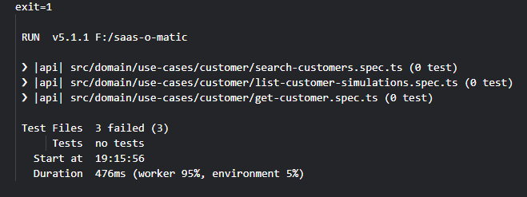
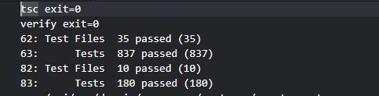

# 004-customers — Fase 7 (2026-11-24, sesión 18)

La sesión principal abre este registro al recibir el retorno de la T-04 con su fase roja. `/sdd-session` lo completa al cerrar la tarea.

## Objetivo y fase
- Fase 7, spec `004-customers`, puerta 5 (implementación), con `/sdd-implement`.
- Tarea T-04: domain, casos de uso de lectura.
- Implementer con Opus 5.5 y encargo sin enseñar antes (ADR-016, puntos 4 y 6).
- La spec sigue en `En implementación`.

## Prompts clave
> /sdd-implement 004-customers

> Sí, confirmo la T-04 con Opus 5.5, como quedó en tasks.md. Pide al implementer la salida íntegra del rojo, sin abreviar ni reescribir ninguna línea, y que no toque ningún fichero fuera de los tres de producción y los tres tests de la T-04. Pide también `npx tsc -p apps/api/tsconfig.json --noEmit` con su código de salida.

> Apruebo la T-04 (domain: casos de uso de lectura) con las desviaciones 1 a 4 aceptadas. Rojo no repetido por mi regla (es «Cannot find module»); en el registro, los signos reales. Marca [x] la T-04 y sus casillas, con mi aprobación literal en tasks.md; actualiza MEMORY.md (máximo 50 líneas) con la T-04 hecha y verify en 837 + 180, y enséñame su diff. Yo lanzo /sdd-session 7 004-customers y luego te doy el OK al commit, sin Co-Authored-By.

> /sdd-session 7 004-customers

> Sí, guárdalo; ya he hecho las dos capturas con esos nombres.

## Línea base (sesión principal, antes de lanzar)
- `npx tsc -p apps/api/tsconfig.json --noEmit`: salida vacía, código 0.
- `npm run verify`: código 0. Raíz: «Tests  824 passed (824)». Web: «Tests  180 passed (180)».

## Fase roja (retorno del implementer)
Comando: `npx vitest run --project api search-customers.spec get-customer.spec list-customer-simulations.spec`, con código de salida 1.

La sesión principal la copia de su fichero de salida en el scratchpad, que coincide con el retorno. En el retorno, el comando venía con `&gt;` y `&amp;`; aquí se escribe con los signos reales. El implementer declara una primera ejecución idéntica a las 19:15:56, con la redirección mal ordenada; la que va aquí es la segunda.

````

 RUN  v5.1.1 F:/saas-o-matic

 ❯ |api| src/domain/use-cases/customer/get-customer.spec.ts (0 test)
 ❯ |api| src/domain/use-cases/customer/list-customer-simulations.spec.ts (0 test)
 ❯ |api| src/domain/use-cases/customer/search-customers.spec.ts (0 test)

⎯⎯⎯⎯⎯⎯ Failed Suites 3 ⎯⎯⎯⎯⎯⎯⎯

 FAIL  |api| src/domain/use-cases/customer/get-customer.spec.ts [ apps/api/src/domain/use-cases/customer/get-customer.spec.ts ]
Error: Cannot find module './get-customer.js' imported from F:/saas-o-matic/apps/api/src/domain/use-cases/customer/get-customer.spec.ts
 ❯ src/domain/use-cases/customer/get-customer.spec.ts:6:1
      4| import { CustomError } from '../../errors/custom.error.js';
      5| import type { CustomerRepository } from '../../repository/customer.rep…
      6| import { GetCustomer } from './get-customer.js';
       | ^
      7|
      8| // Caso de uso de lectura de un cliente con un repositorio falso, sin …

⎯⎯⎯⎯⎯⎯⎯⎯⎯⎯⎯⎯⎯⎯⎯⎯⎯⎯⎯⎯⎯⎯⎯⎯[1/3]⎯

 FAIL  |api| src/domain/use-cases/customer/list-customer-simulations.spec.ts [ apps/api/src/domain/use-cases/customer/list-customer-simulations.spec.ts ]
Error: Cannot find module './list-customer-simulations.js' imported from F:/saas-o-matic/apps/api/src/domain/use-cases/customer/list-customer-simulations.spec.ts
 ❯ src/domain/use-cases/customer/list-customer-simulations.spec.ts:7:1
      5| import { CustomError } from '../../errors/custom.error.js';
      6| import type { CustomerRepository } from '../../repository/customer.rep…
      7| import { ListCustomerSimulations } from './list-customer-simulations.j…
       | ^
      8|
      9| // Caso de uso del historial de un cliente con un repositorio falso, s…

⎯⎯⎯⎯⎯⎯⎯⎯⎯⎯⎯⎯⎯⎯⎯⎯⎯⎯⎯⎯⎯⎯⎯⎯[2/3]⎯

 FAIL  |api| src/domain/use-cases/customer/search-customers.spec.ts [ apps/api/src/domain/use-cases/customer/search-customers.spec.ts ]
Error: Cannot find module './search-customers.js' imported from F:/saas-o-matic/apps/api/src/domain/use-cases/customer/search-customers.spec.ts
 ❯ src/domain/use-cases/customer/search-customers.spec.ts:5:1
      3| import type { CustomerWithLastSimulation } from '../../entities/custom…
      4| import type { CustomerRepository } from '../../repository/customer.rep…
      5| import { SearchCustomers } from './search-customers.js';
       | ^
      6|
      7| // Caso de uso de búsqueda con un repositorio falso, sin base ni Expre…

⎯⎯⎯⎯⎯⎯⎯⎯⎯⎯⎯⎯⎯⎯⎯⎯⎯⎯⎯⎯⎯⎯⎯⎯[3/3]⎯


 Test Files  3 failed (3)
      Tests  no tests
   Start at  19:16:05
   Duration  488ms (worker 95%, environment 5%)

````

## Verde (retorno del implementer, comprobado en su fichero de salida)
- `npx tsc -p apps/api/tsconfig.json --noEmit`: salida vacía, código 0.
- `npm run verify`: código 0.
  - Raíz: «Test Files  35 passed (35)» y «Tests  837 passed (837)». Antes eran 824; hay 13 nuevos (8 + 2 + 3).
  - Web: «Tests  180 passed (180)», sin cambios.

## Qué propuso la IA
- **Antes de lanzar:**
  - Leyó el `Estado:` literal de `spec.md` («En implementación»).
  - Vio en `tasks.md` que la T-01 a la T-03 estaban en `[x]` y el resto en `[ ]`.
  - Propuso la T-04 con Opus 5.5, el modelo que fija la tarea, y esperó tu confirmación.
- **Línea base:** `npm run verify` (824 + 180) y `tsc --noEmit` (código 0), con el árbol limpio. La salida de `verify` se guardó en el scratchpad.
- **Encargo del implementer, sin enseñar antes (ADR-016):**
  - tu petición literal;
  - la D-05 y la D-07 (`plan.md:143-169`) y las reglas comunes de `tasks.md`;
  - la fila literal de la T-04;
  - las rutas acotadas, con `backend-conventions`;
  - la salida literal de la línea base;
  - tus tres exigencias: el rojo íntegro con su comando, solo los seis ficheros de la tarea (más `tasks.md` para dejarla en `[~]`) y `tsc` con su código de salida.
- **Al volver:**
  - `git status` y `git diff --stat`: solo los seis ficheros nuevos y la línea «Estado» de `tasks.md`.
  - Comprobó que el rojo del fichero de salida coincidía con el retorno.
  - Comprobó los recuentos en el fichero de `verify` (837 + 180) y los `import` de producción con `git grep --untracked`.
  - Leyó los tres casos de uso, que siguen la D-05 y la D-07.
  - Contó 13 tests (un `it.each` de 3 y 5 `it`, 2 y 3), sin `skip`, `todo` ni `.only`.
  - Abrió este registro con el rojo copiado del fichero y avisó de que el comando venía con `&gt;` y `&amp;` en el retorno.
  - No repitió el rojo, por tu regla de la T-01 de la 004.
- **Tras la aprobación:**
  - en `tasks.md`, la T-04 en `[x]` con sus 5 casillas, tu aprobación literal, las desviaciones 1 a 4 y el recuento;
  - en `MEMORY.md`, la T-04 hecha y `verify` en 837 + 180 dentro de una línea que ya existía, en 50 líneas (comprobado con `wc -l`), y su diff.

## Qué corregí y por qué
- **Instrucciones previas:** antes de lanzar pediste exigirle al implementer el rojo íntegro, no tocar más ficheros que los seis de la tarea y la salida de `tsc` con su código. Así quedó en el encargo.
- **Sin otras correcciones:** aprobaste sin cambios (no registrado otro motivo).

## Decisiones tomadas
- **T-04 aprobada** con las desviaciones 1 a 4, con tu aprobación literal en `tasks.md`:
  1. R-158 sin test en `SearchCustomers`, porque el DTO no deja llegar a él; C-158 ya lo cubre en la T-01.
  2. Tests que la tarea no enumera, dentro de los 13.
  3. `SearchCustomers` ordena una copia sin mutar el array del repositorio.
  4. Textos «spec 004: no se espera …» de los falsos, con el patrón de la T-03.
- **Rojo:** no se repite en la sesión principal, por tu regla (es «Cannot find module»). Va en el registro con los signos reales.
- **Commit:** el de cierre de esta sesión.

## Capturas
- En esta sesión no se anunció ninguna línea `CAPTURA:`. Las dos capturas las guardó el autor, con los nombres que propuso `/sdd-session`.




## Pendiente para la siguiente sesión
- **T-05** (presentation: lecturas, ruta inexistente y textos), con Opus 5.5 según `tasks.md`. Lleva fase roja.
