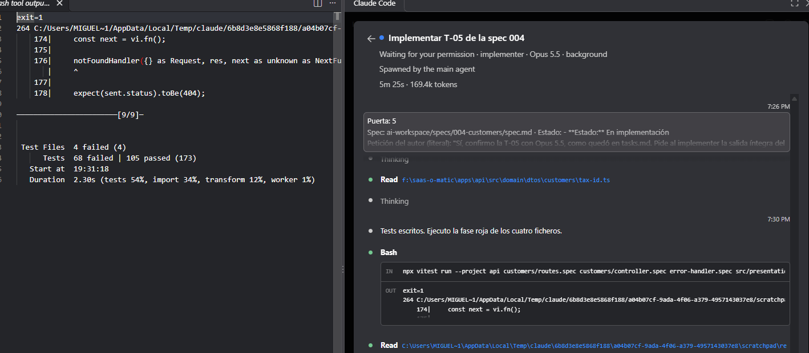
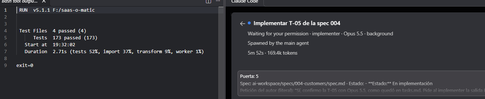

# 004-customers — Fase 7 (2026-11-24, sesión 19)

La sesión principal abre este registro al recibir el retorno de la T-05 con su fase roja. `/sdd-session` lo completa al cerrar la tarea.

## Objetivo y fase
- Fase 7, spec `004-customers`, puerta 5 (implementación), con `/sdd-implement`.
- Tarea T-05: presentation, lecturas, ruta inexistente y textos.
- Implementer con Opus 5.5 y encargo sin enseñar antes (ADR-016, puntos 4 y 6).
- La spec sigue en `En implementación`.

## Prompts clave
> /sdd-implement 004-customers

> /sdd-implement 004-customers

> Sí, confirmo la T-05 con Opus 5.5, como quedó en tasks.md. Pide al implementer la salida íntegra del rojo, sin abreviar ni reescribir ninguna línea, y que no toque ningún fichero fuera de los cuatro de producción y los cuatro tests de la T-05. Pide también `npx tsc -p apps/api/tsconfig.json --noEmit` con su código de salida, y el `git diff` de los tests de la 002 y la 003 que toque.

> Apruebo la T-05 (presentation: lecturas, ruta inexistente y textos) con las desviaciones 1 a 5 aceptadas. Las capturas fase-7-004-t05-rojo y fase-7-004-t05-verde son mías, no del implementer. No repitas el rojo: los fallos son «Unexpected token '<'» y «is not a function», y el único AssertionError falla solo porque el export aún no existía. Rojo copiado de red.txt (264 líneas) al registro, con los signos reales.
> Marca [x] la T-05 y sus casillas, con mi aprobación literal en tasks.md; actualiza MEMORY.md (máximo 50 líneas) con la T-05 hecha y verify en 905 + 180, y enséñame su diff. Yo lanzo /sdd-session 7 004-customers y luego te doy el OK al commit, sin Co-Authored-By.

> /sdd-session 7 004-customers

> Sí, guárdalo; las capturas son mías y están bien.

## Línea base (sesión principal, antes de lanzar)
- `npx tsc -p apps/api/tsconfig.json --noEmit`: salida vacía, código 0.
- `npm run verify`: código 0. Raíz: «Tests  837 passed (837)». Web: «Tests  180 passed (180)».

## Fase roja (retorno del implementer)
Comando: `npx vitest run --project api customers/routes.spec customers/controller.spec error-handler.spec src/presentation/routes.spec`, con código de salida 1.

La sesión principal la copia de su fichero de salida en el scratchpad (`red.txt`, 264 líneas), sin tocar ninguna línea. El retorno solo daba el final y las razones del fallo, con `&lt;` en lugar de `<`; el fichero trae los signos reales.

````

 RUN  v5.1.1 F:/saas-o-matic

 ❯ |api| src/presentation/middlewares/error-handler.spec.ts (14 tests | 2 failed) 24ms
   ❯ notFoundHandler (2)
     × spec 004: ROUTE_NOT_FOUND_MESSAGE es «No existe la ruta indicada.» (D-08) 7ms
     × spec 004: responde 404 NOT_FOUND con «No existe la ruta indicada.», sin details y sin llamar a next (R-14) 1ms
 ❯ |api| src/presentation/customers/controller.spec.ts (85 tests | 14 failed) 66ms
   ❯ spec 004: CustomerController, lecturas (14)
     × spec 004: search con q válido → 200 con el array del caso de uso en la raíz (R-03) 7ms
     × spec 004: findById con un id válido → 200 con el cliente en la raíz (R-79) 1ms
     × spec 004: listSimulations con un id válido → 200 con el array en la raíz (R-04) 1ms
     × spec 004: findById sin el cliente → 404 NOT_FOUND con «No existe el cliente indicado.», sin details (R-10) 1ms
     × spec 004: listSimulations sin el cliente → 404 NOT_FOUND con «No existe el cliente indicado.», sin details (R-10) 1ms
     ❯ spec 004: C-08 (R-08): con un parámetro no válido no se llama al repositorio (6)
       × search con q repetido: 400 VALIDATION_ERROR y ninguna llamada al repositorio 0ms
       × search con un parámetro desconocido: 400 VALIDATION_ERROR y ninguna llamada al repositorio 0ms
       × findById con id abc: 400 VALIDATION_ERROR y ninguna llamada al repositorio 0ms
       × findById con un parámetro de consulta: 400 VALIDATION_ERROR y ninguna llamada al repositorio 0ms
       × listSimulations con id 0: 400 VALIDATION_ERROR y ninguna llamada al repositorio 0ms
       × listSimulations con id 01: 400 VALIDATION_ERROR y ninguna llamada al repositorio 0ms
     × spec 004: C-11 (R-11): search con el repositorio que lanza Error → 500 INTERNAL_ERROR, sin traza ni mensaje interno 0ms
     × spec 004: C-11 (R-11): findById con el repositorio que lanza Error → 500 INTERNAL_ERROR, sin traza ni mensaje interno 0ms
     × spec 004: C-11 (R-11): listSimulations con el repositorio que lanza Error → 500 INTERNAL_ERROR, sin traza ni mensaje interno 0ms
 ❯ |api| src/presentation/routes.spec.ts (7 tests | 3 failed) 132ms
   ❯ createRoutes (7)
     × spec 004: C-14 (R-14): GET /no-existe da 404 NOT_FOUND en JSON con «No existe la ruta indicada.», sin details 11ms
     × spec 004: C-14 (R-14): DELETE /customers da 404 NOT_FOUND en JSON con «No existe la ruta indicada.», sin details 11ms
     × spec 004: C-14 (R-14): GET /api/health da 404 NOT_FOUND en JSON con «No existe la ruta indicada.», sin details 10ms
 ❯ |api| src/presentation/customers/routes.spec.ts (67 tests | 49 failed) 1428ms
   ❯ spec 004: GET /customers (18)
     × spec 004: C-03 y C-80 (R-03, R-80): 200 con los dos clientes en la raíz, iguales a su 201 y lastSimulation null 14ms
     × spec 004: C-05 (R-05): lastSimulation es la de 40 usuarios, creada después de la de 15, con sus diez campos 30ms
     × spec 004: C-06 (R-06): ES con 15 usuarios se lee con 14000, 2100, 2940 y 16940, iguales a los guardados 11ms
     × spec 004: C-07 (R-07): claves en camelCase e ids e importes enteros en las tres lecturas 22ms
     × spec 004: C-12 (R-12): búsquedas con ', %, _ y una inyección responden 200 y la tabla sigue existiendo 9ms
     × spec 004: C-16 (R-16): «Acme» y «B58818501» devuelven Acme y no Lusa 27ms
     × spec 004: C-17 (R-17): «Telecom», «S.L.» y «8818» encuentran «Acme Telecom S.L.» 9ms
     × spec 004: C-18 (R-18): alfa, Álvaro, beta y los dos Gamma por id; «a-b» antes que «ab c» 85ms
     × spec 004: C-19 (R-19): 30 clientes que coinciden salen en una sola respuesta, sin campos de página 408ms
     × spec 004: C-20 (R-20): sin q, con q vacío y con q de blancos, todos los clientes en el orden de R-18 16ms
     × spec 004: C-87 (R-87): «%20Acme%20» y «Acme» dan el mismo resultado 35ms
     × spec 004: C-88 (R-88): ?q=a&q=b da 400 con un INVALID_TYPE en q 7ms
     × spec 004: C-89 (R-89): q de 200 da 200; de 201, 400 TOO_BIG en q; de 200 con dos espacios a cada lado, 200 7ms
     × spec 004: C-90 (R-90): ?foo=1 da 400 con un UNKNOWN_FIELD en foo 8ms
     × spec 004: C-91 (R-91): sin mayúsculas ni tildes; «nandu facades» encuentra «Ñandú Façades» 25ms
     × spec 004: C-92 (R-92): «12.345.678-z» y «5678z» encuentran 12345678Z 32ms
     × spec 004: C-93 (R-93): «100%» solo encuentra «100% Cloud» y «a_L», solo «Data_Lab» 50ms
     × spec 004: C-94 (R-94): «.» solo encuentra «Acme S.L.»; el identificador no participa 11ms
   ❯ spec 004: GET /customers/:id (18)
     × spec 004: C-79 (R-79): 200 con el cliente en la raíz, solo los siete campos de su 201 y sin lastSimulation 24ms
     × spec 004: C-10 (R-10): un id que no existe da 404 NOT_FOUND con «No existe el cliente indicado.», sin details 7ms
     × spec 004: C-83 (R-83): 0 da 400 con un elemento en id 5ms
     × spec 004: C-83 (R-83): -1 da 400 con un elemento en id 8ms
     × spec 004: C-84 (R-84): 9007199254740992 da 400 con un elemento en id 5ms
     × spec 004: C-85 (R-85): abc da 400 con un elemento en id 5ms
     × spec 004: C-85 (R-85): 1.5 da 400 con un elemento en id 6ms
     × spec 004: C-86 (R-86): +1 da 400 con un elemento en id 5ms
     × spec 004: C-86 (R-86): 1e3 da 400 con un elemento en id 6ms
     × spec 004: C-86 (R-86): 0x10 da 400 con un elemento en id 7ms
     × spec 004: C-86 (R-86): %201 da 400 con un elemento en id 5ms
     × spec 004: C-156 (R-156): 01 da 400 con un elemento en id 6ms
     × spec 004: C-156 (R-156): 1.0 da 400 con un elemento en id 6ms
     × spec 004: C-157 (R-157): -1.5 da 400 con un elemento en id 5ms
     × spec 004: C-157 (R-157): 9007199254740992.5 da 400 con un elemento en id 7ms
     × spec 004: C-84 (R-84): 9007199254740991 es válido y, sin ese cliente, da el 404 de R-10 6ms
     × spec 004: C-90 (R-90): /customers/1?q=a da 400 con un UNKNOWN_FIELD en q 10ms
     × spec 004: C-09 (R-09): /customers/abc?foo=1 da 400 con id (INVALID_TYPE) y foo (UNKNOWN_FIELD) 6ms
   ❯ spec 004: GET /customers/:id/simulations (8)
     × spec 004: C-04 y C-82 (R-04, R-82): 200 con sus simulaciones, iguales a su 201, de la más reciente a la más antigua 73ms
     × spec 004: C-81 (R-81): un cliente sin simulaciones da 200 [] 12ms
     × spec 004: C-163 (R-10): /customers/999/simulations sin cliente 999 da 404 y no 200 [] 7ms
     × spec 004: C-164 (R-83): 0 da 400 con un elemento en id 7ms
     × spec 004: C-165 (R-85): abc da 400 con un elemento en id 5ms
     × spec 004: C-166 (R-156): 01 da 400 con un elemento en id 6ms
     × spec 004: C-167 (R-85): 1.5 da 400 con un elemento en id 5ms
     × spec 004: C-90 (R-90): /customers/1/simulations?x=1 da 400 con un UNKNOWN_FIELD en x 5ms
   ❯ spec 004: C-15 (R-15): textos de los errores de las lecturas (5)
     × spec 004: /customers/0 da VALIDATION_ERROR con «Hay datos no válidos.» y el texto de TOO_SMALL 6ms
     × spec 004: /customers/9007199254740992 da VALIDATION_ERROR con «Hay datos no válidos.» y el texto de TOO_BIG 5ms
     × spec 004: /customers/abc da VALIDATION_ERROR con «Hay datos no válidos.» y el texto de INVALID_TYPE 5ms
     × spec 004: /customers?foo=1 da VALIDATION_ERROR con «Hay datos no válidos.» y el texto de UNKNOWN_FIELD 5ms
     × spec 004: el NOT_FOUND del cliente lleva «No existe el cliente indicado.» 5ms

⎯⎯⎯⎯⎯⎯ Failed Tests 68 ⎯⎯⎯⎯⎯⎯⎯

 FAIL  |api| src/presentation/routes.spec.ts > createRoutes > spec 004: C-14 (R-14): GET /no-existe da 404 NOT_FOUND en JSON con «No existe la ruta indicada.», sin details
 FAIL  |api| src/presentation/routes.spec.ts > createRoutes > spec 004: C-14 (R-14): DELETE /customers da 404 NOT_FOUND en JSON con «No existe la ruta indicada.», sin details
 FAIL  |api| src/presentation/routes.spec.ts > createRoutes > spec 004: C-14 (R-14): GET /api/health da 404 NOT_FOUND en JSON con «No existe la ruta indicada.», sin details
 FAIL  |api| src/presentation/customers/routes.spec.ts > spec 004: GET /customers > spec 004: C-03 y C-80 (R-03, R-80): 200 con los dos clientes en la raíz, iguales a su 201 y lastSimulation null
 FAIL  |api| src/presentation/customers/routes.spec.ts > spec 004: GET /customers > spec 004: C-05 (R-05): lastSimulation es la de 40 usuarios, creada después de la de 15, con sus diez campos
 FAIL  |api| src/presentation/customers/routes.spec.ts > spec 004: GET /customers > spec 004: C-06 (R-06): ES con 15 usuarios se lee con 14000, 2100, 2940 y 16940, iguales a los guardados
 FAIL  |api| src/presentation/customers/routes.spec.ts > spec 004: GET /customers > spec 004: C-07 (R-07): claves en camelCase e ids e importes enteros en las tres lecturas
 FAIL  |api| src/presentation/customers/routes.spec.ts > spec 004: GET /customers > spec 004: C-12 (R-12): búsquedas con ', %, _ y una inyección responden 200 y la tabla sigue existiendo
 FAIL  |api| src/presentation/customers/routes.spec.ts > spec 004: GET /customers > spec 004: C-16 (R-16): «Acme» y «B58818501» devuelven Acme y no Lusa
 FAIL  |api| src/presentation/customers/routes.spec.ts > spec 004: GET /customers > spec 004: C-17 (R-17): «Telecom», «S.L.» y «8818» encuentran «Acme Telecom S.L.»
 FAIL  |api| src/presentation/customers/routes.spec.ts > spec 004: GET /customers > spec 004: C-18 (R-18): alfa, Álvaro, beta y los dos Gamma por id; «a-b» antes que «ab c»
 FAIL  |api| src/presentation/customers/routes.spec.ts > spec 004: GET /customers > spec 004: C-19 (R-19): 30 clientes que coinciden salen en una sola respuesta, sin campos de página
 FAIL  |api| src/presentation/customers/routes.spec.ts > spec 004: GET /customers > spec 004: C-20 (R-20): sin q, con q vacío y con q de blancos, todos los clientes en el orden de R-18
 FAIL  |api| src/presentation/customers/routes.spec.ts > spec 004: GET /customers > spec 004: C-87 (R-87): «%20Acme%20» y «Acme» dan el mismo resultado
 FAIL  |api| src/presentation/customers/routes.spec.ts > spec 004: GET /customers > spec 004: C-88 (R-88): ?q=a&q=b da 400 con un INVALID_TYPE en q
 FAIL  |api| src/presentation/customers/routes.spec.ts > spec 004: GET /customers > spec 004: C-89 (R-89): q de 200 da 200; de 201, 400 TOO_BIG en q; de 200 con dos espacios a cada lado, 200
 FAIL  |api| src/presentation/customers/routes.spec.ts > spec 004: GET /customers > spec 004: C-90 (R-90): ?foo=1 da 400 con un UNKNOWN_FIELD en foo
 FAIL  |api| src/presentation/customers/routes.spec.ts > spec 004: GET /customers > spec 004: C-91 (R-91): sin mayúsculas ni tildes; «nandu facades» encuentra «Ñandú Façades»
 FAIL  |api| src/presentation/customers/routes.spec.ts > spec 004: GET /customers > spec 004: C-92 (R-92): «12.345.678-z» y «5678z» encuentran 12345678Z
 FAIL  |api| src/presentation/customers/routes.spec.ts > spec 004: GET /customers > spec 004: C-93 (R-93): «100%» solo encuentra «100% Cloud» y «a_L», solo «Data_Lab»
 FAIL  |api| src/presentation/customers/routes.spec.ts > spec 004: GET /customers > spec 004: C-94 (R-94): «.» solo encuentra «Acme S.L.»; el identificador no participa
 FAIL  |api| src/presentation/customers/routes.spec.ts > spec 004: GET /customers/:id > spec 004: C-79 (R-79): 200 con el cliente en la raíz, solo los siete campos de su 201 y sin lastSimulation
 FAIL  |api| src/presentation/customers/routes.spec.ts > spec 004: GET /customers/:id > spec 004: C-10 (R-10): un id que no existe da 404 NOT_FOUND con «No existe el cliente indicado.», sin details
 FAIL  |api| src/presentation/customers/routes.spec.ts > spec 004: GET /customers/:id > spec 004: C-83 (R-83): 0 da 400 con un elemento en id
 FAIL  |api| src/presentation/customers/routes.spec.ts > spec 004: GET /customers/:id > spec 004: C-83 (R-83): -1 da 400 con un elemento en id
 FAIL  |api| src/presentation/customers/routes.spec.ts > spec 004: GET /customers/:id > spec 004: C-84 (R-84): 9007199254740992 da 400 con un elemento en id
 FAIL  |api| src/presentation/customers/routes.spec.ts > spec 004: GET /customers/:id > spec 004: C-85 (R-85): abc da 400 con un elemento en id
 FAIL  |api| src/presentation/customers/routes.spec.ts > spec 004: GET /customers/:id > spec 004: C-85 (R-85): 1.5 da 400 con un elemento en id
 FAIL  |api| src/presentation/customers/routes.spec.ts > spec 004: GET /customers/:id > spec 004: C-86 (R-86): +1 da 400 con un elemento en id
 FAIL  |api| src/presentation/customers/routes.spec.ts > spec 004: GET /customers/:id > spec 004: C-86 (R-86): 1e3 da 400 con un elemento en id
 FAIL  |api| src/presentation/customers/routes.spec.ts > spec 004: GET /customers/:id > spec 004: C-86 (R-86): 0x10 da 400 con un elemento en id
 FAIL  |api| src/presentation/customers/routes.spec.ts > spec 004: GET /customers/:id > spec 004: C-86 (R-86): %201 da 400 con un elemento en id
 FAIL  |api| src/presentation/customers/routes.spec.ts > spec 004: GET /customers/:id > spec 004: C-156 (R-156): 01 da 400 con un elemento en id
 FAIL  |api| src/presentation/customers/routes.spec.ts > spec 004: GET /customers/:id > spec 004: C-156 (R-156): 1.0 da 400 con un elemento en id
 FAIL  |api| src/presentation/customers/routes.spec.ts > spec 004: GET /customers/:id > spec 004: C-157 (R-157): -1.5 da 400 con un elemento en id
 FAIL  |api| src/presentation/customers/routes.spec.ts > spec 004: GET /customers/:id > spec 004: C-157 (R-157): 9007199254740992.5 da 400 con un elemento en id
 FAIL  |api| src/presentation/customers/routes.spec.ts > spec 004: GET /customers/:id > spec 004: C-84 (R-84): 9007199254740991 es válido y, sin ese cliente, da el 404 de R-10
 FAIL  |api| src/presentation/customers/routes.spec.ts > spec 004: GET /customers/:id > spec 004: C-90 (R-90): /customers/1?q=a da 400 con un UNKNOWN_FIELD en q
 FAIL  |api| src/presentation/customers/routes.spec.ts > spec 004: GET /customers/:id > spec 004: C-09 (R-09): /customers/abc?foo=1 da 400 con id (INVALID_TYPE) y foo (UNKNOWN_FIELD)
 FAIL  |api| src/presentation/customers/routes.spec.ts > spec 004: GET /customers/:id/simulations > spec 004: C-04 y C-82 (R-04, R-82): 200 con sus simulaciones, iguales a su 201, de la más reciente a la más antigua
 FAIL  |api| src/presentation/customers/routes.spec.ts > spec 004: GET /customers/:id/simulations > spec 004: C-81 (R-81): un cliente sin simulaciones da 200 []
 FAIL  |api| src/presentation/customers/routes.spec.ts > spec 004: GET /customers/:id/simulations > spec 004: C-163 (R-10): /customers/999/simulations sin cliente 999 da 404 y no 200 []
 FAIL  |api| src/presentation/customers/routes.spec.ts > spec 004: GET /customers/:id/simulations > spec 004: C-164 (R-83): 0 da 400 con un elemento en id
 FAIL  |api| src/presentation/customers/routes.spec.ts > spec 004: GET /customers/:id/simulations > spec 004: C-165 (R-85): abc da 400 con un elemento en id
 FAIL  |api| src/presentation/customers/routes.spec.ts > spec 004: GET /customers/:id/simulations > spec 004: C-166 (R-156): 01 da 400 con un elemento en id
 FAIL  |api| src/presentation/customers/routes.spec.ts > spec 004: GET /customers/:id/simulations > spec 004: C-167 (R-85): 1.5 da 400 con un elemento en id
 FAIL  |api| src/presentation/customers/routes.spec.ts > spec 004: GET /customers/:id/simulations > spec 004: C-90 (R-90): /customers/1/simulations?x=1 da 400 con un UNKNOWN_FIELD en x
 FAIL  |api| src/presentation/customers/routes.spec.ts > spec 004: C-15 (R-15): textos de los errores de las lecturas > spec 004: /customers/0 da VALIDATION_ERROR con «Hay datos no válidos.» y el texto de TOO_SMALL
 FAIL  |api| src/presentation/customers/routes.spec.ts > spec 004: C-15 (R-15): textos de los errores de las lecturas > spec 004: /customers/9007199254740992 da VALIDATION_ERROR con «Hay datos no válidos.» y el texto de TOO_BIG
 FAIL  |api| src/presentation/customers/routes.spec.ts > spec 004: C-15 (R-15): textos de los errores de las lecturas > spec 004: /customers/abc da VALIDATION_ERROR con «Hay datos no válidos.» y el texto de INVALID_TYPE
 FAIL  |api| src/presentation/customers/routes.spec.ts > spec 004: C-15 (R-15): textos de los errores de las lecturas > spec 004: /customers?foo=1 da VALIDATION_ERROR con «Hay datos no válidos.» y el texto de UNKNOWN_FIELD
 FAIL  |api| src/presentation/customers/routes.spec.ts > spec 004: C-15 (R-15): textos de los errores de las lecturas > spec 004: el NOT_FOUND del cliente lleva «No existe el cliente indicado.»
SyntaxError: Unexpected token '<', "<!DOCTYPE "... is not valid JSON
⎯⎯⎯⎯⎯⎯⎯⎯⎯⎯⎯⎯⎯⎯⎯⎯⎯⎯⎯⎯⎯⎯⎯⎯[1/9]⎯

 FAIL  |api| src/presentation/customers/controller.spec.ts > spec 004: CustomerController, lecturas > spec 004: search con q válido → 200 con el array del caso de uso en la raíz (R-03)
TypeError: controller[handler] is not a function
 ❯ read src/presentation/customers/controller.spec.ts:266:28
    264| ) {
    265|   const { res, sent } = fakeResponse();
    266|   await controller[handler]({ params: request.params ?? {}, query: req…
       |                            ^
    267|   return sent;
    268| }
 ❯ src/presentation/customers/controller.spec.ts:274:24

⎯⎯⎯⎯⎯⎯⎯⎯⎯⎯⎯⎯⎯⎯⎯⎯⎯⎯⎯⎯⎯⎯⎯⎯[2/9]⎯

 FAIL  |api| src/presentation/customers/controller.spec.ts > spec 004: CustomerController, lecturas > spec 004: findById con un id válido → 200 con el cliente en la raíz (R-79)
TypeError: controller[handler] is not a function
 ❯ read src/presentation/customers/controller.spec.ts:266:28
    264| ) {
    265|   const { res, sent } = fakeResponse();
    266|   await controller[handler]({ params: request.params ?? {}, query: req…
       |                            ^
    267|   return sent;
    268| }
 ❯ src/presentation/customers/controller.spec.ts:284:24

⎯⎯⎯⎯⎯⎯⎯⎯⎯⎯⎯⎯⎯⎯⎯⎯⎯⎯⎯⎯⎯⎯⎯⎯[3/9]⎯

 FAIL  |api| src/presentation/customers/controller.spec.ts > spec 004: CustomerController, lecturas > spec 004: listSimulations con un id válido → 200 con el array en la raíz (R-04)
TypeError: controller[handler] is not a function
 ❯ read src/presentation/customers/controller.spec.ts:266:28
    264| ) {
    265|   const { res, sent } = fakeResponse();
    266|   await controller[handler]({ params: request.params ?? {}, query: req…
       |                            ^
    267|   return sent;
    268| }
 ❯ src/presentation/customers/controller.spec.ts:294:24

⎯⎯⎯⎯⎯⎯⎯⎯⎯⎯⎯⎯⎯⎯⎯⎯⎯⎯⎯⎯⎯⎯⎯⎯[4/9]⎯

 FAIL  |api| src/presentation/customers/controller.spec.ts > spec 004: CustomerController, lecturas > spec 004: findById sin el cliente → 404 NOT_FOUND con «No existe el cliente indicado.», sin details (R-10)
 FAIL  |api| src/presentation/customers/controller.spec.ts > spec 004: CustomerController, lecturas > spec 004: listSimulations sin el cliente → 404 NOT_FOUND con «No existe el cliente indicado.», sin details (R-10)
TypeError: controller[handler] is not a function
 ❯ read src/presentation/customers/controller.spec.ts:266:28
    264| ) {
    265|   const { res, sent } = fakeResponse();
    266|   await controller[handler]({ params: request.params ?? {}, query: req…
       |                            ^
    267|   return sent;
    268| }
 ❯ src/presentation/customers/controller.spec.ts:306:26

⎯⎯⎯⎯⎯⎯⎯⎯⎯⎯⎯⎯⎯⎯⎯⎯⎯⎯⎯⎯⎯⎯⎯⎯[5/9]⎯

 FAIL  |api| src/presentation/customers/controller.spec.ts > spec 004: CustomerController, lecturas > spec 004: C-08 (R-08): con un parámetro no válido no se llama al repositorio > search con q repetido: 400 VALIDATION_ERROR y ninguna llamada al repositorio
 FAIL  |api| src/presentation/customers/controller.spec.ts > spec 004: CustomerController, lecturas > spec 004: C-08 (R-08): con un parámetro no válido no se llama al repositorio > search con un parámetro desconocido: 400 VALIDATION_ERROR y ninguna llamada al repositorio
 FAIL  |api| src/presentation/customers/controller.spec.ts > spec 004: CustomerController, lecturas > spec 004: C-08 (R-08): con un parámetro no válido no se llama al repositorio > findById con id abc: 400 VALIDATION_ERROR y ninguna llamada al repositorio
 FAIL  |api| src/presentation/customers/controller.spec.ts > spec 004: CustomerController, lecturas > spec 004: C-08 (R-08): con un parámetro no válido no se llama al repositorio > findById con un parámetro de consulta: 400 VALIDATION_ERROR y ninguna llamada al repositorio
 FAIL  |api| src/presentation/customers/controller.spec.ts > spec 004: CustomerController, lecturas > spec 004: C-08 (R-08): con un parámetro no válido no se llama al repositorio > listSimulations con id 0: 400 VALIDATION_ERROR y ninguna llamada al repositorio
 FAIL  |api| src/presentation/customers/controller.spec.ts > spec 004: CustomerController, lecturas > spec 004: C-08 (R-08): con un parámetro no válido no se llama al repositorio > listSimulations con id 01: 400 VALIDATION_ERROR y ninguna llamada al repositorio
TypeError: controller[handler] is not a function
 ❯ read src/presentation/customers/controller.spec.ts:266:28
    264| ) {
    265|   const { res, sent } = fakeResponse();
    266|   await controller[handler]({ params: request.params ?? {}, query: req…
       |                            ^
    267|   return sent;
    268| }
 ❯ src/presentation/customers/controller.spec.ts:325:26

⎯⎯⎯⎯⎯⎯⎯⎯⎯⎯⎯⎯⎯⎯⎯⎯⎯⎯⎯⎯⎯⎯⎯⎯[6/9]⎯

 FAIL  |api| src/presentation/customers/controller.spec.ts > spec 004: CustomerController, lecturas > spec 004: C-11 (R-11): search con el repositorio que lanza Error → 500 INTERNAL_ERROR, sin traza ni mensaje interno
 FAIL  |api| src/presentation/customers/controller.spec.ts > spec 004: CustomerController, lecturas > spec 004: C-11 (R-11): findById con el repositorio que lanza Error → 500 INTERNAL_ERROR, sin traza ni mensaje interno
 FAIL  |api| src/presentation/customers/controller.spec.ts > spec 004: CustomerController, lecturas > spec 004: C-11 (R-11): listSimulations con el repositorio que lanza Error → 500 INTERNAL_ERROR, sin traza ni mensaje interno
TypeError: controller[handler] is not a function
 ❯ read src/presentation/customers/controller.spec.ts:266:28
    264| ) {
    265|   const { res, sent } = fakeResponse();
    266|   await controller[handler]({ params: request.params ?? {}, query: req…
       |                            ^
    267|   return sent;
    268| }
 ❯ src/presentation/customers/controller.spec.ts:342:26

⎯⎯⎯⎯⎯⎯⎯⎯⎯⎯⎯⎯⎯⎯⎯⎯⎯⎯⎯⎯⎯⎯⎯⎯[7/9]⎯

 FAIL  |api| src/presentation/middlewares/error-handler.spec.ts > notFoundHandler > spec 004: ROUTE_NOT_FOUND_MESSAGE es «No existe la ruta indicada.» (D-08)
AssertionError: expected undefined to be 'No existe la ruta indicada.' // Object.is equality

- Expected:
"No existe la ruta indicada."

+ Received:
undefined

 ❯ src/presentation/middlewares/error-handler.spec.ts:169:37
    167|
    168|   it('spec 004: ROUTE_NOT_FOUND_MESSAGE es «No existe la ruta indicada…
    169|     expect(ROUTE_NOT_FOUND_MESSAGE).toBe(ROUTE_NOT_FOUND_TEXT);
       |                                     ^
    170|   });
    171|

⎯⎯⎯⎯⎯⎯⎯⎯⎯⎯⎯⎯⎯⎯⎯⎯⎯⎯⎯⎯⎯⎯⎯⎯[8/9]⎯

 FAIL  |api| src/presentation/middlewares/error-handler.spec.ts > notFoundHandler > spec 004: responde 404 NOT_FOUND con «No existe la ruta indicada.», sin details y sin llamar a next (R-14)
TypeError: notFoundHandler is not a function
 ❯ src/presentation/middlewares/error-handler.spec.ts:176:5
    174|     const next = vi.fn();
    175|
    176|     notFoundHandler({} as Request, res, next as unknown as NextFunctio…
       |     ^
    177|
    178|     expect(sent.status).toBe(404);

⎯⎯⎯⎯⎯⎯⎯⎯⎯⎯⎯⎯⎯⎯⎯⎯⎯⎯⎯⎯⎯⎯⎯⎯[9/9]⎯


 Test Files  4 failed (4)
      Tests  68 failed | 105 passed (173)
   Start at  19:31:18
   Duration  2.30s (tests 54%, import 34%, transform 12%, worker 1%)

````

## Verde (retorno del implementer, repetido por la sesión principal)
- `npx tsc -p apps/api/tsconfig.json --noEmit`: salida vacía, código 0.
- `npm run verify`: código 0.
  - Raíz: «Tests  905 passed (905)». Antes eran 837; hay 68 nuevos (49 + 14 + 2 + 3).
  - Web: «Tests  180 passed (180)», sin cambios.
- Tests de las specs 002 y 003 (C-01), contado con `git diff`: 113 líneas con `expect` añadidas (84 + 20 + 5 + 4) y 0 quitadas. Las únicas dos líneas quitadas son `import` ampliados, en `controller.spec.ts` y `error-handler.spec.ts`.
- C-21 y C-95: `git diff --stat HEAD -- apps/api/migrations/ ai-workspace/docs/database.md` vacío y 0 `CREATE INDEX` en el diff.

## Qué propuso la IA
- **Antes de lanzar:**
  - Leyó el `Estado:` literal de `spec.md` («En implementación»).
  - Vio en `tasks.md` que la T-01 a la T-04 estaban en `[x]`.
  - Propuso la T-05 con Opus 5.5, el modelo que fija la tarea, y esperó tu confirmación.
  - Volviste a lanzar `/sdd-implement` sin responder. No lo tomó como confirmación y repitió la propuesta.
- **Línea base:** `npm run verify` (837 + 180) y `tsc --noEmit` (código 0), con el árbol limpio. La salida de `verify` se guardó en el scratchpad.
- **Encargo del implementer, sin enseñar antes (ADR-016):**
  - tu petición literal;
  - la D-07, la D-08 (con su tabla de textos) y la D-16 de `plan.md`, literales;
  - las Decisiones 2026-11-24 #22 y #23, literales, y la #45 por su línea;
  - las reservas H-04 y H-15 y los riesgos 3 a 5;
  - la fila literal de la T-05;
  - las rutas acotadas, con `backend-conventions` y `architecture.md:84`;
  - la salida literal de la línea base;
  - tus exigencias: el rojo íntegro sin abreviar ni reescribir, solo los ocho ficheros de la tarea (más `tasks.md` para dejarla en `[~]`), `tsc` con su código de salida y el `git diff` de los tests de la 002 y la 003.
- **Al volver:**
  - `git status` y `git diff --stat`: solo los ocho ficheros y `tasks.md`, más dos capturas sin seguimiento que no eran del implementer. Te preguntó de quién eran.
  - Comprobó que `red.txt` tiene 264 líneas, con `<` real y ningún `&lt;`.
  - Repitió `tsc` (código 0) y `npm run verify` (905 + 180).
  - Contó las aserciones añadidas y quitadas con `git diff`, y que no hubiera `skip`, `todo` ni `xit`.
  - Abrió este registro con el rojo copiado de `red.txt`.
  - No repitió el rojo, por tu regla de la T-01 de la 004. Te preguntó si querías repetir el único test con `AssertionError`.
  - Pegaste en el chat su propio mensaje, sin nada tuyo. No lo tomó como aprobación y te volvió a pedir la aprobación explícita.
- **Tras la aprobación:**
  - en `tasks.md`, la T-05 en `[x]` con sus 9 casillas, tu aprobación literal, las desviaciones 1 a 5 y el recuento;
  - en `MEMORY.md`, la T-05 hecha y `verify` en 905 + 180 dentro de una línea que ya existía, y la siguiente tarea, la T-06; quitó de «Próximos pasos» el 404 de la ruta inexistente, que ya está hecho. Quedó en 50 líneas (comprobado con `wc -l`) y te enseñó su diff.

## Qué corregí y por qué
- **Instrucciones previas:** antes de lanzar pediste exigirle al implementer el rojo íntegro, no tocar más ficheros que los ocho de la tarea, `tsc` con su código y el `git diff` de los tests de la 002 y la 003. Así quedó en el encargo.
- **Rojo:** confirmaste que no se repite, ni siquiera el test con `AssertionError`, porque solo falla porque el export aún no existía.
- **Sin otras correcciones:** aprobaste sin cambios (no registrado otro motivo).

## Decisiones tomadas
- **T-05 aprobada** con las desviaciones 1 a 5, con tu aprobación literal en `tasks.md`:
  1. Tests que la tarea no enumera, dentro de los 68.
  2. `fakeReadRepository` nuevo en `controller.spec.ts`, sin cambiar el falso de la 002.
  3. C-05 y C-06 en integración con filas creadas por `POST /simulations`; las de mismo `created_at` e importes a mano siguen en el spec del datasource de la T-02.
  4. C-18 en un solo test con los siete nombres.
  5. Las dos capturas sin seguimiento son tuyas.
- **Rojo:** no se repite en la sesión principal, por tu regla (fallos «Unexpected token '<'» y «is not a function»; el único `AssertionError` es por el export que aún no existía). Va en el registro con los signos reales.
- **Bloque 1 (API de lectura, T-01 a T-05), completo.**
- **Commit:** el de cierre de esta sesión.

## Capturas
- En esta sesión no se anunció ninguna línea `CAPTURA:`. Las dos capturas las guardó el autor.




## Pendiente para la siguiente sesión
- **T-06** (web: tipos y servicio de búsqueda), con Opus 5.5 según `tasks.md`. Lleva fase roja. Es la primera del bloque 2 (buscador y dashboard).
