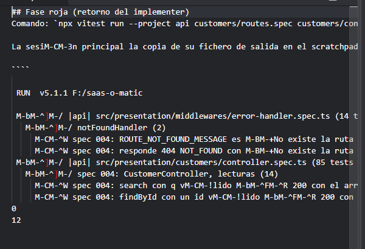
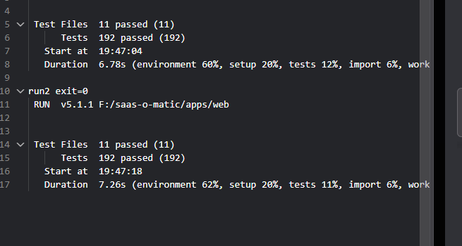

# 004-customers — Fase 7 (2026-11-24, sesión 20)

La sesión principal abre este registro al recibir el retorno de la T-06 con su fase roja. `/sdd-session` lo completa al cerrar la tarea.

## Objetivo y fase
- Fase 7, spec `004-customers`, puerta 5 (implementación), con `/sdd-implement`.
- Tarea T-06: web, tipos y servicio de búsqueda.
- Implementer con Opus 5.5 y encargo sin enseñar antes (ADR-016, puntos 4 y 6).
- La spec sigue en `En implementación`.

## Prompts clave
> /sdd-implement 004-customers

> Sí, confirmo la T-06 con Opus 5.5, como quedó en tasks.md. Pide al implementer la salida íntegra del rojo, sin abreviar ni reescribir ninguna línea, y que no toque ningún fichero fuera de los tres de producción y el test de la T-06. Pide también la salida de `npm run verify` con su código de salida.

> Apruebo la T-06 (web: tipos y servicio de búsqueda) con las desviaciones 1, 3, 4 y 5 aceptadas, y en la 2 elijo string para country y plan en Customer (no uniones de valores). El rojo es de compilación («Could not resolve», «Cannot find module»): no lo repitas; cópialo de red.txt al registro con los signos reales. Anota en el registro, para el revisor, el fallo puntual sin reproducir de la desviación 4 (una pasada de ng test con código 1 y salida cortada, y tres pasadas siguientes en verde); si se repite, se investiga. Las capturas fase-7-004-t06-rojo y t06-verde son mías.
> Marca [x] la T-06 y sus seis casillas, con mi aprobación literal en tasks.md; actualiza MEMORY.md (máximo 50 líneas) con la T-06 hecha y verify en 905 + 192, y enséñame su diff. Yo lanzo /sdd-session 7 004-customers y luego te doy el OK al commit, sin Co-Authored-By.

> /sdd-session 7 004-customers

> Sí, guárdalo; las capturas son mías y están bien.

## Línea base (sesión principal, antes de lanzar)
- `npm run verify`: código 0. Raíz: «Tests  905 passed (905)». Web: «Tests  180 passed (180)».

## Fase roja (retorno del implementer)
Comando: `npm run test -w apps/web`, con código de salida 1.

La sesión principal la copia de su fichero de salida en el scratchpad (`red.txt`, 43 líneas), sin cambiar el texto de ninguna línea. Con OK del autor, se quitaron solo los códigos de color ANSI (carácter ESC seguido de `[…m`) que `ng test` escribe al redirigir la salida, con `sed 's/\x1b\[[0-9;]*m//g'`; el resultado se comparó con `diff` contra `red.txt` sin colores y es idéntico. Los símbolos de dibujo de Angular (`❯`, `✔`, `│`, `╵`) se conservan. En el retorno del implementer los `>` venían escapados como `&gt;`; aquí van con el signo real, porque se copian del fichero.

````

> @saas-o-matic/web@0.0.0 test
> ng test

❯ Building...
✔ Building...
Application bundle generation failed. [4.202 seconds] - 2026-11-24T18:45:46.362Z

X [ERROR] Could not resolve "./customers-api"

    src/app/customers/services/customers-api.spec.ts:6:29:
      6 │ import { CustomersApi } from './customers-api';
        ╵                              ~~~~~~~~~~~~~~~~~


X [ERROR] TS2307: Cannot find module '../../shared/interfaces/customer' or its corresponding type declarations. [plugin angular-compiler]

    F:/saas-o-matic/apps/web/src/app/customers/services/customers-api.spec.ts:4:43:
      4 │ ...stomerWithLastSimulation } from '../../shared/interfaces/customer';
        ╵                                    ~~~~~~~~~~~~~~~~~~~~~~~~~~~~~~~~~~


X [ERROR] TS2307: Cannot find module '../../shared/interfaces/simulation' or its corresponding type declarations. [plugin angular-compiler]

    F:/saas-o-matic/apps/web/src/app/customers/services/customers-api.spec.ts:5:27:
      5 │ import { Simulation } from '../../shared/interfaces/simulation';
        ╵                            ~~~~~~~~~~~~~~~~~~~~~~~~~~~~~~~~~~~~


X [ERROR] TS2307: Cannot find module './customers-api' or its corresponding type declarations. [plugin angular-compiler]

    F:/saas-o-matic/apps/web/src/app/customers/services/customers-api.spec.ts:6:29:
      6 │ import { CustomersApi } from './customers-api';
        ╵                              ~~~~~~~~~~~~~~~~~


npm error Lifecycle script `test` failed with error:
npm error code 1
npm error path f:\saas-o-matic\apps\web
npm error workspace @saas-o-matic/web@0.0.0
npm error location f:\saas-o-matic\apps\web
npm error command failed
npm error command C:\WINDOWS\system32\cmd.exe /d /s /c ng test
````

## Verde (retorno del implementer, repetido por la sesión principal)
- `npm run verify` desde la raíz, repetido por la sesión principal: código 0. Raíz: «Tests  905 passed (905)». Web: «Test Files  11 passed (11)» y «Tests  192 passed (192)». 12 tests nuevos en `customers-api.spec.ts`.
- C-25: `git grep -n --untracked "HttpClient" -- apps/web/src/app/customers/` solo encuentra `customers-api.ts` (líneas 1, 11 y 14) y su test.

## Nota para el revisor: fallo puntual sin reproducir (desviación 4)
- Según el retorno del implementer, la primera pasada en verde de `npm run test -w apps/web` (redirigida a fichero) salió con código 1 y la salida cortada tras la línea «RUN v5.1.1». Las tres pasadas siguientes salieron con código 0 y 192 tests: una con `--reporters=verbose` y dos redirigidas como la primera. La causa no se conoce.
- La repetición de `npm run verify` por la sesión principal salió en verde (código 0, 905 + 192).
- Decisión del autor: se acepta como fallo puntual; si se repite, se investiga.

## Qué propuso la IA
- La sesión principal propuso la T-06 como siguiente tarea (primera del bloque 2, sin dependencias, Opus 5.5 según `tasks.md`) y ejecutar `npm run verify` antes de lanzar, para poner su salida literal en el encargo.
- Encargo al implementer con las condiciones del autor: rojo íntegro copiado del fichero de salida, solo los cuatro ficheros de la tarea (más el `Estado` de la T-06 en `tasks.md`) y `npm run verify` con su código de salida. El encargo dejaba fuera `detailState`, `loadDetail` e `isCanonicalCustomerId` (T-11).
- El implementer entregó `shared/interfaces/customer.ts`, `shared/interfaces/simulation.ts`, `customers/services/customers-api.ts` y `customers-api.spec.ts`, con 12 tests nuevos y cinco desviaciones:
  1. tests que la tarea no enumera;
  2. `country` y `plan` como `string`, que dejó para que decidiera el autor;
  3. campos `readonly`;
  4. un fallo puntual de `ng test` sin reproducir;
  5. la cita «(spec 000: T-16)».
- La sesión principal comprobó los límites con `git status` y `git diff --stat` (solo los ficheros permitidos, más la captura del autor y este registro), repitió `npm run verify` (905 + 192) y la comprobación de C-25. Copió el rojo de `red.txt` con los signos reales, aunque en el retorno venían como `&gt;`.
- Tras la aprobación: la T-06 en `[x]` con sus seis casillas y la aprobación literal en `tasks.md`, la nota de la desviación 4 en este registro, `MEMORY.md` al día (50 líneas) y el commit propuesto.

## Qué corregí y por qué
- Desviación 2: el autor elige `string` para `country` y `plan` en `Customer`, no uniones de valores. Motivo: (no registrado).
- Desviación 4: el autor pide anotar en el registro, para el revisor, el fallo puntual sin reproducir. Si se repite, se investiga.
- Rojo: el autor decide no repetirlo, porque es de compilación («Could not resolve», «Cannot find module»), y pide copiarlo de `red.txt` con los signos reales.
- Capturas: el autor indica que `fase-7-004-t06-rojo` y `fase-7-004-t06-verde` son suyas, no del implementer.

## Decisiones tomadas
- T-06 aprobada por el autor con las desviaciones 1, 3, 4 y 5 aceptadas y la 2 decidida en `string` (aprobación literal en `tasks.md`).
- Fallo puntual de `ng test` aceptado como tal, anotado para el revisor. Si se repite, se investiga.
- Rojo no repetido por la sesión principal (decisión del autor).
- `npm run verify` en verde: 905 + 192.
- Siguiente tarea: T-07.
- Commit: el de cierre de esta sesión.

## Capturas



## Pendiente para la siguiente sesión
- Commit de cierre de la T-06, con el OK del autor y sin `Co-Authored-By`.
- T-07 (web: formato de las vistas y tarjeta de cliente), con Sonnet 5.5 según `tasks.md`.
- Para la puerta 6: la nota de la desviación 4.
