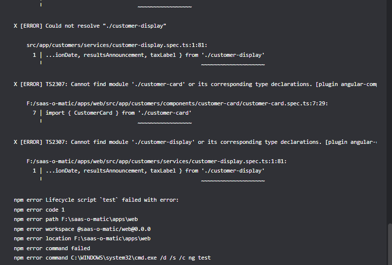
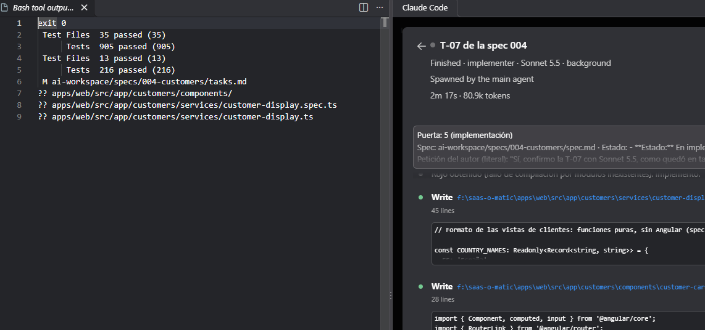

# 004-customers — Fase 7 (2026-11-24, sesión 21)

La sesión principal abre este registro al recibir el retorno de la T-07 con su fase roja. `/sdd-session` lo completa al cerrar la tarea.

## Objetivo y fase
- Fase 7, spec `004-customers`, puerta 5 (implementación), con `/sdd-implement`.
- Tarea T-07: web, formato de las vistas y tarjeta de cliente.
- Implementer con Sonnet 5.5 y encargo sin enseñar antes (ADR-016, puntos 4 y 6).
- La spec sigue en `En implementación`.

## Prompts clave
> /sdd-implement 004-customers

> Sí, confirmo la T-07 con Sonnet 5.5, como quedó en tasks.md. Pide al implementer la salida íntegra del rojo, sin abreviar ni reescribir ninguna línea, y que no toque ningún fichero fuera de los tres de producción y los dos tests de la T-07. Pide también la salida de `npm run verify` con su código de salida.

> Apruebo la T-07 (web: formato de las vistas y tarjeta de cliente) con las desviaciones 1 a 6 aceptadas. Anota para el revisor las desviaciones 4 (countryName devuelve el código si no es uno de los cuatro) y 5 (aserción de texto frágil en C-103). El rojo es de compilación: no lo repitas; cópialo de red.txt al registro sin códigos ANSI y con los signos reales. Las capturas fase-7-004-t07-rojo y t07-verde son mías.
> Marca [x] la T-07 y sus casillas, con mi aprobación literal en tasks.md; actualiza MEMORY.md (máximo 50 líneas) con la T-07 hecha y verify en 905 + 216, y enséñame su diff. Yo lanzo /sdd-session 7 004-customers y luego te doy el OK al commit, sin Co-Authored-By.

## Línea base (sesión principal, antes de lanzar)
- `npm run verify`: código 0. Raíz: «Tests  905 passed (905)». Web: «Tests  192 passed (192)».

## Fase roja (retorno del implementer)
Comando: `npm run test -w apps/web`, con código de salida 1.

La sesión principal la copia de su fichero de salida en el scratchpad (`red.txt`, 43 líneas), sin cambiar el texto de ninguna línea. Se quitaron solo los códigos de color ANSI (carácter ESC seguido de `[…m`) con `sed 's/\x1b\[[0-9;]*m//g'`, como en la T-06, con OK del autor en la aprobación de la T-07; el resultado no tiene ningún carácter ESC (`grep -c` da 0). Rojo no repetido por decisión del autor: es de compilación. Los símbolos de dibujo de Angular (`❯`, `✔`, `│`, `╵`) se conservan. En el retorno del implementer los `>` venían escapados como `&gt;`; aquí van con el signo real, porque se copian del fichero.

````

> @saas-o-matic/web@0.0.0 test
> ng test

❯ Building...
✔ Building...
Application bundle generation failed. [3.553 seconds] - 2026-11-24T19:02:40.615Z

X [ERROR] Could not resolve "./customer-card"

    src/app/customers/components/customer-card/customer-card.spec.ts:7:29:
      7 │ import { CustomerCard } from './customer-card';
        ╵                              ~~~~~~~~~~~~~~~~~


X [ERROR] Could not resolve "./customer-display"

    src/app/customers/services/customer-display.spec.ts:1:81:
      1 │ ...ionDate, resultsAnnouncement, taxLabel } from './customer-display';
        ╵                                                  ~~~~~~~~~~~~~~~~~~~~


X [ERROR] TS2307: Cannot find module './customer-card' or its corresponding type declarations. [plugin angular-compiler]

    F:/saas-o-matic/apps/web/src/app/customers/components/customer-card/customer-card.spec.ts:7:29:
      7 │ import { CustomerCard } from './customer-card';
        ╵                              ~~~~~~~~~~~~~~~~~


X [ERROR] TS2307: Cannot find module './customer-display' or its corresponding type declarations. [plugin angular-compiler]

    F:/saas-o-matic/apps/web/src/app/customers/services/customer-display.spec.ts:1:81:
      1 │ ...ionDate, resultsAnnouncement, taxLabel } from './customer-display';
        ╵                                                  ~~~~~~~~~~~~~~~~~~~~


npm error Lifecycle script `test` failed with error:
npm error code 1
npm error path F:\saas-o-matic\apps\web
npm error workspace @saas-o-matic/web@0.0.0
npm error location F:\saas-o-matic\apps\web
npm error command failed
npm error command C:\WINDOWS\system32\cmd.exe /d /s /c ng test
````

## Verde (retorno del implementer)
- `npm run verify` desde la raíz: código 0 (salida completa en el scratchpad, `verify-after-t07.txt`, 86 líneas). Raíz: «Tests  905 passed (905)». Web: «Test Files  13 passed (13)» y «Tests  216 passed (216)». 24 tests nuevos (12 en `customer-display.spec.ts` y 12 en `customer-card.spec.ts`), cuadrados por la sesión principal con 216 − 192.
- `git status --untracked-files=all`: solo los cinco ficheros de la T-07 y la línea de `Estado` de la T-07 en `tasks.md`.

## Observaciones para el revisor (decisión del autor)
- Desviación 4: `countryName` devuelve el código tal cual si no es uno de los cuatro países (el plan no define ese caso; la spec 002 solo admite esos cuatro).
- Desviación 5: C-103 comprueba con una aserción de texto que la tarjeta no muestra «24/11/2026» ni «15»; es frágil: si cambia el importe de prueba, puede dar un falso positivo.

## Qué propuso la IA
- La sesión principal propuso la T-07 como siguiente tarea (depende de la T-06, ya hecha; Sonnet 5.5 según `tasks.md`) y ejecutar `npm run verify` antes de lanzar, para poner su salida literal en el encargo (905 + 192, código 0).
- Encargo al implementer con las condiciones del autor: rojo íntegro, sin abreviar ni reescribir, también guardado en `red.txt`; solo los cinco ficheros de la tarea, y `npm run verify` con su código de salida. La sesión principal añadió por su cuenta, y lo dijo al autor después de lanzar, el permiso de tocar la línea `Estado` de la T-07 en `tasks.md` para dejarla en `[~]` (lo pide `/sdd-flow`).
- El implementer entregó `customer-display.ts`, `customer-card.ts`, `customer-card.html` y sus dos tests, con 24 tests nuevos (12 + 12) y seis desviaciones:
  1. `currency` y `rateMicros` como `input.required`;
  2. tests que la tarea no enumera;
  3. `provideRouter([])` en los tests de la tarjeta, sin `app.routes`;
  4. `countryName` devuelve el código si no es uno de los cuatro;
  5. aserción de texto frágil en C-103;
  6. clases `customer-card__*` que el plan no cita.
- La sesión principal comprobó los límites con `git status --untracked-files=all` y `git diff --stat` (solo los cinco ficheros y la línea de `tasks.md`) y cuadró el recuento (216 − 192 = 24). Copió el rojo de `red.txt` (`diff` con el bloque de este registro: idéntico). El rojo del retorno no era literal: traía `&gt;` en lugar de `>`, le faltaba el `;` final de las líneas de `import` y algunas líneas en blanco dobles.
- Señaló al autor las desviaciones 4 (decide un caso que el plan no define) y 5 (aserción frágil) para que decidiera.
- Tras la aprobación: la T-07 en `[x]` con sus cinco casillas y la aprobación literal en `tasks.md`, observaciones para el revisor en este registro, `MEMORY.md` al día (50 líneas) y el commit propuesto.

## Qué corregí y por qué
- Desviaciones 4 y 5: el autor las acepta y pide anotarlas para el revisor. Motivo: (no registrado).
- Rojo: el autor decide no repetirlo, porque es de compilación, y pide copiarlo de `red.txt` sin códigos ANSI y con los signos reales.
- Capturas: el autor indica que `fase-7-004-t07-rojo` y `fase-7-004-t07-verde` son suyas.

## Decisiones tomadas
- T-07 aprobada por el autor con las desviaciones 1 a 6 aceptadas (aprobación literal en `tasks.md`).
- Desviaciones 4 y 5 anotadas como observaciones para el revisor (puerta 6).
- Rojo no repetido por la sesión principal (decisión del autor); copiado sin códigos ANSI, con su OK.
- `npm run verify` en verde: 905 + 216.
- Siguiente tarea: T-08.
- Commit: el de cierre de esta sesión.

## Capturas



## Pendiente para la siguiente sesión
- Commit de cierre de la T-07, con el OK del autor y sin `Co-Authored-By`.
- T-08 (web: componente del buscador), con Opus 5.5 según `tasks.md`; si los temporizadores falsos no funcionan con el ejecutor de Angular, para (riesgo 10).
- Para la puerta 6: las observaciones de las desviaciones 4 y 5.
- En los próximos encargos, comparar el rojo del retorno con su fichero: en la T-07 no era literal.
