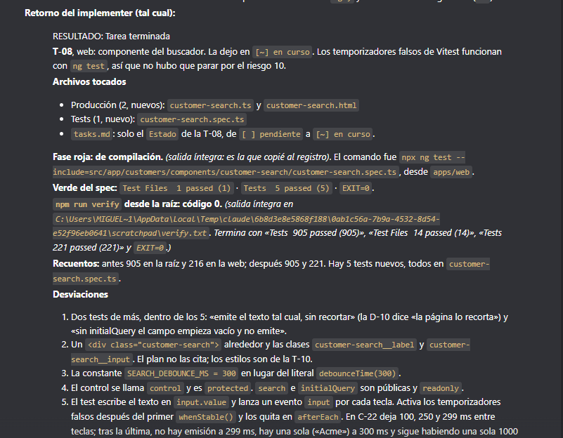
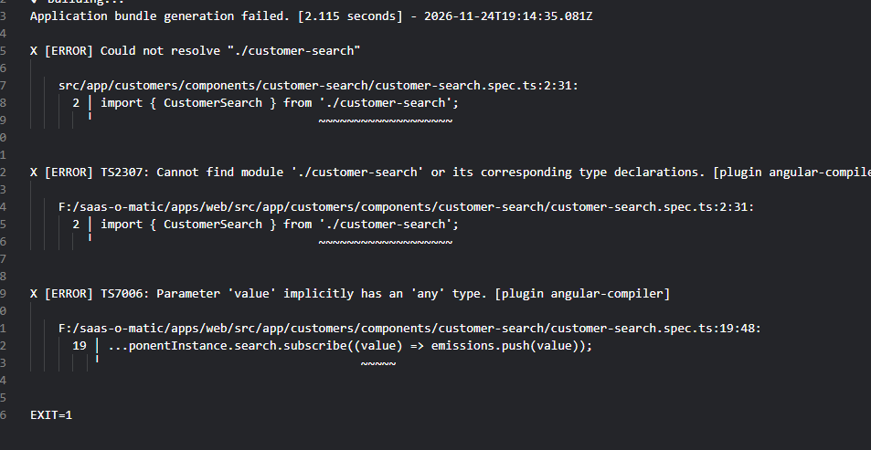
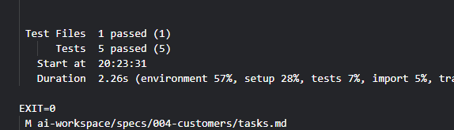

# 004-customers — Fase 7 (2026-11-24, sesión 22)

La sesión principal abre este registro al recibir el retorno de la T-08 con su fase roja. `/sdd-session` lo completa al cerrar la tarea.

## Objetivo y fase
- Fase 7, spec `004-customers`, puerta 5 (implementación), con `/sdd-implement`.
- Tarea T-08: web, componente del buscador.
- Implementer con Opus 5.5 y encargo sin enseñar antes (ADR-016, puntos 4 y 6).
- La spec sigue en `En implementación`.

## Prompts clave
> /sdd-implement 004-customers

> /sdd-session 7 004-customers

> Sí, confirmo la T-08 con Opus 5.5, como quedó en tasks.md. Pide al implementer la salida íntegra del rojo, sin abreviar ni reescribir ninguna línea, y que no toque ningún fichero fuera de los dos de producción y el test de la T-08. Si los temporizadores falsos no funcionan con el ejecutor de Angular, que pare y lo devuelva (riesgo 10). Pide también la salida de `npm run verify` con su código de salida.

## Línea base (sesión principal, antes de lanzar)
- `npm run verify`: código 0. Raíz: «Tests  905 passed (905)». Web: «Tests  216 passed (216)».

## Fase roja (retorno del implementer)
Comando: `npx ng test --include=src/app/customers/components/customer-search/customer-search.spec.ts`, desde `apps/web`, con código de salida 1 y con `NO_COLOR=1 FORCE_COLOR=0`.

La sesión principal la copia de su fichero de salida en el scratchpad (`red.txt`), sin cambiar el texto de ninguna línea; el fichero no trae códigos de color ANSI. Los símbolos de dibujo de Angular (`❯`, `✔`, `│`, `╵`) se conservan. En el retorno del implementer el `>` de `=>` venía escapado como `&gt;`; aquí va con el signo real, porque se copia del fichero. Rojo de compilación.

````
❯ Building...
✔ Building...
Application bundle generation failed. [2.115 seconds] - 2026-11-24T19:14:35.081Z

X [ERROR] Could not resolve "./customer-search"

    src/app/customers/components/customer-search/customer-search.spec.ts:2:31:
      2 │ import { CustomerSearch } from './customer-search';
        ╵                                ~~~~~~~~~~~~~~~~~~~


X [ERROR] TS2307: Cannot find module './customer-search' or its corresponding type declarations. [plugin angular-compiler]

    F:/saas-o-matic/apps/web/src/app/customers/components/customer-search/customer-search.spec.ts:2:31:
      2 │ import { CustomerSearch } from './customer-search';
        ╵                                ~~~~~~~~~~~~~~~~~~~


X [ERROR] TS7006: Parameter 'value' implicitly has an 'any' type. [plugin angular-compiler]

    F:/saas-o-matic/apps/web/src/app/customers/components/customer-search/customer-search.spec.ts:19:48:
      19 │ ...ponentInstance.search.subscribe((value) => emissions.push(value));
         ╵                                     ~~~~~


EXIT=1
````

## Verde (retorno del implementer)
- Spec nuevo: «Test Files  1 passed (1)» · «Tests  5 passed (5)» · `EXIT=0`.
- `npm run verify` desde la raíz: código 0. Raíz: «Tests  905 passed (905)». Web: «Test Files  14 passed (14)» · «Tests  221 passed (221)». 5 tests nuevos, todos en `customer-search.spec.ts`.
- Riesgo 10: los temporizadores falsos de Vitest funcionan con `ng test`; no hubo que parar.

## Hallazgo de la sesión principal y segunda vuelta
- En los tests «initialQuery se pone en el control sin emitir» y «sin initialQuery el campo empieza vacío y no emite», `vi.useFakeTimers()` se activaba después de `render()`, con `ngOnInit` ya ejecutado. Si `setValue` emitiera, el `debounceTime` usaría un temporizador real y el test pasaría igual.

> Elijo la (a): reanuda al implementer para que corrija el orden de los dos tests de initialQuery (activar vi.useFakeTimers() antes de crear el componente), y demuestre el rojo de la casilla quitando emitEvent: false un momento (debe salir rojo) y devolviéndolo (debe salir verde); copia las dos salidas íntegras al registro. Acepto las desviaciones 1 a 9; anota para el revisor la 6 (sin maxlength, reserva H-10) y la 7 (R-68 se comprueba a mano con Tab en la puerta 6). Rojo de compilación sin repetir, sin códigos ANSI y con los signos reales. Las capturas fase-7-004-t08-rojo y t08-verde son mías.
> Cuando vuelva, enséñame el git diff del spec y las dos salidas antes de pedirme la aprobación de la T-08.

- Segunda vuelta del implementer: **Bloqueado** por el riesgo 10. Con `vi.useFakeTimers()` antes de crear el componente, `await fixture.whenStable()` no termina y los dos tests agotan los 5000 ms. No llegó al rojo con `emitEvent: false` quitado ni a `npm run verify`. Apartó el spec al scratchpad (`customer-search.spec.ts.vuelta2-falla`) y devolvió el de la primera vuelta; `customer-search.ts`, idéntico a su copia previa (`diff` sin salida, comprobado por la sesión principal).
- Salida copiada del fichero `faketimers-whenstable.txt` del scratchpad (sin códigos ANSI: `grep -c` da 0). El retorno pegaba otra ejecución vista en la consola, con cabecera y duraciones distintas; esta es la del fichero:

````
❯ Building...
✔ Building...
Application bundle generation complete. [1.880 seconds] - 2026-11-24T19:19:42.860Z


 RUN  v5.1.1 F:/saas-o-matic/apps/web

 ❯ |web| src/app/customers/components/customer-search/customer-search.spec.ts (5 tests | 2 failed) 10127ms
   ❯ CustomerSearch (5)
     × initialQuery se pone en el control sin emitir 5022ms
     × sin initialQuery el campo empieza vacío y no emite 5009ms

⎯⎯⎯⎯⎯⎯⎯ Failed Tests 2 ⎯⎯⎯⎯⎯⎯⎯

 FAIL  |web| src/app/customers/components/customer-search/customer-search.spec.ts > CustomerSearch > initialQuery se pone en el control sin emitir
TestTimeoutError: Test timed out in 5000ms.
If this is a long-running test, pass a timeout value as the last argument or configure it globally with "testTimeout".
 ❯ src/app/customers/components/customer-search/customer-search.spec.ts:74:3
     72|   });
     73|
     74|   it('initialQuery se pone en el control sin emitir', async () => {
       |   ^
     75|     // Antes de crear el componente: si ngOnInit emitiera, el debounce…
     76|     vi.useFakeTimers();

⎯⎯⎯⎯⎯⎯⎯⎯⎯⎯⎯⎯⎯⎯⎯⎯⎯⎯⎯⎯⎯⎯⎯⎯[1/2]⎯

 FAIL  |web| src/app/customers/components/customer-search/customer-search.spec.ts > CustomerSearch > sin initialQuery el campo empieza vacío y no emite
TestTimeoutError: Test timed out in 5000ms.
If this is a long-running test, pass a timeout value as the last argument or configure it globally with "testTimeout".
 ❯ src/app/customers/components/customer-search/customer-search.spec.ts:83:3
     81|   });
     82|
     83|   it('sin initialQuery el campo empieza vacío y no emite', async () =>…
       |   ^
     84|     // Antes de crear el componente: si ngOnInit emitiera, el debounce…
     85|     vi.useFakeTimers();

⎯⎯⎯⎯⎯⎯⎯⎯⎯⎯⎯⎯⎯⎯⎯⎯⎯⎯⎯⎯⎯⎯⎯⎯[2/2]⎯


 Test Files  1 failed (1)
      Tests  2 failed | 3 passed (5)
   Start at  20:19:43
   Duration  11.66s (tests 89%, environment 7%, setup 3%, import 1%)

EXIT=1
````

- Tercera vuelta, salida (a) elegida por el autor:

> Elijo la (a): vi.useFakeTimers({ toFake: ['setInterval', 'clearInterval'] }) antes de crear el componente en los dos tests de initialQuery, manteniendo whenStable(). Si tampoco termina, no pruebes otra salida: para y devuélvelo, y entonces elegiré la (c) (reloj real y espera corta solo en esos dos tests). Haz los pasos 2 a 5 de antes: demostrar el rojo quitando emitEvent: false un momento (debe salir rojo) y devolviéndolo (verde), copiar las dos salidas íntegras al registro, y npm run verify con su código de salida.
> Cuando vuelva, enséñame el git diff del spec y las dos salidas antes de pedirme la aprobación de la T-08.

- Resultado: **Bloqueado**. `whenStable()` termina y el spec sale verde, pero con `{ emitEvent: false }` quitado los dos tests de `initialQuery` siguen en verde: con `toFake` solo de `setInterval`, `Date.now()` sigue real y `debounceTime` reprograma en vez de emitir (`debounceTime.js`, líneas 24-26 y 34, comprobado por la sesión principal). Fallan C-22 y «tal cual», por la tarea de `debounceTime` que deja la emisión de `ngOnInit` con reloj real. `npm run verify` no se ejecutó. `customer-search.ts`, idéntico a su copia original (`diff` sin salida, comprobado por la sesión principal).
- Rojo con `setValue(this.initialQuery())`, copiado de `red-initialquery.txt` (sin códigos ANSI; `grep -c` da 0):

````
❯ Building...
✔ Building...
Application bundle generation complete. [4.915 seconds] - 2026-11-24T19:23:00.790Z


 RUN  v5.1.1 F:/saas-o-matic/apps/web

 ❯ |web| src/app/customers/components/customer-search/customer-search.spec.ts (5 tests | 2 failed) 157ms
   ❯ CustomerSearch (5)
     × C-22: ninguna emisión antes de 300 ms tras la última tecla y una sola después, con «Acme» 38ms
     × emite el texto tal cual, sin recortar: lo recorta la página (spec 004: D-10) 16ms

⎯⎯⎯⎯⎯⎯⎯ Failed Tests 2 ⎯⎯⎯⎯⎯⎯⎯

 FAIL  |web| src/app/customers/components/customer-search/customer-search.spec.ts > CustomerSearch > C-22: ninguna emisión antes de 300 ms tras la última tecla y una sola después, con «Acme»
AssertionError: expected [] to deeply equal [ 'Acme' ]

- Expected
+ Received

- [
-   "Acme",
- ]
+ []

 ❯ src/app/customers/components/customer-search/customer-search.spec.ts:61:23
     59|     expect(emissions).toEqual([]);
     60|     vi.advanceTimersByTime(1);
     61|     expect(emissions).toEqual(['Acme']);
       |                       ^
     62|     vi.advanceTimersByTime(1000);
     63|     expect(emissions).toEqual(['Acme']);

⎯⎯⎯⎯⎯⎯⎯⎯⎯⎯⎯⎯⎯⎯⎯⎯⎯⎯⎯⎯⎯⎯⎯⎯[1/2]⎯

 FAIL  |web| src/app/customers/components/customer-search/customer-search.spec.ts > CustomerSearch > emite el texto tal cual, sin recortar: lo recorta la página (spec 004: D-10)
AssertionError: expected [] to deeply equal [ '  Acme ' ]

- Expected
+ Received

- [
-   "  Acme ",
- ]
+ []

 ❯ src/app/customers/components/customer-search/customer-search.spec.ts:71:23
     69|     type('  Acme ');
     70|     vi.advanceTimersByTime(300);
     71|     expect(emissions).toEqual(['  Acme ']);
       |                       ^
     72|   });
     73|

⎯⎯⎯⎯⎯⎯⎯⎯⎯⎯⎯⎯⎯⎯⎯⎯⎯⎯⎯⎯⎯⎯⎯⎯[2/2]⎯


 Test Files  1 failed (1)
      Tests  2 failed | 3 passed (5)
   Start at  20:23:01
   Duration  3.09s (environment 69%, setup 18%, tests 6%, import 4%, transform 3%, worker 1%)

EXIT=1
````

- Verde tras devolver `{ emitEvent: false }`, copiado de `green-initialquery.txt`:

````
❯ Building...
✔ Building...
Application bundle generation complete. [2.719 seconds] - 2026-11-24T19:23:31.548Z


 RUN  v5.1.1 F:/saas-o-matic/apps/web


 Test Files  1 passed (1)
      Tests  5 passed (5)
   Start at  20:23:31
   Duration  2.26s (environment 57%, setup 28%, tests 7%, import 5%, transform 1%, worker 1%)

EXIT=0
````

- Cuarta vuelta, salida (c) elegida por el autor:

> Elijo la (c): en los dos tests de initialQuery, sin reloj falso: render(), espera con reloj real de 350 ms y comprobar que no hay emisión; quita la llamada toFake. C-22 y el test «tal cual» se quedan con los temporizadores falsos. Repite los pasos 2 a 5: el rojo sin emitEvent: false debe hacer fallar al menos «initialQuery se pone en el control sin emitir»; luego el verde y npm run verify con su código de salida; copia las salidas íntegras al registro. No pruebes otra salida: si algo no cuadra, para y devuélvelo.
> Cuando vuelva, enséñame el git diff del spec y las dos salidas antes de pedirme la aprobación de la T-08. Las capturas fase-7-004-t08-retorno, t08-rojo y t08-verde son mías.

- Resultado: **Tarea terminada**. Los dos tests de `initialQuery` esperan 350 ms con reloj real; C-22 y «tal cual» no cambian. `customer-search.ts`, idéntico a su copia original (`diff` sin salida, comprobado por la sesión principal). Los cuatro ficheros de salida, sin códigos ANSI (`grep -c` da 0).
- Rojo demostrado de la casilla «`initialQuery` se pone en el control sin emitir», con `setValue(this.initialQuery())` (sin `{ emitEvent: false }`), copiado de `red-initialquery-c.txt`. Rojo de aserciones. C-22 y «tal cual» también fallan, por la tarea de `debounceTime` que deja la emisión de `ngOnInit` con reloj real (desviación 11):

````
❯ Building...
✔ Building...
Application bundle generation complete. [2.427 seconds] - 2026-11-24T19:27:36.507Z


 RUN  v5.1.1 F:/saas-o-matic/apps/web

 ❯ |web| src/app/customers/components/customer-search/customer-search.spec.ts (5 tests | 4 failed) 846ms
   ❯ CustomerSearch (5)
     × C-22: ninguna emisión antes de 300 ms tras la última tecla y una sola después, con «Acme» 37ms
     × emite el texto tal cual, sin recortar: lo recorta la página (spec 004: D-10) 16ms
     × initialQuery se pone en el control sin emitir 356ms
     × sin initialQuery el campo empieza vacío y no emite 370ms

⎯⎯⎯⎯⎯⎯⎯ Failed Tests 4 ⎯⎯⎯⎯⎯⎯⎯

 FAIL  |web| src/app/customers/components/customer-search/customer-search.spec.ts > CustomerSearch > C-22: ninguna emisión antes de 300 ms tras la última tecla y una sola después, con «Acme»
AssertionError: expected [] to deeply equal [ 'Acme' ]

- Expected
+ Received

- [
-   "Acme",
- ]
+ []

 ❯ src/app/customers/components/customer-search/customer-search.spec.ts:61:23
     59|     expect(emissions).toEqual([]);
     60|     vi.advanceTimersByTime(1);
     61|     expect(emissions).toEqual(['Acme']);
       |                       ^
     62|     vi.advanceTimersByTime(1000);
     63|     expect(emissions).toEqual(['Acme']);

⎯⎯⎯⎯⎯⎯⎯⎯⎯⎯⎯⎯⎯⎯⎯⎯⎯⎯⎯⎯⎯⎯⎯⎯[1/4]⎯

 FAIL  |web| src/app/customers/components/customer-search/customer-search.spec.ts > CustomerSearch > emite el texto tal cual, sin recortar: lo recorta la página (spec 004: D-10)
AssertionError: expected [] to deeply equal [ '  Acme ' ]

- Expected
+ Received

- [
-   "  Acme ",
- ]
+ []

 ❯ src/app/customers/components/customer-search/customer-search.spec.ts:71:23
     69|     type('  Acme ');
     70|     vi.advanceTimersByTime(300);
     71|     expect(emissions).toEqual(['  Acme ']);
       |                       ^
     72|   });
     73|

⎯⎯⎯⎯⎯⎯⎯⎯⎯⎯⎯⎯⎯⎯⎯⎯⎯⎯⎯⎯⎯⎯⎯⎯[2/4]⎯

 FAIL  |web| src/app/customers/components/customer-search/customer-search.spec.ts > CustomerSearch > initialQuery se pone en el control sin emitir
AssertionError: expected [ 'Acme' ] to deeply equal []

- Expected
+ Received

- []
+ [
+   "Acme",
+ ]

 ❯ src/app/customers/components/customer-search/customer-search.spec.ts:79:23
     77|     expect(field().value).toBe('Acme');
     78|     await new Promise((resolve) => setTimeout(resolve, 350));
     79|     expect(emissions).toEqual([]);
       |                       ^
     80|   });
     81|

⎯⎯⎯⎯⎯⎯⎯⎯⎯⎯⎯⎯⎯⎯⎯⎯⎯⎯⎯⎯⎯⎯⎯⎯[3/4]⎯

 FAIL  |web| src/app/customers/components/customer-search/customer-search.spec.ts > CustomerSearch > sin initialQuery el campo empieza vacío y no emite
AssertionError: expected [ '' ] to deeply equal []

- Expected
+ Received

- []
+ [
+   "",
+ ]

 ❯ src/app/customers/components/customer-search/customer-search.spec.ts:86:23
     84|     expect(field().value).toBe('');
     85|     await new Promise((resolve) => setTimeout(resolve, 350));
     86|     expect(emissions).toEqual([]);
       |                       ^
     87|   });
     88| });

⎯⎯⎯⎯⎯⎯⎯⎯⎯⎯⎯⎯⎯⎯⎯⎯⎯⎯⎯⎯⎯⎯⎯⎯[4/4]⎯


 Test Files  1 failed (1)
      Tests  4 failed | 1 passed (5)
   Start at  20:27:36
   Duration  3.34s (environment 51%, tests 29%, setup 14%, import 3%, transform 2%, worker 1%)

EXIT=1
````

- Verde tras devolver `{ emitEvent: false }`, copiado de `green-initialquery-c.txt`:

````
❯ Building...
✔ Building...
Application bundle generation complete. [2.098 seconds] - 2026-11-24T19:28:09.607Z


 RUN  v5.1.1 F:/saas-o-matic/apps/web


 Test Files  1 passed (1)
      Tests  5 passed (5)
   Start at  20:28:09
   Duration  2.57s (environment 42%, tests 36%, setup 17%, import 4%, transform 1%, worker 1%)

EXIT=0
````

- `npm run verify` desde la raíz (`verify-c.txt`): `EXIT=0`. Raíz: « Test Files  35 passed (35)» y «      Tests  905 passed (905)». Web: « Test Files  14 passed (14)» y «      Tests  221 passed (221)».

## Aprobación del autor
> Apruebo la T-08 (web: componente del buscador) con las desviaciones 1 a 12 aceptadas, incluidas la 10 (350 ms de reloj real en los dos tests de initialQuery, por mi elección de la (c)), la 11 (en el rojo temporal también fallan C-22 y «tal cual», por la espera de debounceTime con reloj real) y la 12 (un solo comentario para los dos tests). Anota en el registro, como aprendizaje: con debounceTime, los temporizadores falsos de Vitest solo sirven si se falsea también Date, y whenStable() puede no terminar; para probar que algo no se emite, se usa reloj real y una espera corta. Rojo de compilación sin repetir, sin ANSI y con los signos reales. Las capturas fase-7-004-t08-retorno, t08-rojo y t08-verde son mías.
> Marca [x] la T-08 y sus casillas, con mi aprobación literal en tasks.md; actualiza MEMORY.md (máximo 50 líneas) con la T-08 hecha y verify en 905 + 221, y enséñame su diff. Yo lanzo /sdd-session 7 004-customers y luego te doy el OK al commit, sin Co-Authored-By.

## Aprendizaje (anotado por indicación del autor)
- Con `debounceTime`, los temporizadores falsos de Vitest solo sirven si se falsea también `Date`, y `whenStable()` puede no terminar; para probar que algo no se emite, se usa reloj real y una espera corta.
- (De la sesión principal, no del autor.) Un test de «no emite» se comprueba con un rojo temporal (aquí, quitar `{ emitEvent: false }`): en la primera vuelta pasaba igual con el fallo, porque el reloj falso se activaba después de `ngOnInit`.

## Qué propuso la IA
- Proponer la T-08 con Opus 5.5, como fija `tasks.md` (Q-01 (a)), con `npm run verify` de partida en verde (905 + 216) y el encargo del implementer sin enseñarlo antes (ADR-016, punto 4), con las cuatro exigencias del autor (rojo íntegro, solo los tres ficheros, parada por el riesgo 10 y `npm run verify` con su código de salida).
- Tras la primera vuelta: el hallazgo de que los dos tests de `initialQuery` no demostraban su casilla (el reloj falso se activaba después de `ngOnInit`), con dos opciones: (a) reanudar al implementer para corregir el orden y demostrar el rojo quitando `emitEvent: false` un momento, recomendada, o (b) aprobar con reserva.
- Tras el bloqueo de la segunda vuelta (`whenStable()` no terminaba con el reloj falso): las tres salidas del implementer, (a) `toFake: ['setInterval', 'clearInterval']`, (b) `detectChanges()` sin `whenStable()` y (c) reloj real; recomendada la (a).
- Tras el bloqueo de la tercera vuelta (con `toFake` solo de `setInterval`, `Date.now()` seguía real y `debounceTime` no emitía; comprobado en `debounceTime.js`): (c) reloj real con 350 ms, recomendada, o (d) falsear también `Date`, sin probar.
- Copiar al registro cada salida desde su fichero del scratchpad y no desde la consola (el retorno de la segunda vuelta pegaba otra ejecución), con los signos reales.
- Un segundo aprendizaje, propio y marcado como tal: un test de «no emite» se comprueba con un rojo temporal.

## Qué corregí y por qué
- No corregí ninguna propuesta: en cada vuelta elegí la opción recomendada ((a), (a) y (c)).
- Añadí condiciones a las vueltas: si la (a) de la tercera vuelta no terminaba, parar sin probar otra salida y pasar a la (c); que en la cuarta, si algo no cuadraba, parara y lo devolviera; y ver el `git diff` del spec y las dos salidas antes de pedirme la aprobación.
- Pedí anotar como aprendizaje que, con `debounceTime`, los temporizadores falsos de Vitest solo sirven si se falsea también `Date`, y que para probar que algo no se emite se usa reloj real y una espera corta.

## Decisiones tomadas
- T-08 aprobada por el autor con las desviaciones 1 a 12 aceptadas (aprobación literal en `tasks.md` y en este registro); observaciones para el revisor: desviaciones 6 (sin `maxlength`, reserva H-10) y 7 (R-68 se comprueba a mano con Tab en la puerta 6).
- Los dos tests de `initialQuery` esperan 350 ms con reloj real (opción (c)); C-22 y «tal cual» siguen con los temporizadores falsos.
- Rojo de compilación sin repetir, copiado de `red.txt` con los signos reales; rojo de la casilla de `initialQuery` demostrado (de aserciones) quitando `{ emitEvent: false }` un momento.
- `npm run verify` en verde, con código 0: 905 + 221 (5 tests nuevos).
- Las capturas `fase-7-004-t08-retorno`, `t08-rojo` y `t08-verde` son del autor.
- Commit: el de cierre de esta sesión.

## Capturas
- En esta conversación no hubo líneas `CAPTURA:`. Las tres capturas de la T-08 son del autor.
- 
- 
- 

## Pendiente para la siguiente sesión
- Commit de la T-08 con el OK del autor, sin `Co-Authored-By`.
- T-09 (página del buscador y ruta `customers`), con Opus 5.5 por la Q-01 (a); C-96 usa temporizadores falsos (riesgo 10): tener en cuenta el aprendizaje de esta sesión.
- Puerta 6: observaciones para el revisor de la T-08 (desviaciones 6 y 7), además de las de las tareas anteriores.
