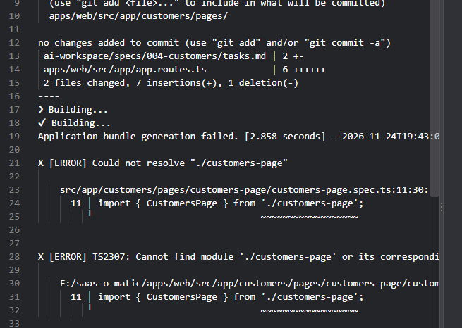
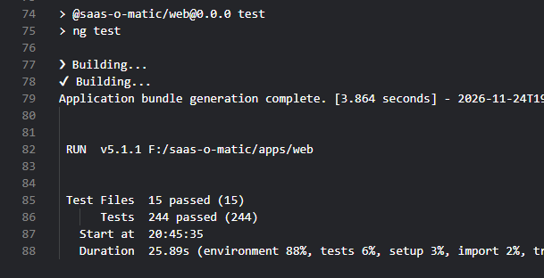

# 004-customers — Fase 7 (2026-11-24, sesión 23)

La sesión principal abre este registro al recibir el retorno de la T-09 con su fase roja. `/sdd-session` lo completa al cerrar la tarea.

## Objetivo y fase
- Fase 7, spec `004-customers`, puerta 5 (implementación), con `/sdd-implement`.
- Tarea T-09: web, página del buscador y ruta `customers`.
- Implementer con Opus 5.5 y encargo sin enseñar antes (ADR-016, puntos 4 y 6).
- La spec sigue en `En implementación`.

## Prompts clave
> /sdd-implement 004-customers

> Sí, confirmo la T-09 con Opus 5.5, como quedó en tasks.md. Pide al implementer la salida íntegra del rojo, sin abreviar ni reescribir ninguna línea, y que no toque ningún fichero fuera de los tres de producción y el test de la T-09. Pide también la salida de `npm run verify` con su código de salida y el `git diff` de `app.routes.ts`.

> Apruebo la T-09 (web: página del buscador y ruta customers) con las desviaciones 1 a 10 aceptadas. No repitas el rojo (es de compilación) ni el temporal de C-172: anótalo en el registro como copiado de la consola, no de un fichero. Anota para el revisor la desviación 9 (R-68 a mano con Tab en la puerta 6; R-165 depende del CSS de la T-10) y que C-172 se prueba con las entradas de SpyLocation, no con location.back(). Rojo copiado de red-t09.txt, sin ANSI y con los signos reales. Las capturas fase-7-004-t09-rojo y t09-verde son mías.
> Marca [x] la T-09 y sus casillas, con mi aprobación literal en tasks.md; actualiza MEMORY.md (máximo 50 líneas) con la T-09 hecha y verify en 905 + 244, y enséñame su diff. Yo lanzo /sdd-session 7 004-customers y luego te doy el OK al commit, sin Co-Authored-By.

> /sdd-session 7 004-customers

## Línea base (sesión principal, antes de lanzar)
- `npm run verify`: código 0. Raíz: «Tests  905 passed (905)». Web: «Tests  221 passed (221)».

## Fase roja (retorno del implementer)
Comando: `NO_COLOR=1 FORCE_COLOR=0 npx ng test --include src/app/customers/pages/customers-page/customers-page.spec.ts`, desde `apps/web`, con la salida en `red.txt` y código de salida 1. Copiada del fichero `red-t09.txt` (18 líneas, sin códigos ANSI: `grep -c $'\x1b'` da 0), no del retorno:

```
❯ Building...
✔ Building...
Application bundle generation failed. [2.858 seconds] - 2026-11-24T19:43:03.849Z

X [ERROR] Could not resolve "./customers-page"

    src/app/customers/pages/customers-page/customers-page.spec.ts:11:30:
      11 │ import { CustomersPage } from './customers-page';
         ╵                               ~~~~~~~~~~~~~~~~~~


X [ERROR] TS2307: Cannot find module './customers-page' or its corresponding type declarations. [plugin angular-compiler]

    F:/saas-o-matic/apps/web/src/app/customers/pages/customers-page/customers-page.spec.ts:11:30:
      11 │ import { CustomersPage } from './customers-page';
         ╵                               ~~~~~~~~~~~~~~~~~~
```

## Verde (retorno del implementer)
- El spec, con el mismo comando: código 0, «Test Files 1 passed (1)», «Tests 23 passed (23)».
- `NO_COLOR=1 FORCE_COLOR=0 npm run verify` desde la raíz: código 0. Raíz «Tests  905 passed (905)»; web «Tests  244 passed (244)» (antes, 905 + 221; 23 nuevos en `customers-page.spec.ts`).
- Rojo temporal de C-172 (`replaceUrl: true` → `false` un momento), copiado de la consola filtrada, no de un fichero: solo falla C-172, con `AssertionError: expected [ '/customers', …(2) ] to include 'replace: /customers?q=Ac'` y «Tests 1 failed | 22 passed (23)». Al devolverlo, `cmp` con la copia dio el fichero idéntico. Por decisión del autor no se repite (tampoco el rojo de compilación).
- El retorno traía `&gt;` y `&amp;` escapados en HTML: se enseñó al autor con los signos reales.

## Aprobación del autor
> Apruebo la T-09 (web: página del buscador y ruta customers) con las desviaciones 1 a 10 aceptadas. No repitas el rojo (es de compilación) ni el temporal de C-172: anótalo en el registro como copiado de la consola, no de un fichero. Anota para el revisor la desviación 9 (R-68 a mano con Tab en la puerta 6; R-165 depende del CSS de la T-10) y que C-172 se prueba con las entradas de SpyLocation, no con location.back(). Rojo copiado de red-t09.txt, sin ANSI y con los signos reales. Las capturas fase-7-004-t09-rojo y t09-verde son mías.

## Observaciones para el revisor (puerta 6)
- Desviación 9: R-68 se comprueba a mano con Tab en la puerta 6; R-165 (anuncio visualmente oculto) depende del CSS de la T-10.
- C-172 se prueba con las entradas de `SpyLocation` (todas `replace:`, ninguna de `go`), no con `location.back()`.

## Qué propuso la IA
- Hacer la T-09, la siguiente del orden (depende de la T-06, la T-07 y la T-08, ya hechas), con Opus 5.5 según la Q-01 (a) de `tasks.md` y con el encargo sin enseñarlo antes.
- Añadir al encargo, además de lo que pidió el autor, que el implementer parase si fallaban los temporizadores falsos (riesgo 10), el aprendizaje de la T-08 sobre `debounceTime` y que declarase cada desviación cuadrando el número de tests nuevos.
- El implementer: `CustomersPage` y la ruta `customers`, con 23 tests nuevos y 10 desviaciones; reloj real de 350 ms en lugar de temporizadores falsos, y `provideLocationMocks()` para C-172, comprobado con las entradas de `SpyLocation` y no con `location.back()`.
- La sesión principal cuadró los 23 tests (4 + 5 + 8 + 6) y propuso repetir el rojo temporal de C-172, porque no venía de un fichero.

## Qué corregí y por qué
- No repetir ningún rojo: el de la tarea es de compilación y el temporal de C-172 se anota como copiado de la consola, no de un fichero.
- Anotar para el revisor la desviación 9 y que C-172 no usa `location.back()`.

## Decisiones tomadas
- T-09 aprobada con las desviaciones 1 a 10 aceptadas (aprobación literal en `tasks.md`).
- Rojo de compilación y rojo temporal de C-172 sin repetir.
- `npm run verify` en verde, con código 0: 905 + 244 (antes, 905 + 221).
- MEMORY.md al día (50 líneas).
- Commit: el de cierre de esta sesión.

## Capturas



## Pendiente para la siguiente sesión
- Commit de la T-09, con OK del autor y sin `Co-Authored-By`.
- T-10 (estilos del buscador: `_customers.scss`, `_tokens.scss` y `styles.scss`), con Sonnet 5.5 y sin fase roja.
- Para el revisor (puerta 6): R-68 a mano con Tab, R-165 con el CSS de la T-10 y C-172 con `SpyLocation`.
