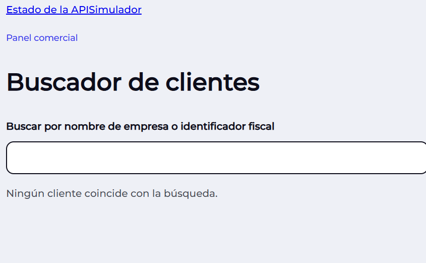
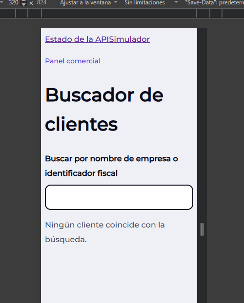

# 004-customers — Fase 7 (2026-11-24, sesión 24)

## Objetivo y fase
Fase 7, spec `004-customers`, puerta 5 (implementación) con `/sdd-implement`: hacer la **T-10 · estilos del buscador**, con `scss/_customers.scss` nuevo y cambios en `scss/themes/_tokens.scss` y en `styles.scss`. Es la última tarea del bloque 2 (buscador y dashboard). `Estado:` de la spec al empezar y al terminar: `- **Estado:** En implementación`.

## Prompts clave
> /sdd-implement 004-customers

> Sí, confirmo la T-10 con Sonnet 5.5, como quedó en tasks.md. Esta tarea no tiene fase roja. Pide al implementer el git diff de _tokens.scss y styles.scss, la lista de reglas de _customers.scss, la salida de `npm run verify` con su código de salida, y que no toque ningún fichero fuera de los tres de la T-10 (más style-guide.md solo para las líneas de los tres tokens nuevos).

> Apruebo la T-10 (estilos del buscador) con las desviaciones 1 a 6 aceptadas y el punto 1 aceptado como desviación 7 (reglas de .customer-search__label y .customer-search__input, según style-guide.md:95 y el patrón de _simulations.scss). Sin fase roja, por no haber tests. Anota para el revisor que los tres tokens nuevos citan líneas de style-guide.md (:53, :64, :55) y que debe comprobar que dicen lo citado; y que C-38, C-39, C-170, C-174 y el recorrido con Tab (R-68) se comprueban en la puerta 6. La próxima vez, el implementer da el git diff literal, no resumido. Las capturas fase-7-004-t10-buscador y fase-7-004-t10-buscador-320px son mías.
> Marca [x] la T-10 y sus casillas, con mi aprobación literal en tasks.md; actualiza MEMORY.md (máximo 50 líneas) con la T-10 hecha y verify en 905 + 244, y enséñame su diff. Yo lanzo /sdd-session 7 004-customers y luego te doy el OK al commit, sin Co-Authored-By.

> /sdd-session 7 004-customers

## Qué propuso la IA
- **Elección de la tarea.** La sesión principal leyó el `Estado:` de `spec.md` y `tasks.md`, vio la T-01 a la T-09 en `[x]` y propuso la T-10 con Sonnet 5.5, el modelo que fija `tasks.md` (punto 6 del ADR-016). El encargo se lanzaría sin enseñarlo antes (punto 4 del ADR-016).
- **Verificación previa.** Antes de lanzar al agente, la sesión principal ejecutó `npm run verify`: código 0, con 905 tests en la raíz y 244 en la web.
- **Encargo del implementer.** Llevaba la D-14 y la D-17 del plan, la fila literal de la T-10 y esa salida, y tres indicaciones de la sesión principal:
  - `style-guide.md` queda como solo lectura de las líneas citadas, porque los tres valores ya están en la guía (`:53`, `:55` y `:64`); si el agente cree que hay que editarla, para y lo devuelve.
  - Los estilos del detalle y del historial son de la T-13.
  - Debe declarar la línea exacta del `@use` en `styles.scss`, porque el orden actual (tokens, base, health, shared, simulations) admite dos lecturas de «después de health».
- **Retorno del implementer.** `Tarea terminada`, con la T-10 en `[~]` y `npm run verify` con `EXIT=0` (905 + 244). Declaró seis desviaciones:
  1. `@use 'scss/customers';` en la línea 5, justo después de `health`.
  2. Cada token en su grupo de `_tokens.scss`, con su comentario de línea de la guía.
  3. La palabra «outline» solo en el comentario de cabecera.
  4. Sin `.customer-card__email`, porque esa clase no existe en las plantillas.
  5. Sin reglas para las clases de estado que la D-14 no pide.
  6. `style-guide.md` y los parciales de otras funcionalidades sin cambios.
- **Comprobaciones de la sesión principal.**
  - `git status` y `git diff --stat`: solo cambiaron los tres ficheros de la tarea y la línea `Estado` de `tasks.md`.
  - `git diff` literal de `_tokens.scss` y `styles.scss`, porque el del retorno venía resumido por hunks.
  - Ningún `.scss` en `customers/`.
  - La palabra `outline` solo en el comentario de `_customers.scss:2`.
  - Todas las clases de `_customers.scss` existen en las plantillas de `customers/`.
  - `npm run verify` repetido: `EXIT=0`, 905 + 244. El fichero de salida del agente no traía la línea `EXIT`.
- **Puntos para el autor.**
  - Las reglas `.customer-search__label` y `.customer-search__input` no las pide la D-14 y el agente no las declaró como desviación. El foco con borde de marca sigue `style-guide.md:95` y el patrón de `_simulations.scss:61`. Se podían aceptar como desviación 7 o quitarse.
  - El diff del retorno no era literal.
- **Tras la aprobación.**
  - `tasks.md`: T-10 en `[x] hecha`, sus cuatro casillas marcadas y la aprobación literal del autor, con las desviaciones 1 a 7 y las observaciones para el revisor.
  - `MEMORY.md`, que sigue en 50 líneas: T-10 hecha y «siguiente la T-11» en «Próximos pasos», y el aprendizaje del diff literal en «Aprendizajes y errores a evitar».

## Qué corregí y por qué
- Acepté como desviación 7 las reglas del buscador que el implementer no había declarado (`.customer-search__label` y `.customer-search__input`), según `style-guide.md:95` y el patrón de `_simulations.scss`.
- Pedí que la próxima vez el implementer dé el `git diff` literal, no resumido: el del retorno venía resumido por hunks.
- Pedí anotar para el revisor que compruebe que las líneas de `style-guide.md` citadas por los tres tokens nuevos (`:53`, `:64` y `:55`) dicen lo citado, y que C-38, C-39, C-170, C-174 y el recorrido con Tab (R-68) se comprueban en la puerta 6.

## Decisiones tomadas
- T-10 aprobada por el autor el 2026-11-24, con las desviaciones 1 a 7 aceptadas. No tiene fase roja porque no hay tests.
- `npm run verify` en verde, con código 0: 905 tests en la raíz y 244 en la web, igual que antes de la tarea.
- Implementer con Sonnet 5.5 (punto 6 del ADR-016) y encargo sin enseñar antes (punto 4).
- `style-guide.md` no se toca: los tres valores ya estaban en la guía.
- Siguiente tarea: la T-11 (web: detalle en el servicio).
- Commit: el de cierre de esta sesión.

## Capturas

## Pendiente para la siguiente sesión
- T-11 (web: detalle en el servicio), con Opus 5.5 según `tasks.md`.
- Para la puerta 6:
  - comprobar que `style-guide.md:53`, `:64` y `:55` dicen lo que citan los tokens;
  - C-38, C-39, C-170 y C-174;
  - el recorrido con Tab (R-68).
- Commit de cierre de la T-10, tras el OK del autor y sin `Co-Authored-By`.
