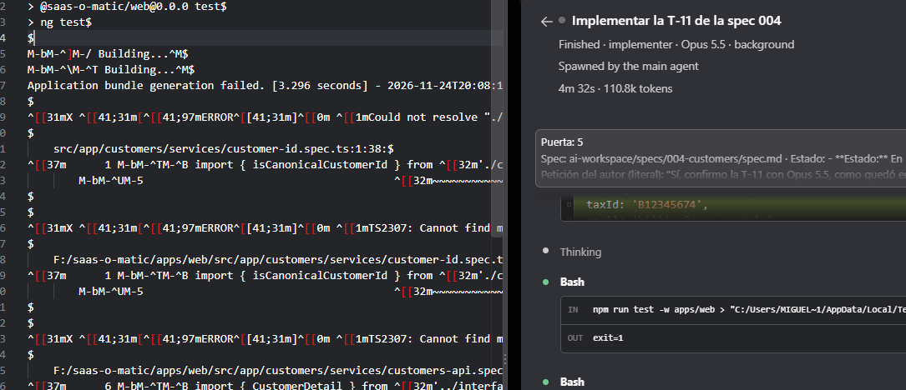
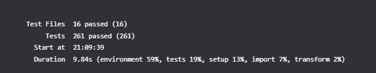

# 004-customers — Fase 7 (2026-11-24, sesión 25)

La sesión principal abre este registro al recibir el retorno de la T-11 con su fase roja. `/sdd-session` lo completa al cerrar la tarea.

## Objetivo y fase
- Fase 7, spec `004-customers`, puerta 5 (implementación), con `/sdd-implement`.
- Tarea T-11: web, detalle en el servicio (`customer-detail.ts`, `customer-id.ts` y `loadDetail` en `customers-api.ts`).
- Implementer con Opus 5.5 y encargo sin enseñar antes (ADR-016, puntos 4 y 6).
- La spec sigue en `En implementación`.

## Prompts clave
> /sdd-implement 004-customers

> Sí, confirmo la T-11 con Opus 5.5, como quedó en tasks.md. Pide al implementer la salida íntegra del rojo, sin abreviar ni reescribir ninguna línea, y que no toque ningún fichero fuera de los tres de producción y los dos tests de la T-11. Pide también la salida de `npm run verify` con su código de salida y el git diff literal, no resumido.

> Apruebo la T-11 (web: detalle en el servicio) con las observaciones 1, 2, 3, 5, 7 y 8 aceptadas. Desviación 6: antes de marcarla, haz el rojo temporal del riesgo 7: quita un momento el catchError de toOutcome, comprueba que falla al menos «historial 500 antes que el cliente 404», guarda la salida íntegra en un fichero, devuelve el fichero y compruébalo con cmp, y repite npm run verify; copia las dos salidas al registro. Desviación 4: se queda para la T-13; anótalo en tasks.md como entrada de la T-13 (si la página reacciona a cambios de :id, cancelar la carga anterior en loadDetail, con su test) y como observación para el revisor. Rojo de compilación sin repetir, sin ANSI y con los signos reales. Las capturas fase-7-004-t11-rojo y t11-verde son mías.
> Cuando lo tengas, marca [x] la T-11 y sus casillas, con mi aprobación literal en tasks.md; actualiza MEMORY.md (máximo 50 líneas) con la T-11 hecha y verify en 905 + 261, y enséñame su diff. Yo lanzo /sdd-session 7 004-customers y luego te doy el OK al commit, sin Co-Authored-By.

> /sdd-session 7 004-customers

## Línea base (sesión principal, antes de lanzar)
- `npm run verify`: código 0. Raíz: «Tests  905 passed (905)». Web: «Tests  244 passed (244)».

## Fase roja (retorno del implementer)
Comando: `npm run test -w apps/web`, con código de salida 1. Copiada del fichero `red-t11-sin-ansi.txt` (148 líneas; copia de `red-t11.txt` sin códigos ANSI ni CR: 0 caracteres ESC, 0 CR y 0 signos escapados en HTML), no del retorno, que traía `&gt;` escapado. El «exp...» de la línea 312 lo corta esbuild en su propia salida:

```

> @saas-o-matic/web@0.0.0 test
> ng test

❯ Building...
✔ Building...
Application bundle generation failed. [3.296 seconds] - 2026-11-24T20:08:19.129Z

X [ERROR] Could not resolve "./customer-id"

    src/app/customers/services/customer-id.spec.ts:1:38:
      1 │ import { isCanonicalCustomerId } from './customer-id';
        ╵                                       ~~~~~~~~~~~~~~~


X [ERROR] TS2307: Cannot find module './customer-id' or its corresponding type declarations. [plugin angular-compiler]

    F:/saas-o-matic/apps/web/src/app/customers/services/customer-id.spec.ts:1:38:
      1 │ import { isCanonicalCustomerId } from './customer-id';
        ╵                                       ~~~~~~~~~~~~~~~


X [ERROR] TS2307: Cannot find module '../interfaces/customer-detail' or its corresponding type declarations. [plugin angular-compiler]

    F:/saas-o-matic/apps/web/src/app/customers/services/customers-api.spec.ts:6:31:
      6 │ import { CustomerDetail } from '../interfaces/customer-detail';
        ╵                                ~~~~~~~~~~~~~~~~~~~~~~~~~~~~~~~


X [ERROR] TS2339: Property 'detailState' does not exist on type 'CustomersApi'. [plugin angular-compiler]

    F:/saas-o-matic/apps/web/src/app/customers/services/customers-api.spec.ts:221:15:
      221 │     expect(api.detailState()).toEqual({ status: 'loading' });
          ╵                ~~~~~~~~~~~


X [ERROR] TS2339: Property 'loadDetail' does not exist on type 'CustomersApi'. [plugin angular-compiler]

    F:/saas-o-matic/apps/web/src/app/customers/services/customers-api.spec.ts:227:10:
      227 │       api.loadDetail(idText, destroyRef);
          ╵           ~~~~~~~~~~


X [ERROR] TS2339: Property 'detailState' does not exist on type 'CustomersApi'. [plugin angular-compiler]

    F:/saas-o-matic/apps/web/src/app/customers/services/customers-api.spec.ts:230:17:
      230 │       expect(api.detailState()).toEqual({ status: 'not-found' });
          ╵                  ~~~~~~~~~~~


X [ERROR] TS2339: Property 'loadDetail' does not exist on type 'CustomersApi'. [plugin angular-compiler]

    F:/saas-o-matic/apps/web/src/app/customers/services/customers-api.spec.ts:235:8:
      235 │     api.loadDetail('7', destroyRef);
          ╵         ~~~~~~~~~~


X [ERROR] TS2339: Property 'detailState' does not exist on type 'CustomersApi'. [plugin angular-compiler]

    F:/saas-o-matic/apps/web/src/app/customers/services/customers-api.spec.ts:243:15:
      243 │     expect(api.detailState()).toEqual({ status: 'loading' });
          ╵                ~~~~~~~~~~~


X [ERROR] TS2339: Property 'detailState' does not exist on type 'CustomersApi'. [plugin angular-compiler]

    F:/saas-o-matic/apps/web/src/app/customers/services/customers-api.spec.ts:246:15:
      246 │     expect(api.detailState()).toEqual({ status: 'loading' });
          ╵                ~~~~~~~~~~~


X [ERROR] TS2339: Property 'loadDetail' does not exist on type 'CustomersApi'. [plugin angular-compiler]

    F:/saas-o-matic/apps/web/src/app/customers/services/customers-api.spec.ts:251:8:
      251 │     api.loadDetail('7', destroyRef);
          ╵         ~~~~~~~~~~


X [ERROR] TS2339: Property 'detailState' does not exist on type 'CustomersApi'. [plugin angular-compiler]

    F:/saas-o-matic/apps/web/src/app/customers/services/customers-api.spec.ts:260:15:
      260 │     expect(api.detailState()).toEqual({ status: 'not-found' });
          ╵                ~~~~~~~~~~~


X [ERROR] TS2339: Property 'loadDetail' does not exist on type 'CustomersApi'. [plugin angular-compiler]

    F:/saas-o-matic/apps/web/src/app/customers/services/customers-api.spec.ts:264:8:
      264 │     api.loadDetail('7', destroyRef);
          ╵         ~~~~~~~~~~


X [ERROR] TS2339: Property 'detailState' does not exist on type 'CustomersApi'. [plugin angular-compiler]

    F:/saas-o-matic/apps/web/src/app/customers/services/customers-api.spec.ts:272:15:
      272 │     expect(api.detailState()).toEqual({ status: 'not-found' });
          ╵                ~~~~~~~~~~~


X [ERROR] TS2339: Property 'loadDetail' does not exist on type 'CustomersApi'. [plugin angular-compiler]

    F:/saas-o-matic/apps/web/src/app/customers/services/customers-api.spec.ts:276:8:
      276 │     api.loadDetail('7', destroyRef);
          ╵         ~~~~~~~~~~


X [ERROR] TS2339: Property 'detailState' does not exist on type 'CustomersApi'. [plugin angular-compiler]

    F:/saas-o-matic/apps/web/src/app/customers/services/customers-api.spec.ts:283:22:
      283 │     const state = api.detailState();
          ╵                       ~~~~~~~~~~~


X [ERROR] TS2339: Property 'loadDetail' does not exist on type 'CustomersApi'. [plugin angular-compiler]

    F:/saas-o-matic/apps/web/src/app/customers/services/customers-api.spec.ts:291:8:
      291 │     api.loadDetail('7', destroyRef);
          ╵         ~~~~~~~~~~


X [ERROR] TS2339: Property 'detailState' does not exist on type 'CustomersApi'. [plugin angular-compiler]

    F:/saas-o-matic/apps/web/src/app/customers/services/customers-api.spec.ts:298:22:
      298 │     const state = api.detailState();
          ╵                       ~~~~~~~~~~~


X [ERROR] TS2339: Property 'loadDetail' does not exist on type 'CustomersApi'. [plugin angular-compiler]

    F:/saas-o-matic/apps/web/src/app/customers/services/customers-api.spec.ts:306:8:
      306 │     api.loadDetail('7', destroyRef);
          ╵         ~~~~~~~~~~


X [ERROR] TS2339: Property 'detailState' does not exist on type 'CustomersApi'. [plugin angular-compiler]

    F:/saas-o-matic/apps/web/src/app/customers/services/customers-api.spec.ts:312:15:
      312 │     expect(api.detailState()).toEqual({ status: 'data', data: exp...
          ╵                ~~~~~~~~~~~


npm error Lifecycle script `test` failed with error:
npm error code 1
npm error path f:\saas-o-matic\apps\web
npm error workspace @saas-o-matic/web@0.0.0
npm error location f:\saas-o-matic\apps\web
npm error command failed
npm error command C:\WINDOWS\system32\cmd.exe /d /s /c ng test
```

## Verde (retorno del implementer)
- `npm run verify` desde la raíz: código 0 (`echo $?`). Raíz «Tests  905 passed (905)»; web «Tests  261 passed (261)», «Test Files  16 passed (16)» (antes, 905 + 244; 17 nuevos: 6 en `customer-id.spec.ts` y 11 en `customers-api.spec.ts`).
- `git diff` del retorno comparado por la sesión principal con el suyo (`git diff` más `git diff --no-index /dev/null` de los tres ficheros nuevos), con los signos reales: idénticos.

## Rojo temporal del riesgo 7 (sesión principal, por decisión del autor)
Cambio temporal: se quitaron las líneas 25 a 27 de `customers-api.ts` (el `catchError` de `toOutcome`), con copia previa del fichero en el scratchpad (`customers-api.ts.orig`). Comando, desde `apps/web`: `NO_COLOR=1 FORCE_COLOR=0 npx ng test --include src/app/customers/services/customers-api.spec.ts`, con código de salida 1. Fallan 4 tests, entre ellos «historial 500 antes que el cliente 404». Salida íntegra copiada del fichero `red-t11-riesgo7.txt` (114 líneas, sin ANSI; las líneas «Building...» traían CRLF y aquí van con LF, único cambio: `diff --strip-trailing-cr` no da diferencias):

```
❯ Building...
✔ Building...
Application bundle generation complete. [2.490 seconds] - 2026-11-24T20:17:13.647Z


 RUN  v5.1.1 F:/saas-o-matic/apps/web

 ❯ |web| src/app/customers/services/customers-api.spec.ts (23 tests | 4 failed) 115ms
   ❯ CustomersApi (detalle) (11)
     × cliente 404 e historial 404 → not-found (spec 004: C-169, R-164) 8ms
     × historial 500 antes que el cliente 404 → not-found (spec 004: C-169, R-164; plan, riesgo 7) 7ms
     × datos 200 e historial 500 → error con el texto de spec 004: R-125 (C-44, R-44) 5ms
     × datos 500 e historial 200 → error con el texto de spec 004: R-125 (C-44, R-44) 3ms

⎯⎯⎯⎯⎯⎯⎯ Failed Tests 4 ⎯⎯⎯⎯⎯⎯⎯

 FAIL  |web| src/app/customers/services/customers-api.spec.ts > CustomersApi (detalle) > cliente 404 e historial 404 → not-found (spec 004: C-169, R-164)
Error: Cannot flush a cancelled request.
 ❯ TestRequest.flush ../../../k8-fastbuild-ST-fdfa778d11ba/bin/packages/common/http/testing/src/request.ts:80:13
 ❯ src/app/customers/services/customers-api.spec.ts:258:8
    256|     http
    257|       .expectOne(SIMULATIONS_URL)
    258|       .flush({ code: 'NOT_FOUND' }, { status: 404, statusText: 'Not Fo…
       |        ^
    259|
    260|     expect(api.detailState()).toEqual({ status: 'not-found' });

⎯⎯⎯⎯⎯⎯⎯⎯⎯⎯⎯⎯⎯⎯⎯⎯⎯⎯⎯⎯⎯⎯⎯⎯[1/4]⎯

 FAIL  |web| src/app/customers/services/customers-api.spec.ts > CustomersApi (detalle) > historial 500 antes que el cliente 404 → not-found (spec 004: C-169, R-164; plan, riesgo 7)
AssertionError: expected true to be false // Object.is equality

- Expected
+ Received

- false
+ true

 ❯ src/app/customers/services/customers-api.spec.ts:269:39
    267|
    268|     simulationsRequest.flush('Failed!', { status: 500, statusText: 'In…
    269|     expect(customerRequest.cancelled).toBe(false);
       |                                       ^
    270|     customerRequest.flush({ code: 'NOT_FOUND' }, { status: 404, status…
    271|

⎯⎯⎯⎯⎯⎯⎯⎯⎯⎯⎯⎯⎯⎯⎯⎯⎯⎯⎯⎯⎯⎯⎯⎯[2/4]⎯

 FAIL  |web| src/app/customers/services/customers-api.spec.ts > CustomersApi (detalle) > datos 200 e historial 500 → error con el texto de spec 004: R-125 (C-44, R-44)
AssertionError: expected 'loading' to be 'error' // Object.is equality

Expected: "error"
Received: "loading"

 ❯ src/app/customers/services/customers-api.spec.ts:284:26
    282|
    283|     const state = api.detailState();
    284|     expect(state.status).toBe('error');
       |                          ^
    285|     if (state.status === 'error') {
    286|       expect(state.message).toBe(DETAIL_ERROR_MESSAGE);

⎯⎯⎯⎯⎯⎯⎯⎯⎯⎯⎯⎯⎯⎯⎯⎯⎯⎯⎯⎯⎯⎯⎯⎯[3/4]⎯

 FAIL  |web| src/app/customers/services/customers-api.spec.ts > CustomersApi (detalle) > datos 500 e historial 200 → error con el texto de spec 004: R-125 (C-44, R-44)
Error: Cannot flush a cancelled request.
 ❯ TestRequest.flush ../../../k8-fastbuild-ST-fdfa778d11ba/bin/packages/common/http/testing/src/request.ts:80:13
 ❯ src/app/customers/services/customers-api.spec.ts:296:37
    294|       .expectOne(CUSTOMER_URL)
    295|       .flush('Failed!', { status: 500, statusText: 'Internal Server Er…
    296|     http.expectOne(SIMULATIONS_URL).flush(detailSimulations);
       |                                     ^
    297|
    298|     const state = api.detailState();

⎯⎯⎯⎯⎯⎯⎯⎯⎯⎯⎯⎯⎯⎯⎯⎯⎯⎯⎯⎯⎯⎯⎯⎯[4/4]⎯

⎯⎯⎯⎯⎯⎯ Unhandled Errors ⎯⎯⎯⎯⎯⎯

Vitest caught 4 unhandled errors during the test run.
This might cause false positive tests. Resolve unhandled errors to make sure your tests are not affected.

⎯⎯⎯⎯⎯ Uncaught Exception ⎯⎯⎯⎯⎯
HttpErrorResponse: Http failure response for /api/customers/7: 404 Not Found
⎯⎯⎯⎯⎯⎯⎯⎯⎯⎯⎯⎯⎯⎯⎯⎯⎯⎯⎯⎯⎯⎯⎯⎯⎯⎯⎯⎯⎯⎯
Serialized Error: { headers: { headers: { constructor: 'Function<Map>', get: 'Function<get>', set: 'Function<set>', has: 'Function<has>', delete: 'Function<delete>', clear: 'Function<clear>', entries: 'Function<entries>', forEach: 'Function<forEach>', keys: 'Function<keys>', size: 0, values: 'Function<values>' }, normalizedNames: { constructor: 'Function<Map>', get: 'Function<get>', set: 'Function<set>', has: 'Function<has>', delete: 'Function<delete>', clear: 'Function<clear>', entries: 'Function<entries>', forEach: 'Function<forEach>', keys: 'Function<keys>', size: 0, values: 'Function<values>' }, lazyInit: undefined, lazyUpdate: null, constructor: 'Function<HttpHeaders>', has: 'Function<has>', get: 'Function<get>', keys: 'Function<keys>', getAll: 'Function<getAll>', append: 'Function<append>', set: 'Function<set>', delete: 'Function<delete>', maybeSetNormalizedName: 'Function<maybeSetNormalizedName>', init: 'Function<init>', copyFrom: 'Function<copyFrom>', clone: 'Function<clone>', applyUpdate: 'Function<applyUpdate>', addHeaderEntry: 'Function<addHeaderEntry>', setHeaderEntries: 'Function<setHeaderEntries>', forEach: 'Function<forEach>' }, status: 404, statusText: 'Not Found', url: '/api/customers/7', redirected: undefined, responseType: undefined, error: { code: 'NOT_FOUND' } }
This error originated in "src/app/customers/services/customers-api.spec.ts" test file. It doesn't mean the error was thrown inside the file itself, but while it was running.

⎯⎯⎯⎯⎯ Uncaught Exception ⎯⎯⎯⎯⎯
HttpErrorResponse: Http failure response for /api/customers/7/simulations: 500 Internal Server Error
⎯⎯⎯⎯⎯⎯⎯⎯⎯⎯⎯⎯⎯⎯⎯⎯⎯⎯⎯⎯⎯⎯⎯⎯⎯⎯⎯⎯⎯⎯
Serialized Error: { headers: { headers: { constructor: 'Function<Map>', get: 'Function<get>', set: 'Function<set>', has: 'Function<has>', delete: 'Function<delete>', clear: 'Function<clear>', entries: 'Function<entries>', forEach: 'Function<forEach>', keys: 'Function<keys>', size: 0, values: 'Function<values>' }, normalizedNames: { constructor: 'Function<Map>', get: 'Function<get>', set: 'Function<set>', has: 'Function<has>', delete: 'Function<delete>', clear: 'Function<clear>', entries: 'Function<entries>', forEach: 'Function<forEach>', keys: 'Function<keys>', size: 0, values: 'Function<values>' }, lazyInit: undefined, lazyUpdate: null, constructor: 'Function<HttpHeaders>', has: 'Function<has>', get: 'Function<get>', keys: 'Function<keys>', getAll: 'Function<getAll>', append: 'Function<append>', set: 'Function<set>', delete: 'Function<delete>', maybeSetNormalizedName: 'Function<maybeSetNormalizedName>', init: 'Function<init>', copyFrom: 'Function<copyFrom>', clone: 'Function<clone>', applyUpdate: 'Function<applyUpdate>', addHeaderEntry: 'Function<addHeaderEntry>', setHeaderEntries: 'Function<setHeaderEntries>', forEach: 'Function<forEach>' }, status: 500, statusText: 'Internal Server Error', url: '/api/customers/7/simulations', redirected: undefined, responseType: undefined, error: 'Failed!' }
This error originated in "src/app/customers/services/customers-api.spec.ts" test file. It doesn't mean the error was thrown inside the file itself, but while it was running.

⎯⎯⎯⎯⎯ Uncaught Exception ⎯⎯⎯⎯⎯
HttpErrorResponse: Http failure response for /api/customers/7/simulations: 500 Internal Server Error
⎯⎯⎯⎯⎯⎯⎯⎯⎯⎯⎯⎯⎯⎯⎯⎯⎯⎯⎯⎯⎯⎯⎯⎯⎯⎯⎯⎯⎯⎯
Serialized Error: { headers: { headers: { constructor: 'Function<Map>', get: 'Function<get>', set: 'Function<set>', has: 'Function<has>', delete: 'Function<delete>', clear: 'Function<clear>', entries: 'Function<entries>', forEach: 'Function<forEach>', keys: 'Function<keys>', size: 0, values: 'Function<values>' }, normalizedNames: { constructor: 'Function<Map>', get: 'Function<get>', set: 'Function<set>', has: 'Function<has>', delete: 'Function<delete>', clear: 'Function<clear>', entries: 'Function<entries>', forEach: 'Function<forEach>', keys: 'Function<keys>', size: 0, values: 'Function<values>' }, lazyInit: undefined, lazyUpdate: null, constructor: 'Function<HttpHeaders>', has: 'Function<has>', get: 'Function<get>', keys: 'Function<keys>', getAll: 'Function<getAll>', append: 'Function<append>', set: 'Function<set>', delete: 'Function<delete>', maybeSetNormalizedName: 'Function<maybeSetNormalizedName>', init: 'Function<init>', copyFrom: 'Function<copyFrom>', clone: 'Function<clone>', applyUpdate: 'Function<applyUpdate>', addHeaderEntry: 'Function<addHeaderEntry>', setHeaderEntries: 'Function<setHeaderEntries>', forEach: 'Function<forEach>' }, status: 500, statusText: 'Internal Server Error', url: '/api/customers/7/simulations', redirected: undefined, responseType: undefined, error: 'Failed!' }
This error originated in "src/app/customers/services/customers-api.spec.ts" test file. It doesn't mean the error was thrown inside the file itself, but while it was running.

⎯⎯⎯⎯⎯ Uncaught Exception ⎯⎯⎯⎯⎯
HttpErrorResponse: Http failure response for /api/customers/7: 500 Internal Server Error
⎯⎯⎯⎯⎯⎯⎯⎯⎯⎯⎯⎯⎯⎯⎯⎯⎯⎯⎯⎯⎯⎯⎯⎯⎯⎯⎯⎯⎯⎯
Serialized Error: { headers: { headers: { constructor: 'Function<Map>', get: 'Function<get>', set: 'Function<set>', has: 'Function<has>', delete: 'Function<delete>', clear: 'Function<clear>', entries: 'Function<entries>', forEach: 'Function<forEach>', keys: 'Function<keys>', size: 0, values: 'Function<values>' }, normalizedNames: { constructor: 'Function<Map>', get: 'Function<get>', set: 'Function<set>', has: 'Function<has>', delete: 'Function<delete>', clear: 'Function<clear>', entries: 'Function<entries>', forEach: 'Function<forEach>', keys: 'Function<keys>', size: 0, values: 'Function<values>' }, lazyInit: undefined, lazyUpdate: null, constructor: 'Function<HttpHeaders>', has: 'Function<has>', get: 'Function<get>', keys: 'Function<keys>', getAll: 'Function<getAll>', append: 'Function<append>', set: 'Function<set>', delete: 'Function<delete>', maybeSetNormalizedName: 'Function<maybeSetNormalizedName>', init: 'Function<init>', copyFrom: 'Function<copyFrom>', clone: 'Function<clone>', applyUpdate: 'Function<applyUpdate>', addHeaderEntry: 'Function<addHeaderEntry>', setHeaderEntries: 'Function<setHeaderEntries>', forEach: 'Function<forEach>' }, status: 500, statusText: 'Internal Server Error', url: '/api/customers/7', redirected: undefined, responseType: undefined, error: 'Failed!' }
This error originated in "src/app/customers/services/customers-api.spec.ts" test file. It doesn't mean the error was thrown inside the file itself, but while it was running.
⎯⎯⎯⎯⎯⎯⎯⎯⎯⎯⎯⎯⎯⎯⎯⎯⎯⎯⎯⎯⎯⎯⎯⎯⎯⎯⎯⎯⎯⎯


 Test Files  1 failed (1)
      Tests  4 failed | 19 passed (23)
     Errors  4 errors
   Start at  21:17:14
   Duration  1.96s (environment 59%, setup 26%, tests 7%, transform 5%, import 2%, worker 1%)

```

Al devolver la copia, `cmp customers-api.ts.orig customers-api.ts` no da diferencias, y el `git diff` del fichero es el del retorno del implementer.

## `npm run verify` tras el rojo temporal (sesión principal)
Comando, desde la raíz: `NO_COLOR=1 FORCE_COLOR=0 npm run verify`, con código de salida 0. Salida íntegra copiada del fichero `verify-t11-tras-rojo.txt` (88 líneas, sin ANSI; las líneas «Building...» traían CRLF y aquí van con LF, único cambio: `diff --strip-trailing-cr` no da diferencias). Raíz «Tests  905 passed (905)»; web «Tests  261 passed (261)»:

```

> verify
> npm run build && npm run test


> build
> npm run build:pricing && npm run build --workspaces --if-present


> build:pricing
> npm run build -w packages/pricing


> @saas-o-matic/pricing@0.0.0 build
> tsc -p tsconfig.json


> @saas-o-matic/api@0.0.0 build
> tsc -p tsconfig.build.json


> @saas-o-matic/web@0.0.0 build
> ng build

❯ Building...
✔ Building...
Initial chunk files | Names           |  Raw size | Estimated transfer size
main-DDVHKMZH.js    | main            | 270.02 kB |                72.68 kB
styles-YSJZ6BMS.css | styles          |   8.64 kB |                 1.49 kB

                    | Initial total   | 278.66 kB |                74.17 kB

Lazy chunk files    | Names           |  Raw size | Estimated transfer size
chunk-CIG634zX.js   | -               | 476.14 kB |                87.90 kB
chunk-BtU87DJg.js   | customers-page  |   6.97 kB |                 2.41 kB
chunk-BJzyfRIj.js   | simulation-page |   6.88 kB |                 2.33 kB
chunk-CeFAkUsf.js   | health-page     |   1.41 kB |               740 bytes
chunk-D7-317Sz.js   | -               | 988 bytes |               988 bytes

Application bundle generation complete. [4.933 seconds] - 2026-11-24T20:17:55.621Z

Output location: F:\saas-o-matic\apps\web\dist\web


> @saas-o-matic/pricing@0.0.0 build
> tsc -p tsconfig.json


> test
> npm run build:pricing && vitest run && npm run test --workspaces --if-present


> build:pricing
> npm run build -w packages/pricing


> @saas-o-matic/pricing@0.0.0 build
> tsc -p tsconfig.json


 RUN  v5.1.1 F:/saas-o-matic


 Test Files  35 passed (35)
      Tests  905 passed (905)
   Start at  21:18:01
   Duration  7.56s (tests 60%, import 34%, transform 3%, worker 2%)

    Isolate  35 workers spawned · ~611ms startup each (spawn + environment, per file)
             at least ~2.44s faster with isolate: false — reuses workers across files instead of one per file


> @saas-o-matic/web@0.0.0 test
> ng test

❯ Building...
✔ Building...
Application bundle generation complete. [4.355 seconds] - 2026-11-24T20:18:15.601Z


 RUN  v5.1.1 F:/saas-o-matic/apps/web


 Test Files  16 passed (16)
      Tests  261 passed (261)
   Start at  21:18:15
   Duration  9.76s (environment 63%, tests 19%, setup 12%, import 5%)

```

## Aprobación del autor
> Apruebo la T-11 (web: detalle en el servicio) con las observaciones 1, 2, 3, 5, 7 y 8 aceptadas. Desviación 6: antes de marcarla, haz el rojo temporal del riesgo 7: quita un momento el catchError de toOutcome, comprueba que falla al menos «historial 500 antes que el cliente 404», guarda la salida íntegra en un fichero, devuelve el fichero y compruébalo con cmp, y repite npm run verify; copia las dos salidas al registro. Desviación 4: se queda para la T-13; anótalo en tasks.md como entrada de la T-13 (si la página reacciona a cambios de :id, cancelar la carga anterior en loadDetail, con su test) y como observación para el revisor. Rojo de compilación sin repetir, sin ANSI y con los signos reales. Las capturas fase-7-004-t11-rojo y t11-verde son mías.

## Observaciones para el revisor (puerta 6)
- `loadDetail` no cancela la carga anterior. Si la página del detalle reacciona a cambios de `:id`, una respuesta tardía podría pisar el estado (desviación 4, pasada a la T-13 como entrada).

## Qué propuso la IA
- **Antes de lanzar.**
  - La sesión principal propuso la T-11, con Opus 5.5 según `tasks.md`, y esperó la confirmación del autor.
  - Ejecutó `npm run verify` antes de empezar (código 0, 905 + 244) y puso la salida literal en el encargo, sin los códigos ANSI de las líneas de Vitest de la web, y así lo indicó en él.
- **El retorno del implementer.**
  - Implementó la T-11 con 17 tests nuevos y rojo de compilación.
  - Declaró las observaciones 1 a 8. Dejó dos para que decidiera el autor: la 4 (`loadDetail` no cancela la carga anterior) y la 6 (no hizo un rojo temporal del riesgo 7).
- **Comprobaciones de la sesión principal.**
  - `git status` y `git diff --stat`: solo los ficheros permitidos.
  - El `git diff` del retorno, con los signos reales, es idéntico al suyo. Los 17 tests nuevos cuadran con el diff.
  - El texto de R-125 coincide con `spec.md:373`.
  - El rojo de compilación se copió del fichero sin ANSI, con `diff` idéntico.
  - Enseñó el retorno con los signos reales: traía `&gt;`, `&lt;` y `&amp;` escapados en HTML.
  - Ofreció dos opciones para la desviación 4 (corregirla en la T-11 o dejarla para la T-13) y dos para la 6 (repetir el rojo temporal o aceptarla tal cual).
- **Tras la aprobación.**
  - Rojo temporal del riesgo 7 (fallan 4 de 23 tests), `cmp` al devolver el fichero y `npm run verify` repetido (código 0, 905 + 261). Las dos salidas, en este registro.
  - `tasks.md`: la T-11 en `[x]` con sus casillas, la aprobación literal del autor y la observación para el revisor, y la entrada de la desviación 4 en la T-13.
  - `MEMORY.md`, que sigue en 50 líneas: T-11 hecha, 905 + 261 y «siguiente la T-12».
- **Aviso al autor.** La entrada de la T-13 necesita `customers-api.ts` y su test, que no están en la lista de ficheros de la T-13. Con ellos serían 5 de producción, dentro del límite, pero la regla común solo deja cambiar los ficheros que nombra cada tarea. No lo decidió.

## Qué corregí y por qué
- Pedí el rojo temporal del riesgo 7 antes de marcar la tarea, porque el implementer no había demostrado que el test «historial 500 antes que el cliente 404» falla sin el `catchError`.
- Dejé la desviación 4 para la T-13: es allí donde la página puede reaccionar a cambios de `:id`. Pedí anotarla en `tasks.md` como entrada de la T-13 y como observación para el revisor.
- Al copiar las salidas del rojo temporal y del verify, la sesión principal anotó primero «sin ANSI ni CR». Al cotejar con `cmp` vio que las líneas «Building...» traían CRLF y corrigió la nota antes de enseñarla. (Corrección de la sesión principal, no mía.)

## Decisiones tomadas
- T-11 aprobada por el autor el 2026-11-24, con las observaciones 1, 2, 3, 5, 7 y 8 aceptadas.
- Desviación 6: rojo temporal del riesgo 7 hecho por la sesión principal; fallan 4 tests, entre ellos el del riesgo 7.
- Desviación 4: pasa a la T-13 (cancelar la carga anterior en `loadDetail` si la página reacciona a cambios de `:id`, con su test).
- El rojo de compilación no se repite: va copiado del fichero, sin ANSI y con los signos reales.
- `npm run verify` en verde, con código 0: 905 tests en la raíz y 261 en la web (antes, 905 + 244).
- Implementer con Opus 5.5 (punto 6 del ADR-016) y encargo sin enseñar antes (punto 4).
- Siguiente tarea: la T-12 (web: componente del historial).
- Commit: el de cierre de esta sesión.

## Capturas



## Pendiente para la siguiente sesión
- T-12 (web: componente del historial), con Sonnet 5.5 según `tasks.md`.
- En la T-13: la entrada de la desviación 4, y decidir si su lista de ficheros se amplía con `customers-api.ts` y `customers-api.spec.ts`.
- En la puerta 6: la observación de la T-11 sobre la carga anterior sin cancelar.
- Commit de cierre de la T-11, tras el OK del autor y sin `Co-Authored-By`.
