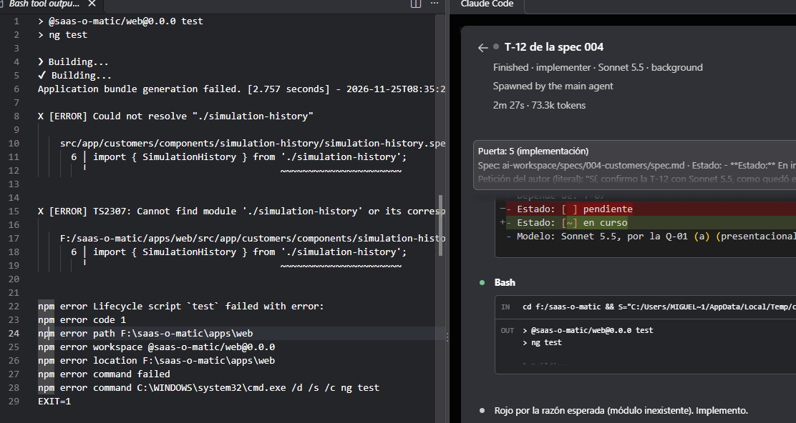
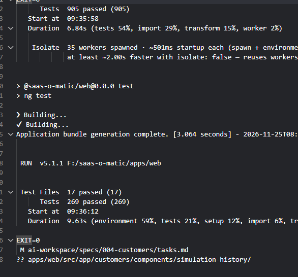

# 004-customers — Fase 7 (2026-11-25, sesión 01)

La sesión principal abre este registro al recibir el retorno de la T-12 con su fase roja. `/sdd-session` lo completa al cerrar la tarea.

## Objetivo y fase
- Fase 7, spec `004-customers`, puerta 5 (implementación), con `/sdd-implement`.
- Tarea T-12: web, componente del historial (`SimulationHistory` en `customers/components/simulation-history/`).
- Implementer con Sonnet 5.5 y encargo sin enseñar antes (ADR-016, puntos 4 y 6).
- La spec sigue en `En implementación`.

## Prompts clave
> /sdd-implement 004-customers

> Sí, confirmo la T-12 con Sonnet 5.5, como quedó en tasks.md. Pide al implementer la salida íntegra del rojo, sin abreviar ni reescribir ninguna línea, y que no toque ningún fichero fuera de los dos de producción y el test de la T-12. Pide también la salida de `npm run verify` con su código de salida y el git diff literal, no resumido.

> Apruebo la T-12 (web: componente del historial) con las desviaciones 1 a 12 aceptadas. Las dos citas sin calificar (simulation-history.html:1 y simulation-history.spec.ts:21) van como observación para el revisor, sin corregirlas ahora; anota también que el implementer no pegó el diff y tocó el índice (git add -N y git reset), sin dejar rastro, y que el título del test de C-49 dice «169,40 €» pero compara con formatCents (C-51). El rojo es de compilación: no lo repitas; cópialo de red-t12.txt sin ANSI y con los signos reales. Las capturas fase-7-004-t12-rojo y t12-verde son mías.
> Marca [x] la T-12 y sus casillas, con mi aprobación literal en tasks.md; actualiza MEMORY.md (máximo 50 líneas) con la T-12 hecha y verify en 905 + 269, y enséñame su diff. No incluyas .claude/launch.json en ningún commit. Yo lanzo /sdd-session 7 004-customers y luego te doy el OK al commit, sin Co-Authored-By.

> /sdd-session 7 004-customers

## Línea base (sesión principal, antes de lanzar)
- `npm run verify`: código 0. Raíz: «Tests  905 passed (905)». Web: «Tests  261 passed (261)».

## Fase roja (retorno del implementer)
Comando: `npm run test -w apps/web`, con código de salida 1. Copiada del fichero `red-t12.txt` sin códigos ANSI ni CR (0 caracteres ESC y 0 signos escapados en HTML), no del retorno, que traía `&gt;` escapado:

```

> @saas-o-matic/web@0.0.0 test
> ng test

❯ Building...
✔ Building...
Application bundle generation failed. [2.757 seconds] - 2026-11-25T08:35:25.825Z

X [ERROR] Could not resolve "./simulation-history"

    src/app/customers/components/simulation-history/simulation-history.spec.ts:6:34:
      6 │ import { SimulationHistory } from './simulation-history';
        ╵                                   ~~~~~~~~~~~~~~~~~~~~~~


X [ERROR] TS2307: Cannot find module './simulation-history' or its corresponding type declarations. [plugin angular-compiler]

    F:/saas-o-matic/apps/web/src/app/customers/components/simulation-history/simulation-history.spec.ts:6:34:
      6 │ import { SimulationHistory } from './simulation-history';
        ╵                                   ~~~~~~~~~~~~~~~~~~~~~~


npm error Lifecycle script `test` failed with error:
npm error code 1
npm error path F:\saas-o-matic\apps\web
npm error workspace @saas-o-matic/web@0.0.0
npm error location F:\saas-o-matic\apps\web
npm error command failed
npm error command C:\WINDOWS\system32\cmd.exe /d /s /c ng test
EXIT=1
```

## Verde (retorno del implementer)
- `npm run verify` desde la raíz, con código 0 (`EXIT=0`). Raíz: «Tests  905 passed (905)». Web: «Test Files  17 passed (17)» y «Tests  269 passed (269)». 8 tests nuevos, todos en `simulation-history.spec.ts`; la sesión principal contó 8 bloques `it(`.
- Salida íntegra en `verify-t12.txt` y `verify-t12-sin-ansi.txt`, en el scratchpad de la sesión.

## Aprobación del autor
Literal en `tasks.md`, en la T-12 (2026-11-25), con las desviaciones 1 a 12 aceptadas.

## Observaciones para el revisor (puerta 6)
- Citas sin calificar (R-144): `simulation-history.html:1` deja «(R-37)» fuera de «spec 004:», y `simulation-history.spec.ts:21` pone R-36 a R-126 delante de «(spec 004: D-11, D-12)».
- El implementer no pegó el diff de los ficheros nuevos; lo sacó la sesión principal con `git diff --no-index /dev/null <fichero>`. Tocó el índice con `git add -N` y lo deshizo con `git reset`, sin dejar rastro.
- El título del test de C-49 dice «169,40 €», pero compara con la salida de `formatCents` (C-51).

## Qué propuso la IA
- La T-12 con Sonnet 5.5 (Q-01 (a) de `tasks.md`), con `npm run verify` previo y, en el encargo, la petición del rojo íntegro y del `git diff` literal.
- El encargo del implementer, sin enseñarlo antes. Contenía:
  - la D-11 y la D-12 literales, y las Decisiones 2026-11-24 #19, #27 y #34;
  - las rutas acotadas a líneas;
  - la fila literal de la T-12;
  - la salida de `verify` previa;
  - seis instrucciones del autor: el rojo íntegro en fichero, solo los tres ficheros, `verify` con su código, el diff literal, las citas calificadas y las desviaciones declaradas.
- La comprobación del retorno:
  - `git status` y `git diff --stat`;
  - el rojo, copiado de su fichero;
  - el recuento de los tests;
  - la detección de dos citas sin calificar y del título de C-49;
  - que el implementer no pegó el diff y tocó el índice.
- Para las dos citas sin calificar, anotarlas como observación para el revisor o corregirlas ahora.

## Qué corregí y por qué
- (no registrado): no hubo correcciones del autor a las propuestas. El autor eligió la observación para el revisor para las dos citas y añadió a las observaciones el diff no pegado, el índice tocado y el título de C-49.

## Decisiones tomadas
- T-12 aprobada por el autor, con las desviaciones 1 a 12 aceptadas.
- Las citas sin calificar se quedan como están y van como observación para el revisor.
- Rojo de compilación sin repetir, copiado de `red-t12.txt` sin ANSI y con los signos reales.
- `.claude/launch.json` no entra en ningún commit (instrucción del autor).
- `MEMORY.md` al día (50 líneas): T-12 hecha, `verify` en 905 + 269 y siguiente la T-13.
- Commit: el de cierre de esta sesión.

## Capturas
Ninguna línea `CAPTURA:` en esta sesión. Capturas del autor:



## Pendiente para la siguiente sesión
- T-13: página del detalle, ruta `customers/:id` y sus estilos (implementer con Opus 5.5). Entra la desviación 4 de la T-11: si la página reacciona a cambios de `:id`, cancelar la carga anterior en `loadDetail`, con su test. Los estilos de las clases `simulation-history__*` también son de la T-13.
- Después, T-14 (cabecera común) y T-15 (seed), y la puerta 6.
- `.claude/launch.json` ya no sale en `git status`, aunque salía al empezar la sesión: que el autor compruebe si lo ha borrado o ignorado.
