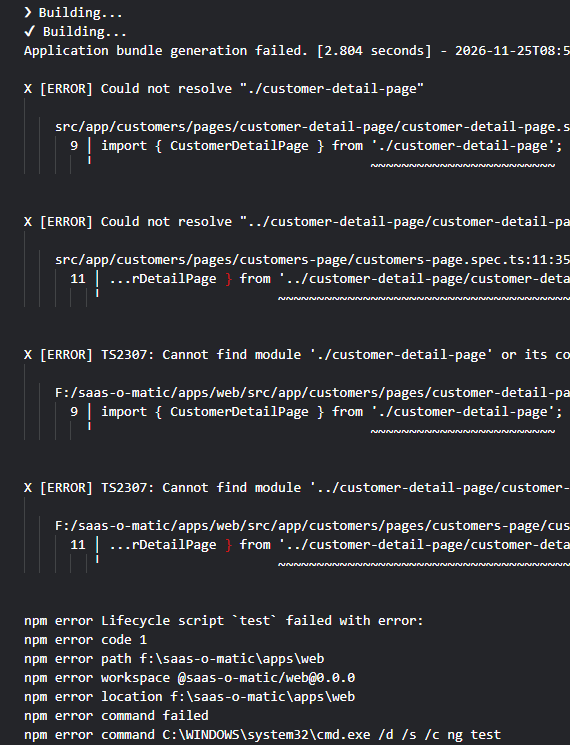
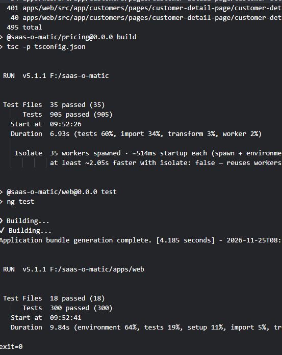
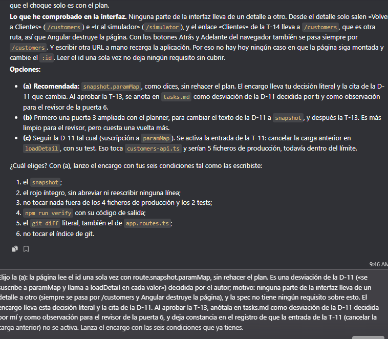
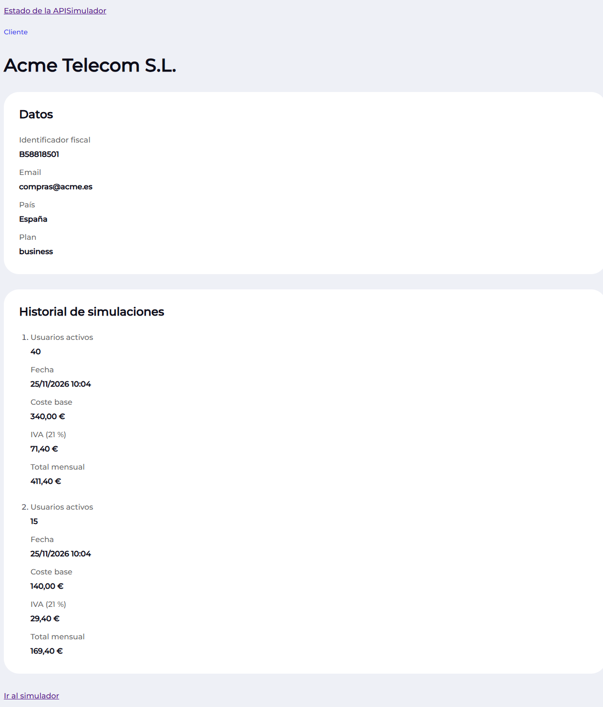
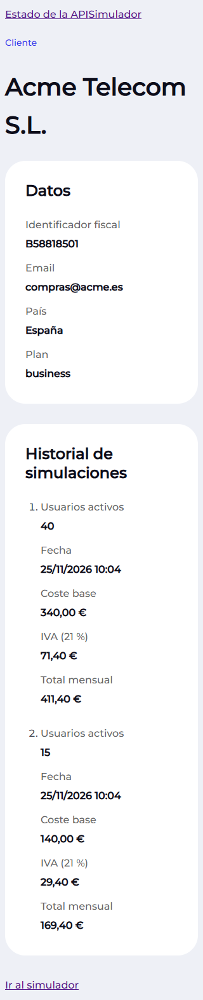

# 004-customers — Fase 7 (2026-11-25, sesión 02)

La sesión principal abrió este registro al recibir el retorno de la T-13 con su fase roja; `/sdd-session` lo completa al cerrar la tarea.

## Objetivo y fase
- Fase 7, spec `004-customers`, puerta 5 (implementación), con `/sdd-implement`.
- Tarea T-13: web, página del detalle (`CustomerDetailPage` en `customers/pages/customer-detail-page/`), ruta `customers/:id` y sus estilos en `_customers.scss`.
- Implementer con Opus 5.5 y encargo sin enseñar antes (ADR-016, puntos 4 y 6).
- La spec sigue en `En implementación`.

## Prompts clave
> /sdd-implement 004-customers

> Sí, confirmo la T-13 con Opus 5.5, como quedó en tasks.md. La página lee el id una sola vez con route.snapshot.paramMap (no reacciona a cambios de :id), así que la entrada de la T-11 sobre cancelar la carga anterior no se activa y no se toca customers-api.ts. Pide al implementer la salida íntegra del rojo, sin abreviar ni reescribir ninguna línea, que no toque ningún fichero fuera de los cuatro de producción y los dos tests de la T-13, la salida de `npm run verify` con su código de salida, el git diff literal (también de app.routes.ts) y que no toque el índice de git.

> Elijo la (a): la página lee el id una sola vez con route.snapshot.paramMap, sin rehacer el plan. Es una desviación de la D-11 («se suscribe a paramMap y llama a loadDetail en cada valor») decidida por el autor; motivo: ninguna parte de la interfaz lleva de un detalle a otro (siempre se pasa por /customers y Angular destruye la página), y la spec no tiene ningún requisito sobre esto. El encargo lleva esta decisión literal y la cita de la D-11. Al aprobar la T-13, anótala en tasks.md como desviación de la D-11 decidida por mí y como observación para el revisor de la puerta 6, y deja constancia en el registro de que la entrada de la T-11 (cancelar la carga anterior) no se activa. Lanza el encargo con las seis condiciones que ya tienes.

> Apruebo la T-13 (web: página del detalle, ruta customers/:id y sus estilos) con las desviaciones 1 a 11 aceptadas; no hace falta que me enseñes customer-detail-page.spec.ts entero. Anota la desviación de la D-11 (snapshot.paramMap, una sola lectura) como decisión mía y como observación para el revisor, y en el registro que la entrada de la T-11 no se activa. Anota también para el revisor: C-33 con click() y no con Intro (Intro y Tab, a mano en la puerta 6), y que con un id no válido la página sigue pidiendo los tipos de cambio (R-57). Rojo de compilación sin repetir, copiado de red-t13-sin-ansi.txt con los signos reales. La captura fase-7-004-t13-choque-d11-snapshot y las de la T-13 (rojo, verde, detalle y detalle-320px) son mías.
> Marca [x] la T-13 y sus casillas, con mi aprobación literal en tasks.md; actualiza MEMORY.md (máximo 50 líneas) con la T-13 hecha y verify en 905 + 300, y enséñame su diff. Yo lanzo /sdd-session 7 004-customers y luego te doy el OK al commit, sin Co-Authored-By.

> Haz tú las dos capturas de la T-13, sin que yo abra nada:
> 1. Arranca `npm run dev` en segundo plano con DATABASE_PATH apuntando a un fichero del scratchpad (para no tocar la base por defecto) y espera a que respondan la API (3000) y la web (4200). Si los puertos ya están ocupados, dímelo antes de parar nada.
> 2. Crea con POST un cliente («Acme Telecom S.L.», B58818501, compras@acme.es, ES, business) y dos simulaciones para él (15 y 40 usuarios), y un segundo cliente sin simulaciones.
> 3. Con chrome-devtools: abre http://localhost:4200/customers/1 y guarda ai-workspace/screenshots/fase-7-004-t13-detalle.png (escritorio); luego con emulate a 320 px de ancho guarda fase-7-004-t13-detalle-320px.png. Sin sobrescribir ninguna existente.
> 4. Dime qué se ve: la tarjeta de datos, el historial con sus filas, el enlace «Ir al simulador» y si hay desplazamiento horizontal a 320 px (scrollWidth frente a clientWidth).
> 5. Para el servidor y comprueba con netstat que los puertos 3000 y 4200 quedan libres. Si alguna herramienta falla, dímelo en vez de saltarte el paso.

> La (a): para los dos árboles con taskkill /T y sigue

> /sdd-session 7 004-customers

## Qué propuso la IA
- Propuso la T-13 (tasks.md:251-272), con Opus 5.5, y ejecutar `npm run verify` antes de lanzar para poner su salida en el encargo.
- Antes de lanzar, detectó el choque entre la decisión del autor y la D-11 y paró con tres opciones (ver «Qué corregí y por qué»); recomendó la (a).
- Lanzó al implementer con las dos peticiones literales, la cita de la D-11 marcada como desviación, la entrada de la T-11 marcada como no activada, la fila literal de la T-13 y las seis condiciones del autor.
- Al volver: `git status` y `git diff --stat` (solo los cuatro de producción, los dos tests y `tasks.md` en `[~]`), comprobación de que los ficheros tienen los signos reales (los `&gt;`, `&lt;` y `&amp;` estaban solo en el retorno), recuento de tests (16 `it` y 13 casos de `it.each` = 29, más 2 = 31) y apertura de este registro con el rojo.
- Avisó de que la condición 5 se cumplió a medias (desviación 11: el spec nuevo no se pegó) y de que la línea `CAPTURA:` del choque se anunció una respuesta tarde.
- Tras la aprobación: repitió los `git grep` de C-74, C-75, C-25 y R-02, marcó `[x]` la T-13 y sus 10 casillas con la aprobación literal, la desviación de la D-11 y las observaciones para el revisor, y actualizó `MEMORY.md` (50 líneas).
- Capturas: encontró el puerto 3000 ocupado (PID 9168, API `tsx` de las 9:52:26; PID 23124, `ng serve` de las 9:26:33 en `[::1]:3000`) y paró a preguntar con las opciones (a) parar los dos árboles, (b) los para el autor y (c) arrancar en otro puerto (no recomendada).

## Qué corregí y por qué
- Choque entre fuentes: la decisión del autor (lectura única con `route.snapshot.paramMap`) chocaba con la D-11 del plan (`plan.md:228`: «se suscribe a `paramMap` y llama a `loadDetail(id, destroyRef)` en cada valor»). Opciones: (a) `snapshot` como desviación de la D-11, sin rehacer el plan; (b) puerta 3 ampliada para cambiar la D-11; (c) seguir la D-11 y activar la entrada de la T-11. El autor eligió la (a); motivo, en su prompt literal.
- La spec no tiene ningún requisito sobre reaccionar a cambios de `:id`.
- **Entrada de la T-11 (desviación 4 de la T-11, `tasks.md:261`: cancelar la carga anterior en `loadDetail` si la página reacciona a cambios de `:id`): no se activa**, porque la página no reacciona a cambios de `:id`. `customers-api.ts` no cambia.
- Puertos ocupados: el autor eligió la (a), parar los dos árboles con `taskkill /T`.

## Decisiones tomadas
- T-13 aprobada con las desviaciones 1 a 11 aceptadas; desviación de la D-11 decidida por el autor; observaciones para el revisor de la puerta 6: esa desviación y la entrada de la T-11 sin activar, C-33 con `click()` (Intro y Tab a mano en la puerta 6), con un id no válido la página sigue pidiendo los tipos de cambio (R-57), y C-38 a 320 px, C-39 y la apariencia de las filas `dt`/`dd` y del `<ol>` a mano.
- Rojo de compilación no repetido, copiado de `red-t13-sin-ansi.txt` con los signos reales.
- Commit: el de cierre de esta sesión.

### Línea base (sesión principal, antes de lanzar)
- `git status --short` vacío. `npm run verify`: código 0. Raíz: «Tests  905 passed (905)». Web: «Tests  269 passed (269)».

### Fase roja (retorno del implementer)
Comando: `npm run test -w apps/web`, con código de salida 1. Copiada del fichero `red-t13-sin-ansi.txt` sin CR (0 caracteres ESC y 0 signos escapados en HTML), no del retorno, que traía `&gt;` escapado. Rojo de compilación:

```

> @saas-o-matic/web@0.0.0 test
> ng test

❯ Building...
✔ Building...
Application bundle generation failed. [2.804 seconds] - 2026-11-25T08:50:35.913Z

X [ERROR] Could not resolve "./customer-detail-page"

    src/app/customers/pages/customer-detail-page/customer-detail-page.spec.ts:9:35:
      9 │ import { CustomerDetailPage } from './customer-detail-page';
        ╵                                    ~~~~~~~~~~~~~~~~~~~~~~~~


X [ERROR] Could not resolve "../customer-detail-page/customer-detail-page"

    src/app/customers/pages/customers-page/customers-page.spec.ts:11:35:
      11 │ ...rDetailPage } from '../customer-detail-page/customer-detail-page';
         ╵                       ~~~~~~~~~~~~~~~~~~~~~~~~~~~~~~~~~~~~~~~~~~~~~~


X [ERROR] TS2307: Cannot find module './customer-detail-page' or its corresponding type declarations. [plugin angular-compiler]

    F:/saas-o-matic/apps/web/src/app/customers/pages/customer-detail-page/customer-detail-page.spec.ts:9:35:
      9 │ import { CustomerDetailPage } from './customer-detail-page';
        ╵                                    ~~~~~~~~~~~~~~~~~~~~~~~~


X [ERROR] TS2307: Cannot find module '../customer-detail-page/customer-detail-page' or its corresponding type declarations. [plugin angular-compiler]

    F:/saas-o-matic/apps/web/src/app/customers/pages/customers-page/customers-page.spec.ts:11:35:
      11 │ ...rDetailPage } from '../customer-detail-page/customer-detail-page';
         ╵                       ~~~~~~~~~~~~~~~~~~~~~~~~~~~~~~~~~~~~~~~~~~~~~~


npm error Lifecycle script `test` failed with error:
npm error code 1
npm error path f:\saas-o-matic\apps\web
npm error workspace @saas-o-matic/web@0.0.0
npm error location f:\saas-o-matic\apps\web
npm error command failed
npm error command C:\WINDOWS\system32\cmd.exe /d /s /c ng test
```

### Verde (retorno del implementer)
- `npm run verify` desde la raíz: código 0 (`exit=0` al final de `verify-t13-sin-ansi.txt`). Raíz: «Tests  905 passed (905)». Web: «Test Files  18 passed (18)» y «Tests  300 passed (300)». 31 tests nuevos: 29 en `customer-detail-page.spec.ts` y 2 en `customers-page.spec.ts` (C-33 y C-57).

### Capturas del detalle (sesión principal, con chrome-devtools)
- `npm run dev` con `DATABASE_PATH` en un fichero del scratchpad (`t13-capturas.db`); la base por defecto no se tocó.
- Datos por POST, todos 201: cliente 1 «Acme Telecom S.L.» (B58818501, compras@acme.es, ES, business) con dos simulaciones, 15 usuarios (total 16940 céntimos) y 40 usuarios (41140); cliente 2 «Lisboa Digital Lda.» (PT509876543, geral@lisboadigital.pt, PT, starter), sin simulaciones. El segundo cliente, el almacenamiento y las llamadas a la API (100 y 10 000, 250 y 50 000) los eligió la sesión principal, solo para la demostración.
- `/customers/1`: eyebrow «Cliente», `<h1>` «Acme Telecom S.L.», tarjeta «Datos» (B58818501, compras@acme.es, España, business), «Historial de simulaciones» con un `<ol>` numerado (40 usuarios: 340,00 €, IVA (21 %) 71,40 €, total 411,40 €; 15 usuarios: 140,00 €, 29,40 €, 169,40 €; fecha 25/11/2026 10:04 en las dos) y el enlace «Ir al simulador».
- Desplazamiento horizontal: a 1280 px, `scrollWidth` 1280 = `clientWidth` 1280; a 320 px, `scrollWidth` 320 = `clientWidth` 320, sin ningún elemento más allá del borde derecho.
- Los enlaces del `<nav>` siguen pegados («Estado de la APISimulador»): pendiente conocido de la T-14.
- Al parar la tarea en segundo plano, los hijos (API `tsx`, PID 18392, y `ng serve`, PID 27416) siguieron escuchando; se pararon con `taskkill /T` y `netstat` confirmó los puertos 3000 y 4200 libres.

## Capturas
- 
- 
- 
- 
- 

## Pendiente para la siguiente sesión
- Commit de la T-13, sin `Co-Authored-By`, con el OK del autor.
- T-14: cabecera común con sus estilos (Sonnet 5.5), con los enlaces del `<nav>` hoy pegados.
- T-15: seed de demostración. Después, la puerta 6.
